La gamme Ninjago existe depuis 2011. Elle comprend aujourd’hui plus d’une centaine de sets en tout genre. Elle s’est aussi sans cesse améliorée. Ce n’est pas le premier que je vous présente et sûrement pas le dernier.

L’allure est bien celle d’un petit avion, mais on ne sait pas très bien si il est propulsé par un réacteur ou par une hélice. Peut être les deux. Qu’importe, il y a de quoi bien s’amuser avec cette petite boite très abîmée que j’ai trouvé en promotion en fin d’année 2019. Le magasin ne s’est pas mis en défaut pour le prix au cas où il manque des pièces, mais c’est complet.

Tout d’abord, voilà les habituelles données techniques du set :

-   Année de sortie : 2018
-   Nombre de pièces : 171
-   Nombre de minifigs : 2
-   Temps de montage : une petite heure.

Sur la face avant de la boite, On nous présente le modèle terminé. Kai est en pleine poursuite de son ennemi Jet Jack.

[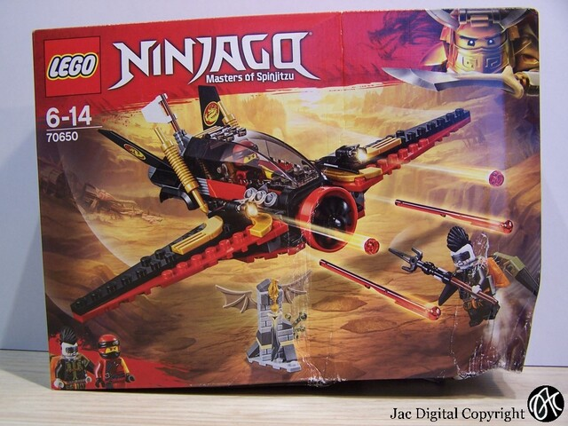](https://www.freelug.org/IMG/jpg/photo_1_-6.jpg)

Au dos, quelques photos détaillées de l’avion, avec ses fonctionnalités. On nous indique aussi que nous avons désormais l’épée du dragon d’or et qu’il faut acheter d’autres boites pour agrandir sa collection d’armes. Elles sont toutes magnifiques.

[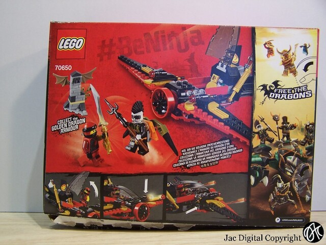](https://www.freelug.org/IMG/jpg/photo_2_-7.jpg)

A l’ouverture de la boite, on a 3 sachets, la notice et une petite planche d’autocollants. Je me rend compte assez vite qu’il va falloir en coller sur les ailes. Ca va pas être facile de faire de la symétrie...

[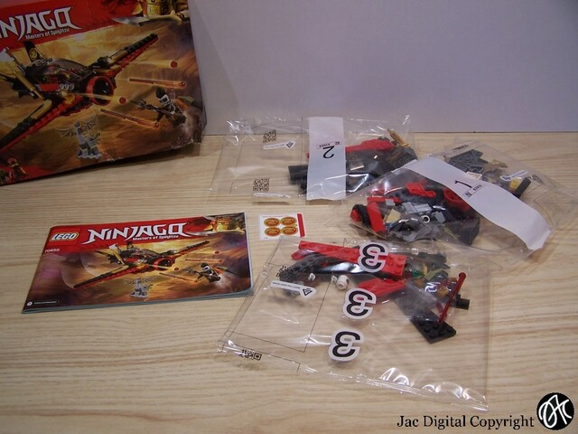](https://www.freelug.org/IMG/jpg/photo_3_-6.jpg)

On commence bien sûr par le sachet numéro un. Rien n’empêche de commencer par un autre, mais ça risque d’être compliqué pour faire l’assemblage. Parce que ici, après le pilote et le petit diorama, on s’attaque à la carlingue de l’avion.

Ce que j’adore dans cette série, ce sont les personnages. Ils sont très recherchés, variés et munis d’armes très diverses. Ici, Kai possède un très beau bandeau et 2 épées noires que l’on peut ranger dans son dos. C’est pas du tout inédit, mais c’est bien fait.

[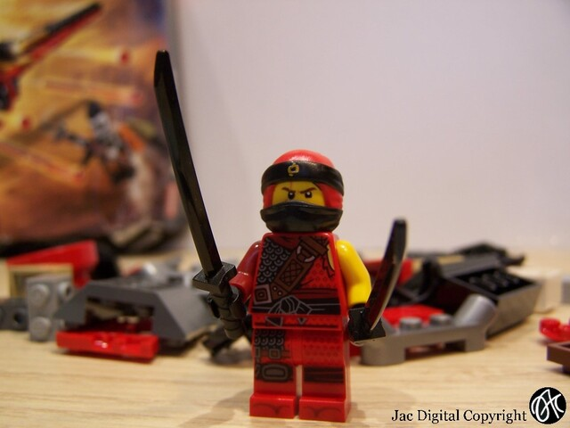](https://www.freelug.org/IMG/jpg/photo_5_-3.jpg)

On poursuit avec un très joli petit diorama qui permet de placer l’épée et les ailes du dragon d’or. J’adore ce genre de petites choses. Bon c’est sûr après il faut arriver à glisser ça dans le jeu, mais je suis sûr que c’est possible.

[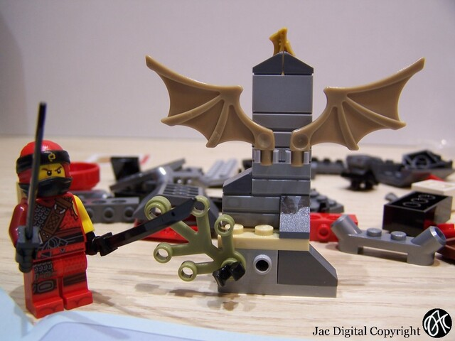](https://www.freelug.org/IMG/jpg/photo_6_-4.jpg)

La carlingue est montée, il est temps d’ouvrir le deuxième sachet.

[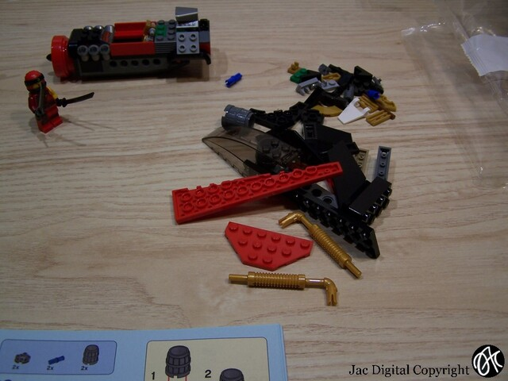](https://www.freelug.org/IMG/jpg/photo_9_-5.jpg)

Il reste 2 petites pièces à la fin du montage. L’ensemble est très bien fait. Mais je regrette franchement le collage des enseignes rondes sur les ailes. Aucun repère, l’autocollant est entièrement rond. Il est très difficile de réussir quelque chose de symétrique. Je doute que toutes les personnes qui monteront ce set arrivent à poser ces 4 marquages correctement. Le problème c’est que ça se voit bien. Ca peut vite gâcher le modèle fini. C’est dommage.

[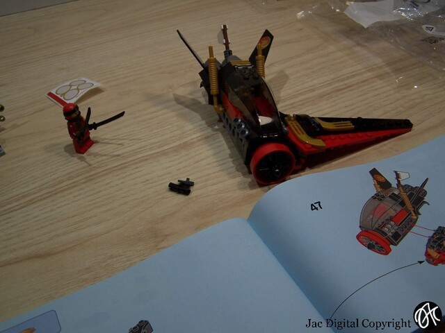](https://www.freelug.org/IMG/jpg/photo_10_-7.jpg)

Contenu du troisième sachet. On assemble les ailes l’une après l’autre.

[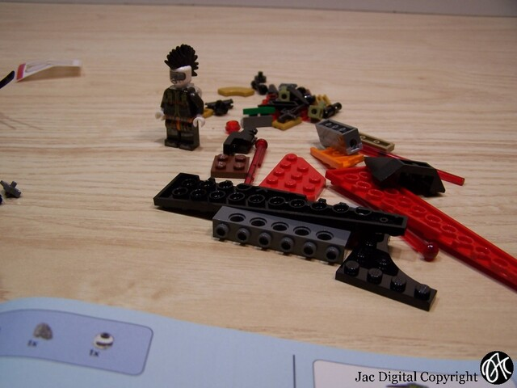](https://www.freelug.org/IMG/jpg/photo_12_-2.jpg)

Je n’ai pas pu m’empêcher de commencer à monter la figurine contenue dans ce dernier sachet. Elle est vraiment très bien faite. Le design sur le visage est bien réalisé.

[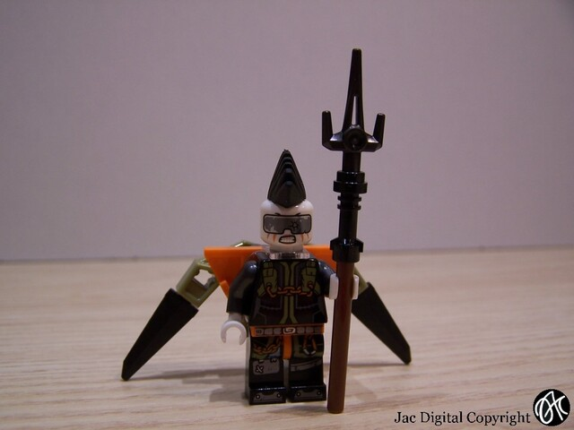](https://www.freelug.org/IMG/jpg/photo_14_-5.jpg)

Une photo avec les deux personnages, les munitions et surtout un joli petit lot de pièces supplémentaires.

[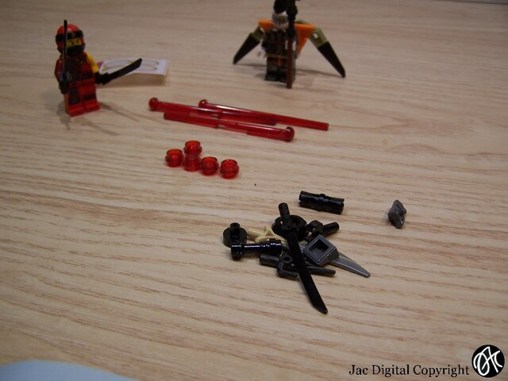](https://www.freelug.org/IMG/jpg/photo_15_-3.jpg)

Un petit avion sympa, que l’on prendra plaisir à voir voler dans ses mains, j’en suis sûr. Les deux personnages très différents demandent à se confronter alors il n’y a plus qu’à !

[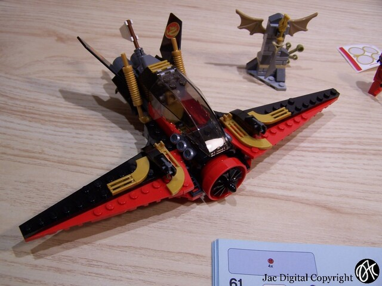](https://www.freelug.org/IMG/jpg/photo_16_-3.jpg)

La gamme Ninjago n’a pas fini de nous surprendre encore et ce n’est pas pour me déplaire. Même si on peut remarquer une certaine redondance avec les dragons, quelques robots ou les espaces d’entrainement, il y a quelques sets comme celui là qui sortent du lot. Justement, il y a encore de belles choses à découvrir cette année.

[Les photos dans ma galerie](https://photos.freelug.org/main.php/v/JAC/review/70650/)
