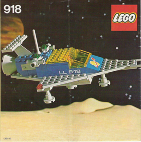
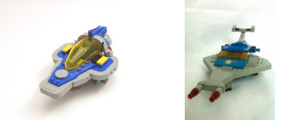
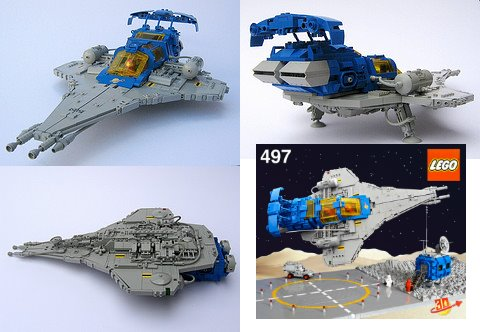
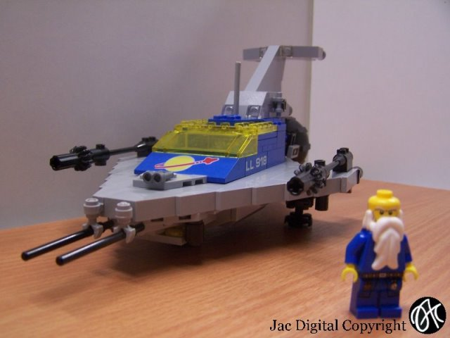
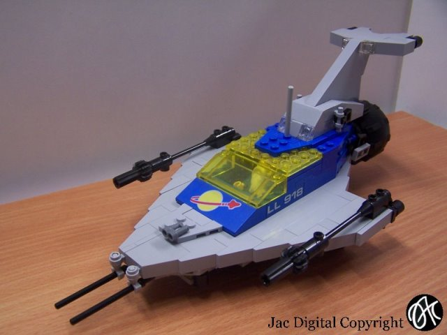
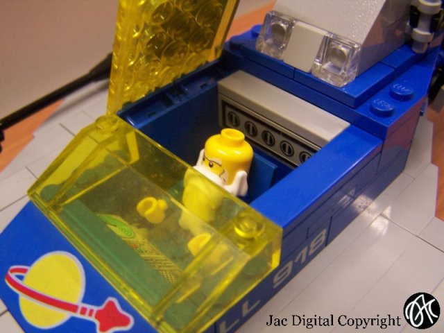
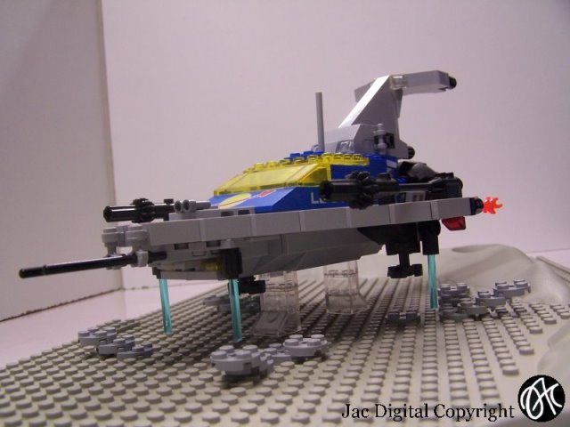
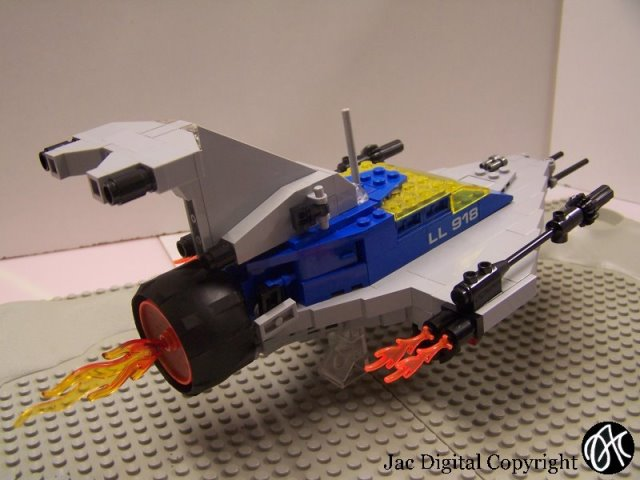

Les modèles d’il y a 30 ans vieillissent, c’est irrémédiable ! Il y a plusieurs raisons à cela, les pièces évoluent, les formes, les couleurs et parce que forcément la logique de création avec ce mode de construction particulier a aussi évolué. Bon il y a sûrement d’autres raisons que j’oublie...

Pour ce nouveau concours L13, il fallait améliorer un modèle officiel LEGO de plus de 10 ans. J’ai choisi de travailler sur une nouvelle version du vaisseau "Space classic LL918", référence 918 bien sûr. Je ne suis pas le seul à l’avoir fait, il y a de très belles œuvres sur le net, même pour le "LL928".

Cela faisait quelques temps que l’ancienne version, d’ailleurs presque en ruine, traînait sur mon plan de "travail" et aussi quelques temps que j’avais en tête de faire un vaisseau avec des ailes en briques. Les possibilités de ce type de montage m’intéressent beaucoup. Du coup j’ai pu faire une réunion des deux.

J’ai vu le modèle plus grand alors que sur le net j’en ai trouvé [une version plus petite.](http://www.neoclassicspace.com/?page=9)

En bas de page, ils ont imaginé le pilote mort alors que le mien a vieilli. Une photo pour preuve.

J’ai gardé l’esprit du vaisseau mais, à part la taille un peu plus grande, j’ai rajouté des choses qui ne pouvaient y être en 1979, comme des armes (l’espace n’est pas si sûr !), un vrai réacteur, des petits directionnels, des réacteurs d’atterrissage et un cockpit qui correspondrait à un vrai vaisseau. Je me suis aussi efforcé de le construire entièrement en briques grises nouvelles couleurs. Cela n’a pas été très facile, car j’ai tout mélangé dans mon stock... Une photo de plus près :

Une vue du cockpit où j’ai conservé une pièce du modèle original, le tableau de bord !

Puis, un atterrissage, euh non, un alunissage...

Et enfin le décollage :

Le lien vers la galerie de [toutes mes photos.](http://photos.freelug.org/main.php/v/JAC/Concour/L13N17/)

Pour surveiller la suite du concours c’est [ici](http://www.brickpirate.net/forum/phpBB3/viewtopic.php?f=50&t=11468), il y a beaucoup de thèmes différents abordés.
