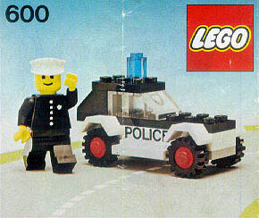
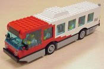
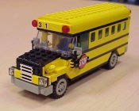
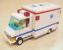

**FreeLUG rencontre Pierre Normandin**

Créateur de MOC dans le thème Ville et co-fondateur de MonLUG.

**FreeLUG :** Bonjour Pierre, peux-tu te présenter ?

Salut, mon nom est Pierre Normandin. Je suis né en septembre 1976. Je demeure dans un petit village à environ 90 km à l’est de Montréal au Québec. Je possède un baccalauréat en géographie de l’Université de Sherbrooke, ville dans laquelle j’ai résidé quelques temps pour mes études.

Depuis mes débuts, je construis dans le thème de ville (incluant les trains, ça va ensemble !). Je ne suis passé aux trains 9 volts qu’à la fin de 1999. Plus récemment, mon dada, c’est les véhicules, auxquels j’aime ajouter le plus de détails possibles par souci de réalisme, sans pour autant délaisser les bâtiments et les trains.

**FreeLUG :** De quand date ta passion pour les briques LEGO(R) ?

D’aussi loin que je puisse me rappeler ! Mon premier set a probablement été le DUPLO 088 (Camping). Ensuite, je me souviens d’avoir reçu les sets 600 (Police Car) et 641 (Excavator) avec lesquels je me suis beaucoup amusé !

**FreeLUG :** As-tu connu un "dark ages" ?

Oui, durant 7 ou 8 ans environ, de 14 à 22 ans. Ça a été très difficile pour moi d’arrêter ! J’ai dû m’y prendre à deux ou trois reprises à cause de rechutes ! Et puis un jour, en sortant quelques boîtes du placard, j’ai eu envie de remonter une ville avec mes LEGO. Ça n’a plus arrêté !

**FreeLUG :** Peux-tu nous parler de tes [créations](http://www.mocpages.com/home.php/170?r=1938148097) ?

Lorsque je construis, j’aime faire des choses qui n’ont pas ou peu été faites avant, surtout si la compagnie LEGO ne l’a jamais fait ! Mon inspiration me vient beaucoup de ce que je vois autour de moi dans la vie de tous les jours, mais aussi d’autres créations sur internet et de défis qui me sont lancés. J’adore voir la tête de la personne qui m’a lancé un défi lorsque je lui montre le résultat !

Parmi mes véhicules, mes préférés sont les bus. Pour leur look, le plaisir que j’ai eu à les construire, les défis qui m’ont été posés et le réalisme que j’ai pu leur apporter. Le bus scolaire a été construit dans le cadre d’un défi que nous nous étions lancé entre membres de MonLUG, chacun devant apporter sa version lors d’une rencontre. Quelques autres créations ont été faites à la suite de défis du genre comme le [camion utilitaire](http://www.brickshelf.com/gallery/pnorm/vehicules/Utility-truck/a-ut1.jpg) par exemple.

**FreeLUG :** Quelle est la taille de ta collection de briques LEGO ?

J’ai arrêté de compter ! Je crois que pour mon budget, il est mieux que je ne le sache pas !

J’achète les boîtes LEGO presque exclusivement que pour faire mes propres créations. Je monte rarement les modèles originaux de LEGO. J’ai longtemps cherché de l’usagé dans les vide-greniers ou les « ventes de garage » comme on dit chez nous, mais je suis devenu difficile en ce qui a trait à la qualité des pièces. Je me considère davantage comme un créateur plutôt qu’un collectionneur. J’ai une collection intéressante mais là n’est pas mon principal intérêt.

**FreeLUG :** Peux-tu nous parler des [photos](http://www.brickshelf.com/cgi-bin/gallery.cgi?f=38323) de tes modèles ?

Je ne m’y connais pas beaucoup en photographie. J’essaie seulement d’obtenir un résultat satisfaisant compte tenu de mes connaissances. Comme mes photos sont principalement destinées à mon compte Brickshelf sur internet, je préfère utiliser un appareil numérique.

**FreeLUG :** Peux-tu nous parler de [MonLUG](http://www.brickshelf.com/cgi-bin/gallery.cgi?f=8054) ?

En 2000, j’ai fait la connaissance d’autres fans de LEGO adultes (Martin Legault et Kevin Zwicker) grâce à LUGNET et peu de temps après nous décidions de former un groupe informel qui allait devenir MonLUG (pour Montréal LEGO User Group). C’était à l’été 2000. MonLUG a donc maintenant 3 ans et compte 7 membres (et quelques « sympathisants »).

Actuellement, nous participons à 2 expositions de trains miniatures et de modélisme, en avril et novembre. Nous exposons une maquette de ville et de trains qui fait 5 mètres par 10 mètres. Ces expositions accueillent environ de 7000 à 8000 visiteurs sur 2 jours.

**FreeLUG :** As-tu des projets ?

J’ai toujours plusieurs projets en marche. La préparation et la construction pour les expositions de MonLUG en est un qui ne cesse jamais ! En plus de construire, j’élabore et produit le plan pour l’exposition (en collaboration avec les autres membres du groupe). Côté MOCs, j’ai plusieurs constructions à faire pour la prochaine exposition mais je ne dévoilerai pas le scoop ! Les instructions de certaines de mes créations et leur publication font aussi partie de mes projets mais je ne peux pas vous en dire plus pour l’instant. Disons que j’en suis à me demander comment je vais procéder pour les publier.

**FreeLUG :** Nous remercions Pierre pour avoir accepter de répondre à nos questions et nous lui laissons le mot de la fin.

Merci à vous pour cette occasion, c’est un honneur. Longue vie à FreeLUG ! Vous faites du très bon boulot, surtout par votre site web qui contribue ainsi à partager la passion de la brique, en français ! Et à bientôt sur le « chat » !
