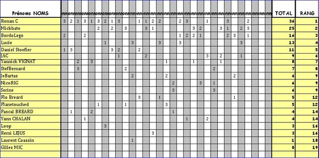
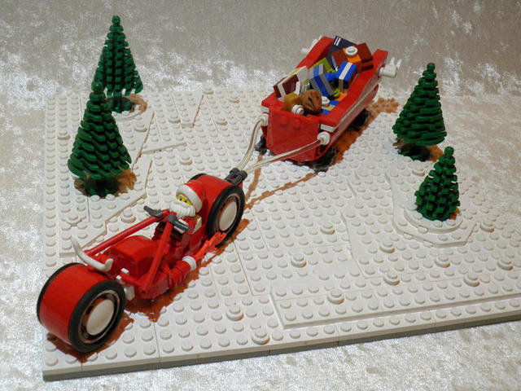
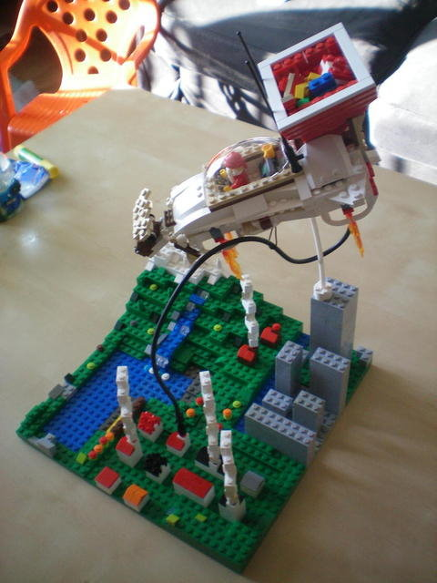
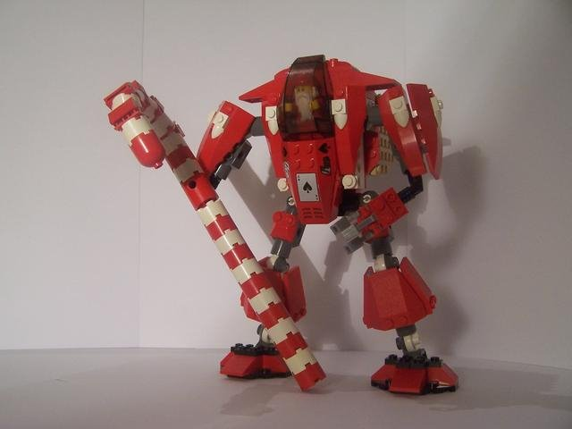

Le concours est fini, voici le point sur son déroulement, ainsi que la présentation des créations gagnantes par leurs créateurs.

Noël approchant, nous avons eu l’idée cette année, avec les membres du CA de FreeLUG de lancer un dernier concours pour l’année. Il fallait qu’il soit sur le thème de Noël puisque c’est l’une des plus grandes fêtes de fin d’année. Il nous restait à en trouver le thème.

C’est alors que j’ai pensé à la fabuleuse livraison du Père Noël. Faire le tour du monde avec des rennes et un traîneau me paraissait démesuré à notre époque même si les vaisseaux qui nous faisaient rêver pour l’an 2000 n’existent toujours pas...

C’est donc tout naturellement que j’ai pensé à une nouvelle version de ce concept. On n’a pas les vaisseaux mais tout de même pas mal d’idées et avec nos briques tout est possible, ELTEP (En LEGO Tout Est Possible !).

Le concours est dont lancé, avec ses délais. On a 4 semaines pour la création et 2 pour le vote, un jugement impartial par les membres de l’association. Chacun choisi 3 des meilleures constructions qu’il poste dans un courriel dans l’ordre de ses préférences. Je les entre dans un tableau en donnant 3 points au premier, 2 au deuxième et 1 au troisième.

Nous inaugurons en même temps une nouvelle façon de procéder pour les concours qui assure une meilleure visibilité à tous et en même temps une motivation à participer. Apparemment, cela a bien porté ses fruits, avec 19 créations, toutes pleine d’ingéniosité. Dans la galerie avec le liens ci-dessous, vous trouverez toutes les entrées au concours ainsi que les explications de leurs créateurs. Je laisse maintenant la place aux gagnants pour un petit résumé de leur participation.

[Galerie contenant toute les créations](http://photos.freelug.org/main.php/v/FreeLUG/Concours/Noel2012/)

Merci à tous les participants. Les prix seront distribués au plus vite et à bientôt à tous pour un prochain concours.

Jac, pour l’association FreeLUG

* * *

## Un mot de Ronan qui en arrivant premier a gagné le vaisseau de Buzz l’Eclair (7593)

.

Merci à tous d’avoir soutenu ma création !

Je ne joue pas pour la gagne, juste pour le plaisir de me forcer à finir un MOC, de-plus à l’échelle minifig ! Ce qui ne m’arrive vraiment pas souvent ! J’aime les concours pour cela, me créer une pression pour m’obliger à finir un MOC, c’est un peu comme avant une exposition, ça force la créativité...

Pour les roues de la moto, je me suis inspiré d’un moc de "EWOK" de 2011 [représentant la moto du film "Tron"](http://www.flickr.com/photos/28177764@N07/5609117436/in/photostream/)

Pour le reste, du rouge, du blanc, et un carton de vrac gratté jusqu’au fond du fond...

Merci à Jac et au CA de FreeLUG pour l’organisation de ce concours.

A bientôt

[Galerie photo de ma création](http://photos.freelug.org/main.php/v/ronan/noel+2012/)

_Ronan_

* * *

## Un mot de Mickaël qui a fini deuxième et qui a gagné un sac Bionicle

Bonjour à tous, une fois n’est pas coutume, j’ai sorti mon MOC sur le thème du concours...

J’ai été assez inspiré, étant moi-même "père-noël" pour la troisième année consécutive dans un centre commercial... J’ai fabriqué un engin basé sur le petit sachet (cerf ou renne ) que j’ai récupéré à Veneux, je crois.

J’ai aussi choisi de le présenter avec un petit support qui le met en valeur, une petite ville en "micro scale" avec ses montagnes enneigées, ses cheminées fumantes et son centre ville morose !

L’engin du père-noël reprend donc les teintes du renne, tan, marron, mais aussi de la neige, blanc... Il ne peut voler en rase-mottes car les réacteurs mettent du temps à chauffer, et il s’en dégage d’énormes flammes.

Les cadeaux sont donc entreposés dans une grande citerne (qui pourrait aller sur mon Xerion !), dans laquelle, les cadeaux sont transformés par un procédé magique dans un conduit qui les déversent directement dans les cheminées.

Tout ceci est bien entendu piloté par ordinateur, et une tasse de chocolat chaud régale le conducteur.

Voilà, j’ai fabriqué ce petit truc en un jet ce matin, dans un garage glacial en un peu plus de 2 h. Je me suis terriblement amusé à le faire et vais peut-être le conserver un moment !

[Galerie photo de ma création](http://photos.freelug.org/main.php/v/mickbatto/concours+noel/)

_Mickbatto_

* * *

## Un mot du troisième Christophe, qui a gagné le Squelette Orient Expediton (7409)

Il était une fois l’étrange Concours de Noël de Mr Jac.

Nous sommes le 20 novembre 2012 quand tombe un mail parmi tant d’autres dans le dossier FreeLUG de ma messagerie. Celui ci passe inaperçu et finit directement à la corbeille !

Mais sans compter sur l’esprit de discussion voir de contradiction de certains qui en je cite « chinoisant » me mettent la puce à l’oreille. Quel est ce concours qui fait tant parler ?

Je plonge « virtuellement » dans ma corbeille et retrouve l’intitulé du concours, avec force détails et règles.

Étant en pleine organisation de « Fans de Briques LEGO » à Talence, j’oublie ce concours, et une fois de plus la liste vient à mon secours afin de rafraichir ma mémoire.

C’est donc le 13 décembre que je me jette à l’eau et sur mes briques au passage !

Le projet me plaît, mais que choisir, quel engin moderne peut remplacer le traîneau du Père Noël ? Puis quitte à être moderne, pourquoi ne pas être carrément futuriste. Oui mais que réaliser alors ? Un vaisseau, un engin roulant ? L’idée de prendre des pièces d’un peu tous les modes de déplacement traverse mon esprit et je commence à imaginer une espèce de traineau munit de chenilles, d’ailes, de roues et de je ne sais quoi encore afin qu’il puisse circuler sur tout type de terrain.

Mais heureusement la raison me revient en voyant trainer dans mon stock de vrac le squelette d’un Exo-Force. Voila l’idée, un mécha pour le Père Noël !

Je récupère donc ce squelette et je commence à réfléchir à comment je pourrais l’habiller, quand dans mon stock me saute aux yeux [cette pièce](http://www.bricklink.com/catalogItem.asp?P=43712pb18) avec dessus cet as de pique. Cela fait longtemps que je rêve de réutiliser cette pièce dans un MOC.

J’ai donc un squelette de mécha, une wedge rouge avec des stickers et bien évidemment mon inépuisable stock de briques rouges !

Je me lance et crée donc ce mécha, comme le prévoient les règles du concours je réalise un cockpit et bien sûr je « greffe » au dos du robot une hotte afin de transporter les cadeaux de tous les enfants du monde entier. Le résultat n’est pas trop mal, mais ce mécha reste un peu guerrier à mes yeux, il lui manque un peu de cet esprit de noël !

Et là, c’est ma femme qui vient à mon secours. En effet quelques jours plus tôt nous cherchions dans tous les magasins des sucres d’orge afin d’en garnir le sapin, car pour elle cela correspond au mieux à l’esprit de noël. Mon mécha aura donc un sucre d’orge géant en guise de canne, car n’oublions pas que le Père Noël reste un vieux Monsieur !

C’est donc ainsi que dans un après-midi d’hiver est né l’As de pique, ne restait plus qu’à écrire son texte de présentation au concours :

« _Je vous présente l’As de Pique : le nouveau véhicule du Père Noël ! Lassé de son traineau, même modernisé ou transformé, le Père Noël à décidé de suivre la mode. Tout les petits garçons de la Terre n’ont de cesse de lui demander des robots, des méchas, des exo-squelettes !_

_

Il s’est donc dit "pourquoi pas moi ?" Les elfes ingénieurs se sont donc mis au boulot et ont créé l’As de Pique !

_

_Issu des dernières technologies en terme de confiserie, son réacteur à barbe-à-papa, associé à un sucre d’orge à effet gyroscopique de stabilisation, lui assure l’autonomie et la puissance nécessaire afin de livrer en une nuit tous les cadeaux destinés aux enfants sages._ »

C’est la première fois que je me lance dans un concours FreeLUG, franchement sans parler de ma 3éme place (dont je suis quand même fier), je pense que je m’y remettrais car cela force notre esprit de création et nous oblige à sortir de notre routine créatrice (bon d’accord je suis quand même resté dans le rouge, mais bon vous le savez je suis mono-thématique, mono-chromatique !).

Alors la prochaine fois qu’un concours débarque, n’hésitez pas foncez. Après tout l’essentiel est de participer et de s’amuser avec nos petites briques !

[Galerie photo de ma création](http://photos.freelug.org/main.php/v/bordolego/Concours+noel/)

_Christophe « Bordolego »_
