Le 4 septembre 2012, un mail tombe dans ma messagerie.  
Il s’agit de Brigitte Eury, qui me fait suivre la demande de Monsieur V. qui ayant visité son exposition de Donville-les-Bains, aimerait voir le même genre d’événement "débarquer" du côté de Bordeaux.

Je remercie Brigitte de me faire suivre cette demande, car après avoir participé à plusieurs expositions, pourquoi ne pas réaliser "ma" propre exposition ! Puis je me rends compte que Monsieur V. voudrait que l’exposition se déroule le premier week-end de décembre, cela nous laisse donc à peine trois mois pour tout mettre en place ! Bref je me dis que c’est de la folie mais bon pourquoi pas, haut les cœurs et contactons donc Monsieur V.

Rendez-vous est pris sur Bordeaux avec Monsieur V. qui par connaissance a déjà un contact avec la ville de Talence qui semble partante pour accueillir la future exposition. Cela pourrait être génial car la ville de Talence est plutôt jeune avec un fort potentiel de visiteurs, une population de 40 000 habitants (quatrième ville de Gironde) et de nombreuses universités. Cette première rencontre est suivie d’une autre belle rencontre avec Jacqueline Chadebost et Françoise Dardot-boulon, respectivement Présidente et Directrice générale de l’[OCET](http://www.ocet.fr/), l’Office Culturel et Educatif de Talence.

Nous aurons donc le soutien de la ville de Talence et le prêt d’une salle tout juste inaugurée, le Dôme, avec environ 300 m² d’exposition. L’équipe est donc prête et chacun se lance dans la préparation de l’évènement.

Pour ma part je me charge du recrutement à travers FreeLUG et les différents forums d’AFOLs sur le net. Répondent finalement présents :

-   FreeLUG avec Nicolas Rigolini, Gwenaël Quris, Lydie et Pascal Rathier
-   BIONIFIGS avec Kevin Pradines et Louis Barbedor
-   BricTechnic avec Romain Doré
-   SeTechnic avec Ismaël Juhoor et Julien Meklis
-   Une annonce passée sur Hoth Bricks me permet de recruter même un "sans étiquette" qui bosse pour la mairie de Talence : Lebian Loïc.

De son coté Monsieur V. récupère les sponsors, nous aurons donc :

-   JouéClub qui assurera un "Corner LEGO" avec en autre la dernière gamme The Hobbit tout juste livrée par le Commercial LEGO.
    
    [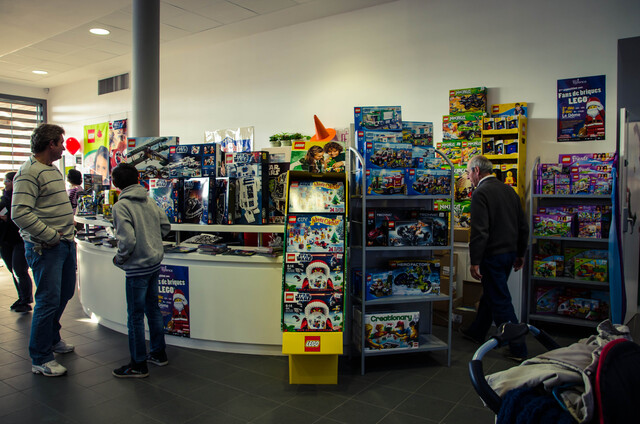](https://www.freelug.org/IMG/jpg/Fans_de_Briques_Lego_Talence_2012_-_094.jpg)
    
-   La Radio Nostalgie Bordeaux qui annoncera l’évènement avec des spots radios et des sets à gagner à l’antenne.
-   Thomas Cook voyage aura un espace sur lequel est mis en jeu un week-end pour 4 personnes à LEGOLAND Windsor.
-   Ellipse affichage s’occupera comme son nom l’indique de l’affichage dans Talence, Bordeaux et ses alentours.
-   Aux saveurs de Madinina aura un espace de vente avec des chocolats en forme de briques et minifigs LEGO.
    
    [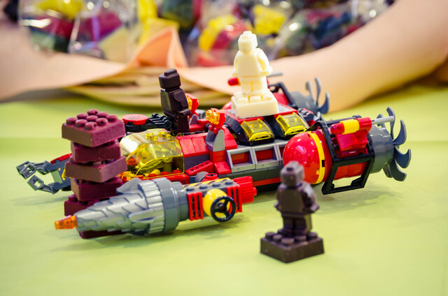](https://www.freelug.org/IMG/jpg/Fans_de_Briques_Lego_Talence_2012_-_044.jpg)
    
-   [Family Sphere](http://bordeaux.family-sphere.com/details-family+sphere+partenaire+de+l+expo+fans+de+briques+lego+a+talence+les+1er+et+2+decembre+2012-167.html) va prendre en charge l’animation et la surveillance de l’atelier "Mini Fans de LEGO-FAMILY SPHERE" avec un énorme stock de briques de base prêté par Samuel "Lego Lorraine" et mises à disposition pour le jeune public.
    
    [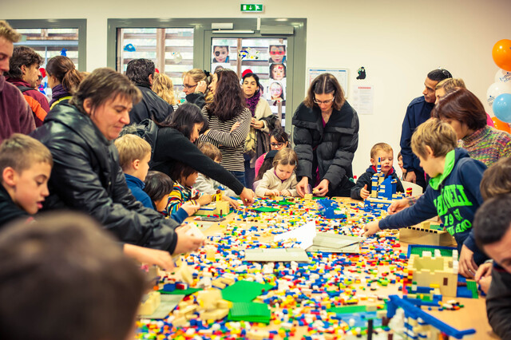](https://www.freelug.org/IMG/jpg/Fans_de_Briques_Lego_Talence_2012_-_282.jpg)
    
-   Le café associatif "Chez pôle" se chargera de la buvette.

Après contact, nous aurons aussi la chance d’avoir Nicolas Forsans qui proposeras à la vente l’édition française du livre "Culture LEGO".

[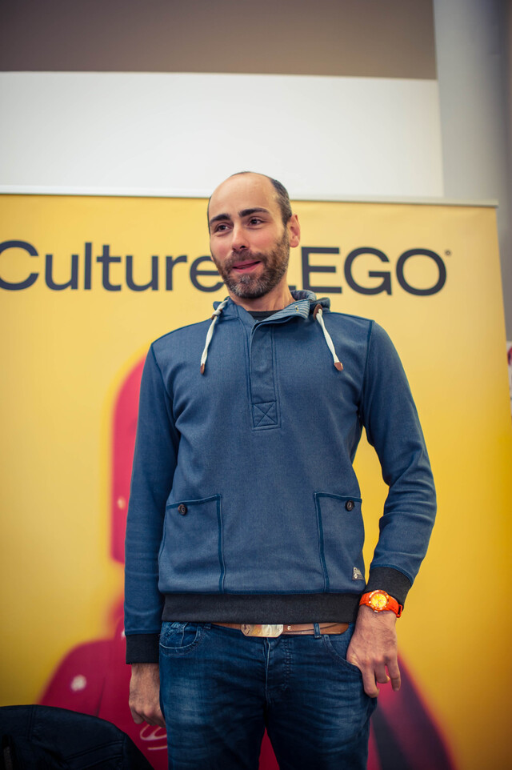](https://www.freelug.org/IMG/jpg/Fans_de_Briques_Lego_Talence_2012_-_304.jpg)

Tout est en place, maintenant on lance la promotion ! Pour ce faire, création d’une page [Facebook](http://www.facebook.com/Fansdebriqueslego) (c’est à la mode !) et convocation des médias à une [conférence de presse](http://www.sudouest.fr/2012/11/28/la-passion-de-la-petite-brique-892258-3200.php).

[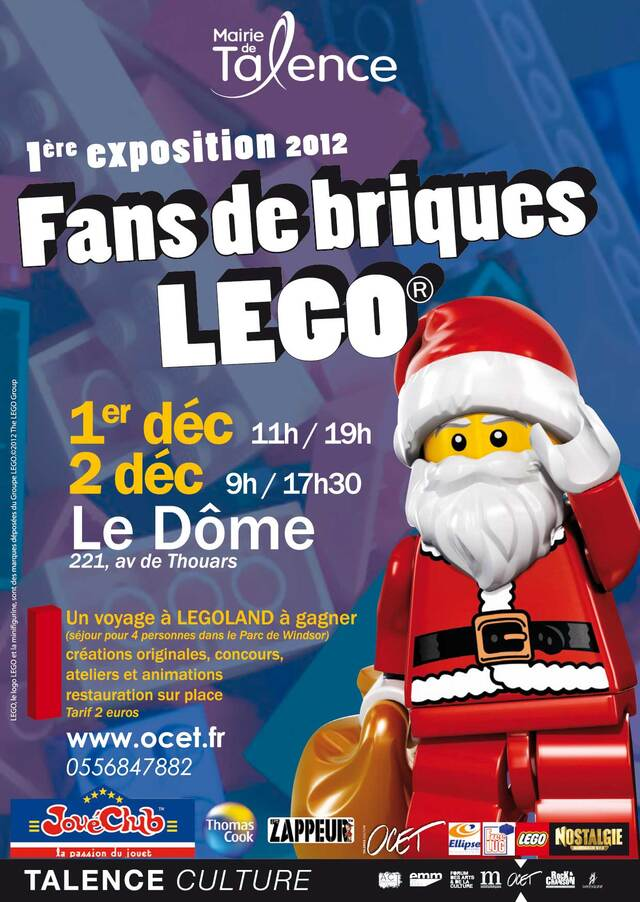](https://www.freelug.org/IMG/jpg/fans-lego-web-2.jpg)

Avec Nicolas Forsans nous aurons aussi droit à un passage TV dans l’émission "[Carré VIP](http://www.mytv7.net/video/ac5e70a6996s.html)" sur TV7 la chaine locale du grand Bordeaux ; et pour ma part un passage sur France Bleue Gironde dans l’émission "Place des grands hommes".

Après de nombreuses réunions préparatoires et mises au point, ça y est le grand jour approche enfin. Je prends donc "possession" de la salle le vendredi matin pour commencer la mise en place des tables à partir du plan. Les exposants arrivent les uns après les autres, nous faisons connaissance pour certains ou nous nous retrouvons avec plaisir pour d’autres.

Nous passons donc à la phase d’installation :

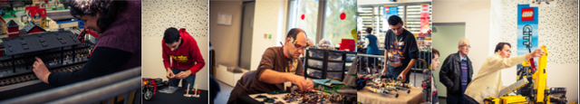

Certains auront même besoin d’aide au vu de leur "petite" création :

[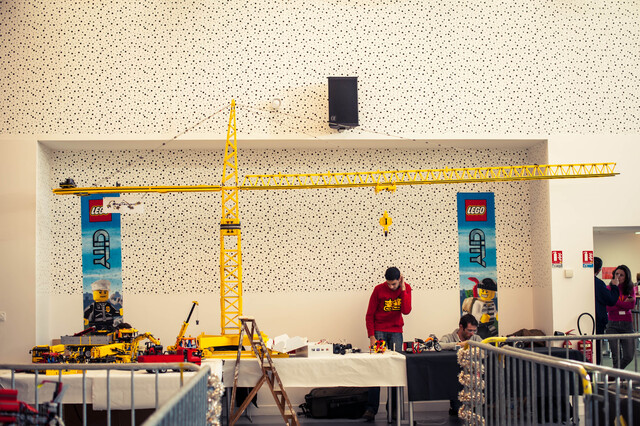](https://www.freelug.org/IMG/jpg/Fans_de_Briques_Lego_Talence_2012_-_045.jpg)

Toute installation réserve son lot de surprises, mais nous en avons eu une bonne en l’occurrence deux palettes en provenance de LEGO France : la première contenant de la décoration pour la salle et la deuxième un R2-D2 à l’échelle 1:1 !

[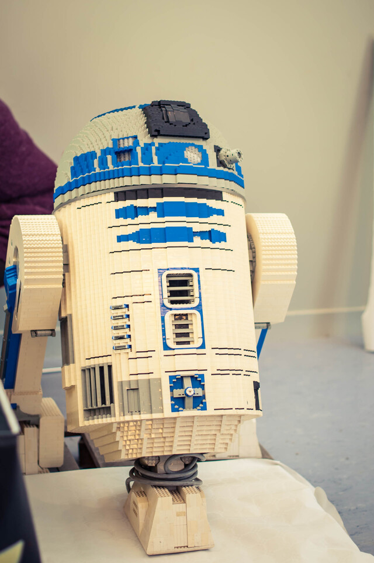](https://www.freelug.org/IMG/jpg/Fans_de_Briques_Lego_Talence_2012_-_145.jpg)

_Il est reparti le lundi suivant l’exposition, snif ! Je ne suis pas fan de Star Wars mais je crois que j’aurais fait un effort !_

Puis vient enfin l’heure fatidique et l’ouverture au public. Pour une première dans le coin, on ne sait pas trop quelle va être la fréquentation, mais on part sur 1500 visiteurs (du moins c’est le nombre de billets d’entrées que nous avons imprimés !). Et déjà quelques personnes attendent depuis un moment l’ouverture des lieux, nous ne les faisons plus attendre plus longtemps, et vers 11h nous offrons enfin aux regards ébahis nos chères petites briques.

Très vite malgré le froid et la pluie par moment, une file d’attente de 200m se forme et dès 16h nous dépassons les 1500 entrées et nous devons trouver des billets d’entrées en urgence !

[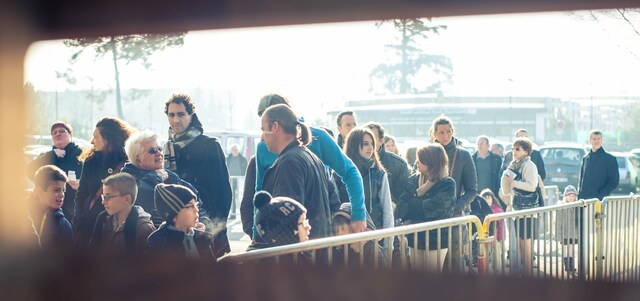](https://www.freelug.org/IMG/jpg/Fans_de_Briques_Lego_Talence_2012_-_058.jpg)

Nous clôturons la journée du samedi à 18 heures avec près de 2200 visiteurs. C’est bien fatigués mais heureux que nous nous rendons au Château de Thouars pour profiter d’un bon repas, tout en refaisant entre nous le film de la journée : du vrai grand spectacle ! Une courte nuit de repos et nous repartons pour une journée marathon, avec encore plus de visiteurs, certains feront près de 1 heure d’attente !  
Nous décidons en plus des jeux concours qui ponctuent l’exposition, de faire gagner un lot à notre 3000-ème visiteur, j’apprends plus tard depuis mon stand que nous allons fêter le 4000-ème et même en fin d’après-midi le **5000-ème visiteur** !!!!!!!! Puis vient l’heure de la fermeture définitive ; nous pouvons tous souffler, cela a été éprouvant mais plus qu’agréable. Le public a été ravi, et nous a remercié tout du long pour avoir organisé cette exposition. Même encore maintenant des remerciements arrivent sur ma boîte mail.

Voici une [vidéo](http://youtu.be/BzHhh6sOn10) qui permet de se faire une idée. Merci à July et Vinz photographes sur Facebook pour nous avoir accompagné pendant tout le week-end et pris plusieurs centaines de photos.

Bref, cette première expérience a été un énorme succès. Maintenant, il va falloir bosser pour la deuxième édition. Le public nous réclame une suite ! Ne le décevons pas et rendez-vous fin 2013.

[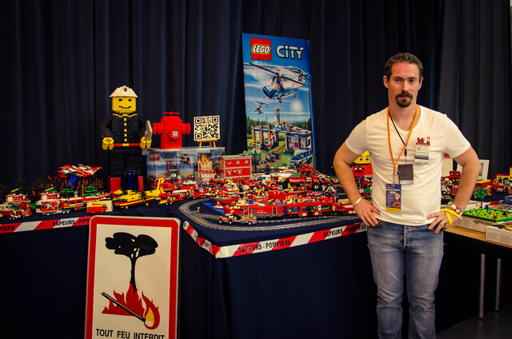](https://www.freelug.org/IMG/jpg/Fans_de_Briques_Lego_Talence_2012_-_342.jpg)

_Christophe "Des pompiers de briques" CASSUTTI_

* * *

Gwenael Quris alias Gwelego de FreeLUG :

[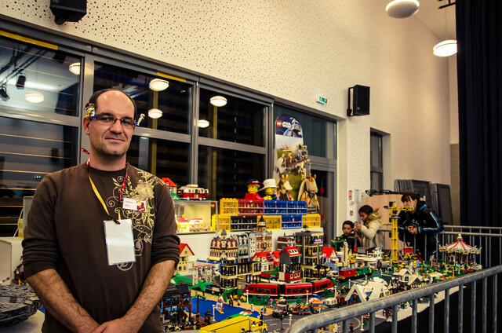](https://www.freelug.org/IMG/jpg/Fans_de_Briques_Lego_Talence_2012_-_341.jpg)

Cette Exposition a été extraordinaire, quelques jours de folie, organisée avec brio. Dès le vendredi midi, j’ai rencontré des AFOLs comme moi (on se sent moins seul de suite), le montage des dioramas s’est fait dans la bonne humeur, entre connaisseurs passionnés de la petite brique.  
Le lendemain matin, après quelques finitions, l’heure d’ouverture des portes arrivant, le stress monte, et le monde (et quel monde) afflue, jamais je n’aurais pu imaginer autant de monde dès l’ouverture. Il est clair que la promotion de Christophe et Victor a dépassé toutes nos espérances.

Beaucoup de gens surpris de voir tant de LEGO dans une même salle, beaucoup de questions, beaucoup d’amusement, bref l’éclate la plus totale.

Après une première journée de folie, le repas du soir a été grandiose, dans un cadre génial (château de Thouars).

Le lendemain, encore plus de monde, malgré la pluie, une journée géniale encore, de partage de passion, de regards brillant sur nos dioramas.

Le démontage a été rude, et le retour fatiguant, mais vraiment, avec une telle organisation, une telle préparation, un tel accueil, j’ai carrément passé le plus beau week-end depuis très longtemps.

Vivement la prochaine édition (j’aurai tendance à dire en mieux, mais cela parait difficile).

Bref,

Quand des fans présentent leurs chères petites briques,  
\_Dévoilant un lien de passionnés, une tendance,  
\_Et que les organisateurs, et la mairie s’appliquent,  
\_On voit des LEGO partout à TALENCE.

_Gwelego_

* * *

Pascal et Lydie Rathier alias Loco16 et Dark de FreeLUG :

[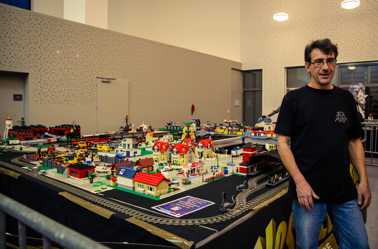](https://www.freelug.org/IMG/jpg/Fans_de_Briques_Lego_Talence_2012_-_334.jpg)

[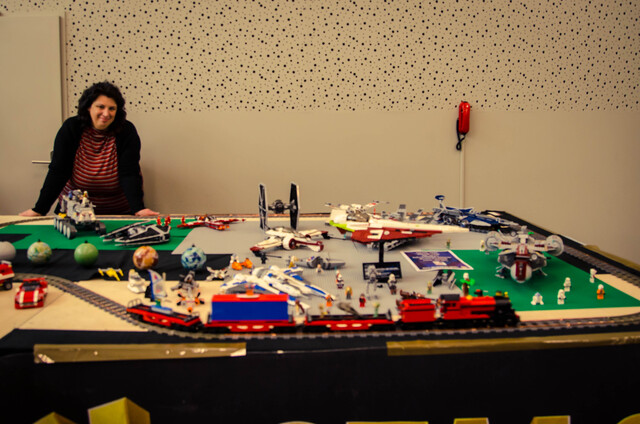](https://www.freelug.org/IMG/jpg/Fans_de_Briques_Lego_Talence_2012_-_335.jpg)

Nous avons reçu 2 mois avant la date un mail de Christophe nous proposant une exposition a Talence, pour du LEGO nous ne nous sommes pas fait prier, nous étions partants pour ce projet.

Dès notre arrivée, nous avons constaté un accueil chaleureux et une organisation au top (gérée par un extraordinaire Christophe et sa petite famille), nous n’avions qu’à installer notre stand (ce qui n’était pas une mince affaire), nous avons fait connaissance avec des exposants supers et aussi très motivés. Dès l’ouverture, le monde a envahi la salle, et les discussions avec les parents et fans de LEGO (AFOL) remplirent la pièce.

Nous remercions pour le repas du samedi soir dans un joli cadre (le château de Thouars) les organisateurs. Le sommeil fut bien mérité après une telle journée, le dimanche commença par l’arrivée de la pluie et une foule encore plus impressionnante, mais nous réussissions quand même à nous occuper de nos briques

Ce fut une super journée avec des visiteurs pleins d’émerveillement devant les différents stands, ce qui fut pour nous une grande joie.  
Comme d’habitude le démontage se réalisa dans la peine, mais tous les exposants connurent 3 journées exceptionnelles.

Nous pensons que tout le monde est pressé de revivre cet évènement ; après une exposition et une organisation aussi parfaite, nous pensons que Talence va vivre en LEGO !

Comme vous avez pu le lire, faire mieux en 2013 va être très compliqué, mais connaissant Christophe l’impossible ne l’arrête pas.

_Pascal et Lydie super motivés pour 2013_

* * *

Nicolas Rigolini alias Rigo de FreeLUG :

[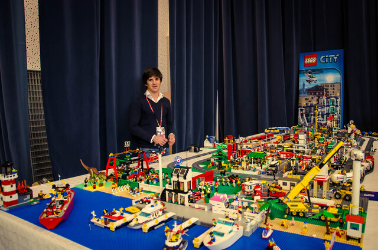](https://www.freelug.org/IMG/jpg/Fans_de_Briques_Lego_Talence_2012_-_340.jpg)

Début Octobre, juste après mon adhésion à FreeLUG, je vois passer un mail concernant une expo 100% LEGO à Talence. Talence ? Mais c’est à côté de Bordeaux ! Allez, banco ! Après tout, c’est aussi pour ça que j’ai décidé de rejoindre FreeLUG ! Je me propose donc pour exposer sur le thème City sans trop savoir exactement ce que je vais bien pouvoir présenter...

Après un mois et demi de travail, j’arrive au Dôme de Talence le vendredi en fin d’après-midi avec ma présentation en kit. Un petit tour pour dire bonjour et admirer les présentations déjà en place et au boulot parce que le lendemain à 11h : feu !

Quelques heures de boulot, une nuit agitée sur place, encore quelques heures de boulot et les portes s’ouvrent enfin ! Nous voilà partis pour un week-end de folie que personne n’avait prévu, ni même espéré ! Mais avec une organisation bien rodée, des participants hyper motivés (dédicace spéciale à Christophe, Monsieur V. Et l’OCET) et des présentations de qualité (oui, il faut bien se jeter des fleurs de temps en temps), le public a été conquis ! Et moi aussi. C’est sûr que pour une première exposition je suis bien tombé, mais quel plaisir de voir les yeux des enfants briller devant nos créations et les parents ou grands parents être tout aussi enthousiastes ! Les LEGO restent intemporels et dépassent les âges, ça ne fait aucun doute.

Et puis les échanges avec les gens, leurs questions sur notre passion : depuis quand ? Combien de temps passé ? Combien de pièces ? Quel budget ? Et parfois des questions plus pratiques, surtout de la part des mamans : où rangez-vous tout ça ? Comment faites-vous la poussière ? Et votre femme ?! Bref, un vrai bonheur de partager et d’échanger pendant ces deux jours ! Et des rencontres très sympas avec les autres exposants. On n’a pas arrêté, on est rentré fatigués mais vivement la prochaine édition ! C’est un drôle de virus mais une fois qu’on l’a attrapé, difficile de s’en débarrasser (d’ailleurs qui voudrait s’en débarrasser ?).

Voici pour finir quelques photos sur les liens suivants :  
**–** [ma présentation](http://photos.freelug.org/main.php/v/RIGO/Expo+Fans+de+Briques+LEGO+Talence+2012/)  
**–** [celles des autres exposants](http://photos.freelug.org/main.php/v/RIGO/Expo+Fans+de+Briques+LEGO+Talence+2012_001/)

Rendez-vous donc début décembre à Talence pour la 2ème édition !

_RIGO._

* * *

Lebian Loïc (Talence) :

[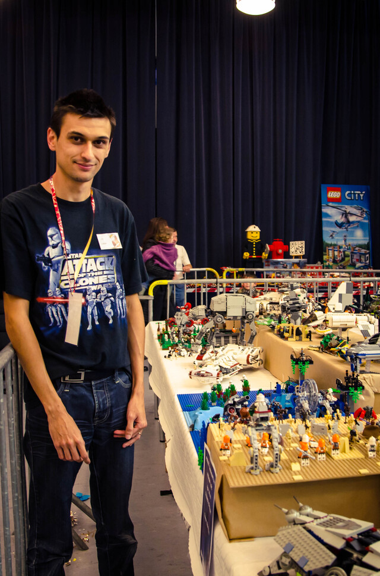](https://www.freelug.org/IMG/jpg/Fans_de_Briques_Lego_Talence_2012_-_339.jpg)

Pour moi comme pour l’organisateur ce fut un baptême du feu (spécial dédicace à toi Christophe), j’avais vu l’annonce sur Hoth Bricks, mince alors une exposition LEGO à 100 m de chez moi, faut que j’y participe c’est décidé ! Après un mois et demi de préparation c’est le grand jour. Je débarque le vendredi soir pour installer mes LEGO et faire la connaissance de mes voisins exposants. C’est là que je m’aperçois que la legomania dont je souffre n’est pas une maladie orpheline. J’apprends de notre pompier de service que nous espérons voir 800 personnes. Lendemain matin, je viens avant l’ouverture pour fignoler mon stand dédié à Star Wars et là, stupeur, il y a déjà la queue. On ouvre les portes à l’heure prévue et c’est parti pour deux jours de folie ! Les gens sont vraiment sympas, les enfants curieux posent des tas de questions (j’ai bien fait d’emmener l’encyclopédie). Les papas (et aussi quelques mamans) qui expliquent à leur enfants qui est la princesse Leia ou pourquoi Luke Skywalker est suspendu sous l’ATAT. Les maris qui me demandent comment je fais avec ma femme ! et les épouses qui me demandent où je range tout ça. A la fin de la première journée je n’avais plus de voix ! Le lendemain il a fallu remettre ça et je crois qu’il y a eu encore plus de monde. Quand je suis rentré dimanche soir j’étais crevé mais content. C’était vraiment génial on s’est bien marré, j’ai rencontré des gens supers et je remercie toute l’organisation (à qui je tire mon chapeau) de m’avoir permis de partager ma passion avec le public. Je n’ai eu que des bons retours durant l’exposition et après. Je peux déjà leur assurer que je serais là pour l’édition 2013 !

Que la Force soit avec Nous !

_Darkheart3111 le coté obscur du LEGO._

* * *

Pradines Kevin alias Skrall789 de Bionifigs :

[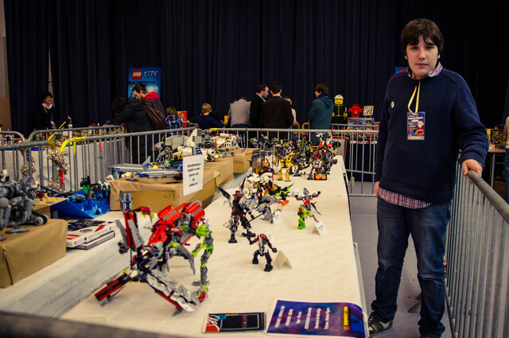](https://www.freelug.org/IMG/jpg/Fans_de_Briques_Lego_Talence_2012_-_336.jpg)

Durant le week-end, j’ai juste exposé mes créations avec Loysnuva. Nous avons discuté avec les visiteurs qui nous posaient quelques questions comme « En combien de temps avez-vous crée ces monstres ? »

J’ai en tout cas vraiment été impressionné par la masse de monde présente à l’exposition. C’est dans les 5200 visiteurs qui nous ont visités ce week-end. Les allées étaient larges, et pourtant ça bouchonnait de partout. Ceux qui vendaient des tickets avait une rupture de stock tellement il y avait du monde. Après, j’ai eu le droit aux traditionnelles remarques : « C’est pas des LEGO ça... », « C’est trop différent. » , « Tiens, des Transformers ! ». J’ai même eu droit à cette phrase « Maman regarde, des ben10 !! » Hum, Pardon ? Bref, j’ai eu aussi de meilleures remarques, de gens souvent très intéressés de découvrir notre gamme une fois la conversation engagée. Par contre, il y a aussi quelque chose d’assez ironique durant l’exposition. Sachez que le petit chibi vert dans la [vidéo](http://youtu.be/SZbP1zVnNsM) a eu un immense succès, plus que mes autres MOCs.

* * *

DORE Romain alias Rom104 de BricTechnic

[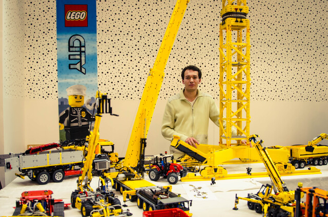](https://www.freelug.org/IMG/jpg/Fans_de_Briques_Lego_Talence_2012_-_338.jpg)

Bonjour,  
l’exposition est déjà finie, après un bon week-end dans le monde du LEGO.

Un grand merci aux organisateurs Christophe, Victor et à la mairie de Talence. Grâce à eux, une très belle exposition 100% LEGO dans le Sud Ouest en moins de 3 mois.

Le nombre de visiteurs attendu était 1500 maximum, ce nombre a été dépassé vers 16 heures le samedi (il me semble).  
Sur l’ensemble du week-end il y a eu 5220 visiteurs, pour une première expo cela est très bien.

Samedi matin arrivé vers 8h00 pour tout mettre en place, sur le stand BT et ST avec Ismaël (Khan) et Julien (TechyMind).  
Merci à eux deux pour le montage de la grue, il faut être au minimum 3 personnes.  
Le public a été enchanté par la qualité des stands il y avait pas mal de thèmes.

Le stand Technic a eu du succès par la présence de MOCs (sauf trois sets) entre moto, avion, moteur, camion, pelle et avec la plus grande construction en LEGO de l’exposition.

Je remercie Julien et Ismaël pour avoir répondu aux nombreuses questions (toutes les 2 minutes) du public sur la grue.

Le samedi soir un bon repas au châteaux de Thouars, avec des chocolats en forme de briques 3x3 (C’est la futur brique LEGO…) et en forme de Minifig.

Le dimanche, déjà le dernier jour d’exposition. Une journée avec beaucoup de monde.

Puis l’heure du démontage est arrivée, avec un petit regret de voir tous les LEGO rangés dans leurs cartons et jusqu’à la prochaine exposition Fana.

Vivement l’année prochaine pour remettre ça dans une salle plus grande.

* * *

Khan et Techymind de SeTechnic

[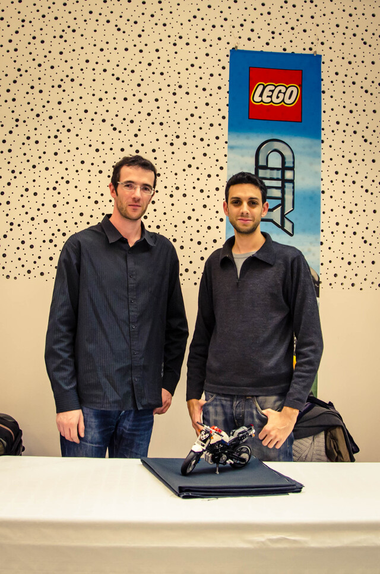](https://www.freelug.org/IMG/jpg/Fans_de_Briques_Lego_Talence_2012_-_337.jpg)

Ismaël JUHOOR alias Khan (à droite sur la photo) :

J’ai particulièrement apprécié les conditions dans lesquelles nous avons pu exposer. Une salle particulièrement bien adaptée, une organisation au top et aux petits soins pour les exposants, autant de choses qui font qu’on prend un maximum de plaisir à échanger avec le public. Avec le LEGO Technic, nous avions l’avantage d’avoir des modèles peu sensibles à la manipulation, nous avons donc pris le parti d’enlever les barrières devant nos tables. Le contact avec le public n’en a été que meilleur, et nous avons pu échanger avec les adolescents, les papas et parfois même les mamans reconnaissant les modèles exposés ! Pour ma part, le bilan est largement positif, et je compte bien me démener pour proposer un stand encore meilleur l’année prochaine.

_Ismaël_

Julien MEKLIS alias Techymind (à gauche sur la photo) :

Cette exposition a été vraiment au delà de nos espérances et nous avons tous été bluffés par l’affluence ; quelques chiffres :  
**–** Nombre de visiteurs attendus sur le week-end : 1500  
**–** Nombre total de visiteurs : 5220

Cette exposition montre qu’il manquait vraiment une exposition LEGO dans le grand sud ouest.

Nous pouvons remettre le crédit de ce succès aux organisateurs qui ont fait un travail exceptionnel en si peu de temps, à la municipalité qui a vraiment été enthousiasmée par le projet et s’y est complètement investie, à Victor de Nostalgie qui a fait du super boulot pour la communication par radio ainsi que les partenaires qui ont sponsorisé l’évènement.

Je voulais vous remercier aussi pour la façon dont vous nous avez chouchoutés en tant qu’exposant, franchement le repas le samedi soir au château de Thouars fait par le traiteur de la mairie était vraiment très bon ; merci également pour les repas de midi qui étaient plus sommaires mais en accord avec le rythme de l’exposition.  
La salle toute neuve est vraiment bien faite et les murs à structure antibruit nous ont permis de sauvegarder nos oreilles.

Excellente ambiance générale.

Tous les visiteurs étaient enchantés et quand je vois ça, je me dis que ça vaut vraiment la peine de se défoncer pour leur donner un peu de bonheur.

A améliorer :

-   Indication fléchée sur la direction de l’exposition depuis la sortie de la rocade.
-   Agrandir le lieu car nous avons déjà été victimes de notre succès donc je n’ose imaginer cette année à venir.
-   Éviter qu’il y ait trop d’attente dehors car à cette période il fait froid et il pleut dehors.
-   Investir dans des barrières moins zoo pour ceux qui en veulent.
-   Appeler les potes exposants à la rescousse.
-   Faire apparaitre les différents thèmes LEGO de façon plus claire.
-   Mettre en valeur nos joujoux.

_Julien_
