La spécificité des rails LEGO en terme de géométrie, en particulier le très faible rayon de courbure des virages et aiguillages, combinée aux configurations complexes d’essieux des locomotives vapeurs imposent que nous nous y attardions avant de nous lancer dans une construction.

Malgré quelques années dans le hobby, en particulier dans le domaine du train LEGO, je n’avais aucune expertise dans le domaine de la construction de locomotives vapeurs en LEGO. Il est vrai que je préfère largement les engins moteurs modernes (diesel, électrique), et même très modernes comme les TGVs. C’est une question de goût tout à fait personnel - subjectif - mais il est tout aussi vrai que les goûts évoluent.

Lorsque le concept de "Jouons à LEGO" sur les trains a été lancé sur la liste de diffusion FreeLUG, c’est une vapeur qui fût choisi : une 141R de la SNCF (oOOOOo) . Il me fallait donc m’intéresser au sujet de façon plus approfondie. Jusque là je n’avais construit - sans les concevoir - que deux vapeurs : un MOC allemand et l’Emerald Night ([10194](http://www.bricklink.com/catalogItem.asp?S=10194-1)).

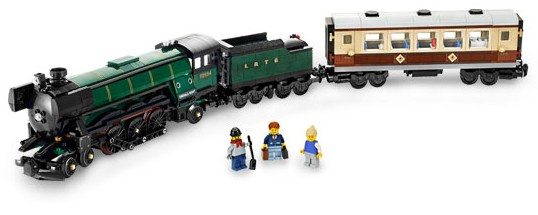

Il faut dire qu’avant 2009, il n’était pas aisé de construire une locomotive vapeur réaliste. En effet, les roues ferroviaires de grandes tailles qui servent de roues motrices n’existaient pas encore... tout du moins chez LEGO puisque [Big Ben Bricks](http://www.bigbenbricks.com/products/products.html) produisait des roues de tailles variées depuis 2004. A la plus grande joie des puristes, elles existent aujourd’hui chez LEGO aussi bien en rouge qu’en noir [^1] et aussi bien [sans boudin](http://www.bricklink.com/catalogItem.asp?P=85489a) (blind) qu’ [avec](http://www.bricklink.com/catalogItem.asp?P=85489b) (flanged). Nous expliquerons un peu plus loin la différence entre ces deux types de roues.

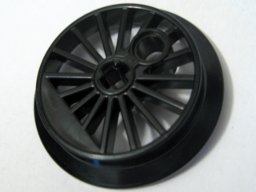

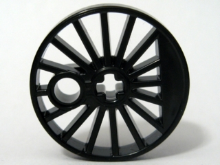

## Roues motrices

Une locomotive, c’est un véhicule moteur : il lui faut des points d’appui au sol qui transmettent le mouvement. La locomotive vapeur pour atteindre des vitesses élevées utilise des roues de grand diamètre. Sur les toutes premières locomotives, un seul essieu moteur était nécessaire mais avec l’accroissement de la puissance, le nombre d’essieu est vite passé à 2, 3, 4 et 5 (voire exceptionnellement plus en Amérique du Nord notamment grâce aux spécifications plus généreuses du réseau).

Les modèles LEGO, à cause du faible rayon de courbure, doivent avoir soit des châssis à empattement réduit (l’empattement sur un châssis est la distance entre les essieux avant et arrière) soit des châssis articulés.

## Boudin

Pour réduire l’empattement des locomotives vapeur en LEGO, on utilise des roues sans boudin. Les roues avec boudin permettent de guider l’engin. Les roues sans boudin sont un artifice. Elles peuvent se déporter latéralement de façon libre et ne guident pas le châssis. Elles n’entrent pas en compte dans la taille de l’empattement, et dans les cas extrêmes de déport, elles peuvent même se retrouver suspendues dans les airs (aux dépens du réalisme).

[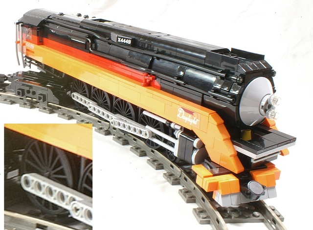](https://www.freelug.org/IMG/jpg/deport.jpg)

On ne peux pas non plus utiliser sur un châssis fixe de plus de deux essieux avec boudin. En notant "F" les roues avec boudin et "B" les roues sans, on utilise **généralement** les configurations d’essieux suivantes :

2 roues motrices : FF

[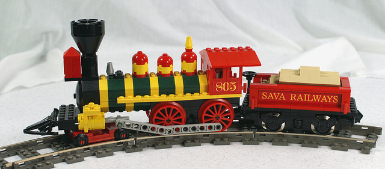](https://www.freelug.org/IMG/jpg/FF.jpg)

**Une américaine de type 220 (ooOO) par Anthony Sava.**

Notez que le bissel avant n’est pas seulement articulé mais qu’il glisse aussi librement de droite à gauche.

3 roues motrices : FBF

[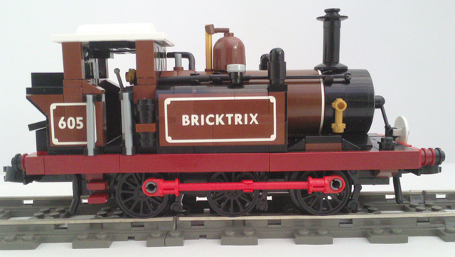](https://www.freelug.org/IMG/jpg/FBF.jpg)

4 roues motrices : FBFB/BFBF

[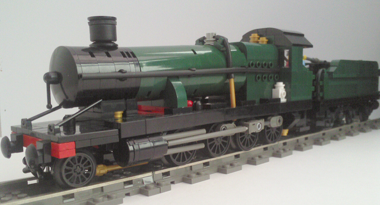](https://www.freelug.org/IMG/jpg/FBFB.jpg)

**La GWR de Carl Greatrix avec sa configuration 140 (oOOOO)**

5 roues motrices : BFBFB

[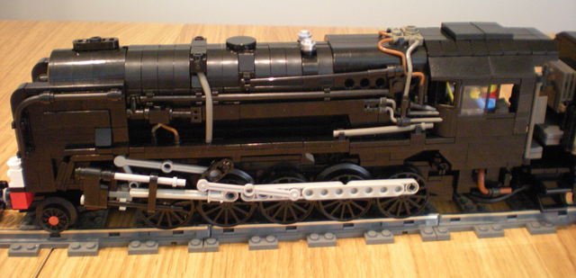](https://www.freelug.org/IMG/jpg/BFBFB.jpg)

**La Evening Star de Carl Greatrix, une impressionnante 150 (oOOOOO)**

L’alternance des "B" et "F" permet de conserver un écartement réduit au minimum entre les essieux, les boudins de par leur encombrement nécessitant un écartement supérieur des essieux, mais les combinaisons -FF- plus rares sont possibles.

[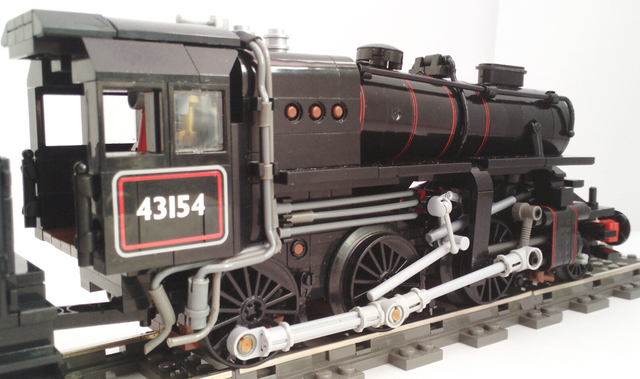](https://www.freelug.org/IMG/jpg/BFF.jpg)

**Configuration FFB sur cette 130 (oOOO) de Cal Greatrix**

## Bissel

Les locomotives toutefois ne possèdent pas uniquement des roues motrices - celles accouplées à l’aide de bielles - mais aussi des roues plus petites placées à l’avant et/ou à l’arrière.

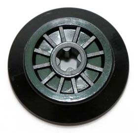

Ces essieux, articulés, sont nommés bissel. Le bissel avant favorise l’inscription dans les courbes, le bissel arrière est principalement porteur.

Pour les modèles LEGO, ces bissels sont sources de problèmes. Comme nous l’avons déjà indiqué, les courbes sont serrées et les bissels, articulés, ont la fâcheuse tendance à se placer en position de coincement. Si le bissel est tracté (bissel arrière), cela cause principalement une résistance à l’avancement. Si le bissel est poussé (le bissel avant), celui-ci se soulève et déraille.

Si le bissel est constitué de deux essieux, comme c’est le cas de la Emerald Night qui est une Pacific (configuration d’essieu 231 : ooOOOo), une solution consiste à utiliser une double articulation. En effet les essieux double se guident sur les rails de façon indépendante et la double articulation permet de compenser à la fois les angles de trajectoire et les déports.

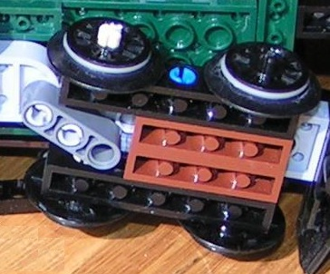

Si le bissel est constitué d’un seul essieu, la double articulation n’est pas une solution. En effet, un essieu isolé ne se maintient pas en ligne et se place de travers rapidement. Il faut réduire ses degrés de liberté.

L’articulation simple peut être une solution. Pour éviter l’écueil de la mise en travers, le point d’articulation doit être éloignée du bissel et se placer au niveau du premier essieu moteur. Pour parfaire la prise de courbe, on peut aussi prendre en compte au mieux le déport du bissel en créant un essieu translateur, autorisant aux roues un mouvement latéral.

## Piston

Globalement le bissel avant pose beaucoup de problèmes. Comme nous l’avons déjà indiqué, le problème provient du fait qu’il est poussé et qu’étant articulé, il peut se mettre de travers et dérailler assez facilement.

Un second problème provient de la présence des pistons sur les côtés. Les pistons sont généralement très bas, devant les roues motrices et à la hauteur de celles-ci. Ils constituent donc un obstacle au bissel avant qui se déplace latéralement. C’est particulièrement vrai pour les bissels qui sont constitué d’un boggie (deux essieux).

Le problème peux se résoudre de multiples façons en fonction des configurations.

**–** La société LEGO pour son Emerald Night a choisi de simplement déplacer le problème en décalant les pistons vers le haut et en réduisant celui-ci à sa plus simple expression.

**–** Nous pouvons aussi choisir d’utiliser des "micro"-roues plutôt que les petites roues classiques. Moins encombrantes, le bissel passe les pistons.

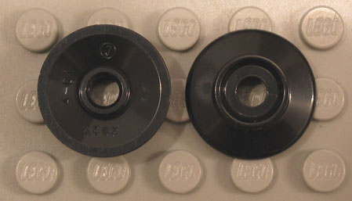

**–** On peut aussi imaginer d’éclater le bissel, l’essieu le plus proche des roues motrices devenant fixe, l’autre devenant un bissel à essieu simple devant les pistons.

**–** Il est aussi imaginable d’utiliser des petites roues sans boudin et de créer des bissels fixes, non articulés, au sacrifice du réalisme (mais voit-on dans la réalité des bissels se tordre de façon aussi extrême que sur les courbes LEGO ?).

**–** Enfin, il n’est pas interdit d’élargir le gabarit de la locomotive pour donner plus de place aux mouvements du bissel. Cela permet de gagner en outre en réalisme, en perdant toutefois en compatibilité vis-à-vis des réseaux d’exposition.

## Motorisation

Les locomotives réelles utilisent du bois, du charbon ou du fioul pour chauffer de l’eau dans une chaudière qui une fois transformée en vapeur viendra actionner des pistons qui entraînent les roues motrices par l’intermédiaire d’un embiellage.

Bien qu’il soit possible de le faire avec des éléments pneumatiques, en LEGO, nous utilisons exclusivement des moteurs électriques pour motoriser nos modèles.

Il existe deux type de moteurs :

**–** les moteurs dédié aux trains (PFS, 9V)

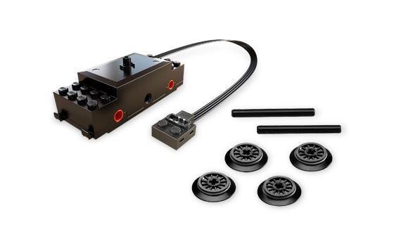

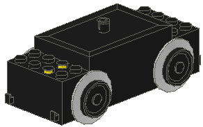

**–** et les moteurs PFS Technic comme le XL.

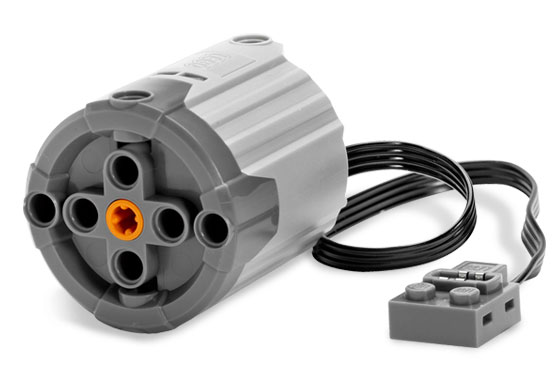

Dès lors, on peux discerner deux grands types de motorisation de nos modèles.

A) Les moteurs Technic vont permettre de motoriser nos modèles en entraînant les grandes roues - celles qui sont motrices dans la réalité. C’est ce type de motorisation que LEGO a choisi pour son Emerald Night. Elle est cependant gourmande en espace.

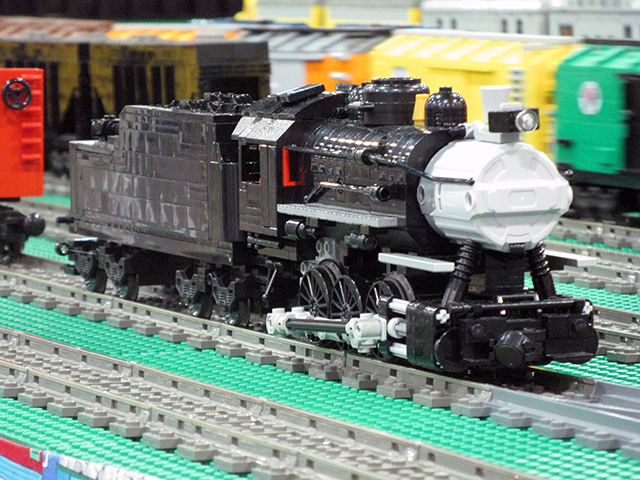

**Une locomotive de manœuvre 030, par Benn Coifman, motorisée avec un moteur PFS XL**

Il est placé en tête de chaudière, profitant de sa forme cylindrique mais aussi de la couleur grise pour mimer la livrée des "USRA". La Emerald Night est elle aussi motorisé avec ce type de moteur, moteur placé dans la cabine de conduite.

B) Les moteurs dédiés aux trains.

1) Le moteur dédié peut prendre la place d’un bissel à deux essieux. C’est par exemple très intéressant dans les modèles de configuration d’essieux 220 (ooOO) ou 231 (ooOOOo).

[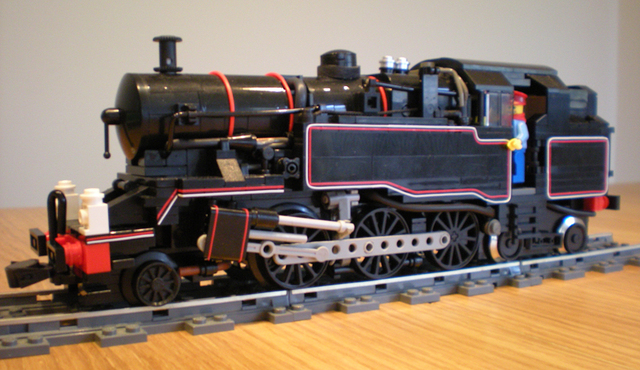](https://www.freelug.org/IMG/jpg/motorisation_bissel_arriere.jpg)

**La 4MT 132 (oOOOoo) de Carl Greatrix motorisé, avec un moteur 9V dédié, sur le bissel arrière**

2) Le moteur dédié peut aussi prendre place d’un boggie du tender. C’est très intéressant pour les modèles très stables car la "pousse" favorise les déraillements.

[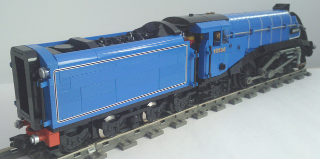](https://www.freelug.org/IMG/jpg/motorisation_tender.jpg)

**Vue arrière de la Pacific A4 de Carl Greatrix motorisée par le tender**

Il est bien sûr intéressant dans la mesure du possible d’améliorer la motricité et la stabilité de la locomotive en multipliant le nombre de moteurs.

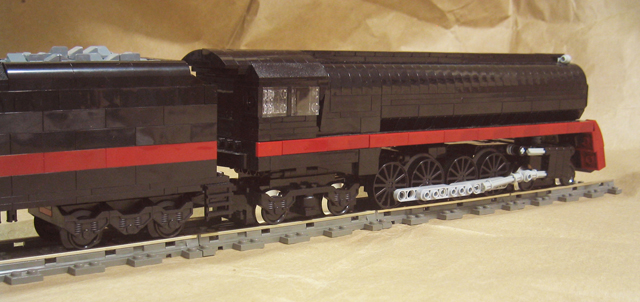

**Une 242 (ooOOOOoo) de Benn Coifman motorisé à la fois par le bissel avant et arrière.**

Pour que le modèle puisse s’inscrire dans les courbes, les essieux couplés sont libres en translation.

## Conclusion

Cet article est largement inspiré par les créations de Cale Leiphart, Benn Coifman, Carl Greatrix, Ross & John Neal et Anthony Sava qui ont permis d’illustrer nos propos.

Cet article est très largement inspiré par les articles parus dans le e-magazine [RailBricks](http://railbricks.com/magazine/), notamment par la série d’article de Cale Leiphart dans les numéros [5](http://railbricks.com/magazine/issue-5/) et [6](http://railbricks.com/magazine/issue-6/).

Pour finir cet exposé, quelques liens présentant des exemples concrets.

Les galeries de :  
**–** [Anthony Sava](http://www.brickshelf.com/cgi-bin/gallery.cgi?f=174415)  
**–** [Benn Coifman](http://www.brickshelf.com/cgi-bin/gallery.cgi?m=zephyr1934)  
**–** [Cale Leiphart](http://www.flickr.com/photos/steampoweredbricks/)  
**–** [Carl Greatrix](http://www.brickshelf.com/cgi-bin/gallery.cgi?f=309654)  
**–** [Steve Barile](http://www.brickshelf.com/cgi-bin/gallery.cgi?f=349239)  
**–** et n’oublions pas la [141R](http://www.flickr.com/photos/48442477@N04/sets/72157624091535607/) de Richard Lemeiter qui malgré (ou grâce) à son embonpoint est tout simplement superbe.

[^1]: Les roues rouges sont courantes à l’est - Allemagne, Russie, Chine - alors que le noir prédomine à l’ouest - France, USA...
