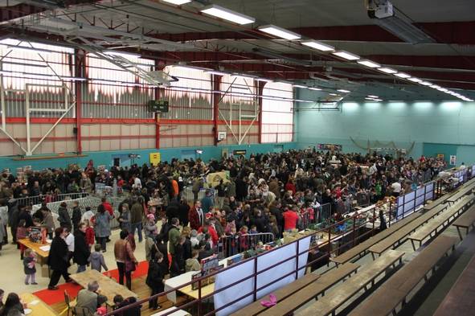

C’est plus d’une cinquantaine de personnes qui ont participé à l’évènement cette année (une quarantaine d’exposants, une dizaine de bénévoles).

Un peu plus de 5000 entrées (4800+273). Comme l’année précédente nous avons une bonne proportion de locaux 50%. Merci à la grande participation de Festibriques pour son implication, à Fanabriques, Bionifigs ,BrickPirate et à Erik de FreeLUG qui nous a apporté l’Horizon Express (TGV).

65 personnes se sont inscrites au concours.
