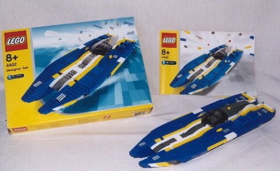
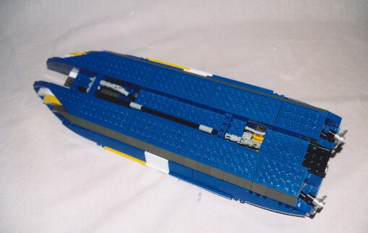
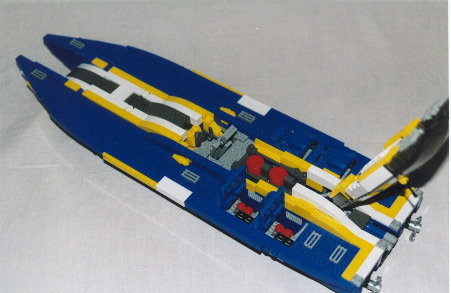
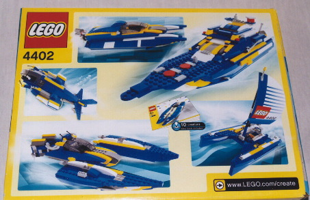

Les Designer sets sont la grande nouveauté de cette année pour les nostalgiques comme moi, qui souhaitaient un retour au principe de base des LEGO® : réaliser toutes les constructions que l’imagination permet, à partir d’éléments de base.

J’ai donc échangé, chez mon détaillant préféré, 49 de mes petits euro contre cette belle boîte jaune et bleue, venant tout juste d’arriver pour fêter la rentrée des classes. Oui, la rentrée des classes est une fête, surtout pour les parents, ceux qui ont des enfants me comprennent.

Je vous livre donc mes impressions histoire de vous embarquer avec moi dans cette croisière où l’on va bien s’amuser.

Ouverture de la boîte et éparpillement des sachets et euh... seccouage de la boîte.

Non pas d’autre sachet coincé à l’intérieur, ça me paraît un peu vide cette grande boîte. Faudrait pourtant enregistrer une fois pour toute M. Kristiansen, que le legophile n’en a jamais assez.

Mais ce n’est qu’une fausse impression, la boîte contient quand même 547 pièces, ce qui occupe quand même une bonne heure pour réaliser l’assemblage principal présenté sur la face avant de la boîte.

**Vue générale**

Bonne surprise, la boîte contient quelques pièces Technic®, dont 4 magnifiques cardans, qui manquaient à ma jeune collection, un volant "sport" et une crémaillère, dont je vais vous décrire l’utilisation plus bas.

Pour les fanas de médiéval, les bas de coque sont réalisés à l’aide de 34 slopes inversés de 2x2 gris foncés... ceux qui servent à faire reposer les crénaux des chateaux forts. Par contre vous aurez du mal à réutiliser les briques arrondies jaunes et bleus.

Le montage chasse véritablement l’impression de "trop peu", que j’ai eu à l’ouverture de la boîte et réserve quelques petits numéros d’accrobatie des phalanges pour mettre en place la commande de direction.

Car dans ce modèle de bateau off-shore, les pièces Technic® servent à rendre la barre fonctionnelle. Les mouvements du volant sont répercutés par un jeu de timonerie, utilisant les 4 cardans, et qui permet de transmettre les changements de direction aux deux moteurs, via la crémaillère.

**Vue du dessous**

L’intérieur des compartiments moteurs est détaillé à l’aide de quelques pièces de nouvelles générations, accompagnés de petits tuyaux pour l’arrivée d’essence (LEGO® préconise Octan !).

**Détail des moteurs**

Les nouvelles briques arrondies donnent un nez fin et agressif. On s’attend presque à entendre rugir les moteurs et à voir cette bête de course nous sauter des bras pour aller se jeter dans le bassin le plus proche. Mais, faute de pilote expérimenté à bord, je n’ai pas essayé la mise à l’eau.

En final, on obtient un beau bolide de 43x14cm qui a fière alure sur une étagère d’exposition. Un petit regret, les petites plaques ajourées de 2x1 auraient été du plus bel effet en chromé plutôt qu’en gris clair.

Voilà donc la description de ce modèle, dont la notice permet également 9 autres assemblages comprenant entre autre un sous-marin, un bateau de pêche, un jet ski et un catamaran, dont la voile est à découper dans la notice (bof !).

**Verso de la boîte**

Quoiqu’il en soit, je ne regrette pas mes 49 euro et j’espère que cette nouvelle série aura tout le succès commercial qu’elle mérite, car elle marque un véritable retour aux sources et s’inscrit comme une étape incontournable pour les plus jeunes qui souhaitent se lancer dans des constructions un peu plus techniques sans aborder toutefois le purement technique.

Bonnes constructions.

Didier (qdm)
