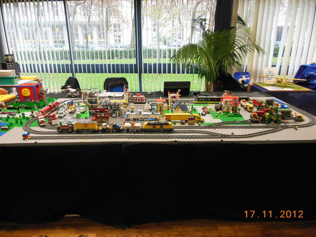

Le 17 et 18 novembre 2012 avait lieu au Palais des Congrès de Lorient le 24e salon de la maquette et de la figurine.

J’y exposais mon circuit de train et Erik (ScroogeMcBrick) le coffre fort de Picsou et le bateau du capitaine Crochet.

Je tiens à remercier Pierrick Cosquer, Président du club de St Martin Des Champs, qui a appuyé ma demande auprès des organisateurs.

_Damien_

* * *

Une exposition en compagnie de Damien qui s’est bien déroulée (si on omet l’absence de tables le vendredi après-midi...).

Et voici le lien vers les photos de... ah oui c’est vrai, j’avais oublié l’appareil.

Mention spéciale au visiteur qui m’a vendu son NXT 2.0, ça risque de déménager sur les expos à présent ^^

À refaire sans hésitation !

_Erik / ScroogeMcBrick_
