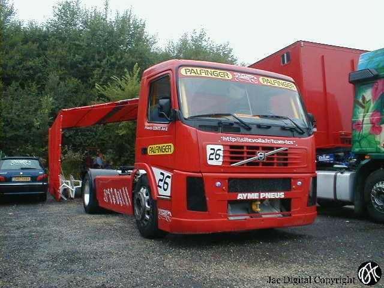
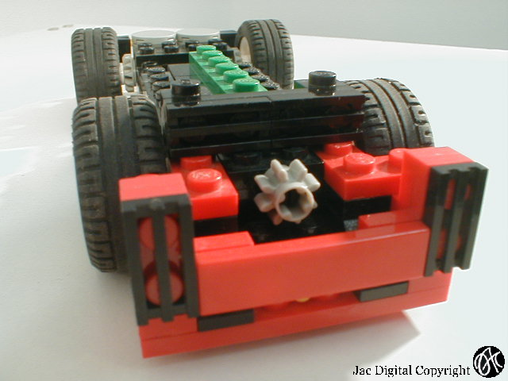
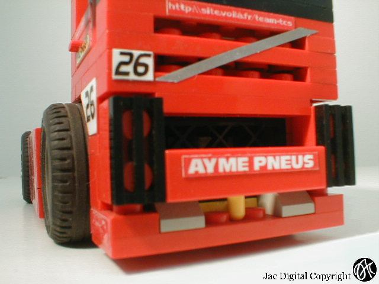
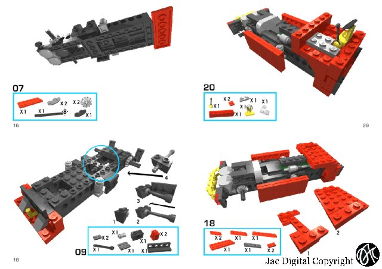
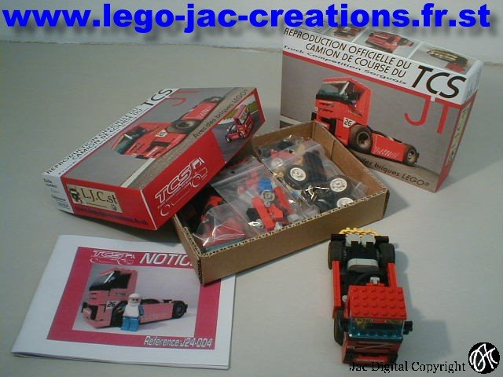
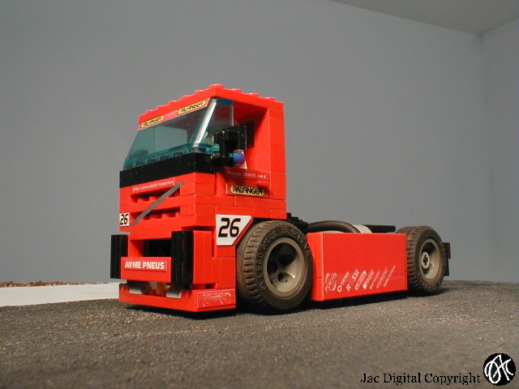
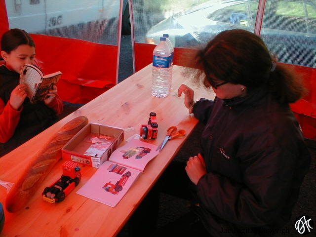
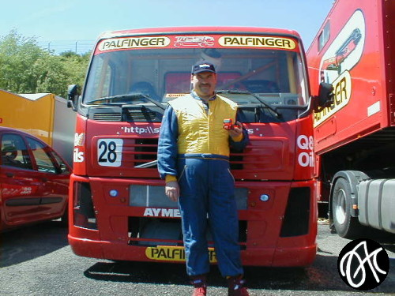
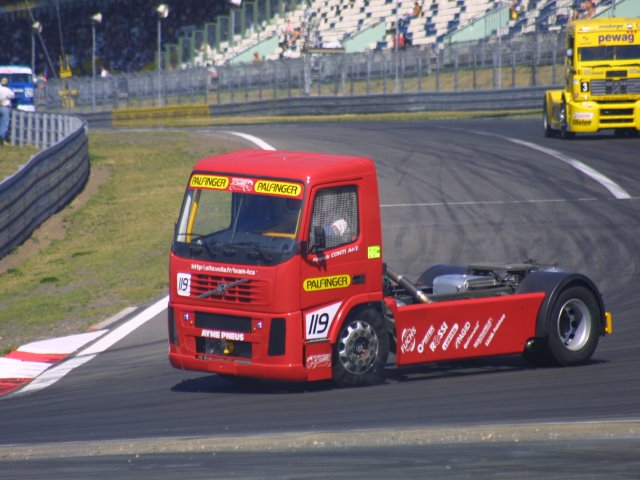
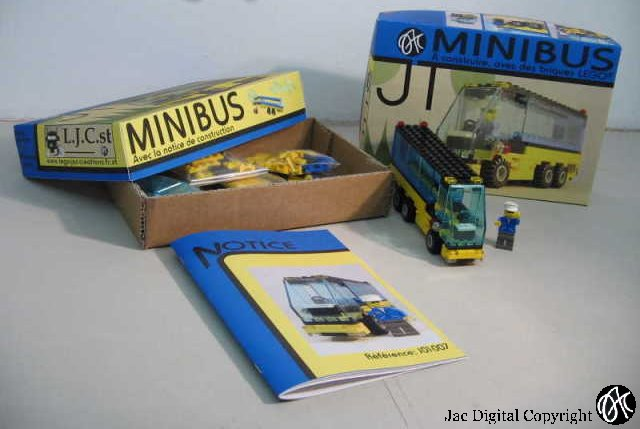

Comment grâce au team TCS (Truck Compétition Sorguais), j’ai pu créer une boite de LEGO. Mais commençons par le début de l’histoire.

Depuis très longtemps, j’avais un rêve fou, créer une boîte LEGO de A à Z, avec un design personnel, une notice complète et surtout une création de ma conception. Ah ça oui d’accord, mais quel modèle et par quoi est-ce que je commence ? Du coup le projet dormait paisiblement dans ma tête.

Jusqu’à ce jour de Septembre 2003, ou je décide d’aller voir une course de camions au circuit de Charade en Auvergne. J’ai suivi les débuts où les pilotes étaient routiers la semaine et prenaient leur camion pour les faire tourner sur un circuit le week-end. Mais, depuis, les règles ont bien changé et aujourd’hui, ce sont de vrais bolides qui foncent sur les circuit européens, avec des contraintes de courses dont une vitesse maximale de 160 km/h. Cette vitesse doit être impressionnante dans une cabine d’un "truck" de 5,5 tonnes poussé par un moteur dépassant parfois les 1000 ch. Certains côtoient même des Porsche à l’accélération !

Donc, malgré la pluie battante, je me suis baladé dans le paddock, l’accès étant libre aux visiteurs. J’ai pris pas mal de photos de tous ces camions si extraordinaires et si uniques. De retour chez moi je regarde les clichés que j’ai pris et je constate que je peux lire une adresse internet sur un beau Volvo aux couleurs rouge vifs. J’écris un petit mail de sympathie et sans aucune arrière-pensée, je présente mon diorama de courses de camions que j’exposai à l’époque. Vous pouvez voir les photos que j’ai pris lors de [l’exposition à Nohanent en 2007](http://photos.freelug.org/main.php/v/JAC/Exposition/Expositions2007/Nohanent-2007/).

C’est alors que je reçois une réponse des plus inattendues. La personne, très intéressée me demande de construire leur camion en briques LEGO. Il se trouve que c’est le préparateur en électricité du camion qui me répond en personne. J’envoie plusieurs mail pour être bien sur d’avoir bien compris, mais c’est bien cela. J’explique alors que je suis partant pour tout construire et livrer le camion en boite avec une notice papier.

Première étape, construction et mise au point du camion, non, faut pas s’emporter non plus... Mais en revanche, nous avons échangé encore quelques mails pour finaliser la construction et coller au mieux au vrai camion de course. J’ai même pu faire un déplacement au garage Volvo de Sorgue pour une visite de l’atelier.

Pour donner encore plus de caractère à ce Volvo de course, je suis allé chercher les autocollants chez l’imprimeur qui édite ceux pour le vrai camion. On a fait la réduction du fichiers en direct. Bon, ils font un peu épais sur les briques LEGO, mais ça fait bien !!

Une foi le camion terminé, je passe à la mise en notice. Certains font l’inverse, mais je préfère tester les constructions avec mes briques. Je travaille avec MLCad pour la modélisation, puis je transforme le fichier avec L3PAddon et enfin, je sort une belle image virtuelle avec Pov-Ray. Il suffit de placer l’image correctement pour bien montrer les pièces que l’on rajoute. Mais le plus compliqué à faire c’est de préparer les fichiers pour l’imprimerie. Pourtant j’ai pris énormément de plaisir à créer le livret de la notice, à faire correspondre les pages et à faire en sorte que tout se suive correctement. Surtout que j’ai imprimé les feuilles en A5 pour une notice en A3 ! Grâce à l’imprimeur que j’avais trouvé, j’ai pu avoir une belle couverture en papier glacé. J’ai appris à ce moment là qu’il fallait une bonne résolution des fichiers image pour avoir un bon rendu sur papier. Pour cette notice c’était trop tard, les images ne sont pas vraiment belles.

Ensuite, je passe à la création de la boîte. Je la voulais type maquette avec des inscriptions sur le côté, des photos de détails du modèle, une photo du vrai, un design du dessus qui me serve de marque et même une référence. J’ai pris aussi beaucoup de plaisir à cette création. Le rendu était vraiment satisfaisant. Heureusement, je n’ai pas fait comme pour la notice et les images à imprimer ont une résolution suffisante. Les boites, je sais faire, il suffit de prévoir des rabats sur les bords pour les coller entre eux. La boite est constituée d’un fond en carton de base et d’un couvercle. J’ai aussi fait des recherches à ce sujet pour au final faire le travail moi-même. La série étant vraiment très réduite.

Pour bien présenter le camion fini, j’ai construit un morceau de piste avec une représentation d’un virage. Aujourd’hui je peux le faire en brique mais ce n’était pas le cas à l’époque...

L’année suivante, je me suis présenté au circuit de Charade avec deux boites à monter. Un membre du team s’est mis de suite à la construction et le pilote [Franck Conti](http://s300232766.onlinehome.fr/franck_conti.html) pose fièrement avec "mon" camion en LEGO. Aujourd’hui il trône encore sur le site officiel du [team TCS](http://s300232766.onlinehome.fr/maquettes.html), dans la partie maquette.

Mais voilà, tout cela je l’ai fait avant la création du site [Bricklink](http://www.bricklink.com/) et de la mise en place de la vente de pièce par [pick-a-brick](http://shop.lego.com/fr-FR/Pick-A-Brick-ParTheme) sur le [shop Lego](http://shop.lego.com/fr-FR/) ou dans les parc d’attraction. Du coup, pour avoir les pièces neuves, j’ai acheté des boîtes et j’ai commandé des sachets de pièces au détail, vendus à ce moment là. Ce qui au final s’en ressentait énormément sur le prix total de la boîte, surtout avec 40 Euros de frais d’imprimerie...

Très pris par l’engouement, j’ai fait aussi une boite pour un modèle plus petit, un mini-bus, contenant moins de pièces et d’un budget plus faible. Là, avec l’expérience du camion de course, j’ai sorti une notice très propre. Mais un plantage PC m’a fait perdre tous les fichiers, tous...

Il faut énormément de travail pour avoir ce résultat. C’est un long investissement, juste pour le plaisir quelquefois. Mais c’est surtout à cause du problème de l’approvisionnement en briques que j’ai abandonné ces projets pour passer à la vente de CD de notice uniquement.

Aujourd’hui, au vu du système des échanges de briques existant et des vendeurs que je connais, le projet me tente vraiment à nouveau. Mais reprendre celui là et réactualiser le camion, ou créer un nouveau modèle ? Là est la question...

## Liens

Attention, le site "Lego-JAC-créations n’existe plus. Ma [galerie de créations](http://photos.freelug.org/main.php/v/JAC/) est maintenant sur le site FreeLUG.

[Le team TCS](http://s300232766.onlinehome.fr/index.html)

[Le camion de course en LEGO](http://photos.freelug.org/main.php/v/JAC/Notices/TCS/)

Plus de photos sur les courses de camions et tout les résultats :  
[Les camions.com](http://www.lescamions.com/)
