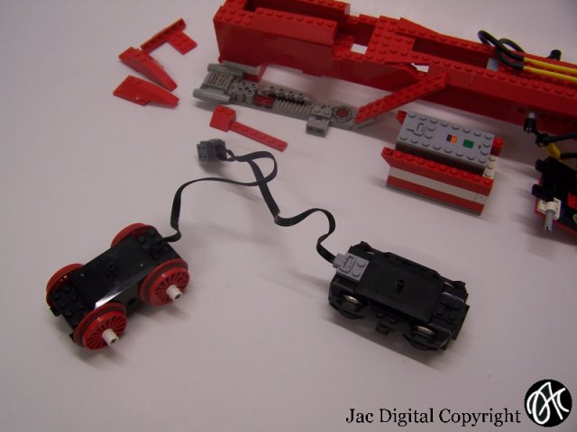
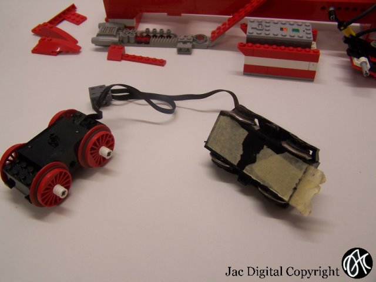
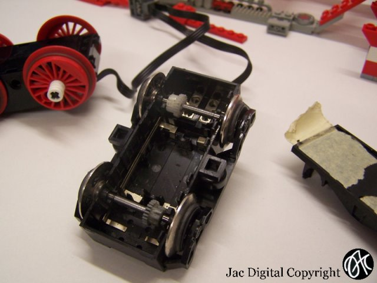
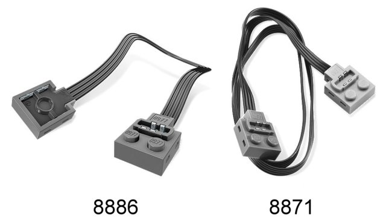

Voici une des solutions possibles pour continuer à faire rouler nos trains sur des réseaux 9V, tout en passant aux moteurs PFS.

Pour changer, je ne vais pas exposer ici le moyen de faire fonctionner un train de cette manière. Mais je vais vous présenter cet article sous la forme d’un interview, grâce à la participation de Yann qui s’est trouvé une passion pour tout ce qui peut rouler sur les rails depuis peu. Du coup, lui vient la question de savoir quel système choisir...

**–** Cher tonton Jac63, je t’écris ces quelques mots afin de profiter de ton expérience sur les trains et notamment sur les [prototypes](https://www.freelug.org/spip.php?article1232) pour la [LGV](/articles/1220/).

-   Bon finalement, je vais laisser tonton parce que c’est rigolo. Par contre, je vais écrire la solution pour l’alimentation, mais rien ne filtrera sur les protos, non mais !

**–** Les moteurs PFS (Power Function System) étant plus abordables et plus faciles à trouver que les bons vieux moteurs 9V, je souhaite utiliser ce type de moteur.

J’ai cru comprendre que les moteurs PFS étaient également plus performants.

-   Ah oui, ça c’est clair. Ils sont plus performants que les moteurs RC, qui représentent la première génération de train à commande à infra rouge dans la gamme LEGO. J’ai fait le test moi-même. Mais je n’ai pas fait d’essais entre les moteurs 9V et les moteurs PFS.

**–** Mais par contre je ne veux pas m’embarrasser ni du récepteur, ni de la batterie box.

-   C’est sûr, ça prend pas mal de place...

**–** Comment puis-je faire ?

-   Bien, il faut tout enlever... Nan je rigole, c’est un peu plus compliqué.

**–** J’ai cru comprendre que je pouvais me servir d’un moteur 9V hors d’usage, ce dernier servant au captage du courant des rails pour le transférer dans le moteur PFS.  
**–** Quelle est la manipulation à effectuer sur le moteur 9V ? Si j’utilise un moteur 9V en état de marche, cette manipulation est elle réversible ?  
**–** Quelle référence de câble faut il utiliser pour relier la coque du moteur 9V avec le moteur PFS ?  
**–** Quelle manipulation faut il faire sur le moteur PFS afin de pouvoir injecter plus de 9V de courant et ainsi voir mon proto ridiculiser le tien ?

-   Oulà, oulà, doucement... Donc comme tu le dis, il s’agit bien de prendre le courant sur des rails LEGO d’ancienne génération. C’est à dire ceux munis de la partie métallique qui transporte le courant, du 9V partout sur le réseau. On alimentera du coup le moteur PFS qui fonctionne aussi en 9V, ou plus !

-   Il faut d’abord trouver un moteur 9V qui ne fonctionne plus. J’en ai "crashé" au début de nos "runs" sur la LGV. Mais on peut les trouver sur le net pour une somme modique, par rapport à ceux qui fonctionnent, bien sûr. On peut aussi faire cette manipulation sur un moteur qui fonctionne car la manipulation est réversible. On ne va rien casser dans l’opération.

-   Quand vous avez le moteur, ouvrez le. Il n’y a pas de vis à défaire, car le couvercle est seulement emboité. Par contre, il faut un bon tournevis car il est bien maintenu.

Ensuite, vous enlevez le moteur, c’est le gros truc rond qui est dedans ! On n’en a pas besoin car il nous faut juste le lien électrique entre les roues et la prise de courant qui se trouve au dessus du boggie. Ensuite, il faut remettre en place le couvercle en s’assurant que rien ne bouge dedans et surtout faire en sorte que le dit couvercle tienne bien. Voilà, vous avez entre les mains un simple boggie LEGO tout léger...

**Moteur 9V avec la connexion PFS**

**Rajout de scotch pour maintenir le couvercle.....**

**On voie l’emplacement du moteur.**

-   Habillez-le des pièces que vous voulez, cela n’a aucune importance. Le principal est de faire attention de bien laisser libre la partie à connecter. C’est seulement sur un côté du boggie. Il existe des câbles qui permettent de relier les connecteurs 9V aux connecteurs PFS. Ensuite, il suffit de relier le moteur PFS à votre tout nouveau boggie. Une fois sur les rails, vous aurez un train alimenté par les rails en 9V presque normal...

-   Il faut aussi démonter le moteur PFS, enfin, cela c’est si vous souhaitez faire des "runs" sur la LGV. Car les ensembles motorisés LEGO sont protégés contre la chaleur. Ils se coupent automatiquement si la température monte trop dans le boitier. Par contre, là, pour le démonter il vous faudra vous munir d’un tournevis à micro vis. Mais nous pouvons le faire sur place, avant votre "run"...

-   A l’abandon du moteur 9V on trouvait dans la gamme LEGO un câble qui permettait de relier un élément en 9v et un élément en PFS. Aujourd’hui (à la date de parution de l’article...) il n’est plus en vente sur le [S@H](http://shop.lego.com/fr-FR/) mais on peut toujours raccorder ces deux éléments avec les câbles prolongateurs référence 8871 et 8886 .

-   Pour le système d’alimentation, ce n’est pas de mon ressort. On reste maître de la tension envoyée dans son train avec un potentiomètre. Mais le maximum autorisé est donné par le technicien qui s’occupe de l’alimentation. Après c’est à nous d’accepter de faire des runs à plus de 40V !!!

-   Bien sur il reste à vous munir d’un moteur PFS !
