[Creating trees and foliage](http://www.classic-castle.com/howto/articles/Foliage.html) by Anthony Sava, 20 IX 2003 traduit en français par L.Leger pour Freelug.

Tout le monde est familier avec l’assortiment de feuillage fourni par la compagnie LEGO, donc cet article ne parlera pas de ceux la. Mais il vous présentera les techniques manuelles pour réaliser de beaux feuillages.

## Petites plantes et feuilles mortes

Je vais commencer par les choses qui sont le plus recherchées - les petites verdures. Si vous avez déjà marché dans la forêt, Vous savez que vous ne marchez jamais sur du sol brut. Le sol est couvert de petites plantes, d’herbes et de feuilles mortes.  
Les petites plantes sont le type de feuillage le plus facile à réaliser, car elles utilisent les plus petites briques. Des petites plantes peuvent être une simple combinaison d’une petite tige et de feuilles, comme le montrent ces deux exemples de la galerie de James Grigg :

[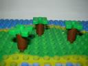](http://www.brickshelf.com/cgi-bin/gallery.cgi?i=457544)  
[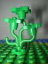](http://www.brickshelf.com/cgi-bin/gallery.cgi?i=457539)

D’autres petites plantes peuvent être très amusantes à faire. De la vigne grimpante peut être réalisées en utilisant les feuilles LEGO© attachées à un mur et entres elles. Voici un exemple de Travis Kunce :

[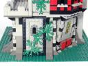](http://www.brickshelf.com/cgi-bin/gallery.cgi?i=497106)

Les différentes vignes peuvent être réalisées en utilisant les même feuillages LEGO© et en les attachant à des lances elles même attachées à des briques rondes 1x1. La poignée perpendiculaire est un bon point d’attache pour les feuilles, et les studs ronds 1x1 font d’excellents fruits. Je peux vous suggérer d’utiliser des rangées de briques marron, pour représenter le cep de la vigne. Voici un exemple de la galerie de Fiona Dickinson :

[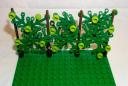](http://www.brickshelf.com/cgi-bin/gallery.cgi?i=413816)

Les herbes sont aussi facile à faire. Les plaques vertes conviennent bien à l’herbe courte. Les herbes plus grande peuvent être faites en utilisant les fleurs LEGO© en enlevant les pétales. Les très grandes herbes, comme les champs de blé, peuvent être des antennes retournées dans des briques rondes 1x1, comme cet exemple de Johannes Koehler :

[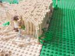](http://www.brickshelf.com/cgi-bin/gallery.cgi?i=499006)

Les feuilles mortes sont plus dures à faire. Au printemps ou en été, Les forêts n’ont plus beaucoup de feuilles mortes, mais le sol est vert ou marron. Cela peut être matérialisé par des plaques de la couleur appropriée, ou en utilisant les feuilles LEGO© attachées directement sur la plaque de base. En automne, quand les couleurs des feuilles sont différentes, les plaques sont surement les meilleures options.

## Petits Arbres

Tous les arbres officiels LEGO peuvent aller dans cette catégorie. Ces arbres peuvent être à feuilles caduques ou des conifères, je vous suggère de les utiliser si vous voulez des conifères de cette taille.

Comme les arbres "MOC", ils peuvent être réalisés de nombreuses façons. En voici une de Yu-chen Shih :

[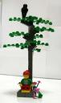](http://www.brickshelf.com/cgi-bin/gallery.cgi?i=456521)

Les arbres fruitiers sont faciles à faire, on revient aux mêmes briques que pour faire les vignes. Prenez des feuilles  
LEGO et attachez les à une lance LEGO, en utilisant une brique 1x1 ronde pour fixer la lance. Après avoir empilé les feuilles en épaisseur souhaitée, mettez des studs colorés rond pour les fruits. Faites toutes les sortes de fruits que vous voulez, amusez vous, comme ceux ci de la galerie de Fiona Dickinson :

[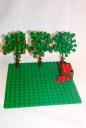](http://www.brickshelf.com/cgi-bin/gallery.cgi?i=413798)

Vous pouvez vous passer des briques rondes 1x1 si vous voulez juste un petit arbre.

Voici un autre exemple de petit arbre. Ces bouleaux d’Anthony Sava montrent comment des briques de base peuvent être utilisées pour simuler le feuillage. Ces arbres sont ici dans leurs couleurs d’automne mais des briques vertes conviennent aussi. Les troncs sont construits en empilant des briques 1x1x1/3 et 1x1 noires et blanches. Pour les gens qui ne peuvent ou ne veulent pas faire de bouleau, des briques marron 1x1 peuvent convenir pour le tronc.

[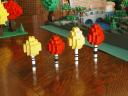](http://www.brickshelf.com/cgi-bin/gallery.cgi?i=520489)

Des petits conifères peuvent être crées en empilant des feuilles LEGO© les unes sur les autres. Voici un exemple de Fiona Dickinson :

[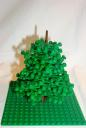](http://www.brickshelf.com/cgi-bin/gallery.cgi?i=413792)  

Et un de Reinhard Ben Beneke :

[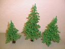](http://www.brickshelf.com/cgi-bin/gallery.cgi?i=122262)

Ou en utilisant des "slopes", comme ce grand arbre de Ondrew Hartigan :

[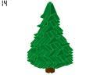](http://www.brickshelf.com/cgi-bin/gallery.cgi?f=30525)

Un autre petit arbre peut être fait en mélangeant les troncs des palmier LEGO et les feuilles LEGO comme dans le set "King’s Mountain Fortress".

## Grands Arbres

Il y a généralement 4 sortes de constructeurs lorsqu’ils s’agit de faire des grands arbres. Ceux qui utilisent des arbres LEGO, ceux qui utilisent des feuilles LEGO, ceux qui utilisent des briques pour le feuillage, et ceux qui utilisent les deux. Parlons des avantages et des inconvénients des arbres en feuilles LEGO ou en briques.

**Les Arbres avec des feuilles LEGO©**

[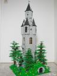](http://www.brickshelf.com/cgi-bin/gallery.cgi?i=443423) La tour de Johannes Koehler dans les bois solitaires.

**Avantages :**  
**–** Plus réaliste,  
**–** Utilise les briques spécialement conçues pour.

**Inconvénients :**  
**–** Les briques sont plus dur a trouver/plus chères,  
**–** Utilise beaucoup de briques,  
**–** Effet d’étagement possible,  
**–** Arbres verts seulement

La plupart des arbres sont faciles a construire. D’abord construisez un tronc et des branches. Puis ajoutez le feuillage LEGO© comme vous le souhaitez. Mais si vous ne faites pas attention, vous pouvez être confronté à un effet d’étagement.

_Qu’est ce que l’effet d’étagement ?_

L’effet d’étagement apparait lorsqu’on utilise qu’une seule couche de feuillage, et les feuilles apparaissent comme des étagères sur l’arbre. Cela ne veux pas dire que les arbres étagés sont forcément disgracieux. Quand cela est bien fait, l’étagement est facile à laisser passer. Voici de bons exemples d’arbres de Heather Patey :

[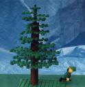](http://www.brickshelf.com/cgi-bin/gallery.cgi?i=9339)

Galerie de Dan Boger :

[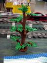](http://www.brickshelf.com/cgi-bin/gallery.cgi?i=15007)

Et un grand bouleau de la galerie de Johannes Koehler :

[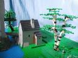](http://www.brickshelf.com/cgi-bin/gallery.cgi?i=147869)

Si vous désirez éviter l’effet d’étagement, empiler vos feuillages marche bien, ou utilisez des feuilles LEGO comme des branches elles-même. Voici quelques exemples d’arbres qui utilisent uniquement des feuilles LEGO et des lances pour les stabiliser. Regardez cet exemple de Fiona Dickinson :

[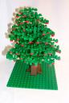](http://www.brickshelf.com/cgi-bin/gallery.cgi?i=413814)  
[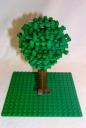](http://www.brickshelf.com/cgi-bin/gallery.cgi?i=413805)

Et de la galerie de John Gerlach :

[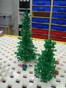](http://www.brickshelf.com/cgi-bin/gallery.cgi?i=35575)

La galerie de Reinhard Ben Beneke nous montre des arbres qui utilisent d’une bonne manière les palmiers LEGO.

[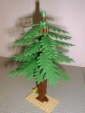](http://www.brickshelf.com/cgi-bin/gallery.cgi?i=122268)

Tous les arbres n’utilisent pas des feuilles LEGO. La meilleure solution pour faire un saule est un grand nombre de fouets verts et autres feuillages. En voici de la galerie de Fiona Dickinson :

[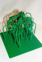](http://www.brickshelf.com/cgi-bin/gallery.cgi?i=406715)

Et celui ci de Johannes Koehler :

[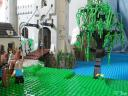](http://www.brickshelf.com/cgi-bin/gallery.cgi?i=147832)

Et voici des exemples de Joseph Williams, il utilise des fusils LEGO© comme branches :

[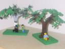](http://www.brickshelf.com/cgi-bin/gallery.cgi?i=170952)

**Les arbres en briques**

[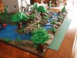](http://www.brickshelf.com/cgi-bin/gallery.cgi?i=501986) Stonebarrow Keep de Anthony Sava

**Avantages** :  
**–** Des briques plus communes,  
**–** Plus de couleurs disponibles

**Inconvénients** :  
**–** Moins réaliste,  
**–** Un design plus difficile

Faire un arbre en brique est très facile à faire en théorie. Créez un tronc en empilant les briques de la couleur que vous souhaitez. La construction d’arbre en brique deviens difficile lorsqu’il s’agit de faire en sorte que les arbres aient un feuillage irrégulier, ce qui le rend plus réaliste. Les arbres ne grandissent pas en parfaites petites balles vous savez. vous pouvez utiliser seulement des briques, ou des briques et des plaquettes mélangées. Mais il est conseillé d’utiliser uniquement des briques. Voici de bons exemples de Shaun Sullivan :

[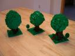](http://www.brickshelf.com/cgi-bin/gallery.cgi?f=39705)

Le plus flagrant avantage à faire des arbres en brique est la possibilité d’utiliser les couleurs d’automne, comme ces exemples d’Anthony Sava :

[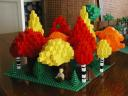](http://www.brickshelf.com/cgi-bin/gallery.cgi?i=519971)  
[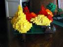](http://www.brickshelf.com/cgi-bin/gallery.cgi?i=520490)

Bien sur, toutes les possibilités ne sont pas décrites ici. Ce qui fait que la construction LEGO© est intéressante est le fait de toujours développer de nouvelles techniques. Chaque technique décrite ici a ses avantages et ses inconvénients. Si vous trouvez de nouvelles techniques, vous pouvez me l’envoyer et j’actualiserais cet article.
