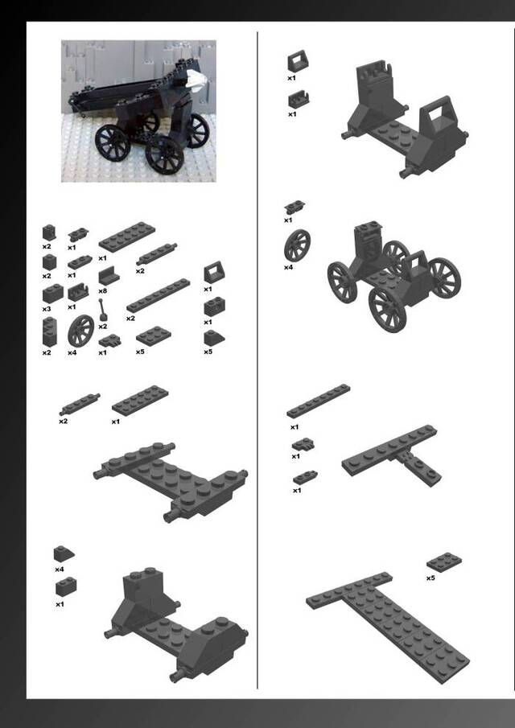
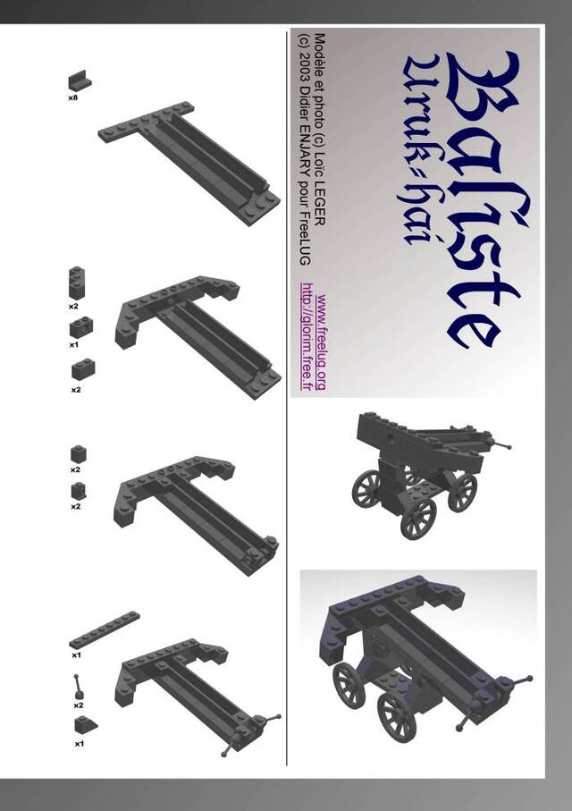

Voici une baliste dont se servent les Uruk hai pour attaquer la forteresse du Gouffre de Helm. Elles tirent de gros grappin qui servent ensuite à monter d’immenses échelles pour assaillir le bastion.

**Baliste-01**

**Baliste-02**

**Baliste-ldr.zip**
