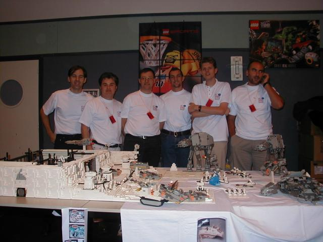
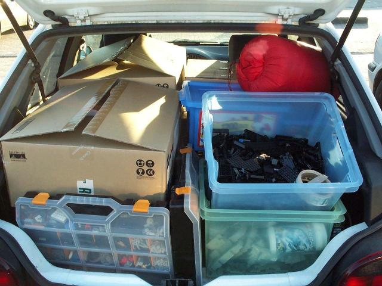
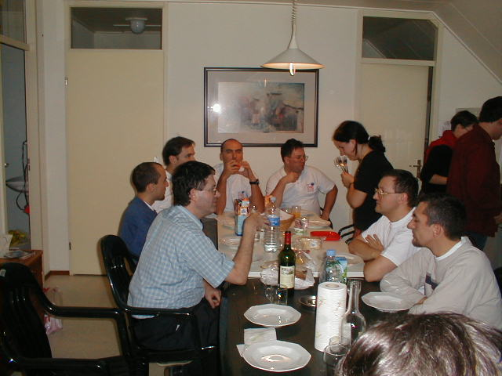
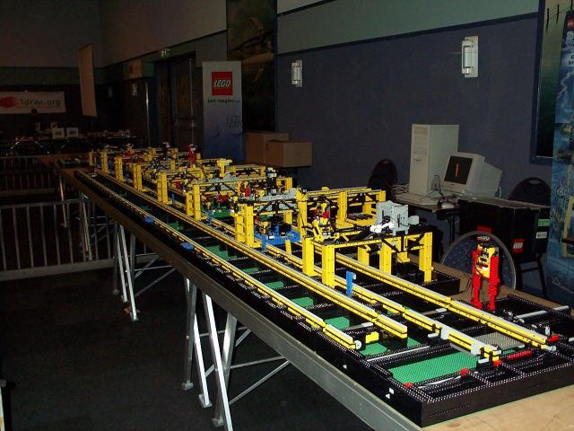
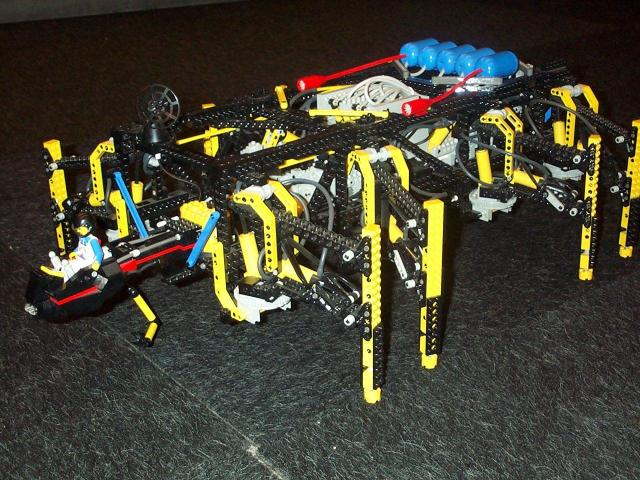
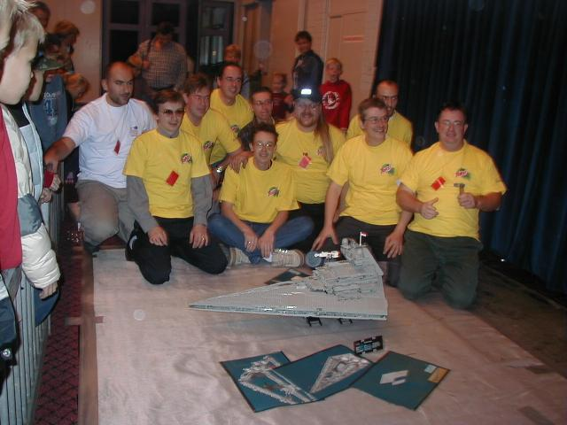
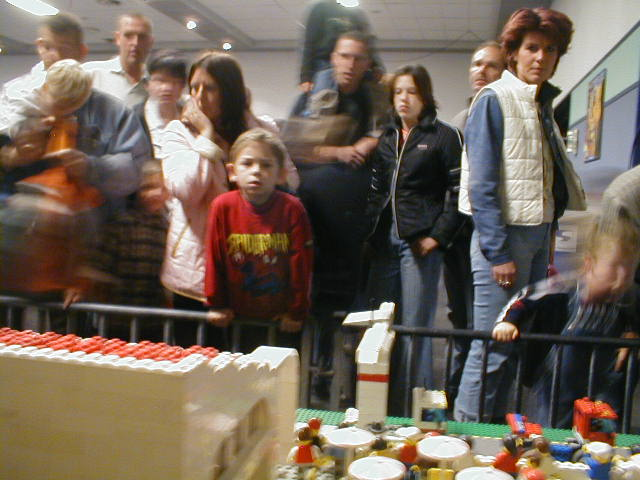
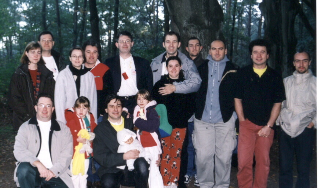
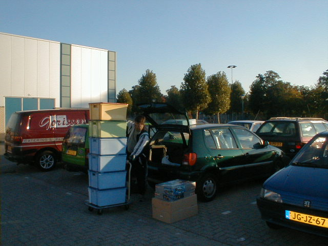
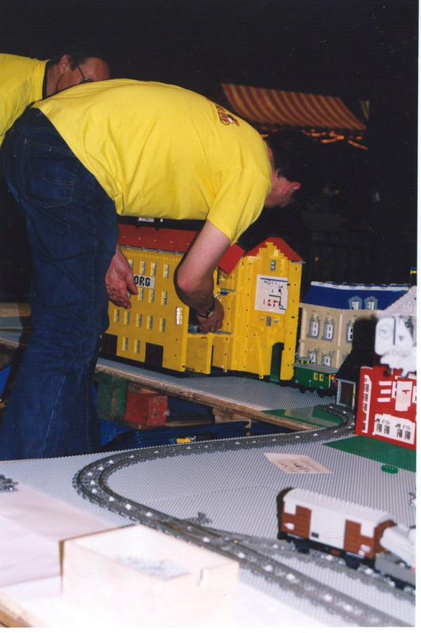

FreeLUG a fait le déplacement au LEGOWORLD 2003. Voici les impressions des courageux à avoir fait le chemin vers ce pays peuplé de gens à vélo :-)

## Impressions Générales

Une bonne dizaine de membres de FreeLUG a fait joyeusement le deplacement en hollande pour exposer le savoir-faire francais.

**FreeLUG au LEGOWorld**

Après le périple de la route (mauvais chemin à la frontière belge pour certains, douane hollandaise faisant du zèle pour d’autre, coffres pleins à craquer, ...), la première impression est : "Wahou c’est grand !". Je pense qu’aucun d’entre nous, ne s’attendait à voir une exposition aussi grande dédiée à notre brique chérie.

**Un coffre bien rempli**

L’acceuil des organisateurs fut parfait. L’hébergement dans des petits chalets nous a permis de nous retrouver le soir autour de grandes tables (les français aiment bien cela, paraît-il :-) ).

**FreeLUG a table :-)**

Ce fut aussi l’occasion pour nombre d’entre nous de se voir pour la première fois.

Nos constructions, parfois preparées à la dernière minute, n’avaient pas à rougir devant les créations exhibées par les membres des autres LUG. Voici, rien que pour vos yeux, l’ensemble des réalisations présentées par FreeLUG :

  
  
  
  
  

## Les impressions Personnelles

**JLB**

Comme tout le monde, je ne m’attendais pas à quelque chose d’aussi grand. Et, je ne m’attendais pas à voir autant de monde non plus (les 3 premiers jours furent un flot continu de jeunes têtes blondes). Je ne m’attendais pas non plus à ce que le public soit aussi jeune. Ce qui fait que certaines "attractions" ne les intéressaient vraiment pas : Par exemple, le concours de Sumo ne les a pas beaucoup passionnés, à l’opposé d’un robot poussant des briques sur le plateau des Sumos. :-))

Je fus aussi tres agréablement étonné par l’accueil des organisateurs et des autres exposants. Ils ont été tous très ouverts et tous très heureux de montrer leurs créations. Un bon exemple là dessus (et qui me touche directement) : un hollandais qui avait eu la même idée de faire un diorama de la bataille de Hoth, nous a proposé de réaliser un projet commun pour le prochain LEGOWORLD. Nous n’avons pas pu refuser (évidemment :-)). Notre présence l’année prochaine est donc obligatoire :-))

Un dernier petit mot sur les modèles qui m’ont le plus impressionné :

**–** **L’usine de fabrication de voiture** : cette chaine de montage assemble **VRAIMENT** une voiture en briques LEGO. Tout n’est pas encore au point, mais ce qui est fait est deja impressionnant.

**Une usine de montage de voiture.**

  
**–** un **robot octopode** : il est tout simplement magnifique (d’un point de vue technic). Il est de plus animé uniquement par un automate et non pas un une brique programmable RCX. Ceci rajoute encore au merite du constructeur.

**Un octopode**

Octopode se deplacant dans tous les sens et uniquement anime par un automate.

**Dicky**

Le LEGOWORLD, c’est immense et c’est vrai que c’est plein de briques LEGO®. Ce qui m’a fait le plus plaisir c’est de rencontrer des personnes d’autres LUG comme Ludo et Vincent de BeLug, Martijn de De Bouwsteen, Mario de ItLug...Ce qui était bien aussi, c’était le logement sur place : des bungalows pour 6/8 qui nous ont permis de passer d’agréables moments, tous ensembles. Enfin c’est vrai que je reviens avec pleins d’idées et de projets après avoir vu tous ces MOC et après toutes les discussions que j’ai pu avoir avec les AFOLs. Donc c’est décidé, j’y retournerais l’année prochaine :-).

**Gmi\_Gilles**

Plein les yeux et plein la tête, un grand week-end qui restera longtemps dans ma mémoire. Quel plaisir de se retrouver ensemble (FreeLUG et autres LUG) et de voir tous ces LEGO® et MOC.  
Mes doigts s’en souviendront aussi longtemps, car ils ont souffert à chercher des briques dans les bacs de vrac et à démonter ce que les enfants avaient construit dans la journée.  
Mes filles ont aussi apprécié le voyage, car elles ont pu faire énormément d’activités et récupérer des gadgets publicitaires (il faut que j’en garde un peu pour moi).  
Expérience à renouveler l’année prochaine, si cela est possible.

**brickerik**

Ma première chose dite en arrivant sur place : "Il y a des briques LEGO® partout !!!" Je sautillais dans tous les sens :-) Il faut dire qu’après un périple de 8 heures assis devant le volant, voir toutes ses briques multicolores était enthousiasment ! Après un rapide tour des halls pour voir ce qu’il y avait et pour trouver notre stand, on s’est lançé dans l’installation (jusqu’à 22h...). Et dès vendredi, que du monde ! Heureusement, en tant qu’exposant, on avait accès aux MOCs et avant l’ouverture :-)

Les moments forts :  
**–** le record du monde pour la construction de l’ISD :-) 1 heure 13 minutes et 35 secondes de construction intensive

**L’equipe des winners :-)**

**–** la rencontre d’AFOLs venus du monde entier dont les noms sont célèbres  
**–** la rencontre avec un frenchie venu tout droit de Paris pour nous voir !!  
**–** l’ouverture de l’Intertoys  
**–** les longues veillées le soir transformées en sorting-parties :-)

Ce qui est à retenir :  
**–** c’est fatiguant :-)  
**–** ça fait mal aux doigts de fouiller dans des caisses de briques et de démonter des plaques 48x48 recouvertes de briques  
**–** que du bonheur pendant ces jours (pour nos yeux et voir ceux des enfants et des parents - émmerveillés devant les MOCs)  
**–** être mieux organisés pour faire encore mieux (je pense que nous avons appris beaucoup de choses)

**Harald**

Notre première visite était un succes, je pense. Nous sommes venus nombreux, avec des créations très intéressantes, aussi bien pour les AFOLs que pour les enfants. Et voir les enfants, c’était ce qu’il y avait de mieux, car ils étaient hyper-enthousiastes. Dès mon arrivée, j’ai eu quelques doutes à propos de notre emplacement (petit hall, dificile à voir de l’exterieure), mais tiens, quel choc quand les enfants sont entrés le vendredi à 10:00 et qu’ils ont commencé à regarder avec des grands yeux tout ce qu’on avait créé : notre stand était la première chose qu’ils voyaient, car on était à côté de l’entrée. L’emplacement était bien choisi, alors :-D

Les créations des autres étaient incroyables. Des projets monstreux, des boîtes exclusives que j’avais jamais vues en vrai, J’ai obtenu au moins 2 000 idées pour des projets à venir. Le système pneumatique pour ouvrir et fermer les portes d’un ferry-boat par example, ou des limousines réalisées par les Italiens et les créations SPACE...

Le plus impressionant pour moi était la voiture sci-fi par un anglais, qui habite en Rotterdam. Il a construit un véhicule avec au moins une dizaine de mini-véhicules dedans. J’ai filmé ce processus, je vous le montrerai plus tard.  
Il y avait aussi les créations par notre ami allemand, qui étaient nickel et également les créations des Italiens. Les détails dans leurs ville étaient époustouflants.

La seule chose que j’ai trouvé dommage c’est qu’apparement beaucoup des AFOLs ne sont pas venus chez nous, car ils pensaient qu’on avait uniquement des trucs Mindstorms et donc tout le monde n’a pas vu notre boulot et nos belles constructions.

J’espère que pour l’année prochaine nous pourrons à nouveau y retourner, avec un équipe aussi bien motivée et que nous sauront faire mieux que les autres. Peut-être, que nous pourrons même essayer d’emporter avec nous des créations des autres gens, qui n’ont pas le temps de venir (je pense que c’est ce que les Italiens font). Avec plus que 60 membres dans le club je sais qu’on peut faire l’imaginable dans ce cas ! :-D

**Jac**

C’est en voyant écrit Zwolle sur les panneaux que mon énergie est revenue. Heureusement, le convoi a maintenu la vitesse pour m’éviter l’excès. Ensuite, l’entrée dans la grande halle a été hyper excitant, voir toutes ces briques, étalées sur de grandes tables, toutes ces vitrines, jusqu’à ce qu’on trouve nos emplacements, pour nos MOCs.

C’était fantastique, car, en tant qu’exposant, le contact n’a pas été le même avec les autres club, on a pu discuter, prendre des photos, échanger des idées, au risque de se faire "killer", hein JLB. La différence de langue, n’a posé aucun problème, car, il n’y a pas besoin de parler, pour voir que les gamins et les grandes personnes sont en admiration devant toutes nos créations. Il faut dire qu’il y avait des choses à voir, encore après nos stands, quelques superbes réseaux de trains, une base lunaire géante, des modéles Technic® en marche, une superbe collection de Bionicle®. Et puis, tout ce que j’oublie. Heureusement qu’il y a les photos !!!!!!

Les soirées étaient autant mémorables, autant par les menus proposés par des FreeLUGiens plein d’imagination, que par d’autres échanges d’idées, suite aux nombreuses pièces différentes que l’on pouvait trouver dans le magasin de l’expo. Les bungalows bien chauffés, on se rendait pas compte de la température extérieure. Une bonne nuit de sommeil, pour affronter un nouvelle vague de visiteurs voulant poser plein de questions, en hollandais, dur, dur, mais, toujours avec le sourire.

Contrairement à ce que j’ai dit, je referais bien l’expo, l’année prochaine, si c’est possible. J’espère avec d’autres modèles...........

**Quelques spectateurs**

**Marc**

LEGOWORLD, ... c’est fut pour moi un grand moment de joie , d’émerveillement.  
Joie et émerveillement, de rencontrer en "réel" les autres Fadas de le brique, de voir des briques dans tous leurs états (MOC, trains,villes...), de rajeunir de 30 ans au pick-a-brick (le bruit des briques en fouillant dans les cartons, c’est une vrai drogue !! mais qu’elle est bonne et sans danger pour la santé !!).  
40 000 visiteurs çà use... je ne m’attendais pas à un tel raz de marée de gens et de questions...in english please...  
Les journées étaient fatiguantes, mais quel plaisir de ce retrouver tous les soirs au bungalow....  
Je suis rentré avec des idées plein la tête et l’année prochaine c’est sûr, j’y retourne refaire mon "pélerinage".

**Didier (qdm)**

Pour sûr je l’ai attendu ce LEGOWORLD. Je me rappelle de la présentation que not’prez Pascal nous avait fait lors de l’Assemblée Générale et d’entrée de jeu avec quelques autres nous nous étions dit, il faut y aller...

Ensuite ça a été les grands échanges de mails avec les organisateurs pour peaufiner notre participation et puis l’arrivée en convoi avec Jérôme, Erik et Jean-Louis et nos premiers regards dans cette immense halle...

Tout le monde a été impressionné par la taille de l’évènement, alors pour le décrire un peu plus en détails, prenez par exemple une salle de concert type Zénith, vous en mettez 3 comme ça cote à cote.  
**–** Dans la première vous laissez la société LEGO faire sa présentation avec ses sculptures, son gros camion jaune et ses animations et attractions en provenance directe des LEGOLAND®.  
**–** Dans la seconde, vous regroupez une soixantaine de fanas de briques venant des quatres coins de la planète !  
**–** Dans la dernière, vous installez une scène de spectacle pour faire défiller les vedettes de la Star’ac locale...

Le décors est donc planté.

A coté vous prenez soin de vos petits exposants que vous logez en pleine forêt, au calme, histoire de les laisser se remettre de leurs journées trépidantes. Et pour moi cet aspect a été un autre grand moment, car il faut dire que les membres de FreeLUG savent vivre et savent recevoir... Je ne sais pas par exemple, si notre ami organisateur hollandais, Paul a réussi à trouver le chemin du dernier bungalow, lors de sa tournée la veille du départ. Faut dire que nous l’avons un peu chargé !

**Le groupe (manque juste Harald)**

J’en profite également pour dire un GRAND MERCI aux épouses et compagnes qui se sont occupé de nous avec abnégation en supportant nos longues heures de tri et nos conversations mono-thématiques. Même que j’ai réussi à faire plonger Marie-Hélène, la femme de Gilles, dans les bacs de briques en vrac pour m’aider à rechercher DES pièces, elle qui généralement est plus occupée à rechercher UNE pièce dans laquelle elle ne trouve pas de briques en vrac.

Je dis également un petit merci à ma petite femme pour m’avoir permis de lui prendre sa petite voiture pendant cette petite semaine...Mais pour l’année prochaine, il faudra que je pense à en changer... de voiture, pas de femme, car là c’était vraiment limite en place !

**La petite voiture de ma petite femme**

Aucun regret concernant cette manifestation qui a en outre connu un autre évènement heureux, puisque c’est au coeur de la fête que l’on m’a confirmé mon nouveau travail. Et s’il est vrai que c’est grâce à cette disponibilité forcée que j’ai pu avoir un peu de temps pour relayer Yann et nos amis hollandais dans la préparation de notre visite, je dois avouer que sur le plan personnel et professionnel, cette occupation a été éminemment bénéfique.

Du coté des réalisations de nos amis, j’ai beaucoup apprécié les nombreux trains originaux réalisés pour l’occasion, le TEE des Allemands, le train chromé des Belges, les réalisations de Steve Barile, l’idée superbe de l’immeuble de rangement, la finesse et le goût du détail de nos amis Italiens, l’excitation de l’autre Didier quand il a vu Kjel Kirk Kristriansen venir nous rendre visite et celle de Pascal quand il a découvert les vitrines historiques de véhicules au 1/87 présentées par la société LEGO.

**L’immeuble de rangement**

Pour l’année prochaine, ce que je retiens c’est qu’une préparation longue et soigneuse est la clé de la réussite d’une belle exposition. Il n’est pas forcément nécessaire de faire des réalisations monumentales pour obtenir du succès, le meilleur exemple en est la tour Smart de Didier. Le choix des sujets, leur originalité et le soin des détails constituent vraiment ce qui attire le regard des spectateurs.

Les points à améliorer... voyons voir... ah, si la Tour Eiffel des Belges, qui n’est vraiment pas à l’échelle et pas de la bonne couleur et puis la motorisation et la sonorisation de mon Sumo :-) !

**Yann**

Qu’ajouter de plus à la myriade de compliments sur l’organisation, à la débauche de briques, à la taille de l’évenement ?  
Tout d’abord, j’ai passé un excellent week-end avec mes camarades de l’association. Rien que ça valait les quelques heures de voyage.  
J’ai adoré rencontrer les hollandais, les italiens, les belges, les quelques américains et tous les autres ! Que d’imagination, que de créativité, que de fraicheur !  
On va arrêter le baume (sincère) passée sur le dos de tous ces passionnées, et passer aux choses serieuses.  
Je retiendrais de ces deux jours sur place l’acceuil des responsables de l’organisation, qui malgé la pression sont restés ouverts et souriants.  
Que dire des créations vues ? Les italiens ont frappé un grand coup, leur ville était magnifique de détails, de ces petites choses qui rendent un diorama LEGO® si vivant. Les allemands ont eu des idées originales sur leur set de train. Et les deux avions, ah le Dac et la Julie, superbes !  
Les belges avec leur Tour Eiffel (Ok Didier, pas à l’échelle, mais pfff, pas mal du tout !!!!).  
Hallucinant ce que peuvent faire des passionnés de leurs 2 mains et de leur temps libre (et de beaucoup de briques) !  
N’oublions pas de parler de cette extraordinaire ligne de construction de voiture et de ce stade de folie (pour acceuillir 7000 minifigs).  
Ca donne envie de revenir tous les ans !! D’ailleurs, rendez-vous est pris comme le dit Jean Louis, une base Hoth Franco-hollandaise !

Bien sur je ne pourrais pas finir sans faire un gros bisous de remerciement à ma chérie qui m’a suivi dans ce périple fatiguant !

## Liens

**–** [Les photos de Jac](http://www.brickshelf.com/cgi-bin/gallery.cgi?f=61247)  
**–** [Les photos de JLB](http://www.brickshelf.com/cgi-bin/gallery.cgi?f=60682)  
**–** [Les photos de YL32](http://www.brickshelf.com/cgi-bin/gallery.cgi?f=60468)  
**–** [Les photos de Dicky](http://www.brickshelf.com/cgi-bin/gallery.cgi?f=60719)  
**–** [Les photos de qdm](http://perso.wanadoo.fr/qdm-clindoeil/Legoworld.html)
