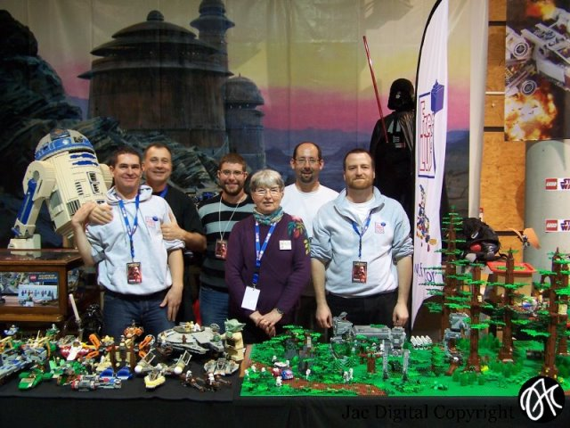
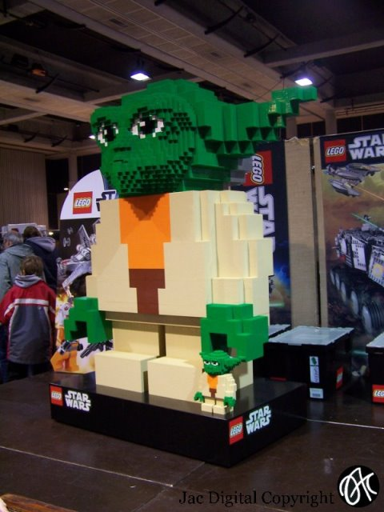
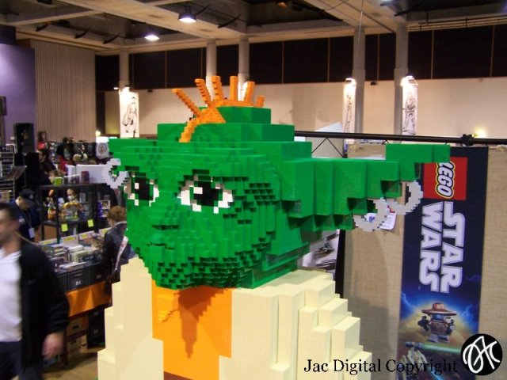
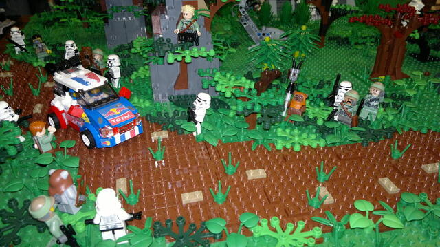
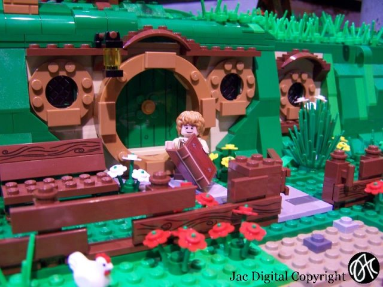
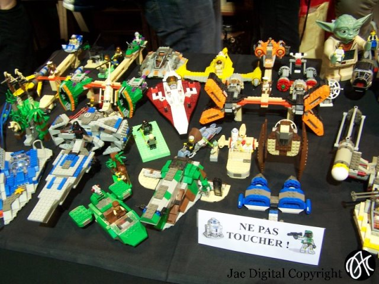
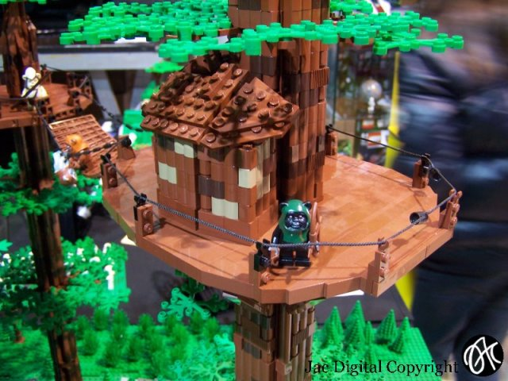

15 ans d’exposition sur la Science Fictions et 30 ans pour le retour du Jedi, il ne fallait pas rater ça !

Pour arranger nos exposants qui arrivent de loin et pour être plus tôt sur place le samedi, nous accueillons chez nous 4 personnes dès le vendredi soir. Ce qui donne l’occasion de partager déjà un bon repas fait de minicrêpes et de rires.

Nous pourrons donc être à la salle vers 10h, ce qui nous donne encore 3h de préparations. Ce qui n’est pas un mal car nous devons tout installer. Seuls les arbres ont été construits chez nous, tout l’aménagement du diorama de la lune d’Endor sera installé sur place. Cette manière de construire nous permet d’improviser de très belles scènes tout en renouvelant nos constructions.

Nous avons cette année un stand beaucoup plus grand que les fois précédentes. Il y a les habituelles sculptures prêtées par LEGO France, avec cette année un R2D2 et un mini Dark Vador puis des tables pour les exposants avec une représentation de la gamme LEGO SW sortie en 1999, puis la lune d’Endor qui est un diorama commun et quelques scènes de film connues.

Mais ce qui nous attendait sur le stand, c’est aussi une grande estrade, juste en face de nos tables qui allait permettre aux enfants de tout âge de construire un Yoda géant, de plus de 24 000 briques. Ce fut une vraie attraction supplémentaire, occupant les adultes et les enfants. Nous avons été mis à contribution pour aider à ce montage hors norme, mais il n’y a pas eu besoin de gros moyens pour nous convaincre ! Le Yoda a été monté deux fois, une fois le samedi et une fois le dimanche. Certains enfants participaient même aux deux, montage et démontage. Ce fut un réel succès, en plus de nos constructions. Le Yoda, une fois assemblé s’est vu affublé de sourcils et cigare pour la première fois, puis de boucles d’oreilles et d’une crête pour la deuxième...

Encore un bon moment de passé pour cette convention, entre les exposants toujours aussi joyeux et tous les visiteurs, Yannick, Jean-Alain et tous ceux que j’oublie.

_Jérôme / JAC_

* * *

Une des seules expositions pas trop loin de chez moi, c’est ma deuxième participation mais pas la dernière. Excellente ambiance sur le stand, rencontre avec des passionnés et des nouvelles tête pour moi. Que du bonheur. Le Yoda géant était un plus indéniable au niveau animation, c’est certain. Mais bon, je suis fan de Star Wars donc plaisir doublé.

_Rémi_

* * *

Toujours aussi funky de venir exposer à Cusset !

**Ah ! C’est le rallye d’Endor aujourd’hui !**

Nous profitons d’avoir la parole ici, pour remercier JAC et Séverine pour l’accueil chez eux pour le week-end.

Merci aussi à nos camarades du jour pour la bonne ambiance toujours aussi présente, à nos amis FreeLUGiens visiteurs (Xavier est même resté tout le dimanche !), merci à Alain pour les pizzas, et bien-sûr aux organisateurs qui nous accueillent toujours aussi bien !

_Pierre / Tribolego et sa chérie, Emilie_

* * *

Une nouvelle édition se présente, j’en suis forcément. Cette convention est devenu **la** convention Star Wars et SF de France. Nous sommes toujours accueillis dans les meilleures conditions. Un grand stand pour nous cette année. L’organisation a pu avoir de la part de LEGO France le Yoda à construire, ce qui a été un franc succès ! Il a été monté une fois le samedi, démonté et remonté le dimanche...

Pour ce qui est de nos tables à remplir nous avons cette année privilégié Endor et le public a bien apprécié de ce qu’on a pu en voir. Le tout accompagné des modèles de 1999 et quelques vignettes avec Vador.

Pour ce qui est du reste de l’expo, encore beaucoup de chose à voir... Et le vrai Dark Vador était là !

Alors oui, je signe pour la 16e édition !!

_Pierre / Pierrolego_

* * *

J’ai été super contente de participer à ma première exposition, il y avait une telle foule que j’ai un peu tremblé pour nos arbres dans le diorama de la lune d’Endor.

C’était extra de voir tous ces yeux scruter les détails de nos constructions, et d’entendre les réflexions souvent d’envie devant mes vieux modèles SW.

Je me suis éclatée avec ma petite fille Jeanne et d’autres enfants à participer au montage de Yoda.

Pour l’installation du diorama, j’ai pu apprendre des techniques de construction de paysage, d’arbres, d’accessoires, auprès d’AFOLs chevronnés, et admirer la rapidité de conception des deux Pierre et de Laurent, je pourrai mettre à profit cette observation pour reconstruire mon village, entièrement démonté pour lavage.

Merci à Séverine et Jérôme pour l’accueil du samedi soir, et les repas à l’expo. Merci à Xavier pour les avant-premières de son film spatial, et Merci à tous pour la bonne humeur, l’ambiance, les connaissances sur les modèles.

_Danielle / Mamy Danny_

* * *

Deuxième participation à Cusset pour moi. J’aime bien cette exposition car les thèmes représentés ne sont pas ceux que je pratique habituellement (SF). Cette année, nous avons eu l’animation ’construction du Yoda’ avec de jeunes participants très motivés. Sans oublier les statues prêtées par LEGO (Dark Vador et R2-D2 cette année) qui attirent toujours autant... Mais surtout, il y avait notre diorama d’Endor "mémorable" :D, et la collection des premiers modèles Star Wars de Mamy Danny. On fait quoi l’année prochaine ?

_Laurent_

* * *

## Galerie photos

**–** [Galerie de Jac](http://photos.freelug.org/main.php/v/JAC/Exposition/2013/generationSW/)  
**–** [Galerie de Tribolego](http://photos.freelug.org/main.php/v/Pierre_13/Expos/2013/Cusset/)  
**–** [Galerie de Mamy Danny](http://photos.freelug.org/main.php/v/dannylou/expos/cusset+2013/)
