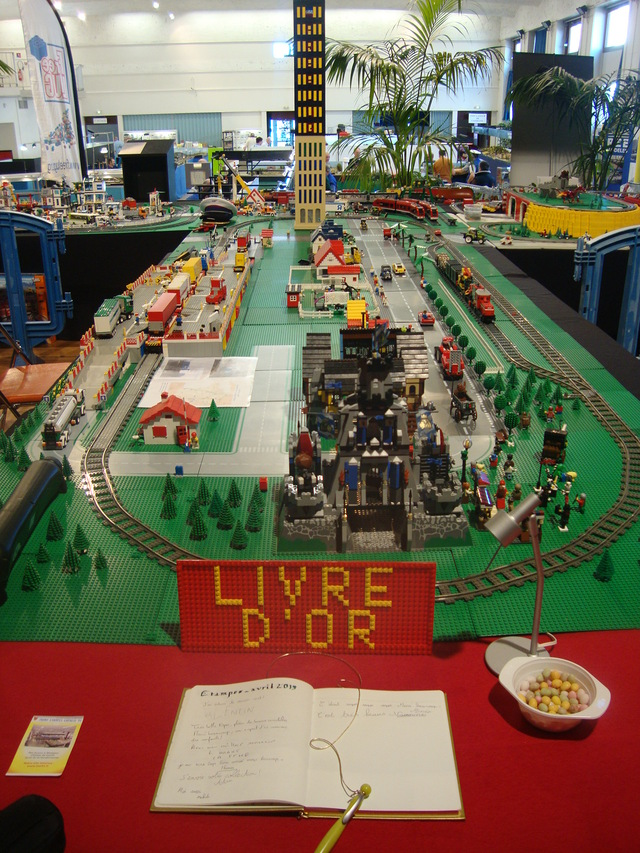
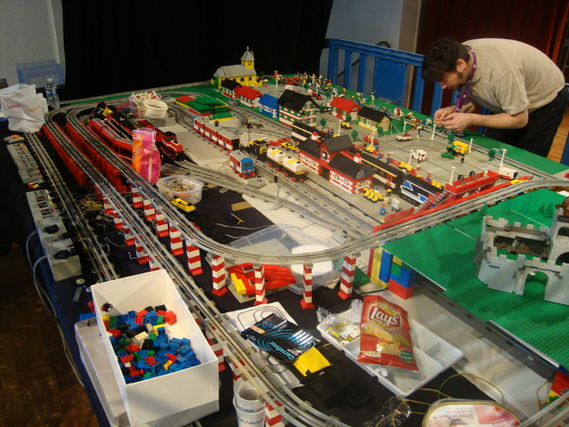
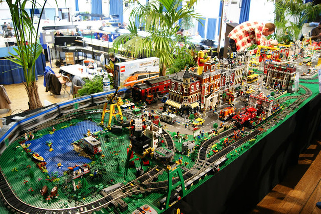
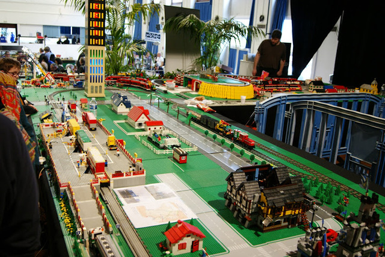
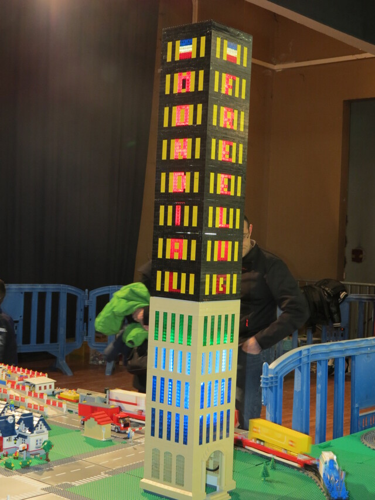
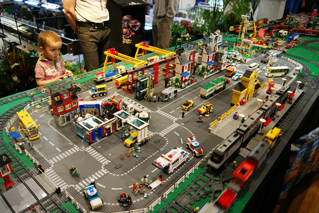
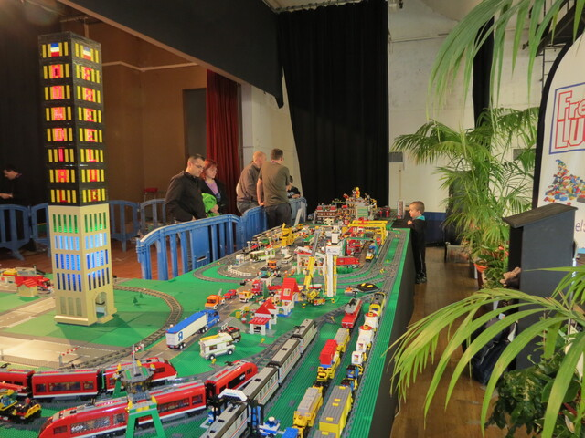

FreeLUG était invitée et, à ce titre, a sollicité ses adhérents pour y exposer des briques danoises. C’est ainsi qu’Alexis L., Gilles M., Stéphane B., Denis L. et Bruno G. se sont retrouvés durant deux jours afin d’y présenter les trains LEGO.

L’exposition prenait place dans une salle des fêtes d’Etampes. De nombreux clubs de modélisme ferroviaire, ainsi que des professionnels, mais également des particuliers, avaient fait le déplacement. Chacun y présentait ses réalisations, souvent impressionnantes, tant en taille que dans le niveau de détail réalisé.

**Le livre d’or du stand FreeLUG**

Qui n’a reçu que du positif de cette exposition !!!

Pour sa part, FreeLUG était doté d’un stand de 11 m x 6,50 m, positionné sur l’estrade de la salle.

Toutes les générations de trains LEGO y étaient représentées et tous les modules interconnectés par des routes.

**Le module 12V d’Alexis**

Les dernières finitions !!

Alexis avait apporté son réseau de train 12V, avec une colline et un train corail de sa création.

**Le module 9V de Stéphane**

Stéphane présentait son diorama 9V avec des modulars. Il y avait une partie interactive avec le public, avec des minifigs "Jeux Olympiques" cachées à retrouver et un dispositif chargement/déchargement actionné par les enfants.

**La gare de ferroutage de Denis**

**La tour FreeLUG**

Denis exposait sa gare de ferroutage, dominée de très haut par la tour FreeLUG de Gilles.

**Le module PFS de Bruno**

Quant à Bruno, ses trains PFS avaient élu domicile au centre du dispositif avec une boucle à double voie.

**Vue générale**

L’exposition a été un grand succès pour une première (1 300 personnes), dépassant même les espérances des organisateurs. Et il y a fort à parier qu’une nouvelle édition verra le jour !

Les photos en ligne : [Denis](http://photos.freelug.org/main.php/v/dlaurencon/Expo/Etampes+2013/).
