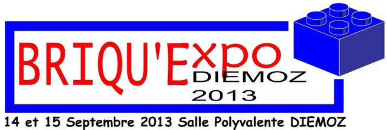
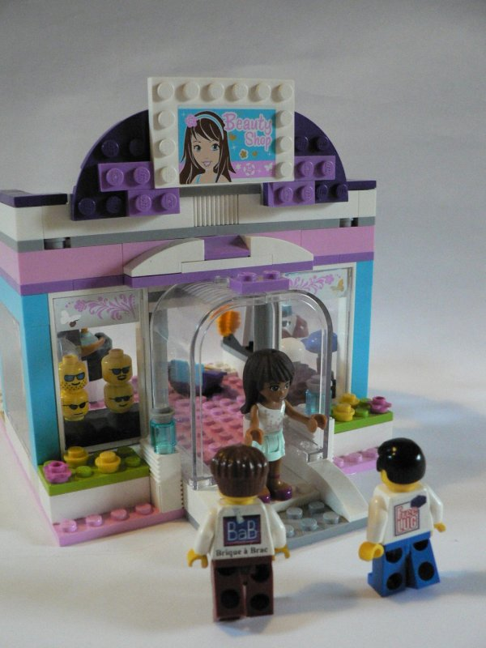
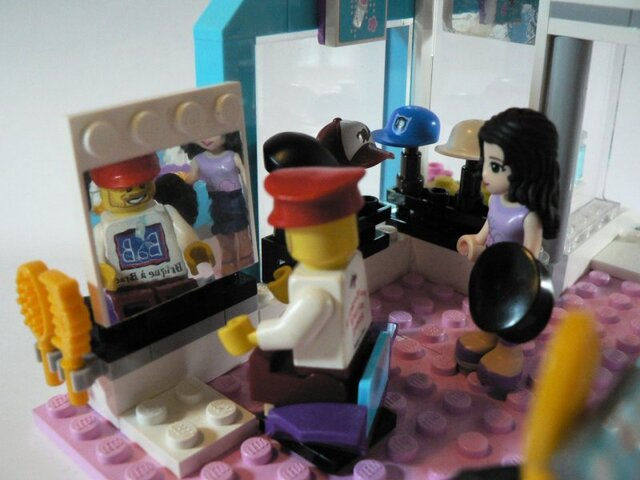
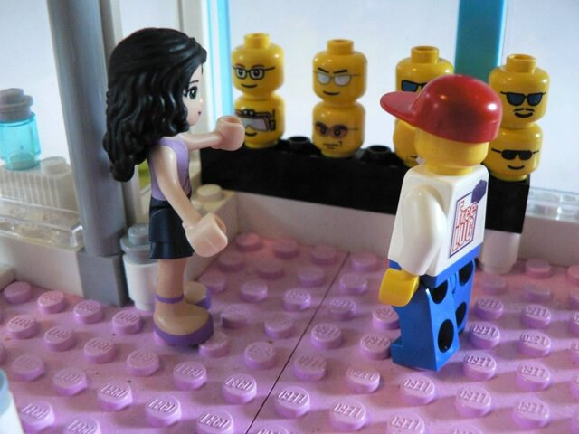
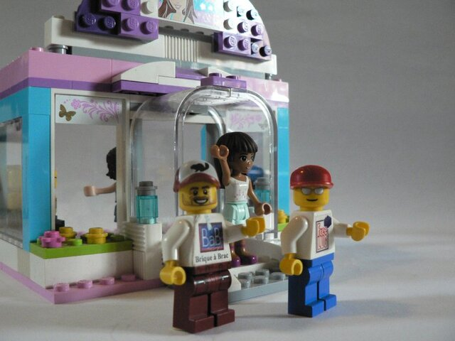

FreeLUG, Bab et le sou des écoles de Diemoz organisent une Briqu’Expo les 14 et 15 septembre 2013. Pour que tout le monde (et même au delà comme dirait Buzz l’éclair) soit au courant, la minifig Bab et la minifig FreeLUG ont décidé de se mettre sur leur 31 et de partir en promo.

## Mission n°1 : Le Look

Pour faire de la promo, il faut un look qui va bien et pour cela rien de tel qu’un petit passage au Butterfly Beauty Shop. Les conseils de Sarah sont toujours les bienvenus.

A l’intérieur Emma s’occupe de nos clients ...

Pour la minifig Bab c’est le choix de la casquette qui est difficile.

Et pour la minifig FreeLUG ce sont les lunettes !

Ouf ! Enfin le choix est fait ! Merci Sarah et merci Emma, les minifigs sont prêtes pour leurs prochaines missions

[_à suivre_](/articles/1661/)
