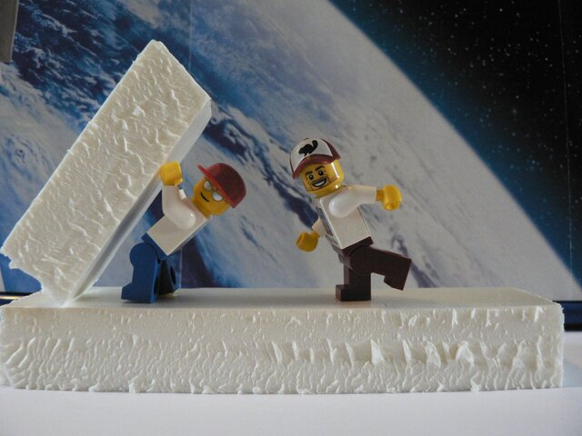
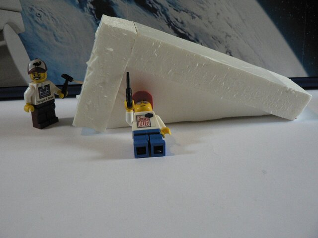
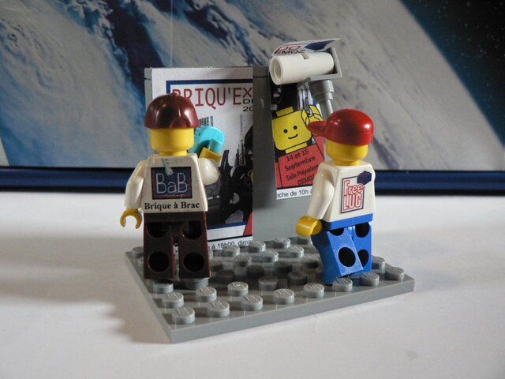
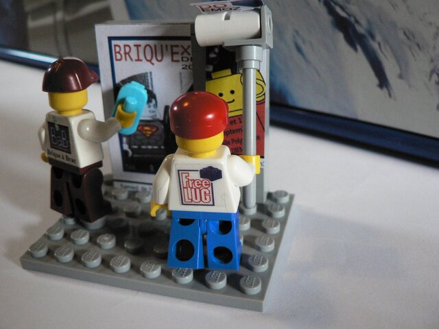
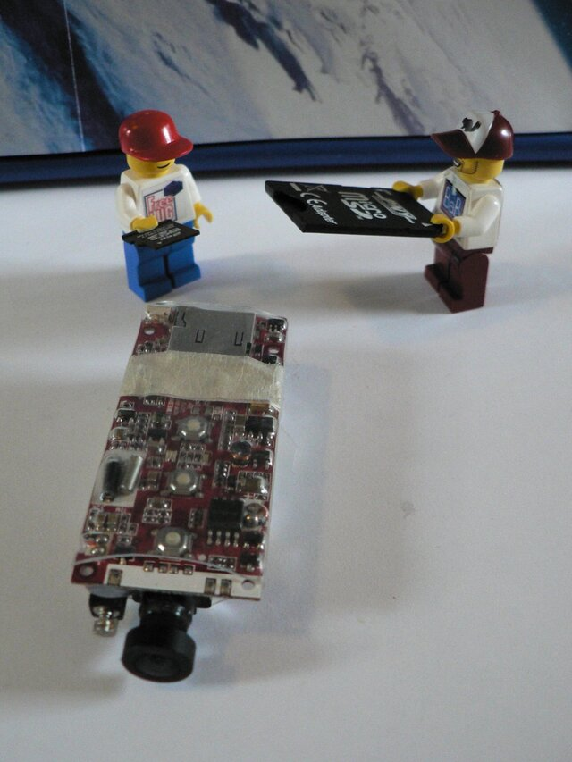
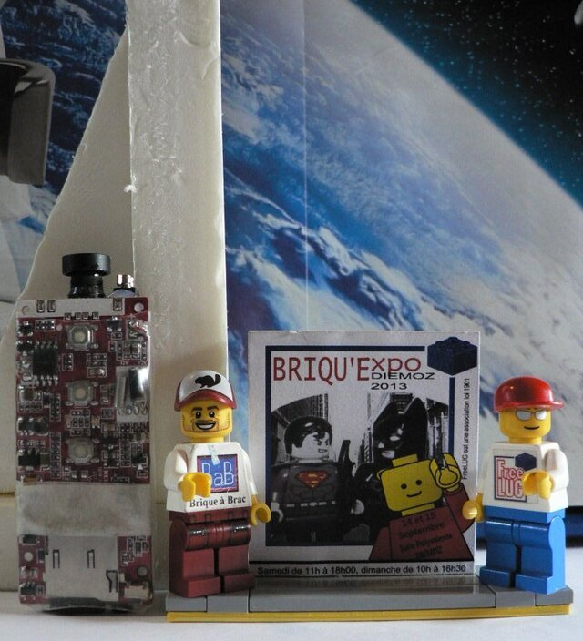

[Après leur mission au Butterfly Beauty Shop](/articles/1659/), nos minifigs continuent leur promo de Diemoz 2013 avec la mission II : le Matériel.

## Mission n°2 : Le Matériel

Pour être sûr de terminer sa mission, il faut forcement être très attentif au matériel.

Avant toute chose il faut un bon support...

Au secours Bab !!

... bien solide.

Une fois le support terminé, il faut coller les affiches avec soin.

Attention Bab ! Il ne faut pas de bulle d’air.

Et pour finir il faut le matériel multimédia pour immortaliser l’instant.

Tu ne te trompes pas de sens FreeLUG ? Hein, t’es sûr ?

**Mission matériel accomplie !**

_[à suivre](/articles/1663/)_
