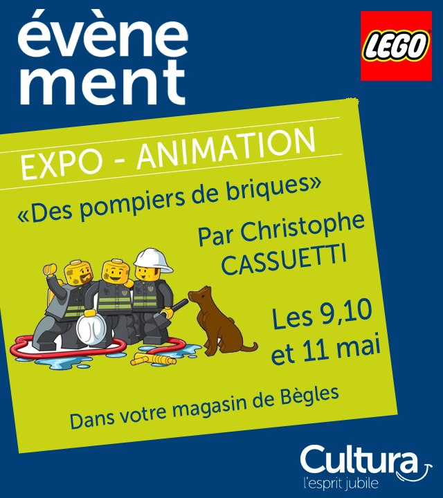
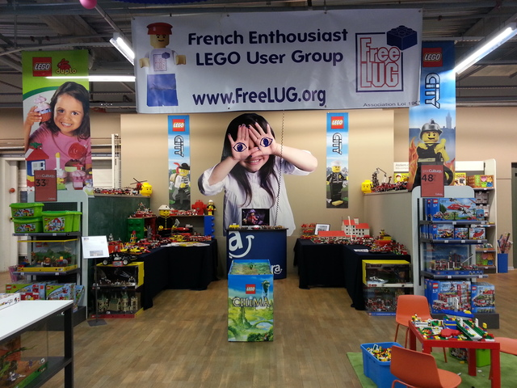
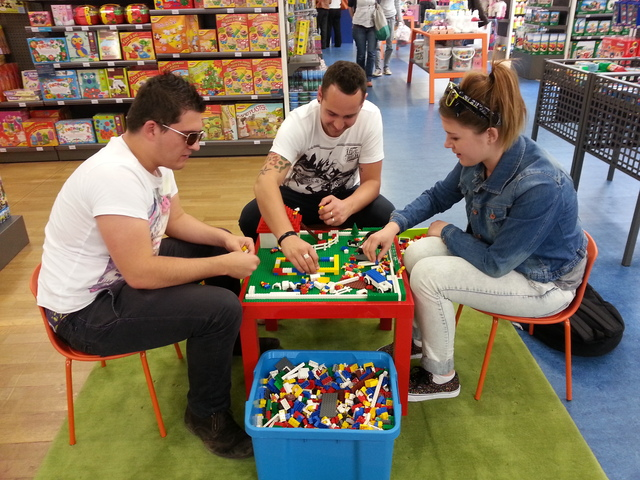

Ayant pris de l’assurance au fur et à mesure des différentes expositions auxquelles j’ai participé, voire organisé ([Cf Fans de Briques LEGO Talence 2012](/articles/1581/)), je me suis mis en tête de tenter l’animation dans un espace de vente.

Client de l’enseigne Cultura, je fus ravi lorsqu’ils se sont décidés à développer leur rayon LEGO, mais ce qui me plait surtout dans ce magasin c’est leur philosophie et leur amour pour la création et l’amusement dans tous ces états.

De plus, pile en face du rayon LEGO se trouve un espace dédié aux activités pour le jeune public avec tableau, table, et quelques jouets à disposition.

Je me décide donc de leur proposer mes "services" et de monter une exposition animation. Je propose donc au directeur un dossier avec comme projet : mes "Pompiers de Briques" en exposition d’arrière plan, une télévision avec les différents films LEGO, un espace LEGO Games et enfin un espace avec du vrac.

Emballé par le concept, la direction du magasin rentre également de son côté en contact avec LEGO France pour son soutien, qui en réponse fournira de quoi faire une animation LEGO Legends of Chima avec une arène en carton pour les Speedorz.

Nous avons donc tous les éléments pour faire passer un bon moment aux public et clients du magasin. L’expo / animation est donc annoncé sur les forums : Brickpirate, Festi’Briques, Setechnic, Brictechnic, Bionifigs et bien sur FreeLUG. L’enseigne, elle distribue des flyers en caisse pendant 15 jours avant.

Rendez-vous est donc pris du jeudi 9 mai au samedi 11 mai. Mon père viendra la veille pour charger sa voiture et sa remorque, je me chargerai du reste avec ma voiture, faut dire que 7 vitrines ça prend de la place !

Le jour J tout le monde sur le pont ! Mon père et moi déballons mes "Pompiers de Briques" pendant que l’équipe du magasin met à profit les vitrines et kakemono que j’ai amené, pour décorer et ré-agencer leur espace de vente. Je découvre au passage l’animation Legend Of Chima, franchement ça marche bien et c’est bien sympa ces Speedorz.  
Au final, tout l’espace à disposition est occupé, j’avoue j’avais même vu large et je n’ai pas posé toute ma collection de pompiers.

Sur les trois jours d’expo/animation peu de temps creux, surtout le jeudi où je me suis presque fait déborder (Cultura a battu des records d’affluence, lié aux jours fériés et à la pluie poussant les touristes à faire du lèche vitrine plutôt que des ballades), le public est venu de manière régulière, les parents découvrant les jeux de société LEGO, pendant que les enfants s’amusaient avec le vrac pour les petits et pour les plus grands, ce sont les Speedorz qui ont eu du succès.

_Non il ne s’agit pas d’une partie de Poker ! Mais une joyeuse bande de potes qui se sont fait un petit retour en enfance !_

En conclusion, si vous avez l’occasion d’organiser une animation, n’hésitez pas, je recommencerais avec le plus grand plaisir !

Christophe "Bordolego"
