Pour sa nouvelle édition l’EXPO BRICK ISDOISE a présenté un diorama de 10,2 m², le dimanche 12 mai 2013 dans la Maison des Associations de ISDES (45).

[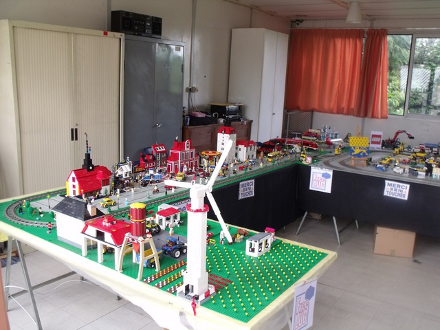](https://www.freelug.org/IMG/jpg/DSCF2589.jpg)

Pour la réalisation du diorama, EXPO BRICK ISDOISE s’est mis à la page du 9 Volts, qui a permis l’électrification des rails de train, des moteurs d’aiguillages, du manège et de l’éolienne.

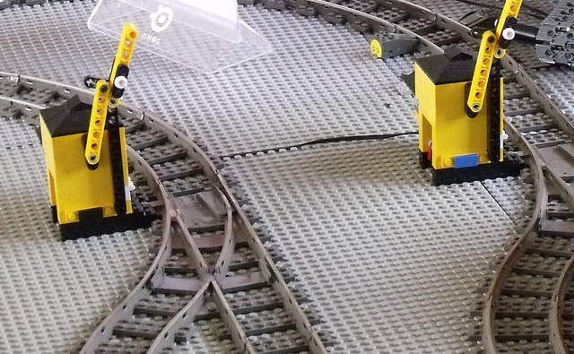

[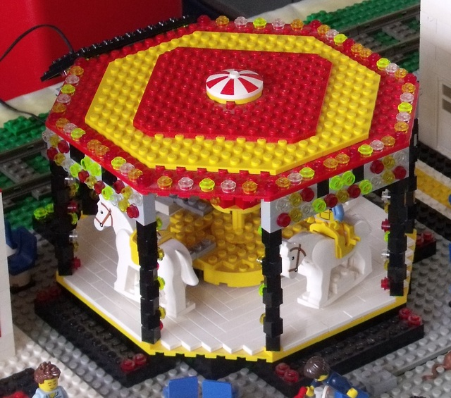](https://www.freelug.org/IMG/jpg/DSCF2607_m.jpg)

[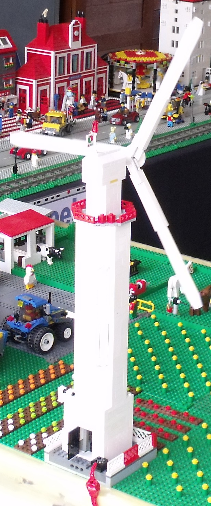](https://www.freelug.org/IMG/jpg/DSCF2589_e.jpg)

Sur ce diorama, on pouvait apercevoir :  
Une ferme avec ses animaux et son éolienne.

[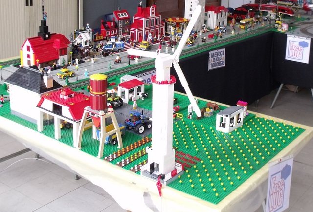](https://www.freelug.org/IMG/jpg/DSCF2589_f.jpg)

[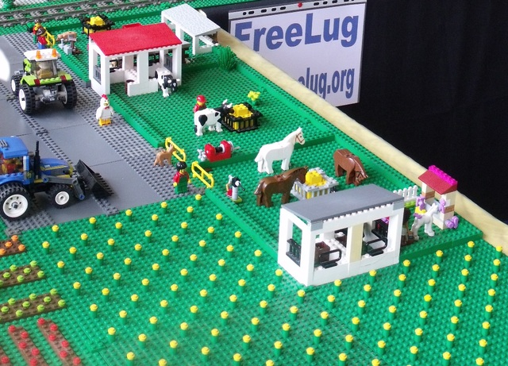](https://www.freelug.org/IMG/jpg/DSCF2599_f.jpg)

[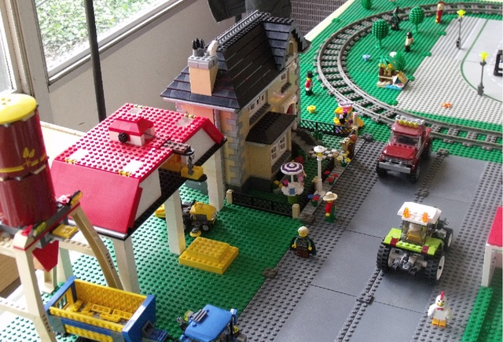](https://www.freelug.org/IMG/jpg/DSCF2600_f.jpg)

Une ville avec :  
**–** Son église.

[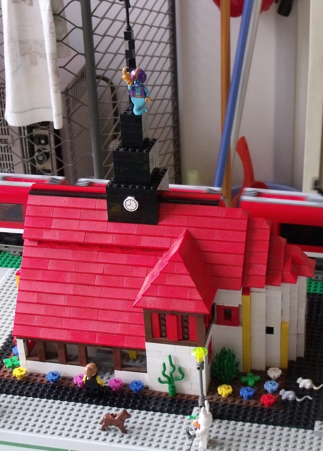](https://www.freelug.org/IMG/jpg/DSCF2601_v.jpg)

**–** Sa gare.

[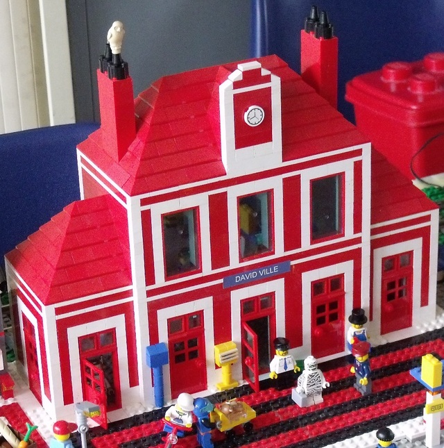](https://www.freelug.org/IMG/jpg/DSCF2605_v.jpg)

**–** Son manège.

**–** Et de nombreux autres bâtiments.

[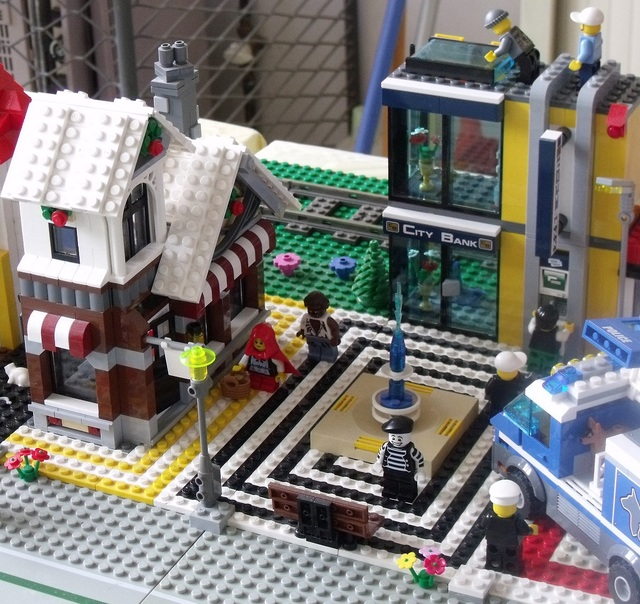](https://www.freelug.org/IMG/jpg/DSCF2603_v.jpg)

[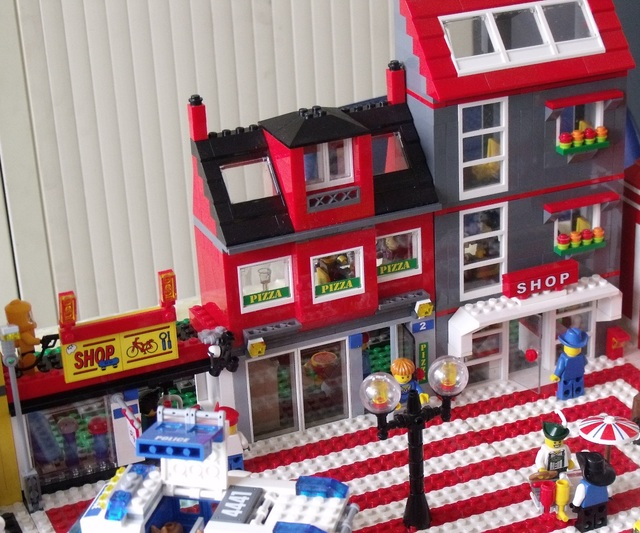](https://www.freelug.org/IMG/jpg/DSCF2604_v.jpg)

[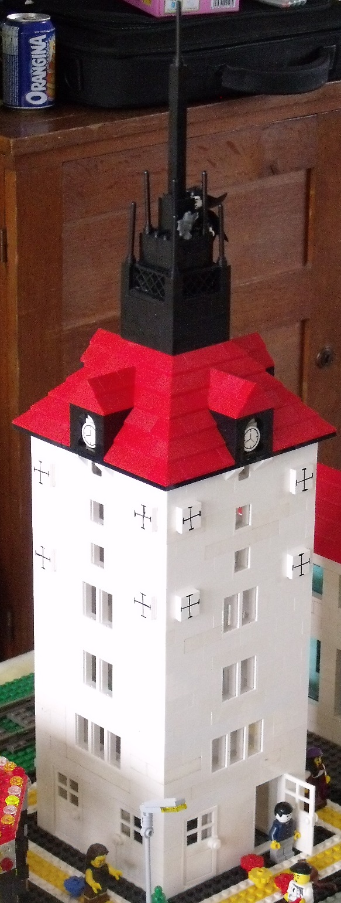](https://www.freelug.org/IMG/jpg/DSCF2608_v.jpg)

[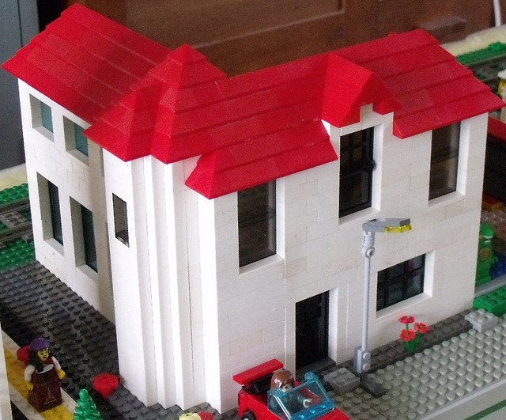](https://www.freelug.org/IMG/jpg/DSCF2612_v.jpg)

[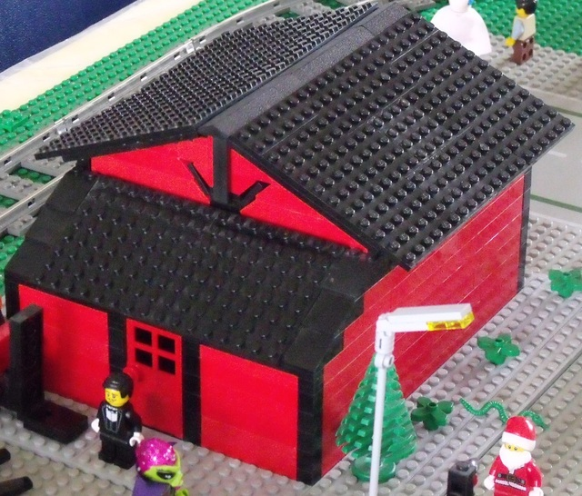](https://www.freelug.org/IMG/jpg/DSCF2617_v.jpg)

Son aéroport.

[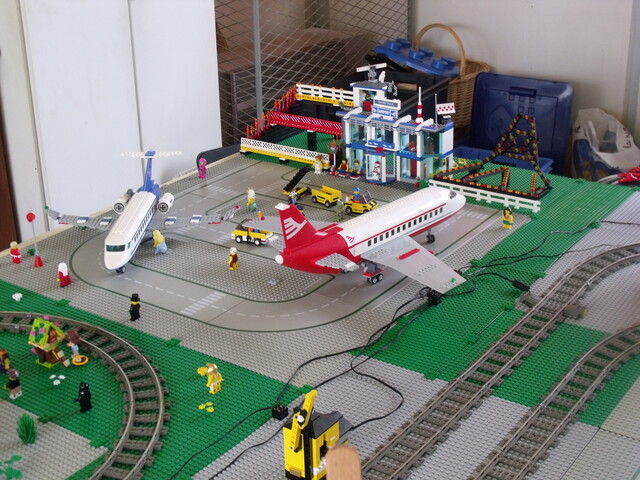](https://www.freelug.org/IMG/jpg/DSCF2597.jpg)

Une mine.

[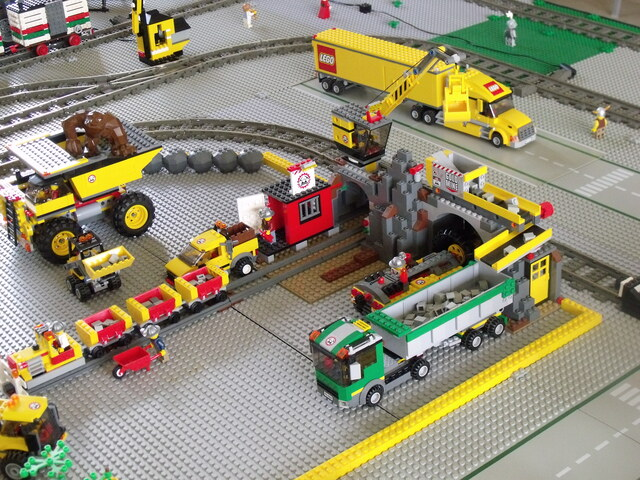](https://www.freelug.org/IMG/jpg/DSCF2594.jpg)

[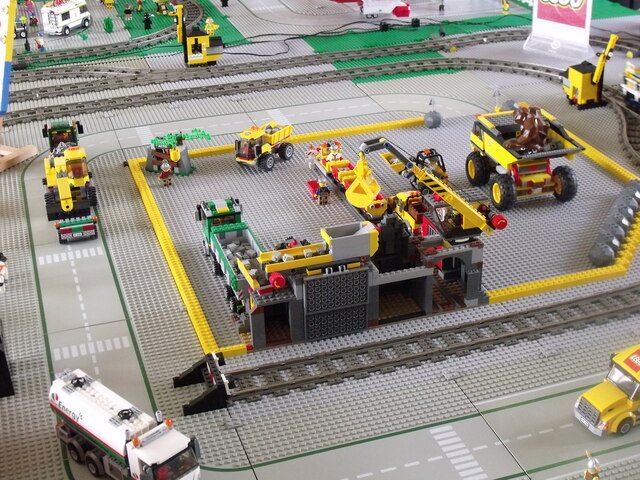](https://www.freelug.org/IMG/jpg/DSCF2591.jpg)

Et de nombreux véhicules TECHNIC.

[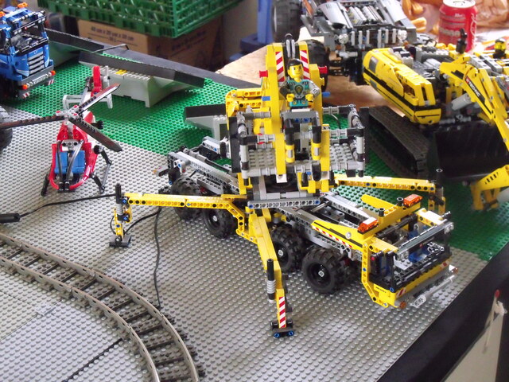](https://www.freelug.org/IMG/jpg/DSCF2581.jpg)

[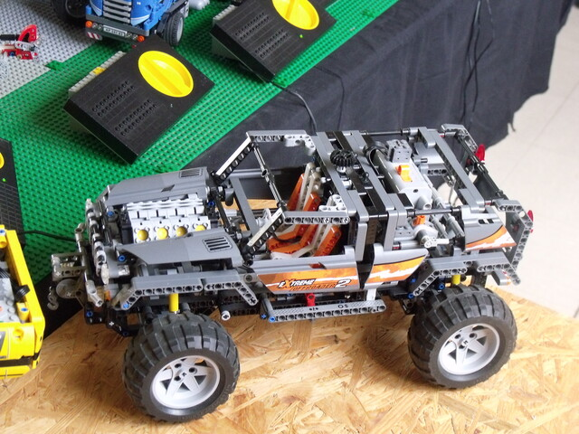](https://www.freelug.org/IMG/jpg/DSCF2582.jpg)

[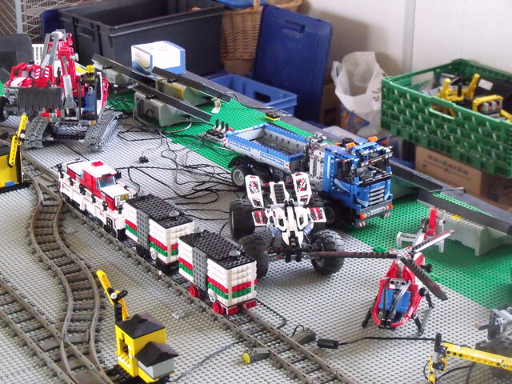](https://www.freelug.org/IMG/jpg/DSCF2584.jpg)

Ce qui a permis de faire rêver petits et grands.

**Remerciements** :  
**–** A FreeLUG, pour la mise en avant de l’association.  
**–** Au comité des fêtes et à la mairie de Isdes, pour le prêt de la salle.  
**–** A la famille Goberville, pour la mise à disposition de matériel 9 Volts (rails, câbles, moteurs de trains, régulateurs, plaques de base, ...).  
**–** A JouéClub Gien, pour la mise en relation avec LEGO France et la mise à disposition du concorde.  
**–** A LEGO France, pour la mise à disposition de publicités LEGO.  
**–** A Sébastien Hamon, pour avoir passé le dimanche après-midi à nos cotés.

Merci à tous les visiteurs pour cette fabuleuse journée.

[Galerie photos](http://photos.freelug.org/main.php/v/davidkurys/expo-brick-isdoise2013/)

_A bientôt pour une nouvelle exposition_.

David KURYS
