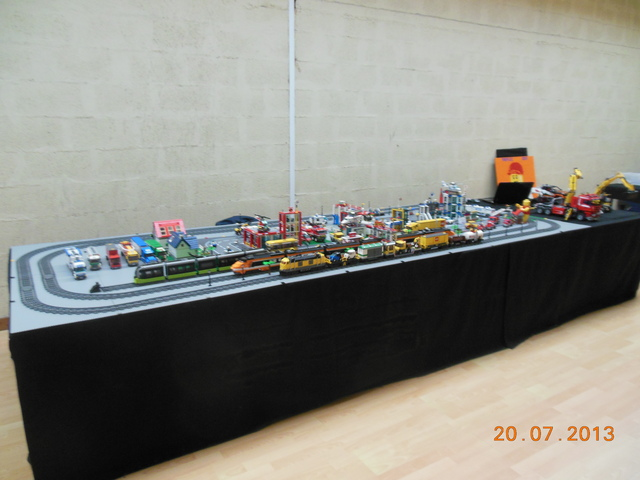
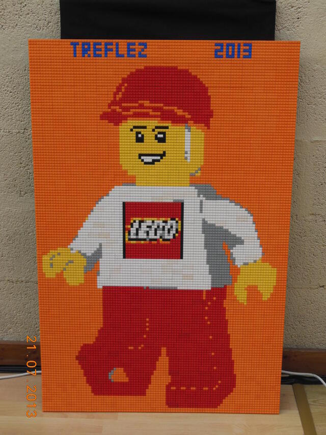

[L’Amicale des Maquettistes de la Côte des Légendes](http://amcl-29.e-monsite.com/) organisait son troisième salon de la maquette à la salle omnisport.

Pendant deux jours, j’ai exposé mon circuit de train avec une ville et des Technic plus le robot Mindstorms NXT.

**Vue d’ensemble du stand**

Deux jeunes du club organisateur exposaient une petite ville et divers modèles de train, Chima, Ninjago et Stars Wars. Théo, passionné de LEGO qui a 12 ans, membre du club de Saint Martin-des-Champs, a pu exposer le dimanche son train.

**La mosaïque de l’exposition**

Une mosaïque a été construite au cours du week-end et présentée lors de la remise des prix.

Damien

[Voir toutes les photos de l’exposition.](http://photos.freelug.org/main.php/v/dam29/expo+2013/treflez/)
