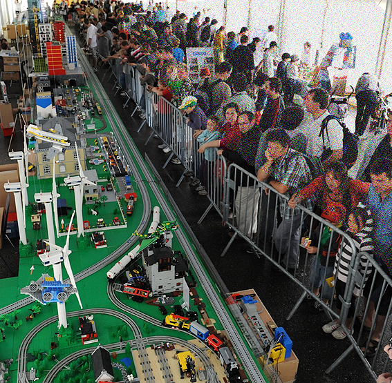
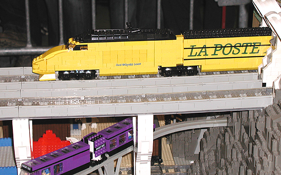
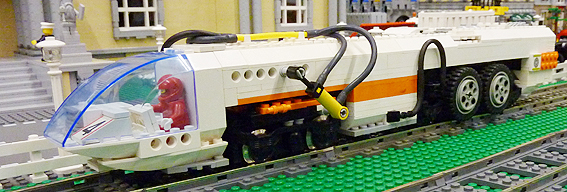
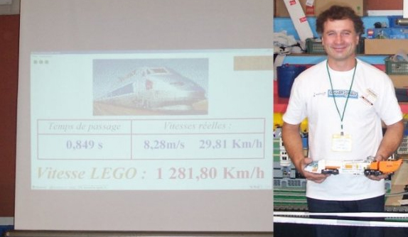
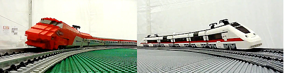
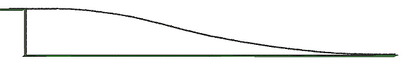

Informations techniques et règlement V3 pour le record du monde de vitesse d’un train LEGO.

Dernière version mise à jour : le 20/08/2013

## Sécurité générale

Des barrières efficaces doivent être mises en place afin d’interdire strictement au public la possibilité de toucher les rails (et en particulier aux enfants).

En dehors des périodes officielles de course, l’alimentation est bridée à 9V. En cas de manque de barrières, il est possible de compléter par de la rubalise solide. Les enfants mineurs qui souhaitent concourir doivent obligatoirement être accompagnés d’un parent lors des courses. Dans ce cas, la course se fait sous la responsabilité du(des) parent(s) présent(s).

## Les trains grande vitesse

Par définition, un train grande vitesse est un train roulant à plus de 200 Km/h en vitesse commerciale dans la réalité.

Pour le record du monde de vitesse de trains LEGO, deux catégories sont ouvertes :  
**–** une catégorie "record officiel" ;  
**–** une catégorie "prototype".

## Catégorie "record officiel"

Cette catégorie accepte :  
**–** soit certains modèles de trains en boîte LEGO ;  
**–** soit des MOC reconnaissables de T.G.V. ou autres trains à grande vitesse réels, c’est à dire ayant une vitesse commerciale supérieure à 200 Km/heure dans la réalité.

**Liste des trains LEGO**

Modèles en boîte vendus dans le commerce :  
**–** N°4558/10001 : Metroliner  
**–** N°4560/4561 : Railway Express  
**–** N°7897 : train de voyageurs rapide  
**–** N°7938 : train de voyageur rapide  
**–** N°10020 (avec wagons 10022 ou 10025)  
**–** N°4511 et boites complémentaires du même train  
**–** N°10233 : Horizon Express

Une rame LEGO officielle pour le record doit être constituée d’au moins 5 éléments du set officiel concerné.

Les rames LEGO doivent être complètes, c’est à dire sans pièces enlevées et non modifiées (sauf éventuellement quelques boggies remplacés par des moteurs). La commission technique sera seule juge de la conformité.

**MOC**

Le train grande vitesse présenté doit exister dans la réalité. Le constructeur du train devra fournir à la commission technique les photos du train réel ayant servi de modèle.

Une commission technique composée d’experts statuera sur l’éligibilité de chaque rame à participer aux tentatives de record sur les critères suivants :  
**–** la rame doit être composée d’au minimum 5 éléments correspondant à une composition possible du train réel ;  
**–** la rame doit être immédiatement reconnaissable comme étant un train à grande vitesse existant (preuves photos à l’appui) et être proportionnée correctement ;  
**–** la rame doit être construite uniquement avec des pièces LEGO, motorisation comprise ;  
**–** aucune pièce ne doit être collée y compris au moyen d’autocollants ou autres pelliculages de décoration pour le matériel roulant (caisse des locomotives et des voitures) ;  
**–** aucune pièce ne doit être coupée ;  
**–** largeur minimum des motrices et des voitures de la rame : 6 tenons ;  
**–** largeur maximum des motrices et des voitures de la rame : 14 tenons ;  
**–** aucune modification n’est permise sur une rame après son homologation par la commission d’expert (ou alors la rame doit repasser devant la commission avant sa tentative) ;

_Nota :_ les moteurs LEGO sont considérées comme un assemblage de pièces LEGO : ils peuvent donc être désassemblés ou réassemblés.

**A propos de la motorisation**

Pour la catégorie "record officiel" le nombre de boggies moteur est strictement limité à dix maximum aussi bien pour les modèles LEGO que pour les MOC.

_Nota :_ un boggie est un ensemble d’essieux et de roues montées sur un même châssis pouvant pivoter sous une motrice ou sous une voiture.

L’organisation ne fournit pas les moteurs. Chaque participant vient avec ses moteurs qu’il pourra faire fonctionner jusqu’à 60V sous son entière responsabilité.

L’organisation ne remboursera aucun moteur.

## Catégorie "prototype"

Tout est libre mais uniquement avec des pièces LEGO. Pas de pièces collées.  
Largeur maximum : 14 tenons ;

## Le chronométrage pour le "record officiel" de vitesse T.G.V.

Le chronométrage se fera sur une longueur de 10 mètres [^1] sur la voie extérieure du module.

La mesure du temps se fait par détection de passage de l’avant du train au moyen de cellules.

Le train à grande vitesse le plus rapide est celui qui met le moins de temps pour parcourir la distance entre les deux points de mesure.

En fait, ce n’est pas une vitesse instantanée à un point donné, mais c’est une vitesse moyenne du train entre les deux cellules de mesure.

Cette vitesse est en Km/h.

Pour chaque course de tentative de record, la rame doit être conduite par son propriétaire.

Une course de tentative de record se fait au moins sur 6 tours :  
**–** 1er tour de chauffe (obligatoire) ;  
**–** Au moins 3 tours pour mesure de la vitesse (ou moins si déraillement avant...) ;  
**–** Le nombre de tour maximum est fixé à chaque événement en fonction du nombre de concurrents.

Les courses de tentatives de record "homologables" ne se feront que dans les périodes horaires définies par l’organisation (au minimum 1 période par demi-journée d’exposition publique).

L’affichage du résultat (vitesse moyenne atteinte sur les 10 mètres pour le run) se fait en temps réel sur ordinateur connecté si possible à un vidéoprojecteur pour le public.

La distance de mesure de la vitesse moyenne ne peut pas être inférieure à 7m pour que le record soir homologable.

Pour que le chrono soit homologué, le train complet doit finir un tour complet c’est à dire revenir au point de départ de la ligne droite chronométré.

**Vitesse réelle et vitesse LEGO**

Deux vitesses sont calculées : la vitesse moyenne réelle et la vitesse moyenne LEGO.

La vitesse moyenne réelle est donnée en Km/h. Cette vitesse est celle réalisée par le train entre les deux points de mesure.

La vitesse LEGO est une vitesse calculée en fonction de l’échelle du train par rapport à la réalité.

La valeur retenue est de 1/45ème. Pour déterminer cette échelle, le principe est le suivant : une MiniFig fait 4 cm de haut et elle représente un homme de 180 cm de haut = 1/45.

## La commission technique

Elle est composée d’experts désignés avant le début de l’évènement :  
**–** un "Président" de la commission ;  
**–** deux membres organisateurs du record ;  
**–** un membre de l’organisation de l’exposition ;  
**–** un membre à prendre parmi les exposants présents. Soit un total de 5 personnes.

Cette commission est chargée de trancher toutes les questions pouvant se poser lors de l’évènement.

## La ligne grande vitesse

**Géométrie de la ligne**

La LGV est faite de rails spéciaux (pour les spécialistes : rails en aluminium code 250), constituée d’au moins un aller totalement droit et plat entre les deux virages.

Les virages de chaque extrémité sont d’un rayon de 1450 mm et en dévers (max 13°). Les attaques de courbes sont des clotoïdes.

Le gabarit roulant minimum en largeur doit être de 14 tenons y compris les deux virages.

Tunnels, ponts et autres viaducs ne sont pas sur la zone des 7 à 10 mètres de mesure de la vitesse pure.

La longueur de la ligne droite est de 30 mètres. Aucun aiguillage, tile, décoration, etc. sur la ligne LGV. Il n’y a pas de rail d’alimentation central pour les moteurs 12V.

Il y a une rampe au bout de la ligne droite chronométrée, et une pente en sortie de boucle pour le retour.

**Profil en long de la rampe**

Profil en long de la rampe

La rampe permet de monter de 40 briques sur une longueur de 3,50 mètres (idem pour la descente).

Le % de pente de la rampe est très important et comme sur une vraie LGV l’inertie des trains doit permettre de monter sans problèmes...

**Alimentation électrique**

Une alimentation électrique puissante de 0 à 60 V / 15 Ampères est mise en place. La voie du record est alimentée de façon à minimiser les chutes de tension : alimentation multipoints tous les 3 ou 4 modules.

## Pupitre de commande

Le pupitre de commande sera conçu de façon à afficher clairement 3 zones d’alimentation électrique :  
**–** zone verte de 0 à 9 volts ;  
**–** zone orange de 9 à 12 volts ;  
**–** zone rouge au dessus de 12 volts.

Un arrêt d’urgence coup de poing sera mis en place. La commande est mise au centre de la partie chronométrage sur une table à la même hauteur que les autres.

## Le train le plus rapide sur un tour complet

Le plus rapide sur un tour est un concours car on ne peut pas encore garantir d’évènement en évènement d’avoir toujours le même tour (longueur et disposition des virages), car toutes les expositions ne permettent pas de faire des virages de 3m de diamètre et les lignes droites de 30 m.

Deux catégories sont ouvertes :  
**–** une catégorie "record officiel" ;  
**–** une catégorie "prototype".

Les trains admis à rouler dans ces deux catégories sont soumis aux mêmes règles de construction et d’homologation que pour le record de vitesse.

Il s’agit d’un concours où le train le plus rapide (de chaque catégorie) sur un tour gagne le concours.

Aucune assistance extérieure est autorisée lors du tour complet chronométré pour ce concours.

Le départ est un départ arrêté.

Tous vos commentaires sont les bienvenus

* * *

## Voir aussi :

**–** [Construction de la LGV V.2](/articles/1220/)  
**–** [Construction de la LGV V.1](/articles/1368/)  
**–** [Le record du monde de vitesse d’un train LEGO](/articles/1177/)  
**–** [Une ligne moyenne vitesse pour la mise au point des trains pour la LGV2](/articles/1195/)  
**–** [Test comparatif des moteurs de train](/articles/1183/)  
**–** [Fana L.G.V. et record train grande vitesse - le B a BA](/articles/1136/)  
**–** [Une LGV pour nos trains LEGO](/articles/1045/)

[^1]: 10 mètres est la distance normale de mesure de la vitesse moyenne pour ce record. Toutefois cette distance peut être diminuée jusqu’à 7 mètres si il n’est pas possible de faire autrement compte tenu de la place disponible.
