La région Rhône Alpes a aujourd’hui un grand nombre d’AFOLs, mais n’avait n’avait pas eu droit à son exposition LEGO depuis plusieurs années. FreeLUG s’est lancé en compagnie du Sou-des-Ecoles de Diemoz, et voici le compte-rendu de cette première édition.

* * *

Les sorties de la LGV ne sont pas fréquentes car c’est très long à installer. Il faut compter une bonne journée de travail pour aligner correctement la trentaine de mètres de rails droits pour permettre à nos trains de faire des pointes à plus de 20 Km/h sans trop de soucis. Donc, je ne pouvais pas rater l’exposition de Diémoz.

J’ai suivi de loin les préparatifs qui ont été menés de main de maître par toute l’organisation. Le travail a bien payé, avec le nombre de visiteurs qui a été totalisé sur le week-end.

Pour la LGV, au fur et à mesure des sorties, nous affinons la chose. Les trains évoluent, les prototypes s’améliorent, la voie est de plus en plus stable, plate, droite et les décors suivent, de plus en plus justes, somptueux...

Voilà mon diorama avant les crash...

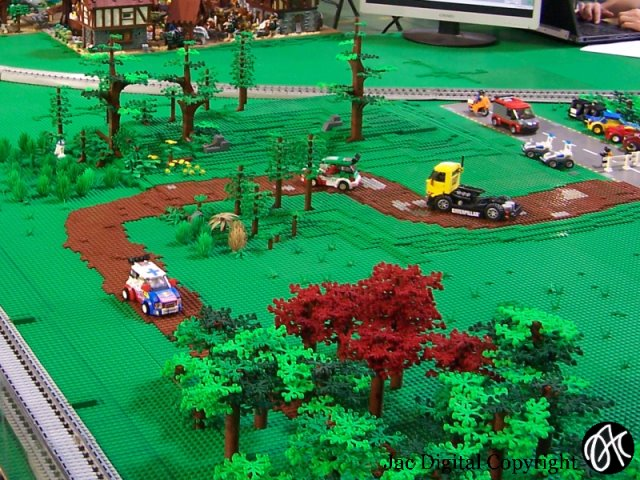

On en apprend sur la construction des trains qui roulent vite mais aussi sur le décor à fournir. La prochaine fois que je suis dans un virage, je mettrai des sapins en méta-pièces, c’est plus simple à replacer.

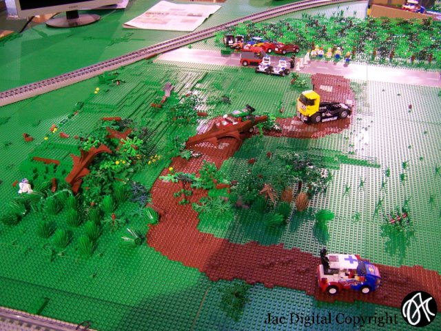

Un grand merci à toute l’organisation de cette belle exposition et un super week-end passé à échanger les runs avec Yann et des crashs mémorables. Bon, j’ai pas osé photographier mon prototype !

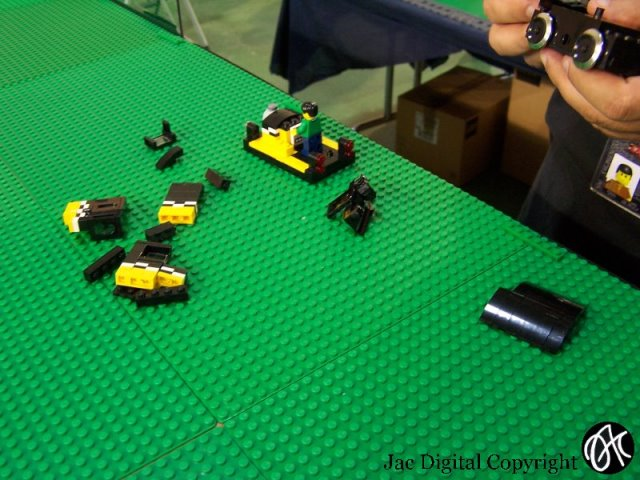

**JAC**

* * *

Cela faisait longtemps que je révais d’une exposition 100% LEGO en Rhône-Alpes. Et voilà que Yannick se dit pourquoi pas. Il en parle :  
Et vous viendriez avec la LGV ?  
Tu parles qu’on viendrait, mais il faut une salle assez grande : la LGV fait 34m de longueur et les virages en bout font 3m de diamètre.  
J’ai une grande salle.  
Bon, on vient. Et en plus c’est une BRIQU’Expo : que demander de plus.

La suite on la connait : première sortie de la LGV complète c’est à dire avec une rampe (pour le looping, on va attendre encore un peu).

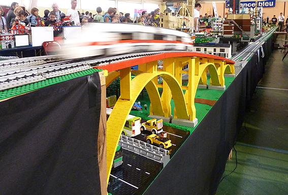

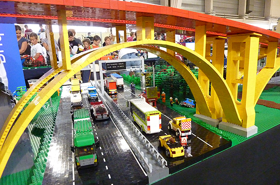

Une double première avec aussi le nouveau système de chronomètrage (Xavier Inc. Corp. ) et affichage sur grand écran. Il a parfaitement fonctionné tout le WE sans panne (c’est ça la double première :-) ) ce qui a permis d’enregistrer et valider plus de 800 runs sur environ 1600 réalisés.

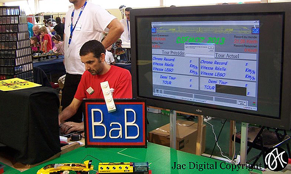

Mais le plus beau, c’est la décoration collective de la LGV avec plus de 95% de MOCs : c’est la plus belle LGV depuis sa création en 2008. Merci à tous les participants de la LGV car sans vous, la LGV c’est que des rails...

[Vidéo de la publication d’origine](https://www.youtube.com/embed/TsqM8cv_cYA)

_To be continued_..

**cdhd**

[Article : Le record du monde de vitesse d’un train LEGO - 09/2013](http://www.freelug.org/spip.php?article1709)

* * *

Que dire de plus après Denis ? Ah si...d’où vient-elle cette rampe ?

Pour le savoir, revenons un peu en arrière, en 2012 à la fin du mois de juin (dernière sortie de la LGV avant celle-là).  
Gérard, à Fana’Briques, nous amène un très joli pont pour TGV et cela donne des idées. A la REF 2013, je dis à Denis qu’il faut faire un pont sur la LGV. C’est ok pour tout le monde mais il faut tomber d’accord sur la hauteur... après négociations ce sera +40 briques !

Je ne regrette surtout pas d’avoir cédé dans la négociation sur la hauteur. C’est effectivement la plus belle LGV que j’ai vue.

Merci Yannick pour cette exposition et bien sûr aussi toute l’organisation pour cet excellent week-end.

**Xavier "Brikolego"**

* * *

J’ai eu la chance d’avoir une position très privilégiée tout au long de cette aventure même si je n’ai pas été parmi les plus actifs. Et je sais que la liste est longue de ceux qu’il faut remercier. C’est une aventure collective et nous avons été heureux d’être réunis - c’est notre récompense.

J’ai particulièrement apprécié que, sur un seul lieu, tout soit proposé aux visiteurs : exposition (on ne touche pas), animations (on touche mais on n’emporte pas) et ventes (on peut emporter).

Au niveau de l’exposition, je ne reviendrai pas sur les très belles réalisations qui entouraient la LGV, et je voudrais mettre en avant l’exposition de [photos](http://www.flickr.com/photos/samsofy/8989089624/) de très bonnes qualités techniques et artisitiques de Sofiane "Samsofy".

Merci aussi aux très nombreux visiteurs.

**Didier "SixStudS"**

* * *

Une Briqu’Expo à 1h de la maison ?  
Forcement j’en suis !  
Avec la LGV ???  
J’ai obligation d’y être !!!

Et j’ai bien eu raison d’avoir réservé ce week-end pour être présent pour cette première fête du LEGO à proximité de Lyon.  
Une organisation impeccable, des bénévoles du Sou-des-Ecoles de Diemoz venus prêter main forte avec plaisir (on l’a vu sur leur visage...), des exposants venus de Lille à Perpignan en passant par Paris et Bordeaux...!!!  
Et plein de belles choses à voir, avec du Technic, les MOCs de BrickPirate, les LEGO de Thierry, les pompiers de Christophe, les constructions des visiteurs au travers des briques jaunes, la fusée Ariane construite en un après-midi, l’atelier stop-motion... les vendeurs...  
et sans oublier la LGV qui a tourné sans une seule panne en continu tout le week-end avec un bel ensemble et continu le long de la ligne...  
Pour résumer... Magnifique !  
Et je prends pour preuve les visiteurs venus en nombre pour doubler la population de Diemoz le temps d’un week-end !  
On peine à croire que c’était une première !

Un grand merci aux bénévoles de nous avoir laissé jouer le temps d’un week-end chez eux, merci à Céline pour toute l’intendance et enfin un grand Merci et bravo à Yannick pour cette réussite !

à l’année prochaine ???

**Pierre L. "Pierrolego"**

* * *

Des expositions, ça fait un an maintenant que j’en fais.

J’avais beaucoup entendu parler de la LGV, lu tous les articles sur le site et je désespérais de ne pas avoir amené de train lors de la REF 2013.  
Donc quand Yannick a proposé une exposition "pas trop loin" de chez moi avec la LGV, comment dire non !

Grand bien m’en a pris !

Le week-end fut dantesque, avec de bonnes crises de rires et des "runs" endiablés aux manettes de mon "bat" train.

Je signe pour la prochaine sortie de la LGV !

Bravo à l’ensemble du staff et à Yannick en particulier.

Merci à Xavier et Denis pour m’avoir prêté leur jouet.

Merci à Jac pour avoir joué avec moi :D

**Yann "Candia"**

* * *

Première exposition pour la team "Play-Well TEKnologies".

Tout s’est décidé très tard pour Edward et moi, mais en tant que FreeLUGiens tous les deux, et en tant que représentants de Play-Well, nous ne pouvions nous permettre de rater cette exposition qui s’annonçait énorme.

Et le week-end a effectivement confirmé tout cela. Du coup, je ne peux même pas vous parler de l’exposition, puisque si je cumule sur le week-end, j’ai dû passer un peu plus de 30min devant les dioramas le dimanche matin avant l’ouverture, sans avoir assisté à un run sur la LGV que je découvrais pourtant !

Le reste du temps, Edward et moi animions notre stand avec notre "Battletrack". Quézako un "Battletrack" ? C’est un combat de joute entre deux véhicules montés sur un grand rail. Le but étant de pousser l’adversaire pour le faire tomber de ce dernier.

Tous les visiteurs pouvaient participer. Nous mettions à disposition nos véhicules "nus", et nous proposions aux participants de les accessoiriser avec des pièces LEGO mises à disposition.

Au final, nous avons dû faire plus de 800 combats dans le week-end, avec des véhicules parfois très bien conçus.

[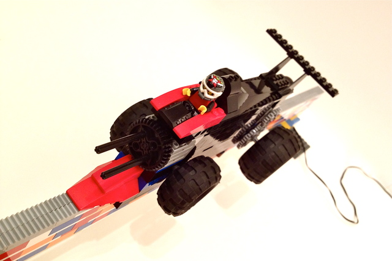](https://www.freelug.org/IMG/jpg/BattletrackCardAbove.jpg)

Notre tirage au sort afin de faire gagner des boîtes LEGO a connu un gros succès avec près de 300 participations.

Nous avons fini, comme tous, le week-end sur les rotules... Mais notre but a été atteint. Nous avons fait connaitre notre société et sa méthode, tout en proposant de l’animation permanente pendant l’exposition. Les enfants qui revenaient en permanence sur notre stand sont le meilleur des encouragements pour nous.

La team Play-Well est donc prête à animer avec entrain toutes les expositions à venir !!

[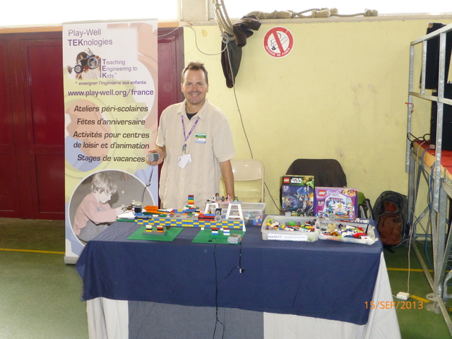](https://www.freelug.org/IMG/jpg/P1010025.jpg)

Edward

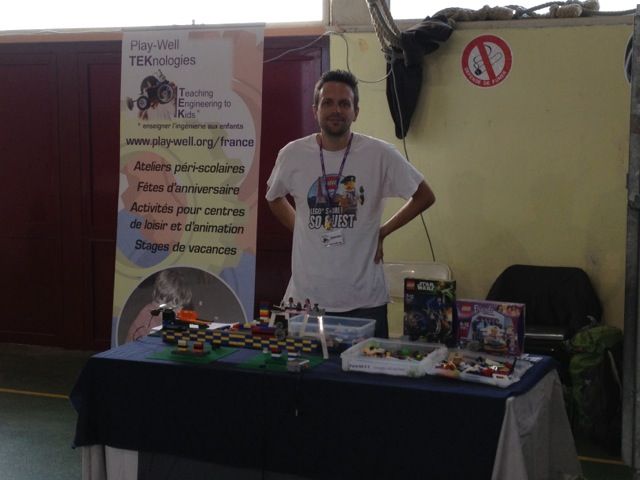

Damien

A+

**Damien R.**

* * *

Par où commencer ? Le lieu : Diémoz, à côté de Lyon, c’est cool. Une exposition "à côté" de chez moi, ça permet plus de libertés, car il est facile et rapide de retourner chercher les pièces manquantes... (non, je ne pense pas aux vis pour les tables xBab de la LGV :D, quoique...)

La LGV justement, je commence à la connaître, même si elle apparaissait cette fois-ci dans sa nouvelle version avec la rampe. L’habillage a été un peu plus compliqué à préparer car nous étions trois sur une petite zone : Denis pour la rampe elle-même, Pierrolego pour la falaise +40 briques, et moi, et bien, un peu de choses autour ! Mais tout s’est bien passé, nos différentes parties se sont bien intégrées les unes aux autres.

Comme d’habitude, le week-end est passé beaucoup trop vite, n’ayant pas eu le temps de discuter autant que je l’aurais voulu avec tous les exposants... et d’admirer toutes les constructions. L’afflux du public a été en relation avec la communication faite pour cette exposition : remarquable !

Un grand merci aux organisateurs, Yannick, Céline, aux exposants / vendeurs / photographes / animateurs... et aux très nombreux visiteurs.

Vivement la prochaine BRIQU’Expo Diémoz !

**Laurent**

* * *

Diémoz, une exposition à l’autre bout de la France... Cool ! ;)  
On s’est dit pourquoi pas ? Et on a décidé de participer, Flo, Médérik et Moi.  
On a du coup inauguré notre nouveau camion, qui a été bien rentabilisé, et passant par Paris, pour récupérer le Bulk des exposants de FreeLUG, et la Fusée Ariane pour l’atelier. La route a été longue, mais sans problèmes, et la gare de Rouen, le morceau le plus fragile est arrivée sans encombre.  
Arrivés le vendredi soir, une partie de la nuit pour le montage, et les finitions le lendemain matin. Tout était prêt, ou presque pour l’ouverture au public.

Superbe LGV, pleine de créations.  
Quand au reste de l’exposition, tout était d’un niveau remarquable.  
A noter, les revendeurs qui ont eu aussi pas mal de succès.  
Les visiteurs étaient venus en masse, et on a été submergés pendant 2 jours. Personnellement, je dormais dans la salle, ce qui m’a permis de faire le tour des créations présentes, tranquillement, car dans la journée, c’était presque impossible.

De retour au Havre, épuisés, mais ravis... On reviendra !

Et une petite vidéo embarquée dans le TGV :

[Vidéo de la publication d’origine](https://www.youtube.com/embed/HggHIxCxuwU)

**Vendredi** : L’installation de la salle en générale et LGV en particulier se passent bien. Un plan qui se déroule sans accroc !

**Samedi** : Ouverture des portes à 11h. La salle se remplit doucement. En milieu d’après midi c’est le rush, avec une belle file d’attente devant la salle !  
Le soir on compte déjà plus de 2500 entrées !

**Dimanche**  : Une bonne surprise dès le matin avec la pleine page que le Dauphiné Libéré nous consacre :

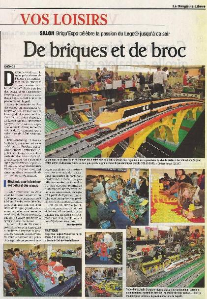

Le concours organisé avec [Brickheroes](http://www.brickheroes.com/) a attiré beaucoup de visiteurs, et une cinquantaine de participants. Tous repartiront avec un lot ! L’après-midi, c’est le Rush. Les divers stands sont pris d’assaut : concours briques jaunes, stand Play-Well, Techball, Atelier Stop-motion de Jean-Yves, et bien sur tous les stands ou des MOCs tous plus beaux les uns que les autres sont exposés !

[Vidéo de la publication d’origine](https://www.youtube.com/embed/DwGBWN-DYuA)

Devant la foule incroyable, on est bien content de voir arriver des renforts bénévoles et FreeLUGiens (Merci à Daniela et Sylvain) qui n’hésitent pas à mettre la main à la pâte, que ce soit pour s’occuper de la buvette, gérer les entrées, parking, etc.

Pour ma part, je n’ai pas eu le temps de voir grand chose de l’exposition, ayant passé le week-end à courir dans tous les sens. Je vous laisse donc voir la vidéo (encore réalisée par Gérard) qui vaudra mieux que des longs discours :

[Vidéo de la publication d’origine](https://www.youtube.com/embed/19JWuq6MIz4)

Au final, l’exposition aura accueilli plus de 6800 personnes ! Juste incroyable ! Quel plaisir de voir le résultat de ces deux années de préparation avec le Sou-des-Ecoles, FreeLUG, les exposants (Brick Pirate, TechLug, BricTechnic, Fanabriques, BaB, etc.) les bénévoles et les divers partenaires et sponsors ! Un grand merci à tous, en espérant pouvoir remettre cela... en 2015 ???

**Yannick "Yannoch06"**

* * *

Diémoz, pour un local (de Lyon), cela ne pouvait pas se manquer.

Cette fois-ci, pas d’automatismes de train pour le pas gêner la circulation sur la LGV. J’ai donc opté pour une petite ville inspirée du set ["Town Plan 10184"](http://www.bricklink.com/catalogItem.asp?S=10184-1) agrémentée d’une église et de la gare, bien améliorée, déjà présente sur mes deux dernières expositions.

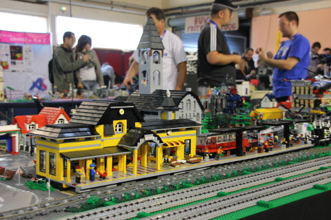

Je viens encore une fois chercher l’émerveillement du public, c’est avec cette quatrième exposition avec FreeLUG, quelque chose dont je ne me lasse pas. De temps en temps, je fais un peu d’interaction en laissant la télécommande du train à un enfant derrière les grille. C’est toujours fort apprécié... “_Et moi monsieur, c’est quand mon tour ?_”.

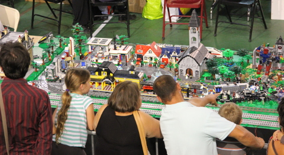

L’organisation et l’accueil FreeLUG et Sou-des-Écoles ont été tops avec une affluence record, pas besoin de faire un long discours, les images suffisent.

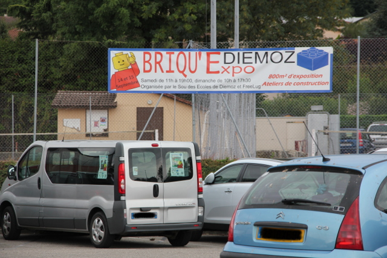

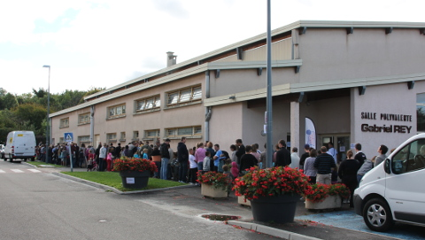

Ce que j’ai particulièrement apprécié, ce fut la quantité d’animations prévues pour que les enfants puissent toucher aux petites briques : Duplo, Briques de bases, Fusée Ariane, StopMotion, Play-Well. C’est un truc à retenir et reproduire.

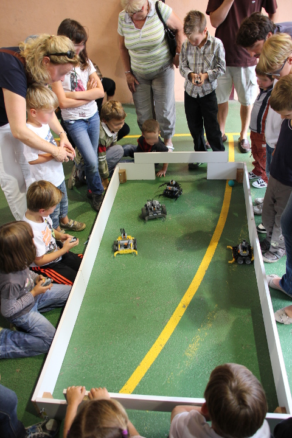

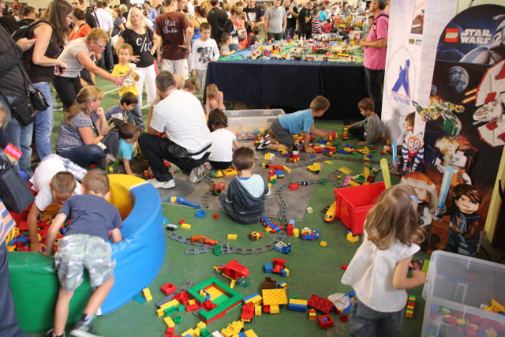

**Vivement la prochaine !**

**Nicolas "CoLego"**

* * *

Après Vannes, direction Dièmoz.  
Ben quoi, depuis Blaye, il y a juste sept heures de route et environ 650 Km !

Ma collection "[Des Pompiers de Briques](http://bordolego.e-monsite.com/)" ne connait pas encore cette région de France.

Plus l’exposition approche, plus la communication entre en action et plus je me dit que notre "record" de 5200 visiteurs sur [Fans de Briques LEGO Talence](http://www.freelug.org/spip.php?article1581) va être battu.

Dorénavant mon père fait parti de l’aventure, en même temps vu mon stand ne cessant de s’agrandir, nous ne sommes pas trop de deux pour le surveiller et l’animer. (Faut aussi avouer que sa voiture est plus pratique pour transporter tout çà !).

[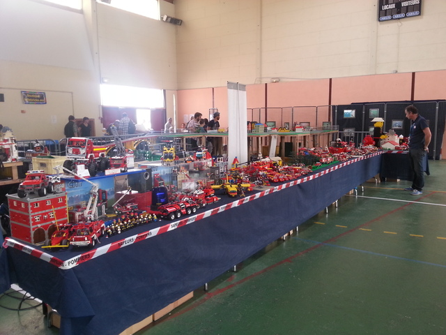](https://www.freelug.org/IMG/jpg/20130914_110335.jpg)

Quel souvenirs de ce week-end ?  
**–** un public toujours aussi agréable et curieux de tout.  
**–** des gens qui découvrent et/ou redécouvrent les LEGO.  
**–** des dioramas de qualité.  
**–** et puis un chiffre, plus de 6800 visiteurs ! Notre record est donc battu ! Mais je ne suis ni jaloux, ni vexé ! Bien au contraire, je suis ravi. Ravi d’y avoir participé, ravi de voir que les expositions de nos petites briques ont de plus en plus de succès. Cela me motive encore plus, pour la deuxième édition de "Fans de Briques LEGO".

Merci de m’avoir invité, et accueilli à Dièmoz.

**Christophe "Bordolego"**

Tiens au passage ! Mon Crawler (ou plutôt celui de ma femme) modifié en camion feu de forêt à écrasé de nombreux pieds durant le week-end et heureusement personne n’a porté plainte ! Ils sont sympas ces lyonnais !

* * *

Que dire de plus ? Ils ont déjà tout dit !

Week-end génial, ambiance et public au rendez-vous, des frites au top (merci les cuistots du "Sou-des-Ecoles").

On voit les copains habituels, on en retrouve des anciens (Spécial dédicace à Loys, tu nous as manqué le grand !!!), on s’en fait des nouveaux...

[Vidéo de la publication d’origine](https://www.youtube.com/embed/bEmVZtfmC9g)

A quand la suivante ?

**Pierre C. "Tribolego"**

* * *

_WOUAHHH !!!!_  
Quel pied !! Y’a pas a dire, les expos c’est vraiment trop cool !

Cela faisait 4 ans que je n’avais pas retouché à mes briques. Et quand j’apprends que Yannick monte une BRIQU’Expo a 30mn de chez moi... Je dois en être ! Merci Yannick pour ça, tu m’as remis sur le droit chemin !! :)

Et quel plaisir de revoir tous les copains, de connaitre des nouvelles têtes, et surtout de revoir l’émerveillement sur le visage de tous ces enfants qui viennent nous voir .

Au final, un superbe succès grâce à une organisation aux petits oignons de Yannick et Céline .

Bravo à tous !!

**Loys "Chimere"**

* * *

**Galerie photos**

[JAC](http://photos.freelug.org/main.php/v/JAC/Exposition/2013/Diemoz/)

[CoLego](http://photos.freelug.org/main.php/v/nicolas_carel/expo_diemoz_2013/)

[Yannoch06](http://photos.freelug.org/main.php/v/yannoch06/BE+Diemoz+2013/)

[Chimere](http://photos.freelug.org/main.php/v/Chimere/BriquexpoDiemoz2013/)
