## Briqu’Expo Diemoz 2013

Pour cette première édition de BRIQU’Expo Diemoz, c’est la première sortie de la LGV V2 complète avec sa rampe.

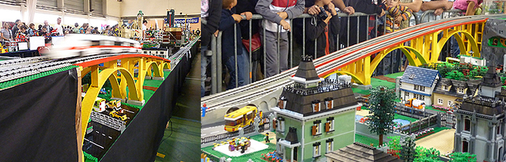

Plus de 1600 ’runs’ tous trains confondus ont été faits dont environ 800 ont été validés par le tout nouveau système de chronométrage avec affichage sur grand écran.

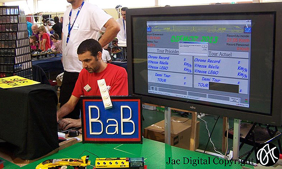

Malheureusement pas de record de vitesse pure à la clef même si cela est passé très très près aussi bien pour les prototypes que pour la catégorie trains officiels.

Malgré tout, le spectacle fût au rendez-vous avec quasiment tous les trains roulant entre 20 et 28 Km/h sur les 2 grandes lignes droites, plus de nombreux crashs au bout des lignes droites.

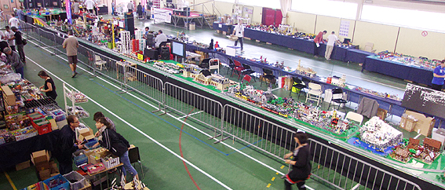

## Résultats

Ces tableaux sont un récapitulatif des vitesses atteintes.

Pour établir les tableaux de résultats, il a été gardé un maximum de 3 chronos par manifestation/catégorie/train.

## Récapitulatif catégorie officielle

Record actuel : 25,59 Km/H

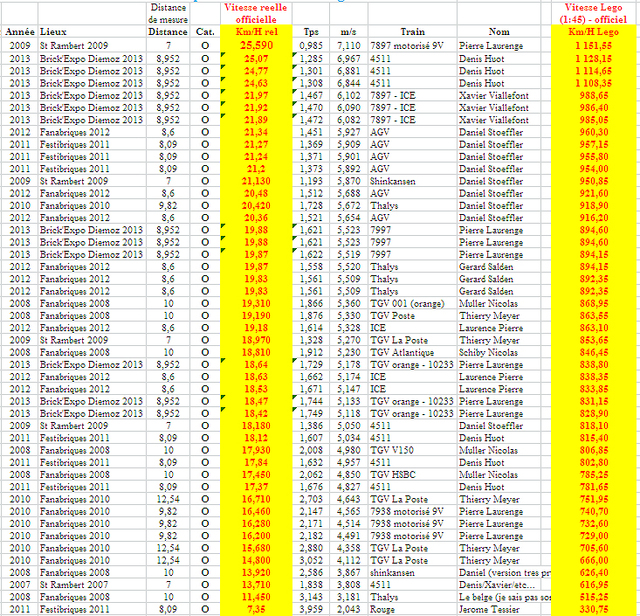

## Récapitulatif catégorie "proto"

Record actuel : 29,81 Km/H

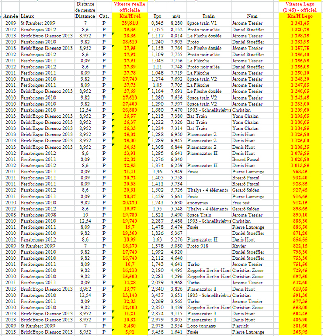

**Et pour finir, quelques trains...**

_La flèche double_

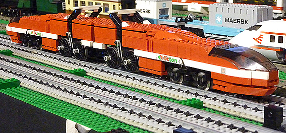

_Bat Train_

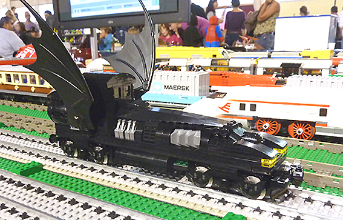

_Plasmazator 1_

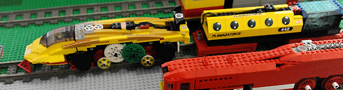

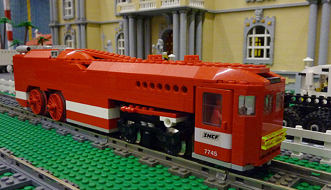

_Plasmazator II_

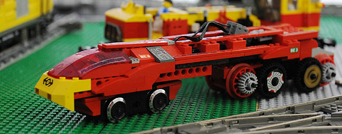

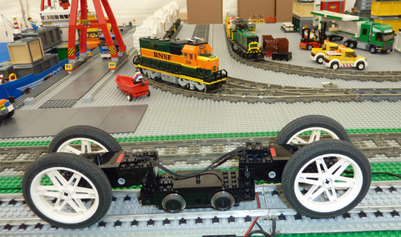

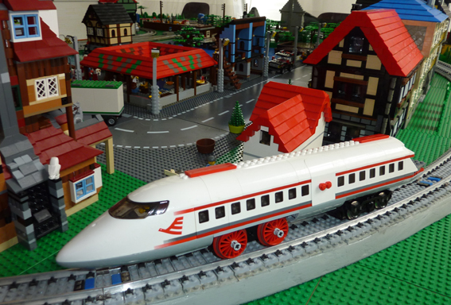

_La flèche_

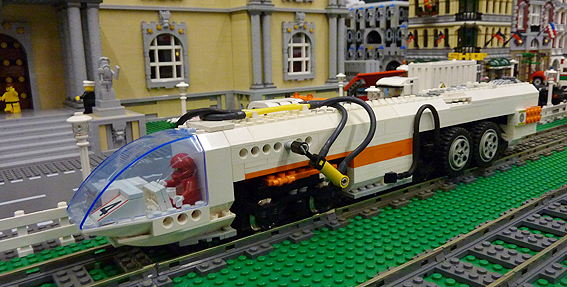

_1903 - Schnelltriebwagen_

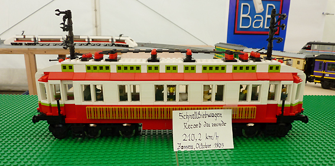

_Shinkansen_

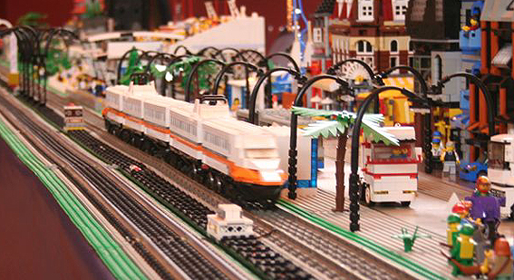

_Thalys_

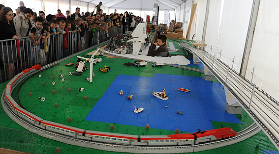

... et le vôtre prochainement ?
