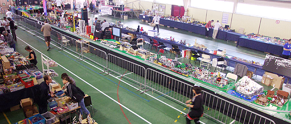
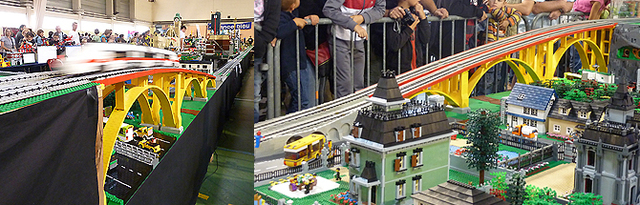
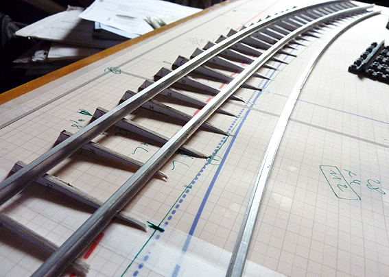
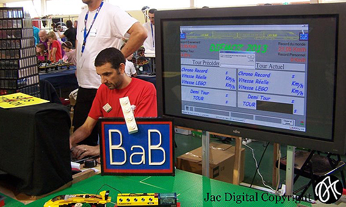

When dealing with LEGO trains, realism is a subject which comes over and over. Realism is often about details: details of design and colors, details of dimensions and functions.

Realism also resides into layout planning and operation. One enjoys the (discontinued) 12V System with all its automated functions such as lights, switches and uncouplers. Others do some modifications to install DCC (Digital command) into their creations for finer control.

**Speed**

But realism is also about speed. In France, we are proud of our TGV, the bullet train and the least one can say is that it is iconic. Contrary to what happens in North America, in Europe train means high speed passenger trains as demonstrated by the UK Flying Scotsman (see RailBricks #6) or the German ICE, while in America, train is almost only about heavy freight trains.

Back in the LEGO world, speed is not easily achievable. Power is limited to 9 volt with low current input, curves which are of the short radius style only and the unique straight track is short, connecting with seams of a noticeable size. Those are conditions that high speed can not handle - speed is not only a matter of rolling stock but mainly a question of railtrack and powering solutions.

**The purist way**

Some tricks do exist to resolve those issues. Large radius curves can be built as described in the article "Smooth Curves Without Cutting Corners" in RailBricks issue #1 or "Fun with radii" in RailBricks issue #7. It allows trains to run at full throttle without them tilting nor derailing. Those curves can also be improved by raising the outer side of the rail, creating a superelevation (also called a cant).

The powering issue is more technical to work out. At first sight, one might think that increasing the number of motors would make one’s train run faster. That is true but at a very small scale - you will certainly not double the speed of your engine this way. Worst, you might even slow it down because motors are heavy.

The best solution is rather to power your train by the railtrack and quickly dismiss the Power Function System. With the 9V System you have to use multiple unit of the speed regulator in order to prevent the current from falling down with distance or motors consumption.

Nevertheless, you are powering the layout under 9 volt, whatever current you send into the rails. If you want to increase speed, you have to feed the system with higher voltage. There is a way to do this, [first demonstrated by Daniel Stoeffler](http://freelug.org/spip.php?article1195), which consists in plugging two speed regulators as a serie circuit through an additional piece of track. This way, you are powering your layout under a theoretical 18 volt.

Note that the LEGO electrical components (motors, speed regulators) are not meant to be used that way but it does work. There is however a chance that the lifetime of the components might be shortened. Use these tips at your own risk.

**Modders are in the place  
**

If you are not a purist, you can modify LEGO parts or make use of non-LEGO parts. And this is the choice Denis Huot and Xavier Viallefont made to create a high speed track of their own. This layout is exhibited about once a year in various events taking place in France since 2008 (Fana’Briques, BriqueExpo...) and the following discussion is at large inspired by two articles they wrote for the FreeLUG website based on their experience.

**Levelling**

A high speed line has to be level. You can not use disparate tables to setup the layout. Denis and Xavier use wooden built tables which height can easily be finely tuned on uneven floor.

**Gauge**

The gauge of the LEGO track is larger than the one of the motors and trucks. It is quite logical as it makes the friction on curves less important. But as previously said, the high speed line makes use of a large radius curve. As a consequence, the gauge of the high speed line is a bit smaller than the LEGO-gauge, making the rolling stock more stable at high speed.

**Lenghth**

The first attempts at high speed have been made on 13 and 19 meters long straight lines and the conclusion was obvious. The faster you go, the longer the line had to be. Today, the high speed line is 30 meters long (without curves) but is still too short: the use of a ramp to get help from gravity to slow down the train before the curve or to speed it up in the line entry, is required.

**Seams and Splints**

The LEGO straight tracks are 12.8 cm long. As a consequence the train encounter a seam 8 times a meter. This is unacceptable for a high speed train and the high speed line is built from 1 meter long aluminum rails, connected with the help of splints, making seams almost imperceptible.

**Curves**

The high speed line curve are not only large radius (1.5m) but also features a superelevation (maximum 13°). As in the real world, an Euler spiral is used as a track transition curve in order to limit the consequences of centripetal acceleration.

**Powering**

The high speed line is powered with a custom made power supply offering a 60V electrical source. Quite surprisingly, the LEGO motors withstand the overload for short time.

**Measuring**

Now you just have to make your train runs. Some IT material and a couple of sensors allow to display statistics on train speed (up to 21 km/h) during events.

**Conclusion**

....the high speed line is a must see at events and is very well enjoyed both by train AFOLs and visitors.

**–** /-/-/-/

More :

[Lego speed train. TGV & other](https://www.youtube.com/playlist?list=PL525AA3316A78E69D)

[Lego TGV 10233 - horizon express? running - Diemoz 2013 - Briqu’Expo](http://youtu.be/8-h-BKMfpGU?list=UUTVB0KTfg_lrk9ZuhT_xQUA)

[Le record du monde de vitesse d’un train LEGO - 06/2014](http://railbricks.com/magazine/issue-14/)

[Règlement V3 : record du monde de vitesse d’un train LEGO](http://www.freelug.org/spip.php?article1687)

[Le record du monde de vitesse d’un train LEGO - 07/2012](http://www.freelug.org/spip.php?article1513)

[Construction de la LGV V.2](http://www.freelug.org/spip.php?article1220)

[Construction de la LGV V.1](http://www.freelug.org/spip.php?article1368)

[Fana L.G.V. et record train grande vitesse - le B a BA](http://www.freelug.org/spip.php?article1136)
