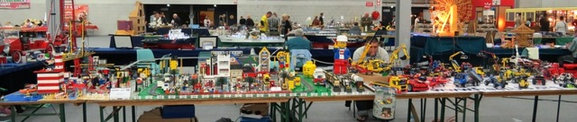
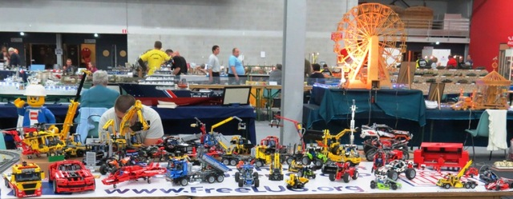
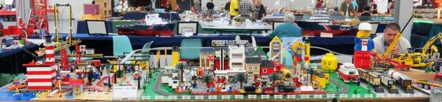

FreeLUG a été invitée par le Kit Club Bisontin à Expokit le salon Européen de la maquette et du modélisme les 26 et 27 octobre 2013.

Organisé par [le Kit Club Bisontin](http://kitclubbisontin.free.fr/) , créé en 1978, ce salon est l’une des plus importante exposition de modélisme en France.

Répondant à la proposition du C.A. je me suis inscrit avec un collègue de travail qui possède quelques modèles Technic.

**emplacement FreeLUG**

> L’exposition m’a beaucoup plu, je remercie FreeLUG pour cette opportunité et nouvelle expérience.
> 
> Je recommencerai sans hésiter si on me redemande.
> 
> Anthony

**les lego de Tony**

Un beau salon avec de superbes maquettes de bateaux, d’avions et dioramas militaire.

De bon contacts avec les autres exposants et surtout avec le public présent en nombre devant le stand durant ces deux jours. Les wagons de bonbons ont été vidés à de nombreuses reprises par de petites mains.

La présence d’un bassin extérieur m’a même permis de faire quelques ronds dans l’eau avec mon porte conteneurs.

J’ai passé un bon week-end avec mon collègue qui était tout sourire,  
merci au Kit Club pour son invitation.

Cédric

**ma ville**

[lien vers ma gallery](http://photos.freelug.org/main.php/v/maitresoda/expo++2013/expokit/)
