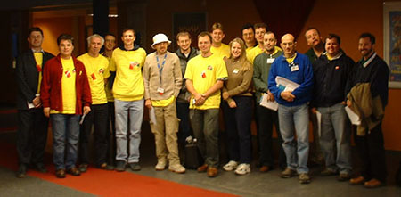

LEGO(r)World 2003 a été l’occasion pour l’ensemble des LUGs Européens de se présenter. Voici une courte présentation.

Etaient présents les représentants des Pays-Bas, de Belgique, d’Allemagne, de France, de Grande-Bretagne, d’Italie et du Portugal. De plus assistaient à la présentation des invités  
américains et LEGO Direct (Brad JUSTUS)

Pascal Brugier (Fr), Yann Laurent (Fr), Ludo (Be), ?, Pedro Silva (Pt), ? (It), Jake McKee (LD), ?, ?, Christina Hitchcock (USA - Brickfest), Volker Drashka (All), ?, ?, Mario Ferrari (It), Larry Pieniazek (USA pour Brickish), Abner Finley (USA) et Steve Barile (USA - PNLTC, ILTCO, BrikWorx)

Chaque représentant à décrit l’organisation de son groupe, ces activités ainsi que les relations qu’ils entretiennent avec la compagnie LEGO dans leur pays respectif.

Ce fut une rencontre agréable et utile qui permit d’avoir une vue globale de la situation des LUGs en Europe. Cette réunion permit par ailleurs de créer des contacts entre les groupes qui perdurent notemment grâce aux e-mails.

Merci à Debouwsteen pour le crédit photographique

[L’article en anglais sur le site de Debouwsteen](http://www.debouwsteen.com/index.php?option=displaypage&Itemid=155&op=page&SubMenu=)
