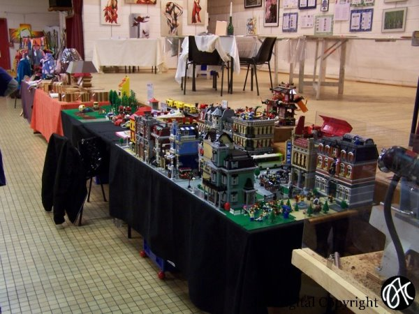
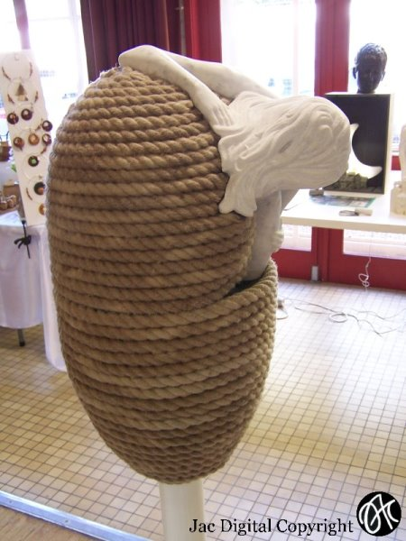

Exposition de dix jours à la salle de l’ancien marché au cœur de Randan. Ca faisait drôle de tout ranger à la fin...

La ville de Randan au Nord du Puy-de-Dôme, organise chaque année une exposition qui regroupe les artisans du canton et un peu au-delà, gratuitement. La note était mise sur la poésie pour cette douzième édition. Plusieurs fois invité par l’organisation, je me décide enfin à y participer. Mais il faut s’organiser pour tenir le stand sur la durée de l’exposition, du 2 au 11 novembre. Heureusement, Danielle m’a prêté main forte pour le courant de la semaine.

Le diorama construit pour Fana’briques en juin a fait encore une petite présentation avec quelques modifications supplémentaires. L’idée de rajouter une portion de route goudronnée est sympa et anime un peu plus la partie avec la venue plus facile des visiteurs.

Randan étant dans le Puy-de-Dôme à quelques kilomètres de Clermont-Ferrand, j’ai eu l’idée de présenter un deuxième camion de course aux couleurs de l’ASM. 

Quelques modèles supplémentaires ont pris place entre les rallyes et la ville de Danielle qui a eu énormément de succès, autant auprès des enfants attirés par des scènes de la vie quotidienne que par les adultes fascinés par la dimension des constructions.

C’était très sympa de présenter nos LEGO au milieu de pièces en bois tournées, mosaïques et autres tableaux. L’exposition avaient des stands magnifiques, d’ailleurs, la visite était très agréable.

L’expérience est à renouveler car avec la bonne ambiance qui régnait dans la salle, le stand LEGO a apporté du sang neuf. Les montages sur place ont confirmé l’aspect très technique et la difficulté d’assembler certaines constructions.

[Galerie photos](http://photos.freelug.org/main.php/v/JAC/Exposition/2013/Randan/)
