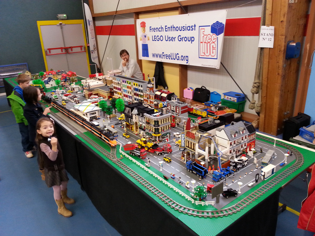
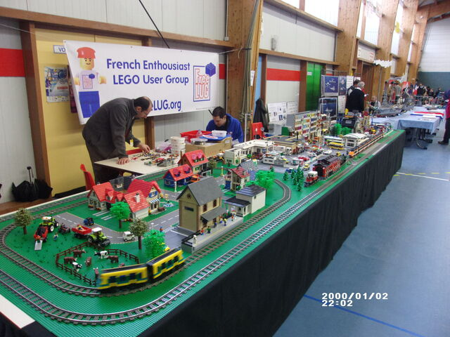
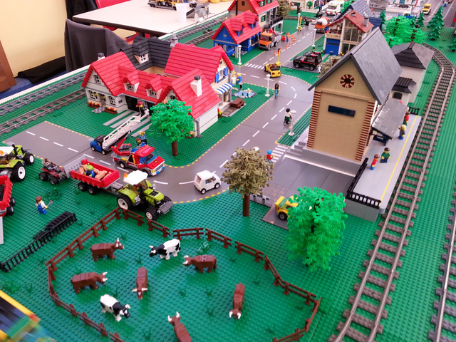

C’est dorénavant le rendez-vous tous les deux ans du mois de novembre pour FreeLUG depuis 2007. Toujours accueillis les bras grands ouverts, nous n’avons pu être que trois adhérents à venir représenter le monde LEGO à ce festival de la miniature.

Il y a deux ans, nous avions réussi à présenter du western sur notre diorama.  
Cette année, nous avons essayé de revenir "aux bases" du diorama LEGO : un réseau de train avec une ville à l’intérieur.

On s’est donc retrouvés à trois pour cette exposition. Après quelques échanges, nous sommes partis sur une double boucle pour faire tourner deux trains.

Une partie ville d’un côté avec les bâtiments modulaires et villages avec des maisons individuelles et surtout deux gares .  
J’ai ramené mon centre commercial pour faire la séparation entre les deux parties.

Comme il est de coutûme, le diorama s’est vite rempli de Minifigs en tous genres du super héros à Spidercochon...

Je tiens à remercier toute l’équipe de l’ADImin et Vincent pour leur accueil.  
Ils nous attendent d’ores et déjà dans deux ans en espérant que l’on viennent plus nombreux...

Et merci à mes deux comparses de m’avoir supporté le temps de ces trois jours...

Pierre L. / Pierrolego

* * *

Après le gros barnum de Diémoz, une petite exposition en comité restreint deux mois après était plutôt sympathique.

je me suis occupé du coté ville avec un assemblage de 12 immeubles modulaires, mes MOCs et les no-MOCs du gamin !! :)

Ah oui, on n’était que trois, mais qu’est ce qu’on s’est bien marrés pendant ces trois jours... des vannes et des bêtises toutes les cinq minutes !

Et comme d’habitude, un accueil toujours parfait de la part de Vincent et son équipe. Et ils savent bien nous rappeler que c’est toujours sur cette exposition que le record sur la LGV a été fait...

Loys

* * *

Comme nous sommes revenus à un réseau de train/City, j’ai proposé de faire une petite gare pour la partie campagne, histoire de sortir un nouveau MOC. Avec quelques-unes des maisons fabriquées pour Diemoz et l’immeuble multicolore (réduit pour l’occasion), c’est parti pour trois jours d’exposition.

Nos stars habituelles, super-héros, personnages Starwars, Toy Story, ... étaient de sortie, dans le diorama ou sur un moteur de train.

Merci à l’ADImin pour leur organisation impeccable, et bien sûr à Pierre et Loys !

Laurent

* * *

[Galerie photo](http://photos.freelug.org/main.php/v/Chimere/StRambert2013/)
