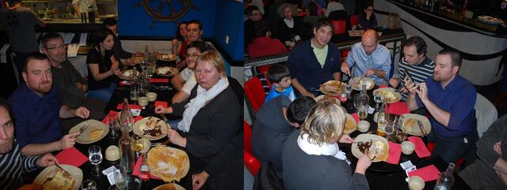
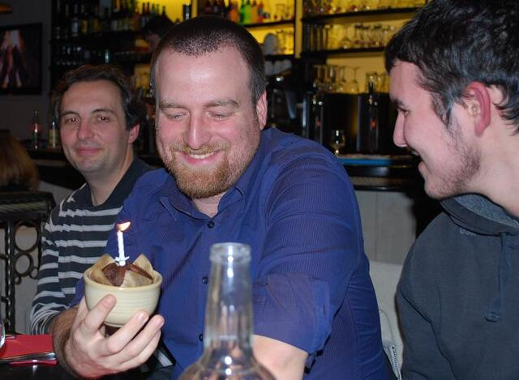

Le vendredi 29 novembre, les AFOL’s du sud parisien se sont donnés rendez-vous pour un RestoLEGO à Rambouillet.

C’est au restaurant « Le phare St Louis » que nous nous sommes retrouvés pour cette soirée. En effet, la petite crêperie du centre-ville a accueillie pour cette soirée 13 AFOLs autour d’un repas convivial. C’était l’occasion de rencontrer de nouveaux adhérents et de retrouver d’autres plus anciens. Pour cette soirée, était au rendez-vous : Erik AMZALLAG, Pierre CHARLES, Xavier CLEMENT, Amaury et Sebastien DREMIER, la famille PETIT (Edwige, Jean-Claude, Julie et Xavier), Alain RENIER, Marc THENOT, Anne-Laure, ma femme et moi-même.

La soirée très animée en discussion est passée très vite, on a tout de même eu le temps de fêter l’anniversaire de Pierre pour qui Julie et Xavier se sont surpassés !!

Rémi B

* * *
