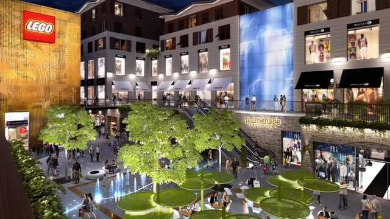
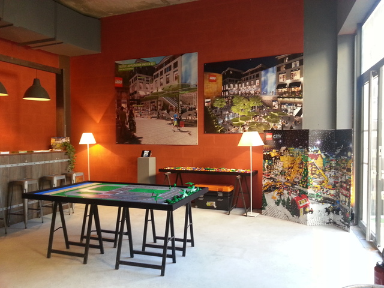
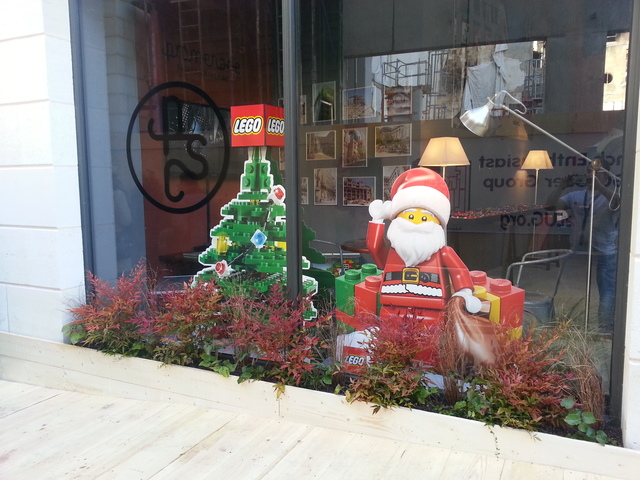
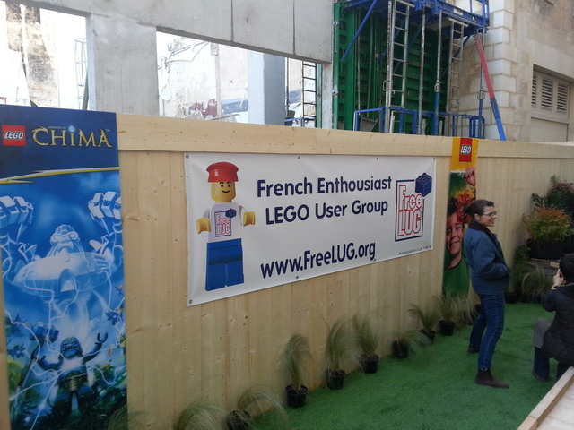
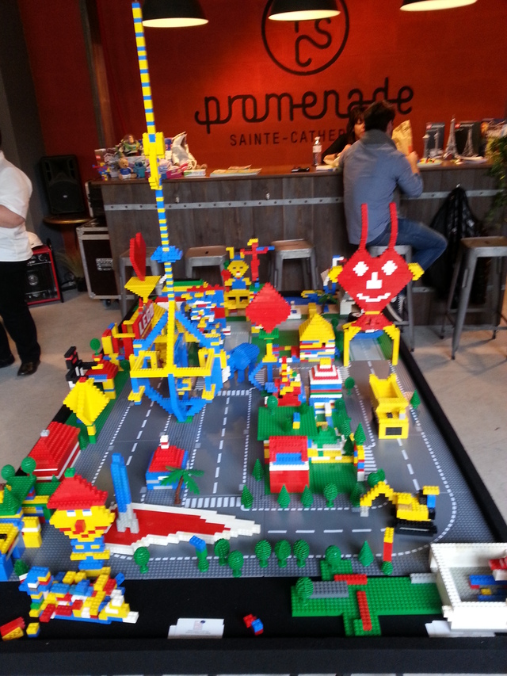
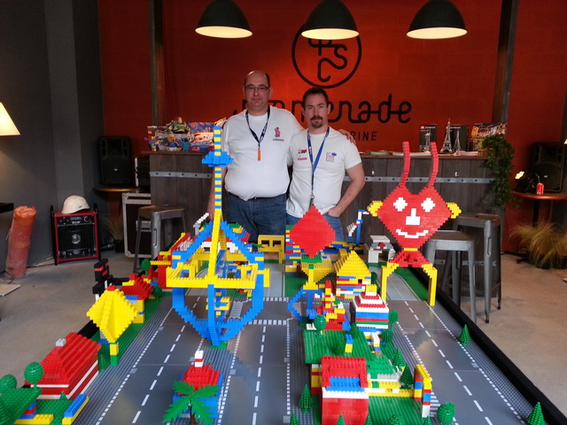

Quelques temps après "Fans de Briques LEGO" Talence édition 2013, je suis contacté par l’agence [COTE OUEST](http://www.coteouestfrance.com/) afin de leur proposer une animation à l’aide de nos petites briques préférées.

Suite à une première réunion, il s’agirait de pouvoir proposer un atelier dont le droit d’entrée sera un jouet neuf ou d’occasion offert aux Restos du Cœur. Les jouets seront remis à l’association de commerçants La Ronde des Quartiers de Bordeaux, qui collecte également sur le Marché de Noël des jouets en faveur des Restos du Coeur.  
Il s’agit pour l’agence COTE OUEST d’entamer une série d’animations jusqu’à l’ouverture de Promenade Sainte-Catherine en 2015. La Promenade Sainte-Catherine entend être le futur grand espace commercial Bordelais, avec déjà comme enseigne principale LEGO avec une surface de 700m² !

Je leur suggère donc une animation où le public contribuera à une œuvre participative en créant une ville à partir de plusieurs milliers de briques de bases ( 2x2, 2x3, 2x4 ....), le lieu choisi est la Maison du projet de Promenade Sainte-Catherine du 20 au 22 décembre.

Afin de représenter au mieux FreeLUG, je propose à Denis alias "Lego Builder 33" (déjà présent à "Fans de Briques LEGO") de me rejoindre pour l’aventure.  
Nous prenons donc possession des lieux le vendredi 20 au matin, afin de mettre tout en place pour l’animation. Bonne surprise, sur mes conseils, l’agence à réalisé des plateaux avec rebords et recouverts de tissus traité anti-feu sur lesquels nous allons pouvoir poser d’une part les plaques servant de bases à la "ville" et d’autre part le stock de briques.

Une fois la "matière première" de l’animation mis en place, nous nous chargeons de la décoration :

Enfin à 14h, nous ouvrons et débutons l’animation avec nos premiers visiteurs. Comme à chaque fois, le public est hétéroclite. Parents comme enfants s’amusent ensemble et ce qui devait être une "ville" devient très rapidement une œuvre d’art participative, ou chacun y va de sa construction au gré de son imagination.

Nous bouclons le dimanche soir avec une petite montagne de jouets collectés au profit des Restos du Coeur, et une fois de plus de nombreuses rencontres avec des curieux ou des AFOL’s à qui nous avons pu présenter l’association FreeLUG.

_Merci à Maryline "La trieuse" et Marie-Laure "City Curly 33" nos compagnes qui nous laissé passer un week-end entre "hommes" ;)_
