Présentation du montage étape par étape de la grue 42009 de 2013.

**Introduction**

Je vais vous présenter un modèle de LEGO de l’année 2013 : la grue 42009.

[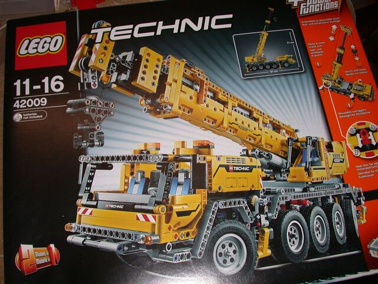](https://www.freelug.org/IMG/jpg/plan1-1.jpg)

Il est composé de 2606 pièces dont la couleur dominante est le jaune.  
Ce modèle est mécanisé et motorisé et n’utilise pas de système pneumatique.

[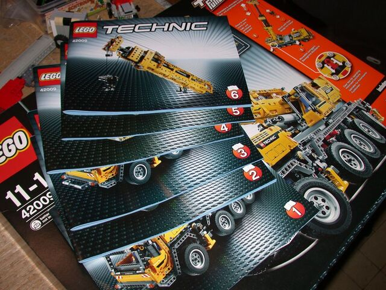](https://www.freelug.org/IMG/jpg/plan1-0.jpg)

Le montage se fait en trois étapes : le châssis (3 plans), la tourelle (2 plans) et la flèche (1 plan). Nous allons maintenant voir le détail de ces trois étapes.

**Etape 1 Le châssis : Plan N°1**

[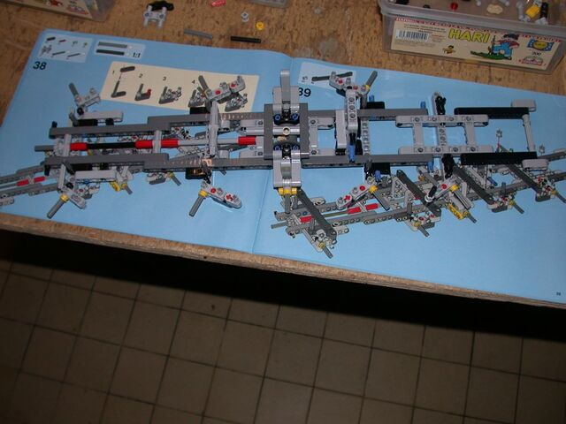](https://www.freelug.org/IMG/jpg/plan1-2.jpg)

Quand on fait l’inventaire, c’est agréable de retrouver des pièces communes à part peut-être les crémaillères. Le départ est très attrayant, et donne envie de terminer rapidement le modèle. Me voilà rendu à la page 75 du manuel, on a mis en place les crémaillères des 4 trains de roulement à roues directrices. On va avoir un véhicule avec 8 roues directrices sur 10.

[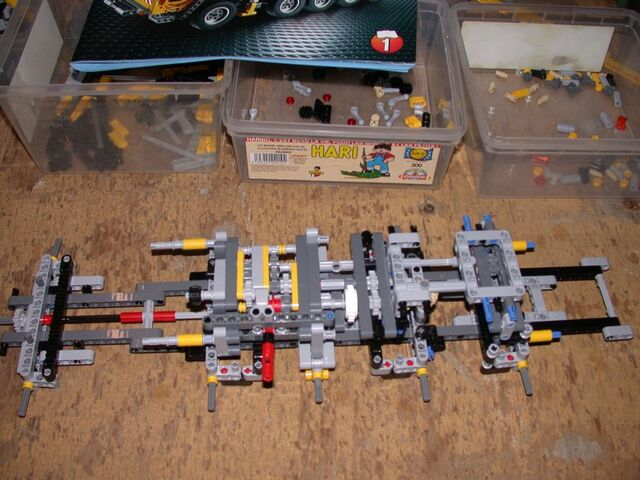](https://www.freelug.org/IMG/jpg/plan1-5.jpg)

La fin du premier plan laisse envisager que le modèle sera de grande taille.

**Étape 1 Le châssis : Plan N°2**

Voilà le plan N°2, nous mettons en places les stabilisateurs, le système est très compact.

[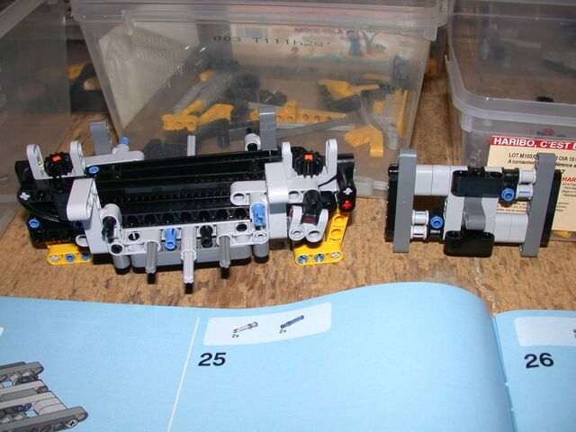](https://www.freelug.org/IMG/jpg/plan2-2.jpg)

Ils se déploient en 2 temps, l’extension puis l’appui se fait par 4 petits vérins mécaniques, ce qui laisse à penser que l’appui sera très efficace.  
Le seul regret est de ne pas pouvoir piloter les stabilisateurs un par un.

[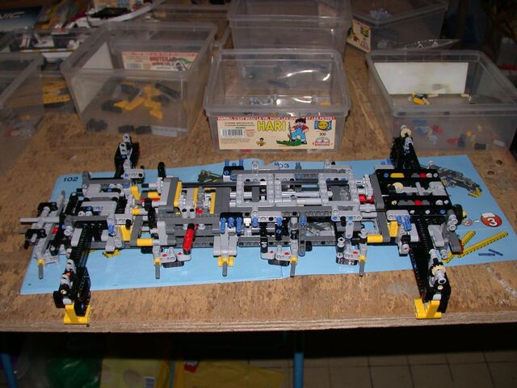](https://www.freelug.org/IMG/jpg/plan2-7.jpg)

L’installation de plusieurs modules donne de la hauteur au châssis  
On finit le deuxième plan par la synchronisation des crémaillères.

**Étape 1 Le châssis : Plan N°3**

Donc là on finalise quelques petits modules fonctionnels, et l’habillage du châssis. Un des éléments important sera la pose du moteur factice, un 8 cylindres en V.

[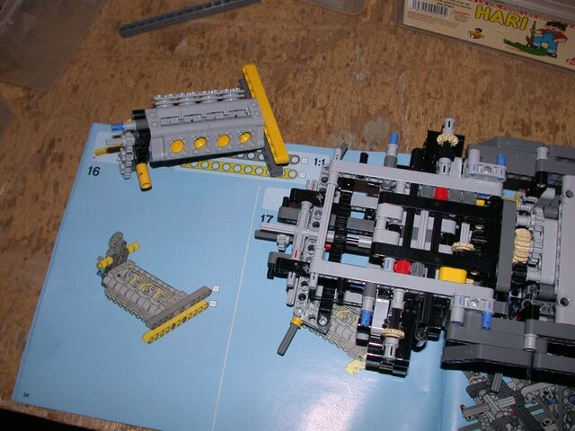](https://www.freelug.org/IMG/jpg/plan3-4.jpg)

Il sera entrainé par le seul train moteur, l’essieu central avec un différentiel.  
On attaque ensuite la pose de la cabine du châssis avec deux portes ouvrantes, 2 fauteuils, rétroviseurs, tout y est.  
Quand je regarde l’ensemble, je remarque que l’accent a été mis pour coller à la réalité.

[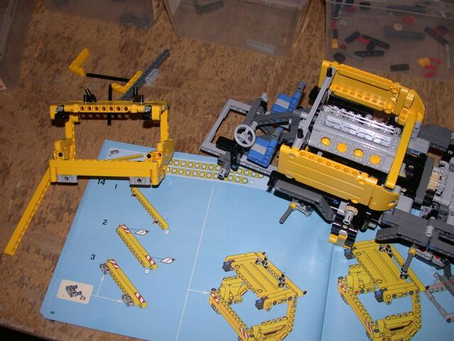](https://www.freelug.org/IMG/jpg/plan3-5.jpg)

Malgré les cinq trains de roulements l’ensemble est très facile à pousser, il reste très maniable avec 4 essieux directionnels.  
La grue du set 8421 à la même largeur de châssis, mais une longueur inférieure.

**Étape 2 La Tourelle : Plan N°4**

Le début du plan 4 commence fort, ça part dans tous les sens, des axes, des engrenages en veux-tu en voilà.  
On met en place les deux vérins mécaniques et enfin on pose le moteur électrique.

[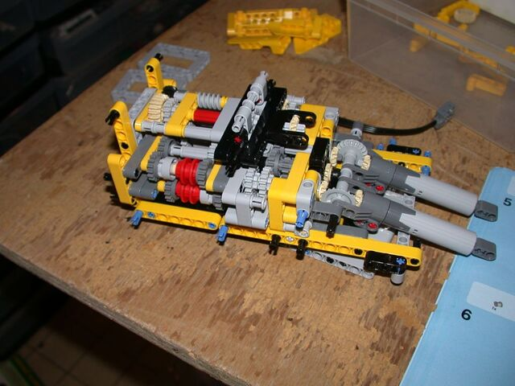](https://www.freelug.org/IMG/jpg/plan4-1.jpg)

**plan4**

Quand je vois le nombre de mécanismes qui sont montés sur le châssis, et rien de motorisé, cela laisse présager que la tourelle va piloter le châssis par des liaisons mécaniques.

[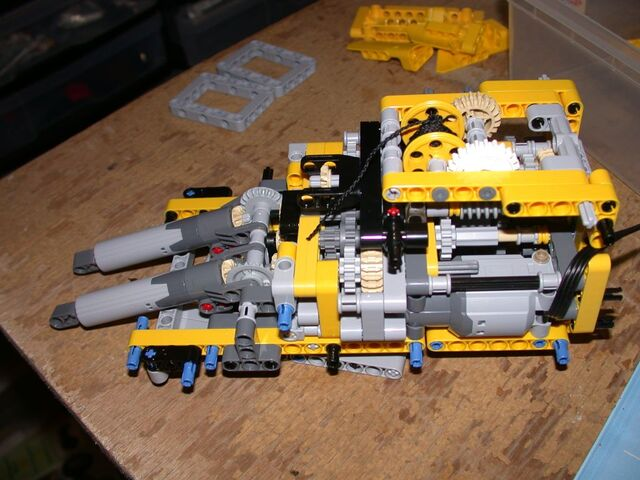](https://www.freelug.org/IMG/jpg/plan4-2.jpg)

Là on frise la crise de panique, car on se demande si tous ces engrenages sont utiles tant il y en a dans un espace si réduit. La tourelle est un élément très complexe, il y a de nombreux éléments en mouvement.

[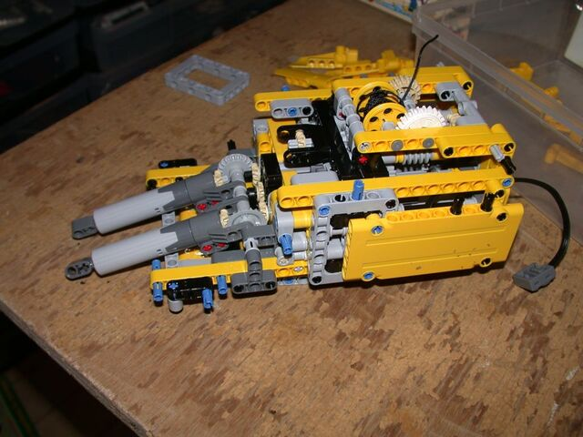](https://www.freelug.org/IMG/jpg/plan4-3.jpg)

On pourrait faire facilement des erreurs dans cette partie. C’est l’élément le plus intéressant de ce modèle.

**Étape 2 La Tourelle : Plan N°5**

Voilà le livre 5, il comprend l’habillage de la tourelle et l’installation du sélecteur de mouvement. Ce dernier distribuera la puissance du moteur électrique vers quatre mécanismes différents.

[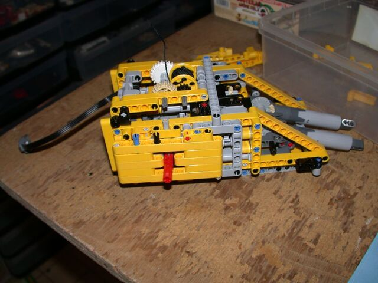](https://www.freelug.org/IMG/jpg/plan5-0.jpg)

La construction de la cabine prévoit elle aussi une porte et un fauteuil. Installation du boitier de piles.

[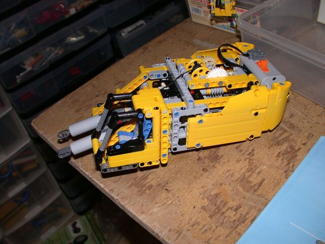](https://www.freelug.org/IMG/jpg/plan5-2.jpg)

Jonction de la tourelle au châssis.

[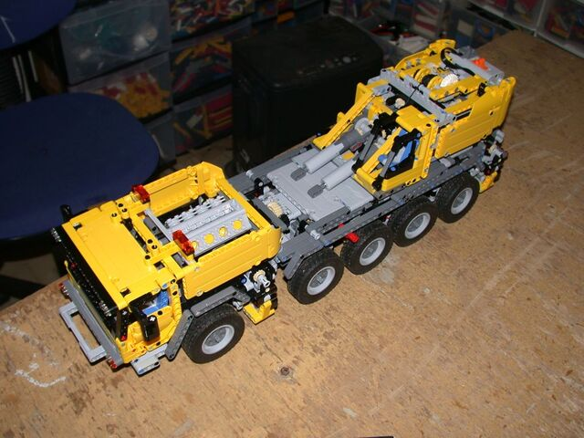](https://www.freelug.org/IMG/jpg/plan5-4.jpg)

Et là je teste les fonctions du châssis : sortie des stabilisateurs et descente des vérins. En effet les 4 petits vérins mécaniques déploient une grosse pression et sur la fin du mouvement le moteur électrique a du mal.

**Étape 3 le bras : Plan N°6**

Je commence la construction de la flèche de levage. Elle sera en trois parties. La premier partie est l’élément qui sera fixé à la tourelle. La deuxième partie sera la mécanique téléscopique alors que la troisième partie c’est le passage du câble qui la déplier. Pas de surprises, c’est le même système de flèche qui a été utilisé sur la grue 8421, mais tout le reste du camion est différent. La jonction du bras avec la tourelle est rapide à terminer.

[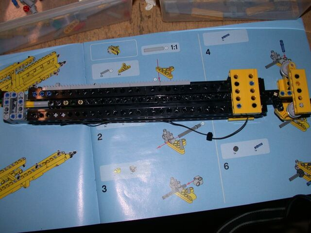](https://www.freelug.org/IMG/jpg/plan6-0.jpg)

Donc là je passe au test des multiples fonctions, déploiement des stabilisateurs, décente des mini-vérins. Descente du câble et déploiement du bras. Une fois le bras déployé le crochet ne peut pas atteindre le sol. Pour la question du fonctionnement, pas un seul bruit de craquement.

[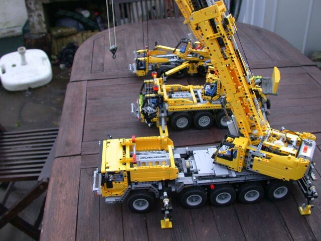](https://www.freelug.org/IMG/jpg/fin1-1.jpg)

Pour comparer, voici les deux autres modèles de grue mobile déjà produits par LEGO présentés avec le petit dernier : au premier plan, le set 8053 sorti en 2010, au milieu la fameuse grue 8421 de 2005 et au fond le set actuel 42009. Pas de doute, ce set 42009 est bien la plus grosse grue mobile construite jusqu’ici par LEGO.

[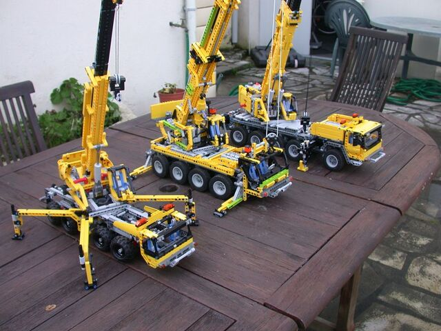](https://www.freelug.org/IMG/jpg/fin1-3.jpg)

**Points forts**  
**–** Un réel plaisir à construire avec le souci des concepteurs de coller à la réalité. Bref, que du plaisir !  
**–** Un modèle qui va donner envie de se remettre à construire et de se replonger dans le bain.  
**–** Je pense que ce modèle va susciter de nouvelles passions.

**Points faibles**  
**–** Le déploiement des deux parties téléscopiques du bras n’est pas si impressionnant !  
**–** Il n’est pas possible de contrôler individuellement les vérins des stabilisateurs !  
**–** La corde fournie pour ce modèle est trop courte de quelques cm !

Rémi Lancien (Darkbaron)
