

Toute l’équipe de Fans de Briques LEGO s’est donc mis en tête de signer pour une deuxième édition.  
Tout de suite une évidence s’impose : Quel site va pouvoir nous accueillir et nous permettre de recevoir nos 5000 visiteurs ?

Le choix se tourne donc naturellement vers L’espace Médoquine une salle de spectacle et concert pouvant recevoir jusqu’à 3000 personnes en configuration concert.  
Une première visite me permet de découvrir un bel espace de près de 1500 m² avec des salons répartis de part et d’autre de la salle principale.  
Ce sera donc "notre" salle !

Maintenant que la salle est trouvée, une date fixée au week-end des 23 et 24 Novembre, il me reste JUSTE à trouver des exposants !

Après quelques mails et messages sur les différents forums LEGO, il est clair que je peux compter sur l’équipe de la première édition.  
Puis rapidement de nouvelles têtes font leur apparition et se montrent intéressées par l’aventure.

La liste finale des exposants nous donne donc :  
**–** BricTechnic : Rom104, Chris et Carl  
**–** TechLUG : Khan, Techymind, MHB, Lastel et Mayou  
**–** Bionifigs : Loysnuva, Skrall789 et Sonic  
**–** Les Grands Z’enfants : Gwelego  
**–** Brickpirate : Mickbatto  
**–** FreeLUG : Loco16, Dark, City Curly 33, Lego Builder 33, BigLegowski, DGB, JyL et Damien  
**–** "Sans étiquettes" : Legoboy et Darkheart3111

Comme l’an dernier, JouéClub viendra proposer un "LEGO store".

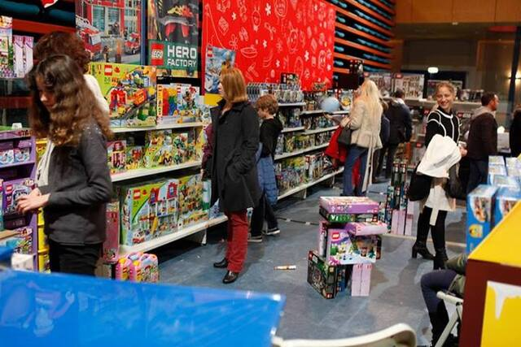

Les nounous de Family Sphere seront de nouveau de la partie avec leur atelier maquillage, mais également l’atelier DUPLO pour les tous petits.

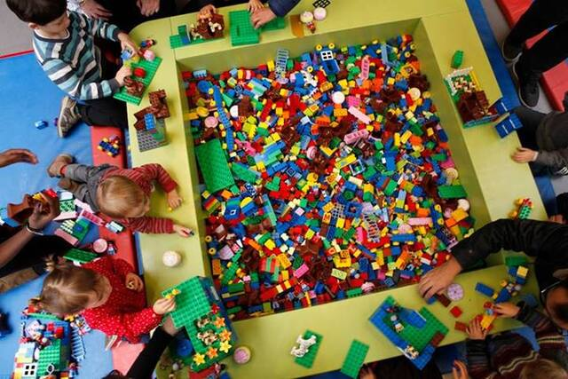

Le Centre Animation Jeunesse de la ville de Talence prendra en charge l’atelier vrac et proposera aux visiteurs de s’initier aux jeux de société LEGO.  
Seront présents également Sophie’s store (épicerie fine anglo-saxone) ainsi que Numeribest (impression multi-supports), Happy Park avec une structure gonflable pour les enfants, Monbana pour les chocolats et enfin Acanthus un fleuriste qui nous a offert la déco de l’espace photo.  
Nous ont également rejoints comme sponsors la mutuelle MCD, et le cinéma Gaumont Talence qui nous a offert 100 tickets que nous avons fait gagner à notre public.  
Même Warner a joué le jeu, en effet l’expo se déroulant quelques mois avant la sortie au cinéma du film "LEGO, la grande aventure" nous avons la joie et la surprise d’avoir avant tout le monde, le photo-box du film qui a rencontré un vif succès auprès du public.

[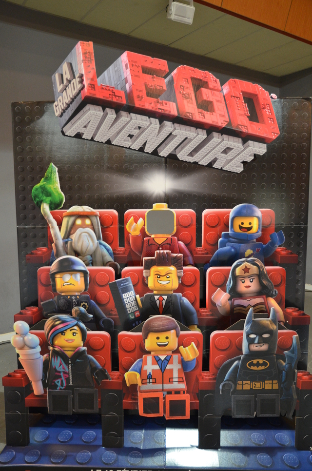](https://www.freelug.org/IMG/jpg/EDE_2022.jpg)

A propos de photos, une autre animation qui a eu beaucoup de succès était notre mascotte Briky, qui a passé son week-end à prendre la pose avec les enfants et parfois même les adultes.

[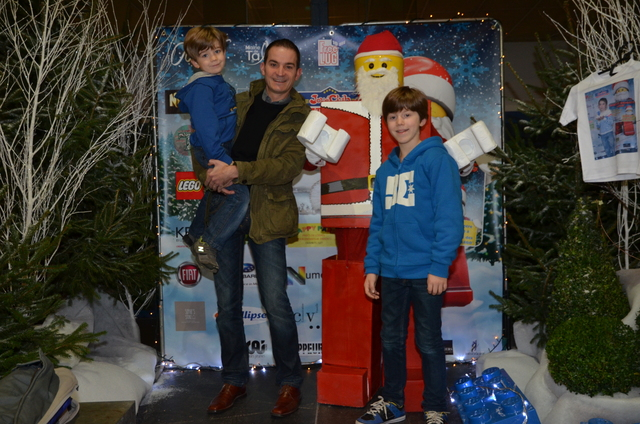](https://www.freelug.org/IMG/jpg/EDE_2750.jpg)

Nous ouvrons donc dès le vendredi soir pour une nocturne et ce sont 400 personnes qui profitent de la soirée pour visiter les stands mis en place par notre joyeuse bande d’Afols (ou en cours de montage, pas vrai Mick !).  
Après une première nuit de repos, nous repartons d’attaque le samedi matin et comme l’année précédente nous sommes rapidement assaillis par les visiteurs.  
Le repas de gala du samedi soir entre Afol’s et partenaires sera une fois de plus un succès avec bonne ambiance garantie avec des boîtes de LEGO à gagner, lots généreusement offerts par FreeLUG.  
Nous repartons donc le dimanche matin encore plus en forme pour un grand rush, je passe mon temps à courir dans tous les sens pour essayer de tout organiser au mieux et répondre aux sollicitations des médias.  
Sur l’ensemble du week-end nous aurons eu : le journal Sud Ouest [http://www.sudouest.fr/2013/11/25/la-petite-brique-qui-deplace-les-foules-1239415-3229.php](http://www.sudouest.fr/2013/11/25/la-petite-brique-qui-deplace-les-foules-1239415-3229.php) [http://www.sudouest.fr/2013/11/24/dans-le-monde-magique-de-la-petite-brique-legomonuments-bordelais-en-lego-1238688-2957.php](http://www.sudouest.fr/2013/11/24/dans-le-monde-magique-de-la-petite-brique-legomonuments-bordelais-en-lego-1238688-2957.php) mais aussi la télé avec France 3 [http://aquitaine.france3.fr/2013/11/23/les-fans-de-lego-ce-week-end-talence-363381.html](http://aquitaine.france3.fr/2013/11/23/les-fans-de-lego-ce-week-end-talence-363381.html) et enfin BFM Tv (mais là le replay reste introuvable !!!!)  
Nous fermons le dimanche fatigués mais heureux avec au compteur plus de 10.000 visiteurs (après vérification nous atteindrons 10.400).

Tout au long du week-end c’est une foule ininterrompue de fans de LEGO qui se sont succédé pour venir voir de superbes créations mais aussi et surtout s’amuser et jouer ! Nous avons offerts de nombreux lots sous forme de différents jeux, dont notamment le jeu de "cherche la brique".

[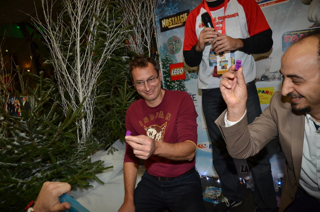](https://www.freelug.org/IMG/jpg/EDE_3263.jpg)

_Au "pays" des LEGO, il n’y a pas que les enfants qui jouent !_

Quelques photos de vue d’ensemble (photos de Gwelego), suivies des créations liées au thème des monuments girondins (photos par Gontran Ducelier MHB) :

[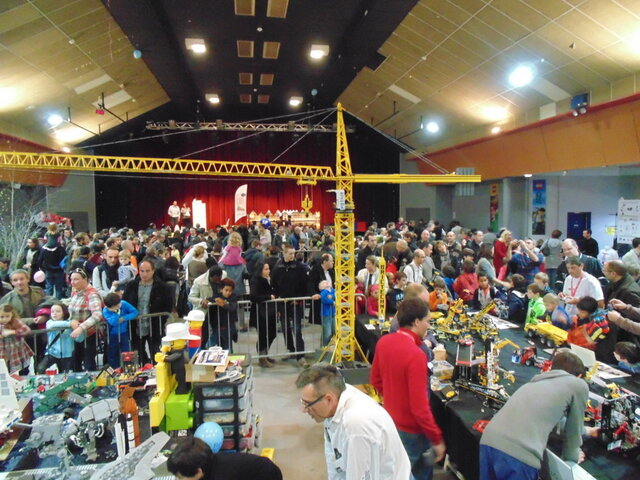](https://www.freelug.org/IMG/jpg/DSC00163_FILEminimizer_.jpg)

[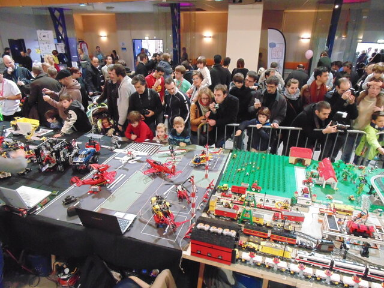](https://www.freelug.org/IMG/jpg/DSC00164_FILEminimizer_.jpg)

[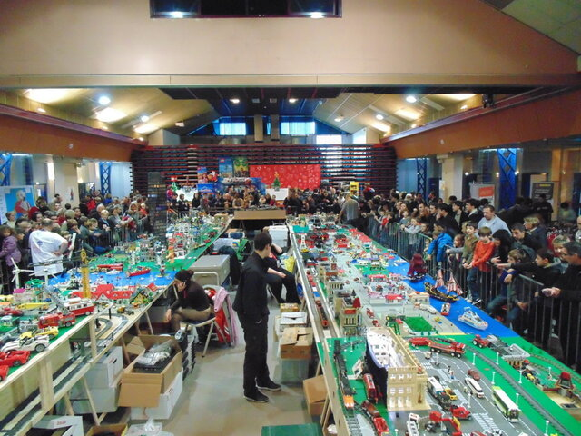](https://www.freelug.org/IMG/jpg/DSC00165_FILEminimizer_.jpg)

[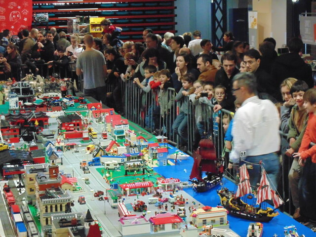](https://www.freelug.org/IMG/jpg/DSC00166_FILEminimizer_.jpg)

[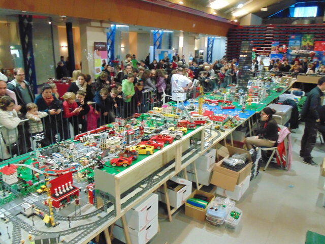](https://www.freelug.org/IMG/jpg/DSC00167_FILEminimizer_.jpg)

[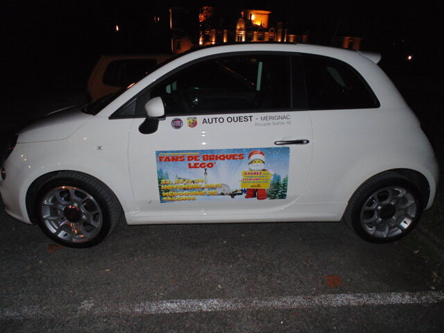](https://www.freelug.org/IMG/jpg/DSC00103_FILEminimizer_.jpg)

_Notre "voiture de fonction" que Gwenaël a adoré_

[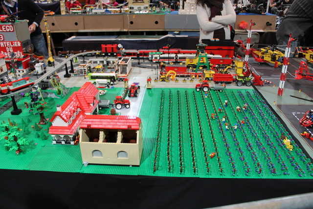](https://www.freelug.org/IMG/jpg/MHB_0072.jpg)

_Un vignoble en plein vendange_

[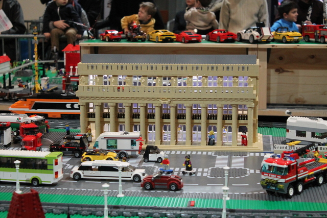](https://www.freelug.org/IMG/jpg/MHB_0152.jpg)

_Le Grand Théâtre de Bordeaux_

[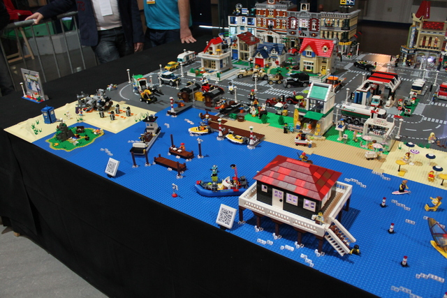](https://www.freelug.org/IMG/jpg/MHB_0223.jpg)

_Les cabanes tchanquées_

[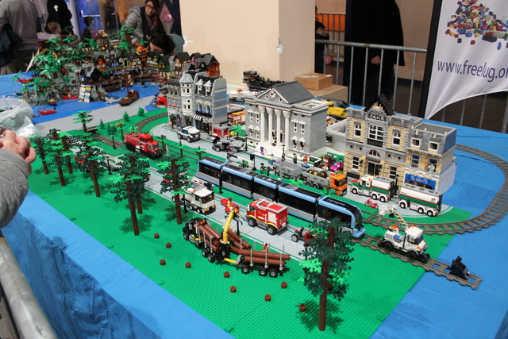](https://www.freelug.org/IMG/jpg/tram_bordeaux.jpg)

_Le tramway de Bordeaux_

Avant de conclure je voudrais remercier tous les Afol’s, tous les LUG’s, toutes les associations qui ont formidablement contribué à la réussite de cet évènement.  
Je remercie aussi notre public encore plus nombreux et toujours aussi mordu de la brique que nous !

_Et enfin, merci à toi Victor pour avoir créé avec moi cette expo, j’espère que nous allons en faire un véritable rendez-vous du LEGO qui fera référence !_

[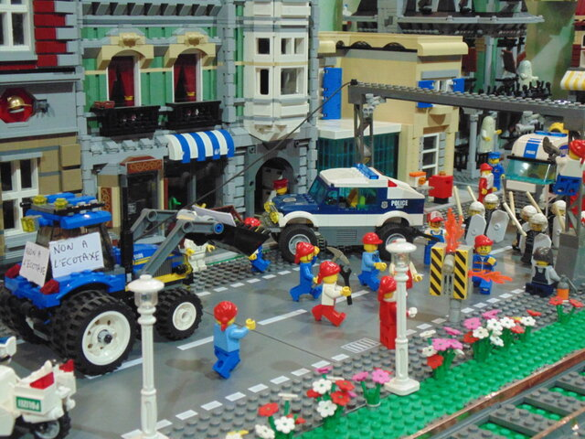](https://www.freelug.org/IMG/jpg/bonnets_rouges.jpg)

* * *

[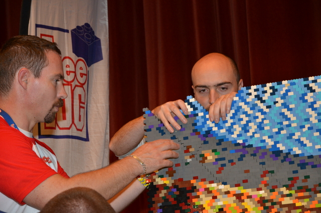](https://www.freelug.org/IMG/jpg/EDE_3286.jpg)

**Erik Amzallag "Brickerik"**  
"Si, si c’est bien lui caché derrière la mosaïque !"

* * *

[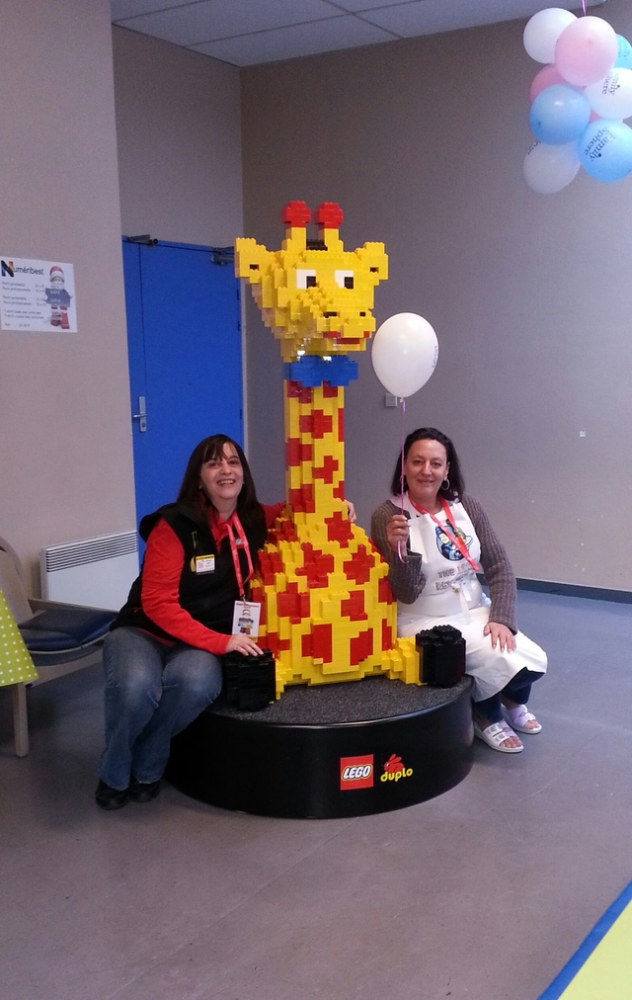](https://www.freelug.org/IMG/jpg/20131123_090842-1.jpg)

_Daniela Drost et Maryline Cassutti (en tablier)_

* * *

**Pierre Charles "Tribolego"**

Ce fut avec un grand plaisir que j’ai répondu à l’invitation de Christophe, avec quelques camarades du CA de FreeLUG (Erik, Daniela et PierreL) ainsi que Xavier qui nous a rejoint, pour organiser en tant que bénévoles deux animations pour cette deuxième édition de "Fans de Briques LEGO".

Pour l’occasion nous avions le "building event" consistant à faire construire au public une fusée géante (reproduction à l’échelle x6 d’un petit modèle représentant Ariane).  
Nous avions aussi emprunté le matériel de Simon Pinta pour réaliser une mosaïque géante représentant la place de la bourse de Bordeaux.

[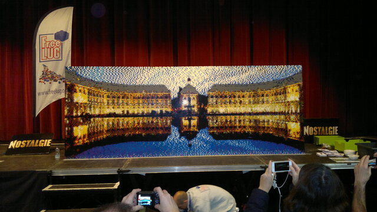](https://www.freelug.org/IMG/jpg/2013-11-24-1066-2.jpg)

**La mosaïque de la Place de la Bourse de Bordeaux**

J’en ai profité pour amener mon immeuble, qui commence à avoir pas mal fait le tour de la France !

[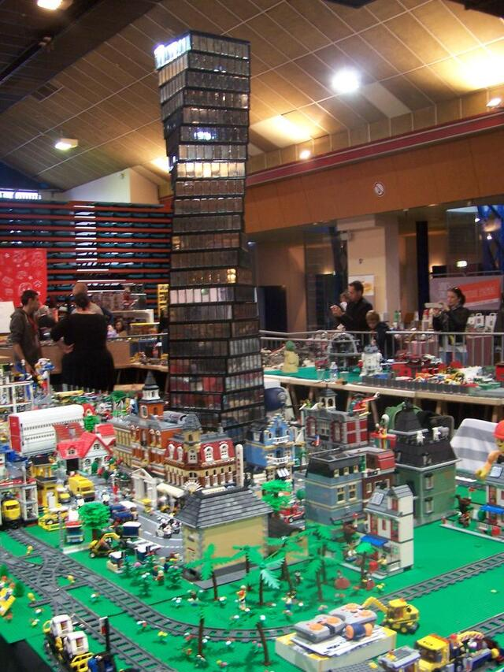](https://www.freelug.org/IMG/jpg/100_7954.jpg)

**Photo de ma tour faite par Nicolas "JyL" Rigolini**

Pour finir, encore un grand merci au nom de l’association et de moi-même pour l’accueil qui nous a été réservé et pour l’organisation "au poil" faite par nos amis Aquitains !

**Pierre "Tribolego"**

* * *

**Pierre Laurenge**

* * *

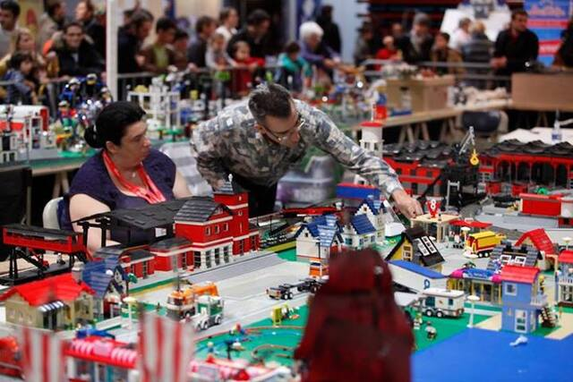

**Pascal et Lydie**

* * *

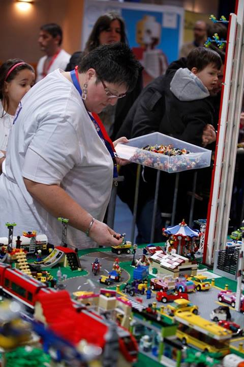

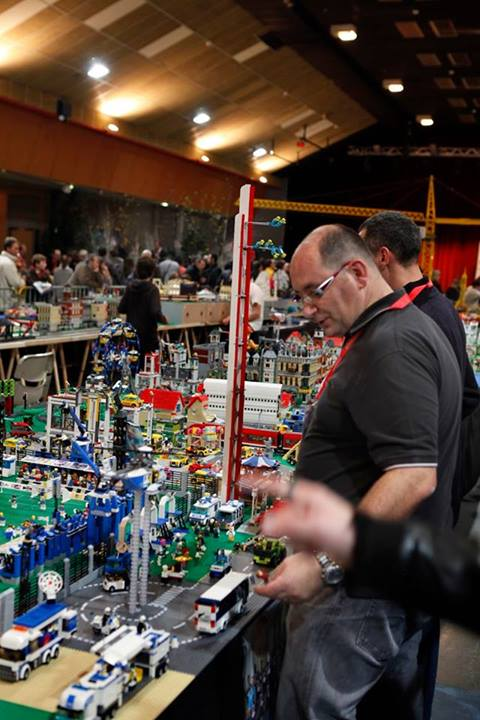

_Marie laure Moulard "City Curly 33" et Denis Vareille "Lego Builder 33"  
_

On avait vécu la première édition en tant que visiteurs… mais là …c’est le grand jour : **QUELLE AVENTURE MAGIQUE !**  
Pour notre part ce fut une première ; …et quelle première !  
On regrette presque de n’avoir voir pas sauté le pas plus tôt, tellement on s’est éclaté. (dans tout les sens du terme lol !)  
Voilà tout est prêt … y a plus qu’à charger ………. Allez c’est parti.

[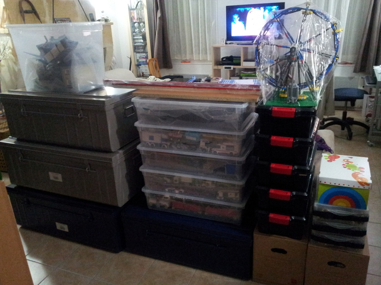](https://www.freelug.org/IMG/jpg/20131121_190001.jpg)

_Vendredi 6h30 on charge dans les 2 voitures_

Montage de 9h30 à 19h et oui ….c’est long pour arriver à ceci.. 13 m2 de diorama ….. MERCI aussi à Pierre "Tribolego" qui dès le samedi nous a prêté sa super tour qui a fait sensation !!

[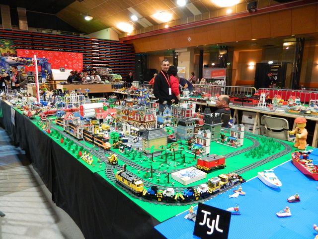](https://www.freelug.org/IMG/jpg/DSCN3194.jpg)

Mais à l’ouverture de la nocturne 19H, ils nous manquaient tout de même les arbres et les fleurs… merci sylvain pour ton aide.

[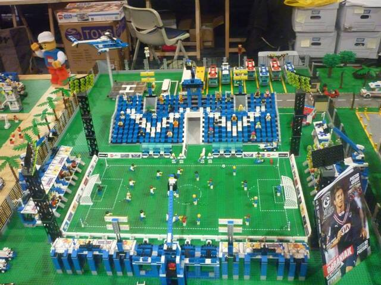](https://www.freelug.org/IMG/jpg/1453479_10201673091523145_792430062_n.jpg)

_Petite reproduction de la tribune présidentielle du Stade Chaban Delmas_

[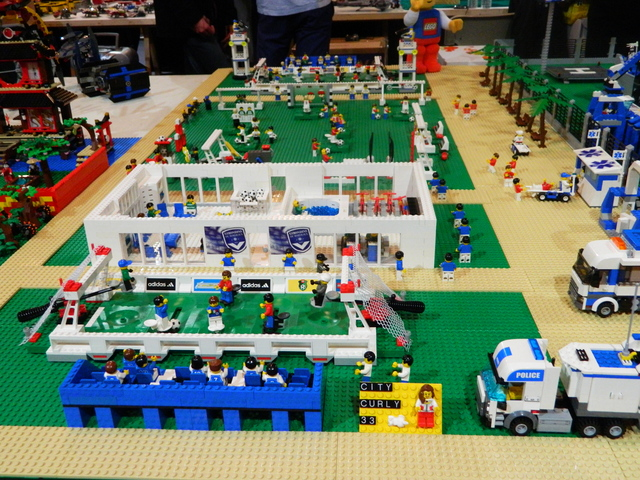](https://www.freelug.org/IMG/jpg/DSCN3207.jpg)

_Un récapitulatif du centre d’entrainement des Girondins de Bordeaux_

[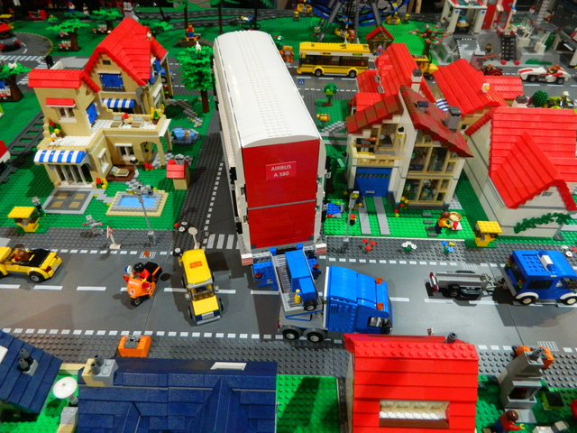](https://www.freelug.org/IMG/jpg/DSCN3200.jpg)

_Une partie du convoi terrien de l’A380 (Langon-Toulouse)_

Nous sommes ravis d’avoir pu donner du plaisir aux visiteurs, d’avoir pu partagé notre passion, d’avoir pu donner des conseils (certes novices) , des astuces pour retrouver des sets, des pièces !  
De voir tous ses yeux qui brillent sur tous les dioramas… Quel bonheur !!  
3 jours de pur bonheur avec une ambiance merveilleuse. On a bien rigolé.

[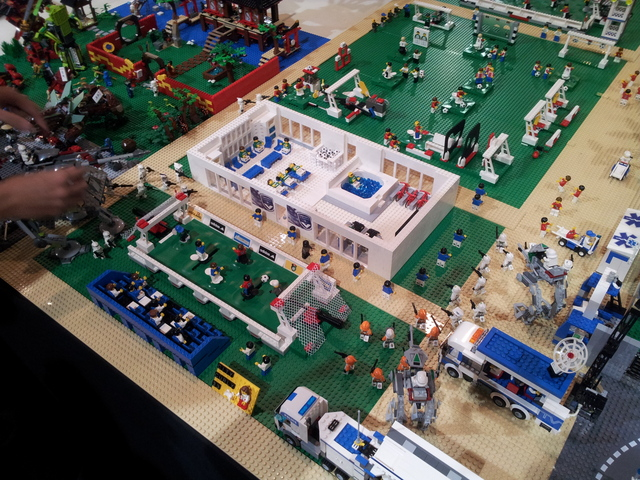](https://www.freelug.org/IMG/jpg/20131123_162225.jpg)

_n’est-ce pas Loïc... merci pour ton attaque_

Dimanche soir 22h30 après déchargement des 2 voitures … notre lit nous attendait vraiment. Nos jambes ne nous soutenaient plus…. lol  
Nous avons fait plus amples connaissances avec les AFOLS présents, avons eu, leurs avis sur les dioramas, leurs conseils pour faire évoluer une ville, pour mettre en valeur telle ou telle chose. Merci à vous tous

Un grand Merci à Christophe « Bordolego » pour nous avoir fait confiance, alors qu’il nous a connu visiteurs lors de la 1ère !  
Et surtout d’avoir eu l’idée de lancer dans le sud ouest… la grande brique LEGO.  
Merci à FreeLUG pour les fils rouges. Cette fusée et cette mosaïque ont vraiment fait sensation.

et un GRAND MERCI A CE NOMBREUX PUBLIC  
qui nous a donné des frissons...

Il nous a fallu 9 mois de préparation, dont les 2 derniers furent très intensifs !! Tant dans la construction que dans la « surchauffe » de la CB … lol  
Mais, ça donne vraiment envie de faire la 3ème édition.

\_\_Marie-Laure “city curly 33” & Denis “lego builder 33”\_\_

* * *

**Xavier Clément**  
Pour une première participation à une expo avec FreeLUG, j’avoue que ça a été fort, souvenir impérissable de ce moment où j’ai pu côtoyer tout les gens qui vivent la même passion que moi et pouvoir partager avec un public averti ou non sur cette petite brique en plastique. Merci pour l’implication et l’accueil chaleureux des organisateurs de cette expo en particulier Christophe et son épouse, merci aux membres de FreeLUG qui m’ont accueilli et on eu confiance en moi pour cette première expo. Merci aux bordelais pour leur gentillesse et leur compréhension. Bravo bel expo et bon organisation de la cuvée 2014.

* * *

**Cassutti Etienne**

Retour d’expérience sur ma première exposition de briques LEGO, sur le salon "Fans de Briques LEGO" à la MEDOQUINE de TALENCE le 22, 23 et 24 Novembre 2013.

Après avoir aidé Christophe sur plusieurs expositions, j’ai décidé de franchir le pas et de devenir acteur sur un salon.  
Cette décision a été motivée par une observation effectuée sur les différents salons. En effet, j’ai vu dans les yeux des enfants une certaine frustration, ainsi que dans le regard de plusieurs adultes.  
Pour imager cette constatation voici deux exemples :  
\-Pour les enfants ces LEGOS ressemblent à une grosse bonbonnière ouverte ou une multitude de gourmandises qui sont à portée de main mais auquel on n’a pas le droit de toucher.  
\-Pour les adultes, devant la dernière FERRARI au budget inaccessible, là aussi seul le regard est satisfait.  
Donc, opération remues méninges, pour créer un stand interactif, enfin une idée : réaliser un stand de conduite tout terrain avec des zones de franchissements pour faire évoluer un véhicule LEGO 4 X 4 ( MOC camion-citerne feu de forêt sur une base de crawler modifié) .

[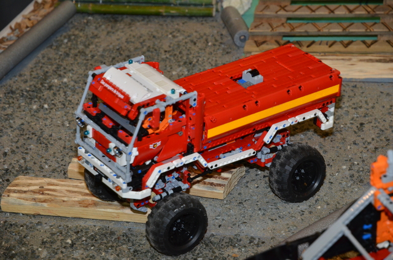](https://www.freelug.org/IMG/jpg/EDE_2002.jpg)

Au travail réalisation du circuit démontable et transportable, des obstacles et des franchissements, essais, modifications et validation par mon chef Christophe « qui est mon fils » .

[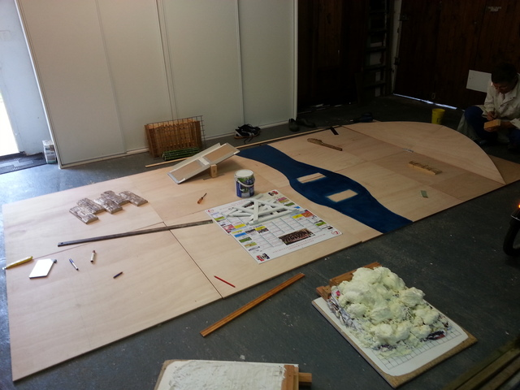](https://www.freelug.org/IMG/jpg/20131015_154810.jpg)

Le jour de vérité arrive enfin le 22 Novembre pour une mise en bouche sur la nocturne, petite période de rodage de l’engin et du bonhomme, pendant que les copains continuent à monter les stands en présence du public.

[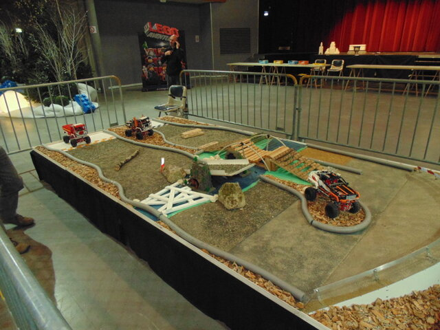](https://www.freelug.org/IMG/jpg/DSC00044_FILEminimizer_.jpg)

Les premiers stagiaires en conduite tout terrain prennent possession du stand, celui ci a l’air de plaire, 22h30 fin de la journée vite au lit.  
Le lendemain samedi 23, ouverture du salon à 10h00, dehors déjà la file d’attente du public se constitue, ce qui laisse présager d’un certain succès de la manifestation.  
En route pour la journée que je suppose animée mais cool, erreur le stand est pris d’assaut par une bande de têtes blondes accompagnée des parents. Rapidement, je dois réagir et réalise un fléchage pour une file d’attente.  
Les enfants s’accaparent de la bête, du circuit ainsi que de l’animateur. Vers 15h00, je décide de suspendre momentanément l’activité pour me restaurer, un sandwich pris sur le pouce, en prenant mon café j’espère que les enfants seront partis voir d’autres stands, cela me permettrai de visiter l’expo.  
Mais non, ils sont patients les bougres, donc changement rapide des piles, remises en état du parcours suite à quelques sorties de routes provoquées par des petits nerveux, l’activité reprend sans arrêt jusqu’à la fermeture.

[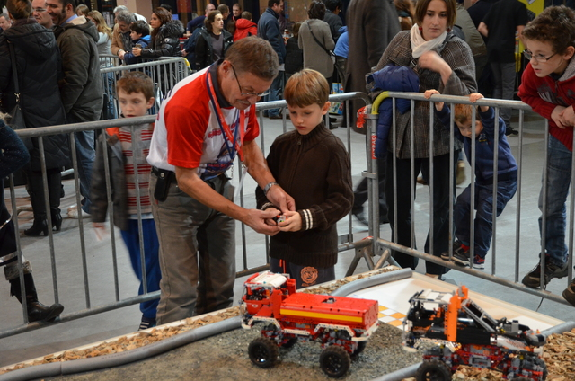](https://www.freelug.org/IMG/jpg/EDE_2014.jpg)

De retour le dimanche matin 24 pour l’ouverture du salon, un petit déjeuner copieux est nécessaire, la journée risque d’être longue.

Vers 10h00 démarrage en douceur, c’est bon signe, je me dis que la journée devrait être plus calme, car le dimanche = grasse matinée, petit tour au marché et repas de famille, suivi d’une sieste.  
La suite est plus compliquée, il est 11h00 et déjà les bambins prennent la file d’attente pour un seul tour de circuit, je dois faire la police car certains sont déjà passé le samedi, mais vu le nombre d’enfants impossible de les reconnaître tous, enfin cela fait partie du jeu.

[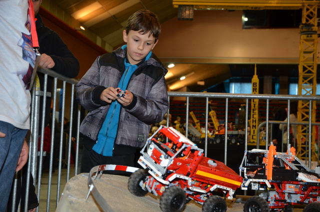](https://www.freelug.org/IMG/jpg/EDE_2170.jpg)

Devant la maladresse de certains enfants quelques parents un peu trop moqueur se retrouvent aux commandes du véhicule et la c’est le drame ! incapacité pour diriger l’engin, aussi ils repartent la tête basse après avoir était la risée du public.  
La journée continue et la salle déborde de public, pour ma part j’ai la tête dans le guidon, des courbatures à force d’avoir le dos courbé et les genoux pliés.  
Les enfants sont toujours aussi patients, lorsque c’est enfin leur tour que de bonheur dans leurs yeux, le crépitement des appareils photos des parents pour immortaliser cet instant, j’ai droit à une tonne de bises et de merci.  
Le stand ne désemplie pas et la file d’attente s’allonge, les seuls arrêts sont pour le changement des piles.  
Devant l’activité non stop, je suis inquiet car les moteurs donnent des signes de vieillissement et chauffent, les engrenages montrent une usure certaine. Heureusement le stand voisin possède un 4/4 crawler et le met à disposition, ce qui me permet d’alterné les rotations d’engins, donc de prolonger la vie de mon véhicule (merci les amis).  
Le temps passe vite, il est 16h30 et je n’ai pas mangé, mais réaction du service restauration qui me livre du réconfort sur le stand, l’organisateur me remplace 10 minutes pour souffler et satisfaire aux besoins naturels.  
Il est 18h00 la fin du salon est proclamée, vite un petit tour du salon avant le démontage.  
Bilan Matériel : un nombre impressionnant de piles usées (entres 250 et 300) donc un budget pile important, le circuit a résisté, quelques améliorations sont à prévoir.  
Bilan humain : plus de 700 enfants ont pratiqué l’activité, tranche d’âge de 5 ans à 15 ans, exception un petit de 3 ans et demi accompagnant son frère a pu faire son tour de circuit aidé de l’animateur, surprise celui ci avait déjà une certaine maîtrise du joystick.  
Bilan pour l’animateur : je n’ai presque rien vu du salon, si ce n’est qu’un rideau d’enfants et de parents agglutinés derrières les barrières de protections.  
Mais que de bonheur dans le regard des enfants et de bises reçues « rançon de la gloire le surlendemain un état grippal sûrement du au contact proche des petits ».  
Je remercie l’organisation de m’avoir permis de vivre cette expérience, une organisation parfaite dans un esprit de camaraderie.  
Signé Étienne le vieux soldat.

* * *

[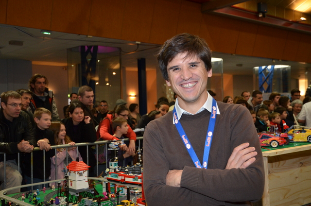](https://www.freelug.org/IMG/jpg/EDE_3143.jpg)

**Nicolas Rigolini "JyL"**

Après le succès et surtout le vrai plaisir que fut la première édition de Fans de Briques LEGO, il était difficile, et même impossible de ne pas participer à cette deuxième édition ! C’est donc tout naturellement que j’ai répondu à l’appel de Christophe, avec, nouveauté cette année, un thème proposé aux exposants : Bordeaux et sa région. Ah... sur le coup, panne d’inspiration... Allez, faisons simple mais efficace, pour moi ce sera la réalisation d’un vignoble !  
Après quelques semaines de préparation de ma présentation (une ville de 2m x 7,5m que bien sûr j’ai terminée au dernier moment, en particulier le vignoble mais chut ! seul le résultat compte !), le moment arrive de transporter le tout à la Médoquine de Talence ! Départ le vendredi matin, arrêt à Toulouse pour prendre ma sœur qui cette année m’accompagnera pour m’aider à monter et direction Talence.  
Arrivée en fin de matinée et là, pas le temps de traîne r ! A peine le temps de saluer tout le monde et il faut vider la voiture, vider les cartons, monter la présentation et faire la mise en scène ! Tout ça avant 19h car nocturne de 19h à 22h ! Oui je sais, comme ça on croirait qu’on a le temps, mais en fait c’est court, TRÈS court ! surtout quand sur les vignes il reste encore à mettre une par une des plates rondes 1x1 violette pour faire le raisin. Et là, je veux adresser un grand merci à ma sœur parce que c’est elle qui s’est fait chier (oui oui, c’est bien le mot !) à faire cette tâche ingrate ! Elle en a même gagné le respect des autres exposants (et moi, je suis passé pour un affreux tortionnaire). Donc, Anne Sophie, si tu lis ça : spéciale dédicace ! ;o)  
Donc, fin du montage un peu dans la douleur à 19h - 19h30 pour accueillir le public, ouf ! (promis, l’année prochaine, je ferai moins grand) Comme d’habitude, on fignolera les détails en cours d’exposition. Et c’est parti pour un super week-end encore qui aura vu passer beaucoup de monde dans une très bonne ambiance ! De bons moments passer avec le public et bien sûr avec les autres exposants, certains que je retrouve, d’autres que je croise pour la première fois. Difficile de faire le détails de tout ce qui s’est passé, mais ce qu’il restera, comme l’année dernière, c’est un grand succès et une très bonne ambiance !  
Malheureusement, tout a une fin et l’heure fatidique de la fermeture et du démontage arrive après une petite prolongation. Alors on "jette" tout dans les cartons et on recharge la voiture. Bizarrement, ça va plus vite qu’au montage...  
Au final, encore un excellent week-end, avec toutefois un petit regret : ne pas avoir eu le temps de prendre une photo avec Briky... :o( Allez, ce sera pour l’année prochaine !

**JyL**

photos de l’expo : [http://photos.freelug.org/main.php/v/RIGO/Expo+Fans+de+Briques+LEGO+Talence+2013/](http://photos.freelug.org/main.php/v/RIGO/Expo+Fans+de+Briques+LEGO+Talence+2013/),  
et [http://photos.freelug.org/main.php/v/RIGO/Expo+Fans+de+Briques+LEGO+Talence+2013\_002/](http://photos.freelug.org/main.php/v/RIGO/Expo+Fans+de+Briques+LEGO+Talence+2013_002/) pour ma présentation.

* * *

[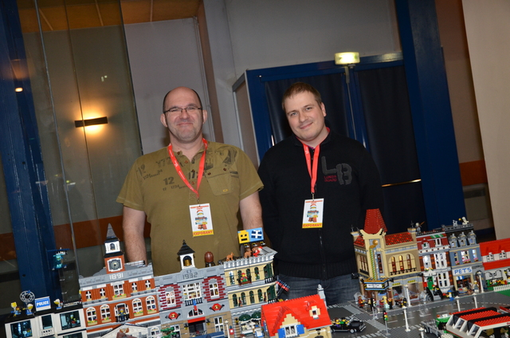](https://www.freelug.org/IMG/jpg/EDE_3150.jpg)

_David Berland "DGB" / Etienne Makowski "BigLegowski"_

loren ipsum

* * *

[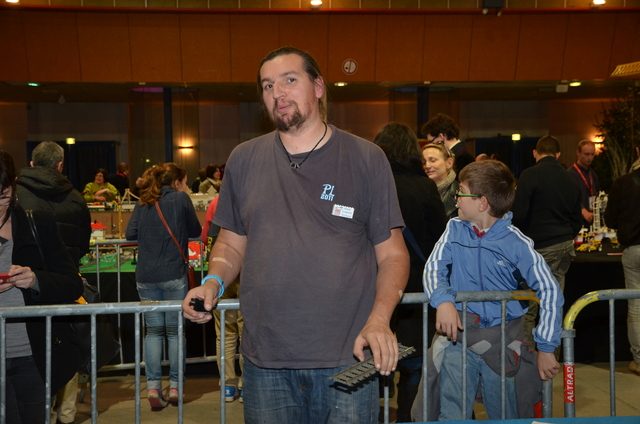](https://www.freelug.org/IMG/jpg/EDE_2042.jpg)

_Mickael Eymann "Mickbatto"_

* * *

[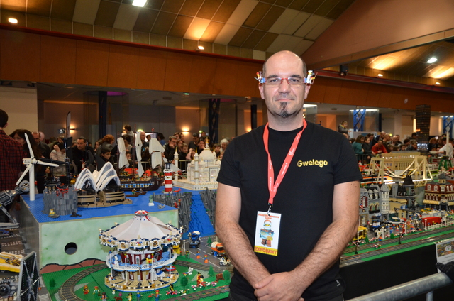](https://www.freelug.org/IMG/jpg/EDE_3147.jpg)

_Gwenael Quris "Gwelego"_

* * *

[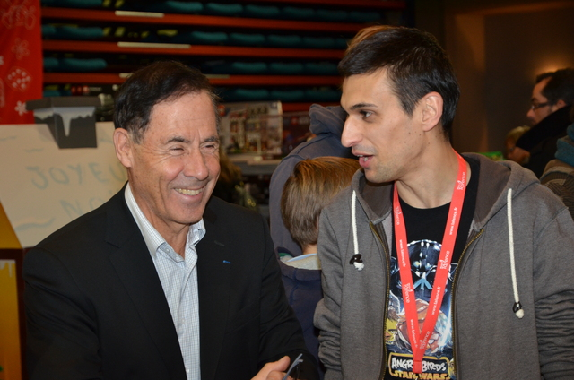](https://www.freelug.org/IMG/jpg/EDE_2034.jpg)

_A gauche : Mr Cazabonne Alain (Maire de Talence) / A droite : Lebian Loïc "Darkheart 3111"_

Fan de Briques LEGO Episode 2

Après le succès du premier Episode de Fan de Briques LEGO, notre Georges Lucas local décide de poursuivre l’aventure avec une deuxième édition encore plus dingue que la première puisque la surface de la salle était multiplié par beaucoup. L’appel est lancé pour cette nouvelle aventure à laquelle je réponds sans hésitation. Cette fois ci nous avons le temps de nous préparer, d’organiser nos stands etc.... A l’automne on m’annonce que mon stand sera juste dans l’entrée, en première ligne juste histoire de me mettre la pression !!!! Le jour J arrive et c’est avec plaisir que je retrouve les visages familiers de la première édition mais également des nouveaux venus tous aussi sympathiques. L’installation ce fait un peu dans la douleur et comme tout le monde je fignolerai mes présentations alors que les premiers visiteurs sont là. J’ai oublié de préciser que nous sommes là pour 3 jours, l’expo ouvrant le vendredi soir. Cette nocturne fut particulièrement agréable, il n’y avait pas trop trop monde, et c’était un plaisir de retrouver les visiteurs curieux et de discuter avec eux. La journée de samedi ponctuée des mini jeux organisés par notre réalisateur barbu et son complice se déroule très bien et se termine autour d’un bon repas et surtout d’une grosse part de rigolade.  
La journée de dimanche fut un peu plus délicate car il y a eut un moment dans l’après midi où il y avait vraiment vraiment vraiment beaucoup de monde. C’était un peu oppressant par moment et certains visiteurs un peu nerveux.  
Mais bon cette nouvelle édition m’a permis encore d’améliorer mes connaissances en LEGO, de voir ce qui plaisait au public (enfants et adultes) en terme de diorama et de retrouver et découvrir les AFOLS du coin pour partager ma passion.  
Vivement l’Episode 3 !!!!!!!

**Darkheart 3111 aka Loïc**

* * *

L’annonce, les préparatifs et compte rendu sur Brickpirate :  
[http://www.brickpirate.net/forum/ph...](http://www.brickpirate.net/forum/phpBB3/viewtopic.php?f=49&t=11886)

La même chose, mais chez BricTechnic :  
[http://forum.brictechnic.fr/viewtop...](http://forum.brictechnic.fr/viewtopic.php?f=133&t=5047&start=45)

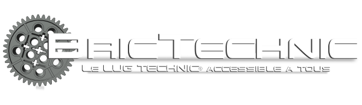

Le compte rendu, vu par TechLUG :  
[http://www.techlug.fr/Forum/topic84...](http://www.techlug.fr/Forum/topic8461.html)

Et enfin, celui de Bionifigs :  
[http://www.bionifigs.com/t7513-expo...](http://www.bionifigs.com/t7513-expo-retour-sur-l-expo-fans-de-briques-2013-a-talence?highlight=fans+de+briques)

[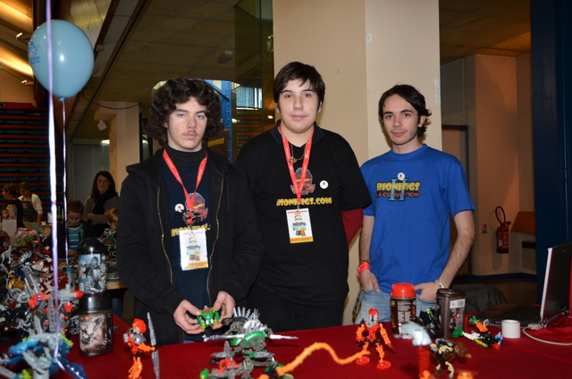](https://www.freelug.org/IMG/jpg/EDE_3156.jpg)

_La team Bionifgs_
