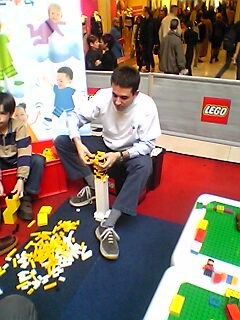
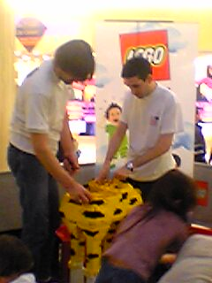
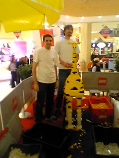
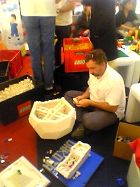

Freelug était présent sur le stand de LEGO(r) au centre commercial de la Part Dieu à Lyon, les samedi 1er et 8 novembre. Voici un résumé du deuxième samedi.

Freelug a été invité par LEGO(r) sur le stand de son animation au centre commercial de la Part Dieu pour construire de grand modèles sur le thème des animaux et de l’environnement. Loys, Denis et moi étions présents le samedi 8 novembre.

Comme il restait pas mal de caisses de briques jaunes, blanches et noires à notre disposition, j’ai proposé à Loys de construire une girafe. Denis arrivant sur le fait a préfèré s’atteler à la construction d’un oeuf géant, d’où devait sortir un poussin. Bien que manquant cruellement de brique 2x2, Denis s’en est sorti admirablement.

Pour ce qui est de la girafe, naturellement, nous avons commencé par les pattes :

Arrivé en haut de la cuisse, j’ai eu un petit doute quant à la stabilité et la solidité de la future girafe. Je me suis demandé si on n’était pas parti dans un modèle trop grand !

Denis ne manquait pas de nous mettre en garde dès qu’une patte de la girafe commençait à se désolidariser !!

Au moment de la jonction des pattes entre elles, nous avons donc consolidé fortement la structure.

L’heure tourne, et il faut absolument finir avant la fermeture du stand. On empile les briques à toute vitesse, on prends des poignées entières de briques, on ne se donne même pas la peine de ramasser les briques qui tombent de nos mains !

C’est bientot la fin, Loys se lance dans la construction de la tête tandis que je me faufile sous la girafe tel un mécanicien sous une voiture pour finir le ventre.

Malheuresement il nous manquera un peu de temps pour fignoler, ce qui fait que la tête est un peu petite. Mais la girafe fait tout de même 1m70, et on a mis environ 4 heures pour la construire.

Denis, lui, n’a pas eu le temps d’attaquer son poussin, mais son oeuf est achevé.

**Conclusion**

**–** Construire de grands modèles avec uniquement des briques 2x4 et 2x8 et en temps limité est une expérience intéressante qui s’apparente pour moi à ce que j’appellerais de l’"extrem building" (en abrégé XB pour Dicky). Denis appelle cela le "Kho Lantha du Lego". En tout cas cela se rapproche de l’exploit sportif et du challenge.

**–** Contrairement à ce qu’on pourrait croire à priori, il est tout à fait possible de construire un grand modèle à plusieurs sans se marcher sur les pieds, et sans que l’unité du modèle ni ses proportions n’en patissent.

**–** Il serait intéressant de pouvoir réitérer l’expérience, mais un minimum de place est nécessaire pour pouvoir tourner autour du modèle sans bousculer les enfants qui jouent à coté.
