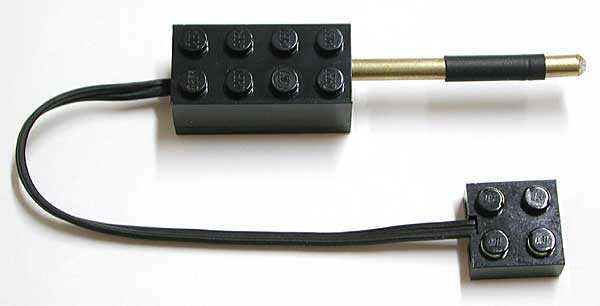
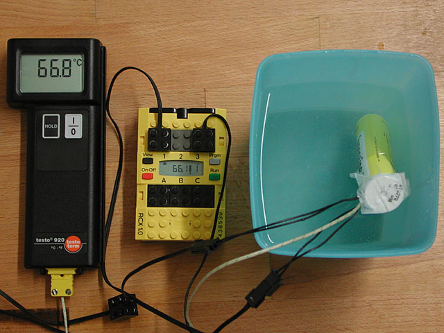
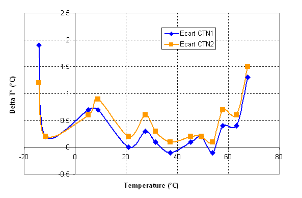
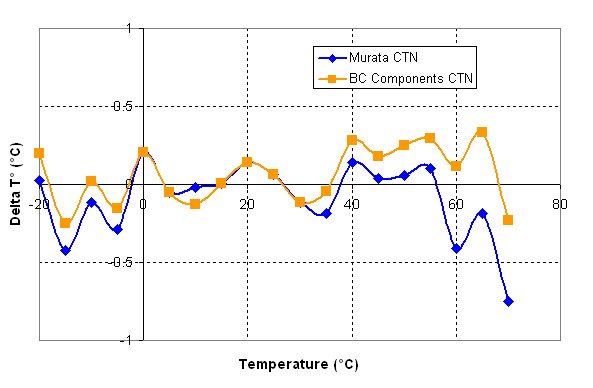
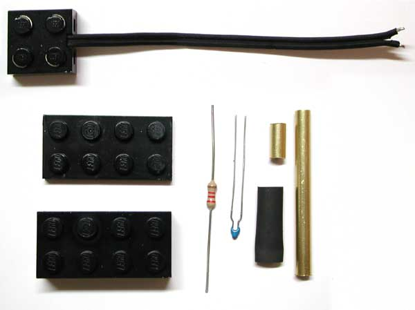
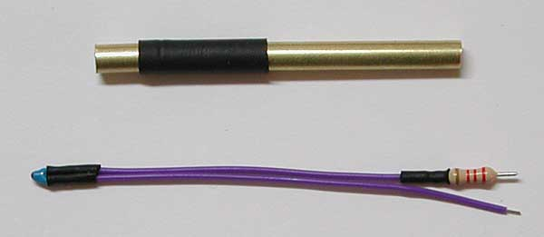
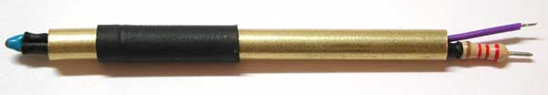
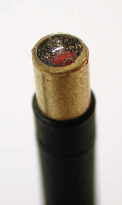
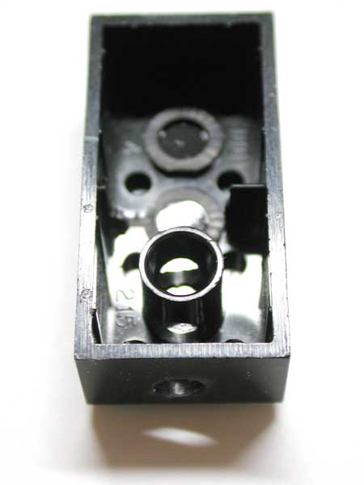
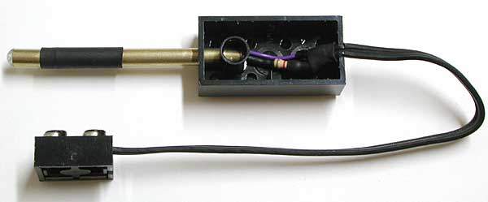

Le capteur de température LEGO® est à la fois très cher et très difficile à trouver (la seule source fiable est [PldStore](http://pldstore.com/)... qui ne livre qu’aux Etats-Unis et Canada !). J’ai donc tenté d’en fabriquer un qui soit totalement compatible avec celui d’origine, afin de permettre au RCX d’afficher correctement la température.

## Choix des composants

Ce genre de capteur est habituellement construit à partir d’une résistance spéciale dont la valeur décroit avec l’augmentation de température ("CTN", résistance à coefficient de température négatif). Restait à déterminer la valeur de base de cette résistance ainsi que son coefficient de variation en fonction de la température. Une visite sur le site de [Michael Gasperi](http://www.plazaearth.com/usr/gasperi/temp.htm) m’a appris que la résistance du capteur LEGO est de 12KOhm à 25°. Mais, fait-il observer, cette valeur est peu courante et il est probable qu’il s’agisse d’une CTN de 10KOhm mise en série avec une résistance fixe de 2.2KOhm. Il suggère également un coefficient de variation élevé, de l’ordre de 4000K.

J’ai donc acheté deux modèles de CTN chez [Radiospares](https://www.radiospares.fr/), une [BC-Components 2322-640-63103](http://www.freelug.org/IMG/pdf/ThBC.pdf) (ref. Radiospares 176-7782) et une [Murata NTSA0XV103FE1B0](http://www.freelug.org/IMG/pdf/ctn-murata.pdf) (ref. Radiospares 164-6269). Après leur avoir ajouté une résistance de 2.2KOhm en série, j’ai relevé les températures affichées par le RCX en fonction de la température réelle, mesurée à l’aide d’un thermomètre à thermocouple.

Bingo ! à moins de 1°C près sauf en limites extrêmes (le RCX n’affiche la température qu’entre -20 et 70°C), la température lue est la bonne...

J’ai ensuite trouvé dans le document de Kekoa Proudfoot ["RCX internals"](http://graphics.stanford.edu/~kekoa/rcx/) la [section de programme](http://www.freelug.org/IMG/txt/convtemp.txt) utilisé dans le RCX pour convertir en température la valeur brute retournée par le capteur. En effectuant ce calcul à partir des valeurs fournies dans les documentations des CTN BC et Murata, j’ai obtenu un excellent accord.

La théorie et l’expérimentation valident donc le choix des composants...

* * *

## Construction

Il ne reste plus qu’à construire le capteur, voici comment j’ai procédé (mais bien sûr d’autres méthodes éventuellement plus simples peuvent être utilisées !)

Matériel nécessaire :  
**–** Brique 2x4  
**–** Plaque 2x4  
**–** 1/2 câble LEGO  
**–** CTN, j’ai utilisé la Murata plus petite  
**–** désistance de 2.2KOhm  
**–** deux morceaux de tube de laiton de 4mm (quincaillerie), un de 1cm et un de 4cm  
**–** un morceau de gaine thermorétractable assez gros pour s’adapter à l’extérieur du tube  
**–** du fil de câblage fin, de la soudure, de la gaine fine pour isoler les fils  
**–** de la colle epoxy rapide (Araldite) et cyanoacrylique (Super-Glue)

Outillage :  
**–** Perceuse sur colonne  
**–** forêt de 4 mm  
**–** fraise de 8 mm  
**–** petite lime carrée  
**–** et bien sûr, fer à souder, pinces coupantes...

* * *

## Assemblage

Assembler les deux morceaux de tube de laiton à l’aide de la gaine thermorétractable en laissant un intervalle de 1mm entre les deux tube. Cela permet d’isoler thermiquement l’extrémité de la sonde du reste du détecteur. Souder fils et résistances à la CTN, isoler les soudures avec de la gaine fine.

Introduire la sonde dans le tube.

Fermer le tube et fixer la CTN par une goutte de colle epoxy (l’Araldite 90 secondes est bien pratique pour ça...)

A l’aide de la fraise montée sur la perceuse à colonne, enlever deux des 3 tubes internes de la brique. **ATTENTION AUX DOIGTS !!!**  
Percer l’extrémité de la brique et traverser le tube restant par un trou de 4mm. Faire une encoche à l’arrière de la brique à l’aide de la lime pour permettre la sortie du câble.

Insérer le tube dans le trou de la brique, puis souder le câble LEGO.

Refermer la brique par la plaque 2x4 (on peut la coller... mais ne pas oublier de vérifier le fonctionnement avant !)

Et voici le résultat !

Bonne construction,

Philo

* * *

**Annexes**

**Code de la conversion de température du RCX**

**Documentation de la Thermistance BC-Components**

**Documentation de la Thermistance Murata**
