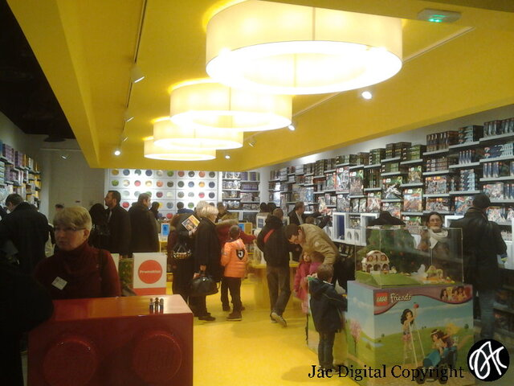
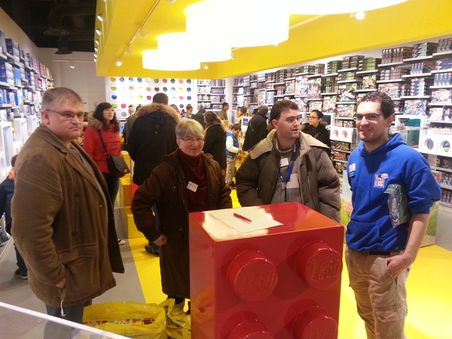
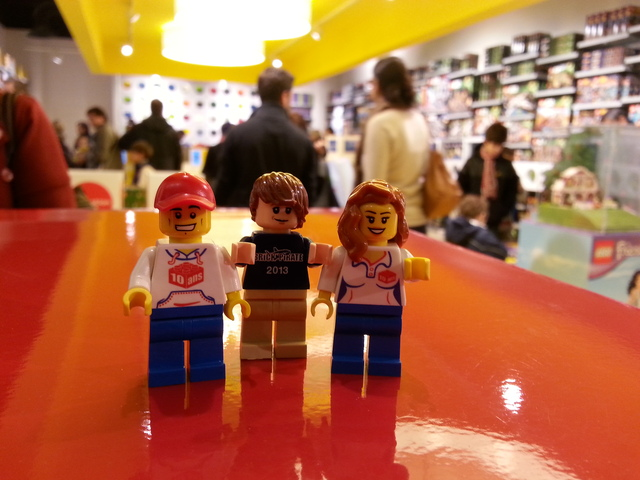
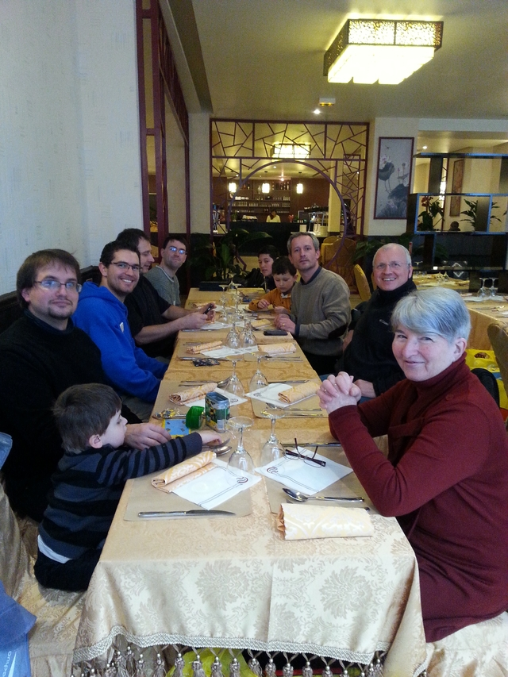

Dès l’ouverture du LEGO store, à 10h00, Pierre et Jean-Alain attendaient devant les portes. Après avoir traversé "presque" toute la ville, j’arrivais pour distribuer les étiquettes "Community" tant convoitées, puisqu’elles offrent -15% sur tout le magasin le jour de l’AFOL’s day.

Dès le départ, il nous a fallu discuter un peu avec la responsable du magasin qui n’avait pas lu les consignes d’achat pour les AFOLs de la même façon que nous. Finalement, après un coup de téléphone salvateur, nous sommes tombés d’accord sur des limites d’achat plus favorables que celles que nous avions compris de notre côté. Tout est bien qui fini bien, dans l’intérêt du commerce :)

**Sur la photo : Laurent, Danny, Jean-Alain et Pierre.**

Laurent est arrivé très peu après l’ouverture suivi de Jérôme, Danny et Mathieu, qui a retrouvé un copain de BrickPirate en la personne de Nicolas.

**Sur la photo : FreeLUGgy, BrickPiratos et FreeLUGguette.**

Après 2 heures de route pluvieuse, Arnaud, venant de la banlieue lyonnaise, nous a rejoint vers midi.

C’est vers 12h30 que nous sommes allés déjeuner rue Lamartine dans un restaurant au buffet à volonté.  
Nous sommes arrivés au restoLEGO les bras encombrés pour certains, mais heureusement que d’autres avaient pu passer déposer leurs achats dans le coffre de leur voiture.

Vous reconnaîtrez sur la photo de gauche à droite, Florian, Mathieu, Pierre, Jérôme, Jean-Alain, Rémy, Clément, Arnaud, Philippe et Danny.

Et même que sur le chemin du retour chez nous, certains sont allés faire encore quelques emplettes vous savez où... :) Faut dire que nous passions devant par inadvertance.

Journée agréable, merci à tous !

* * *

Galerie photos

[JAC](http://photos.freelug.org/main.php/v/JAC/AfolDays/2014-02-01/)
