## LEGO LA GRANDE AVENTURE

Vu par FREELUG & BM

**PARTIE 1 DEAUVILLE (lundi 23 septembre 2013) :  
**

La société Warner Bros France nous a contacté via LEGO FR pour réaliser un totem en LEGO lors de la promotion du film « la grande aventure LEGO » à Deauville.

Le challenge principal était que nous n’avions que quelques jours pour concevoir et faire valider, puis quantifier la réalisation afin de commander les briques dans le délai et ensuite une semaine pour le montage des quelques 20 000 à 30 000 briques.

Warner Bros souhaitait avoir un Totem de taille identique à ceux qu’ils  
présentent habituellement pour les autres films :

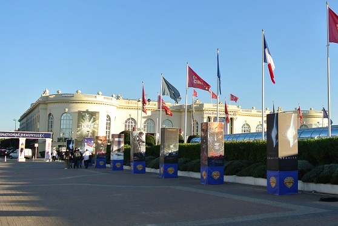

**–** Une base carrée de 80 cm  
**–** Une hauteur au dessus de la base de 200 cm  
Soit une petite construction de 280 cm…. De haut.

Après plusieurs modélisations à partir des visuels qui nous ont été  
envoyés, et discussions, il a été choisi de :

**–** représenter une mini-figurine de dos comme sur les affiches en diminuant les dégradés car 80 cm de large cela ne permet pas énormément de détails et nuances avec des briques. (et aussi un manque de nuance dans la couleur des briques)  
prototype avec les dégradés :

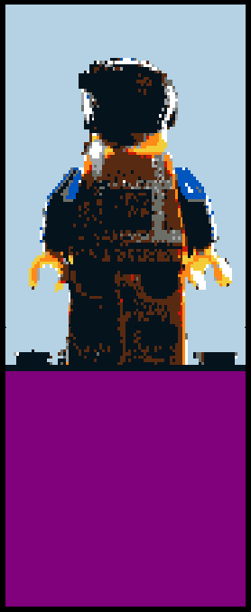

prototype finale :

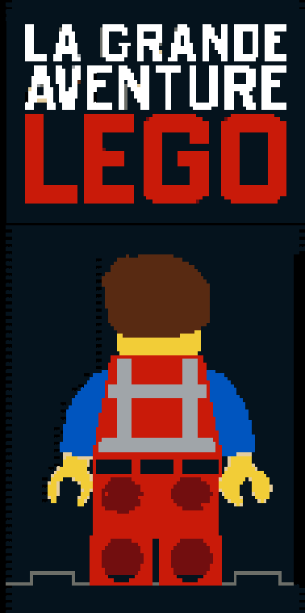

et le prototype en "vrai" brique :

[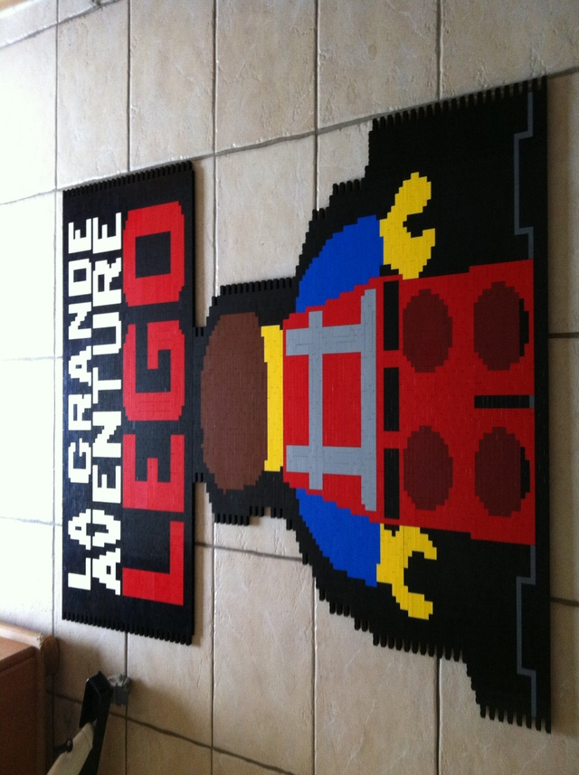](https://www.freelug.org/IMG/jpg/IMG_0846.jpg)

**–** D’écrire en briques le nom du film La grande aventure LEGO. (divers essais du titre en 3D ont été faits en parallèle, mais sans résultat viable dans la résolution finale)  
Au départ nous avons travaillé sur le titre anglais (le seul connu) :

[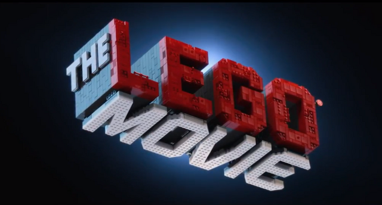](https://www.freelug.org/IMG/png/The_Lego_movie.png)

beaucoup plus facilement transformable que le titre français...

[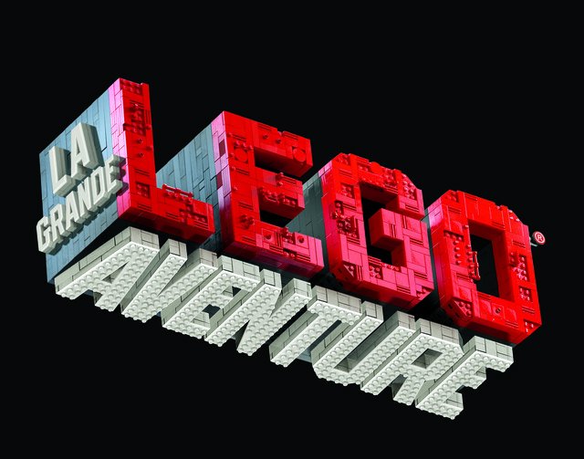](https://www.freelug.org/IMG/jpg/LOGO_LEGO.jpg)

De plus nous avons très vite eu la confirmation que nous devions en plus fabriquer le socle et les supports pour les briques (ceux de Waner Bros n’étant pas adaptés à nos briques), il était plus simple de concevoir nous-même et d’ajuster le support plutôt que de le faire fabriquer (sur plan) par un prestataire.

Au début du projet le totem ne devait servir qu’une fois (donc monté et  
démonté sur place), mais rapidement il nous a été demandé à ce qu’il soit transportable et réutilisable, donc transportable couché… Nous lui avons donc fabriqué un brancard-support ( de 80cm sur 280cm) en espérant pouvoir le basculer sans casse (les briques étaient aussi prises en sandwich entre 2 planches compressées par une sangle à cliquets puis vissées) et cela a fonctionné.

Rapidement, on se partage les tâches, Jeremy se chargeant des briques  
(modélisation, tailles, quantités , suivi commande)...

... et Gilles de la menuiserie.

[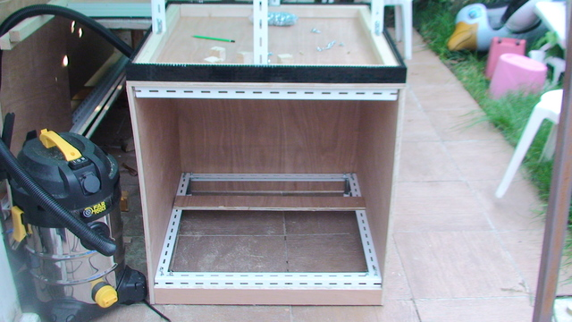](https://www.freelug.org/IMG/jpg/DSC02352.jpg)

[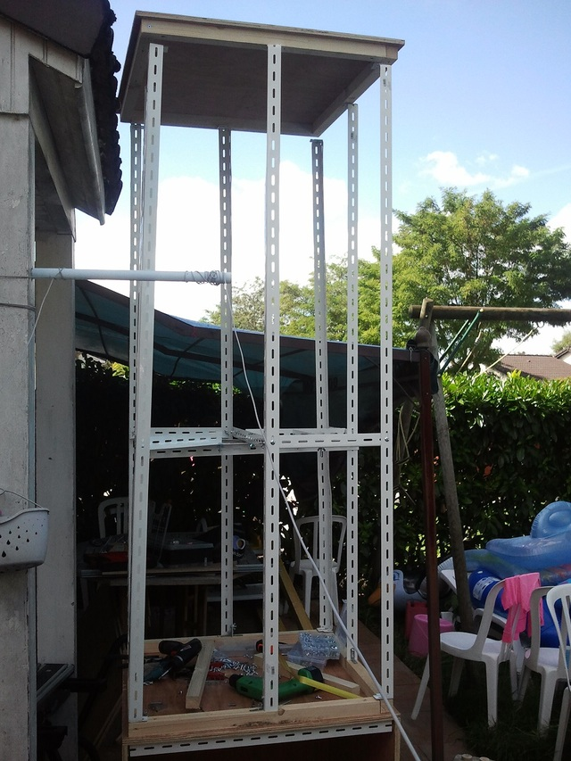](https://www.freelug.org/IMG/jpg/20130915_122655a.jpg)

On peut voir sur l’image précédente en arrière plan la bâche qui me permettait de me protéger de la pluie et de stocker le matériel.

Toute la famille a été mise à contribution pour le montage du totem (Jean-Claude et sa famille sont de passage également pour aider à la construction).

Le totem est construit en tranche afin d’être transportable.

[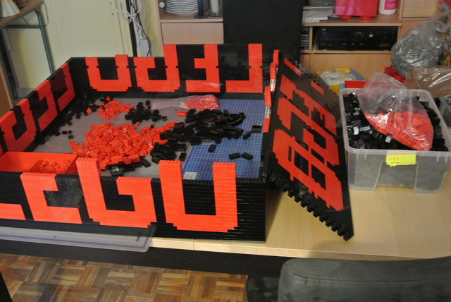](https://www.freelug.org/IMG/jpg/DSC_4900.jpg)

Puis vient le jour J de l’installation à Deauville pour une exposition à un congres des exploitants de cinémas à l’attention des professionnels, avec un superbe temps et une vue sur la mer.

Nous sommes arrivés à 8h00 nous avons fini à 17h00.

Les lieux à 8h00.

[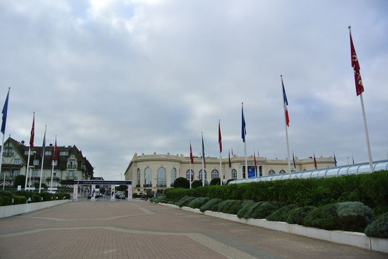](https://www.freelug.org/IMG/jpg/DSC_4920.jpg)

Le démarrage a pris un peu de temps : déchargement puis trouver l’emplacement exact de la position du totem. Nous n’étions pas sûr de pouvoir le déplacer une fois installé et ne voulions pas prendre de risques.

[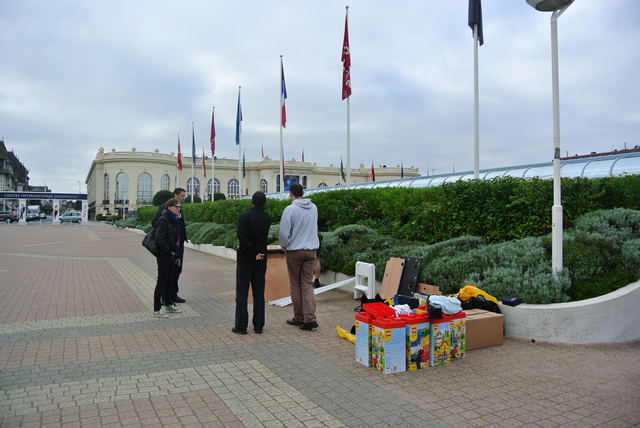](https://www.freelug.org/IMG/jpg/DSC_4919.jpg)

[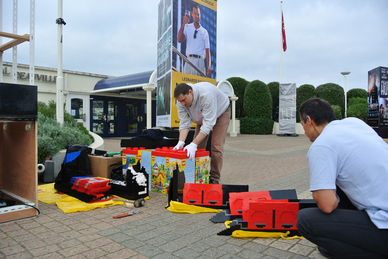](https://www.freelug.org/IMG/jpg/DSC_4940.jpg)

[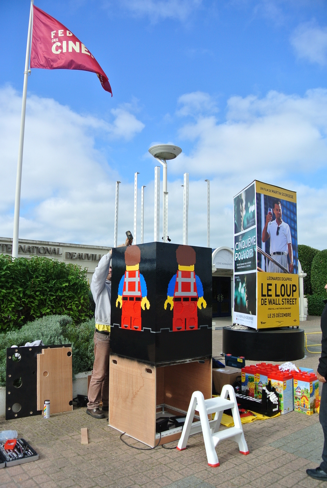](https://www.freelug.org/IMG/jpg/DSC_4950.jpg)

[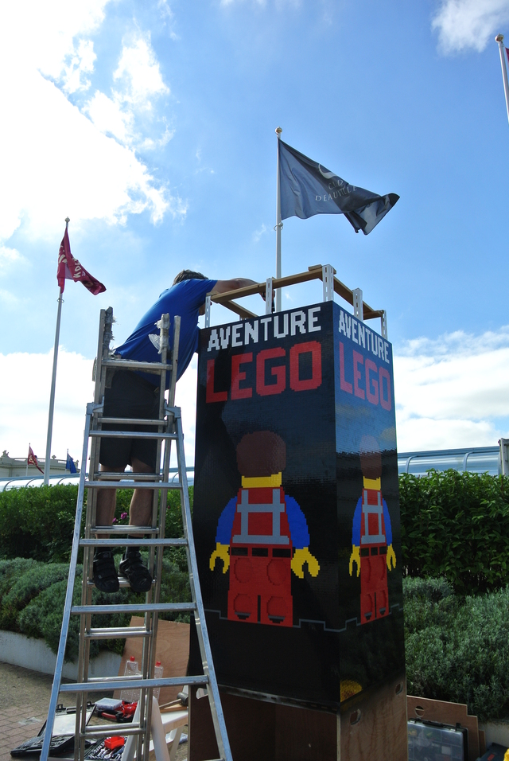](https://www.freelug.org/IMG/jpg/DSC_4960.jpg)

Tous les problèmes de dernière minute ont été résolus sur place :  
**–** Pose de renforts en bois derrière les briques pour éviter que le  
public les enfonce (car le Totem est positionné dans l’allée qui va du  
casino à la plage, ouverte au public et sans protection le jour).  
**–** Derniers trous et ajustement,  
**–** Equilibrage,  
**–** Perrine et Guillaume à l’atelier peinture en plein-air :

[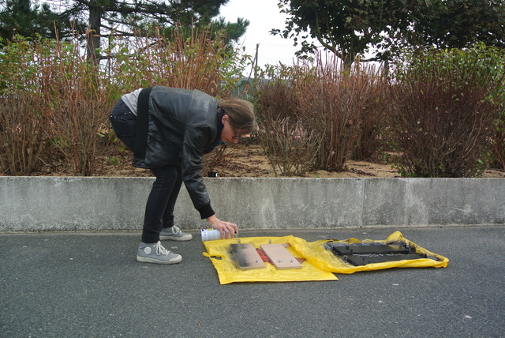](https://www.freelug.org/IMG/jpg/DSC_4933.jpg)

[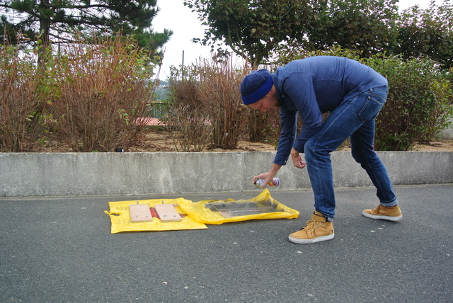](https://www.freelug.org/IMG/jpg/DSC_4931.jpg)

**–** Stickers.

[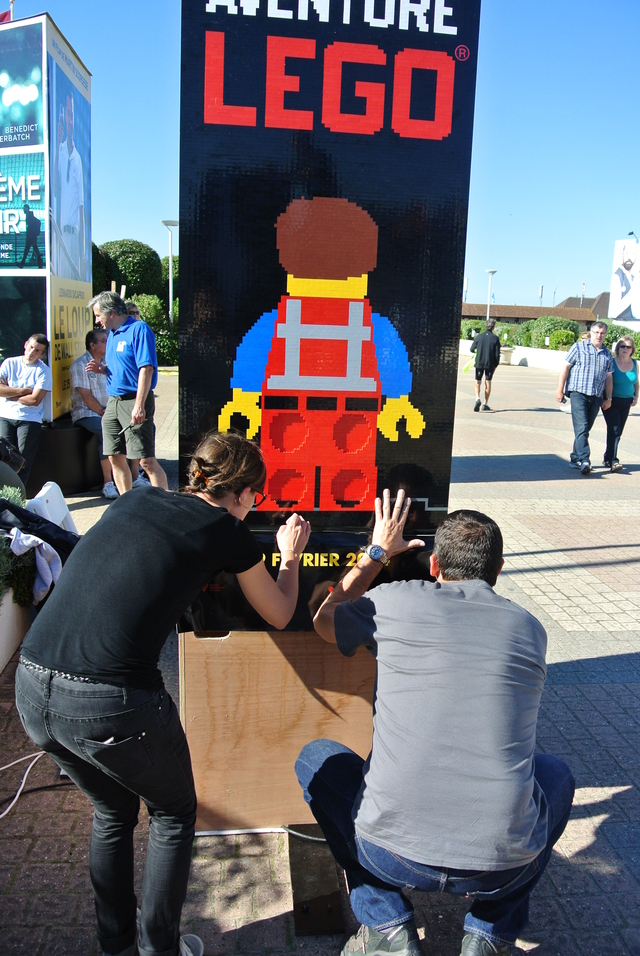](https://www.freelug.org/IMG/jpg/DSC_4989.jpg)

  
**–** Mise ne place des lests

**–** La jupe.

[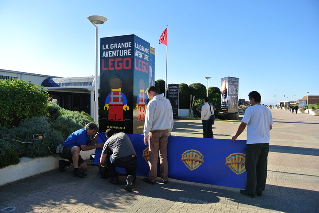](https://www.freelug.org/IMG/jpg/DSC_5002.jpg)

  
**–** Electricité.

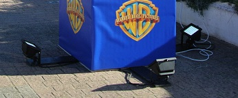

.......

Perrine et la dernière brique :

[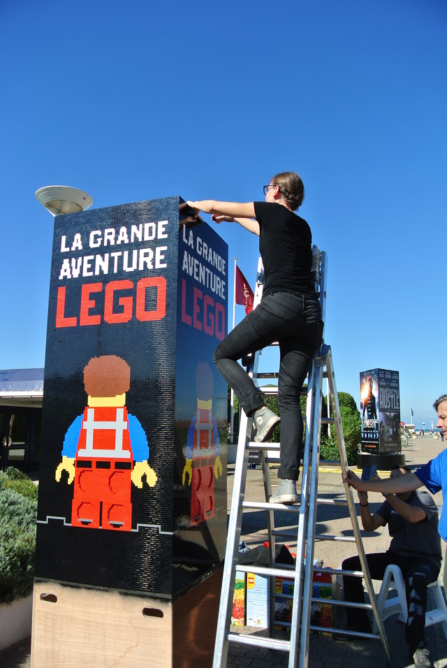](https://www.freelug.org/IMG/jpg/DSC_4969.jpg)

17h00 C’est fini !

[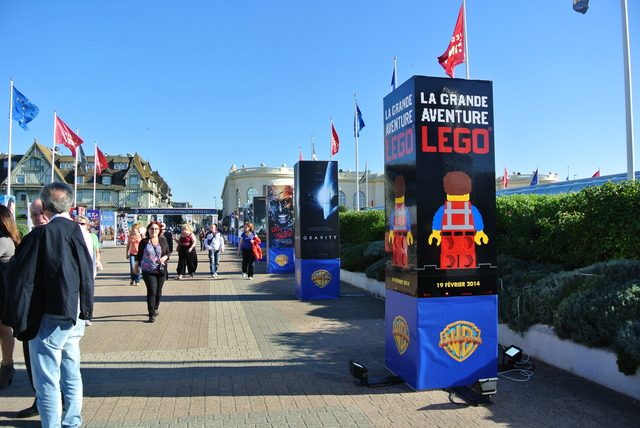](https://www.freelug.org/IMG/jpg/DSC_5014-2.jpg)

Il a été très dur de repartir de la plage que nous avons quitté avec  
regrets vers 19h00, pour le retour sur Paris.

[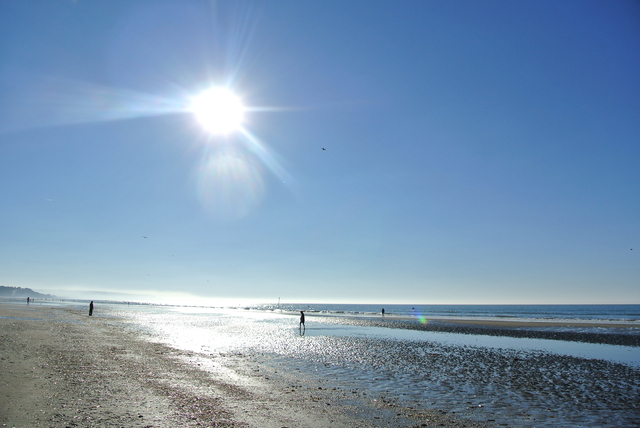](https://www.freelug.org/IMG/jpg/DSC_5021.jpg)

Nous remercions Warner Bros pour la confiance pour ce premier Totem.  
Nous savons déjà qu’ils ne le regrettent pas, puisque un deuxième totem doit être réalisé pour l’avant première du film à Paris.

Nous avons passé une très agréable journée en leur compagnie et leur aide.

Nous avons apprécié les questions et l’admiration des passants (Français et étrangers) car nous avons monté alors que les gens se promenaient et visitaient (groupes qui arrivaient par autocars).

Petite vidéo (8 Mo) d’une partie du montage en stop motion

**PARTIE 2 : PARIS (dimanche 16 février 2014)**

Une petite visite à l’entrepôt ou est stocké le Totem n°1 pour prendre les côtes et pouvoir faire le deuxième aux mêmes dimensions, ainsi que de s’assurer de son bon état.

[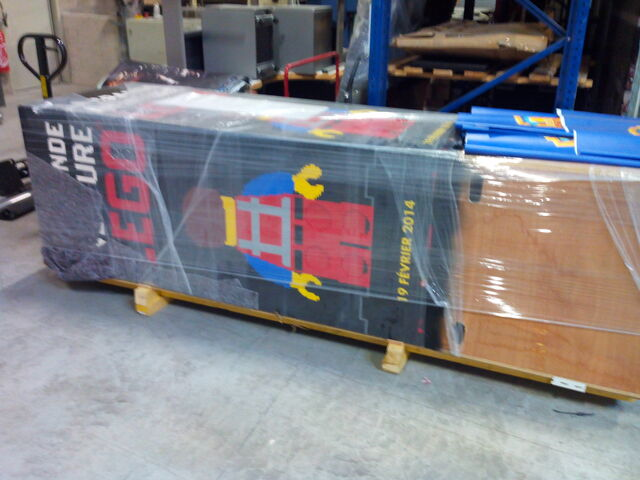](https://www.freelug.org/IMG/jpg/IMG_20140115_145848.jpg)

Suite au succès du totem de Deauville, WB souhaite donc en faire fabriquer un deuxième, pour l’avant-première du film à Paris et les positionner de chaque coté du tapis rouge.

Bon là on se dit on a le temps…. Mais entre le choix des faces à réaliser  
et la livraison des briques…

Comme pour le premier on se partage les tâches : plastique pour Jeremy, bois pour Gilles.

La menuiserie dans le jardin sur le brancard en attente du jour J.

[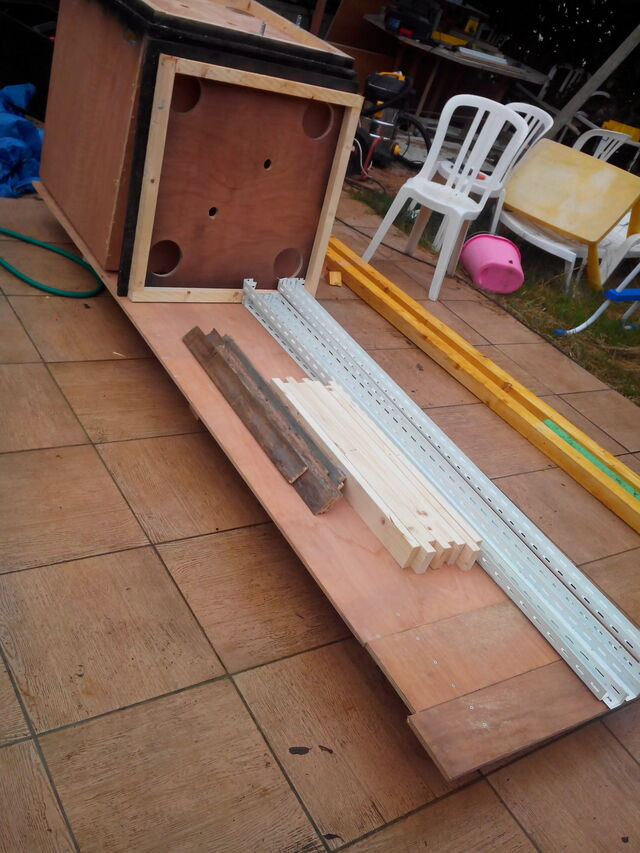](https://www.freelug.org/IMG/jpg/IMG_20140126_123315.jpg)

La WB souhaite mettre en lumière les 2 personnages principaux deux fois :  
**–** Emmet de face sur fond noir,  
**–** Cool tag / lucy de face sur fond blanc.

Après les validation d’usage des modèles numérique.

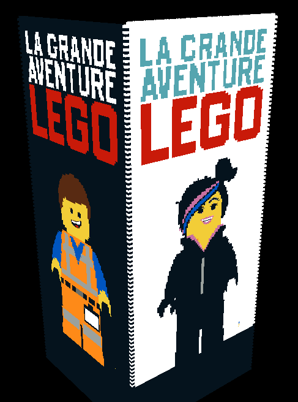

Vient le temps du pré-assemblage en tranche du totem.

Et enfin, les 2 Totems doivent être installés pour 8h30 dimanche matin, nous sommes arrivés samedi vers 18h00 pour décharger et préparer l’installation (avec un petit repas au passage, histoire d’être en forme pour construire).

Nous avons commencé le montage un peu après 20h00, aidés de nos femmes, de l’agent de sécurité (qui ne devait pas penser qu’il allait assembler des briques cette nuit), ainsi que de Perrine et Guillaume (de Warner Bros qui étaient déjà là à Deauville puisque que ce sont nos interlocuteurs principaux).

Montage du support.

[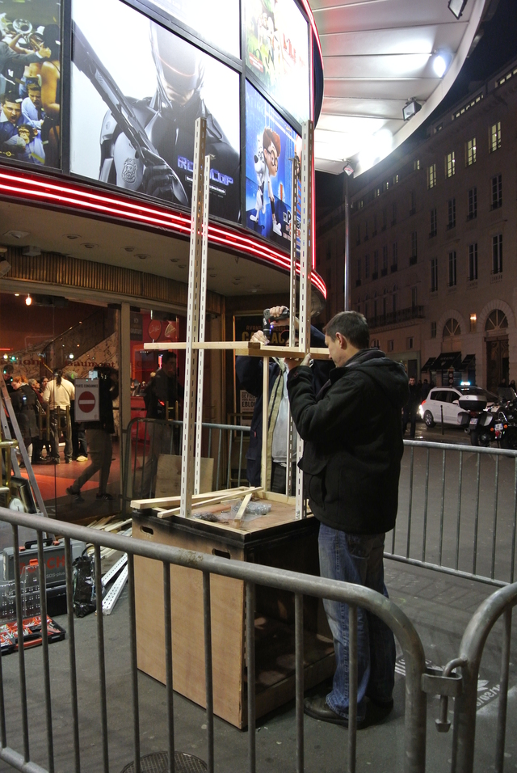](https://www.freelug.org/IMG/jpg/DSC_5786.jpg)

Passage des premières briques.

[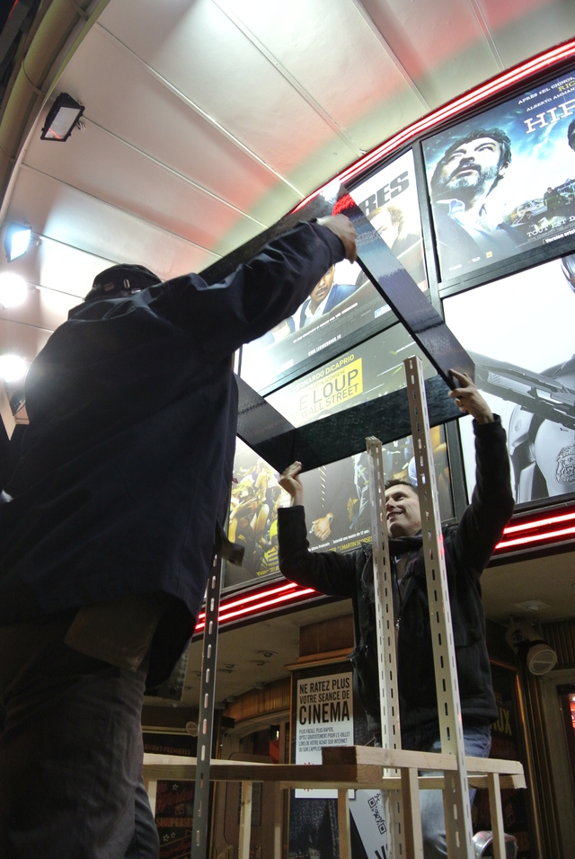](https://www.freelug.org/IMG/jpg/DSC_5788.jpg)

[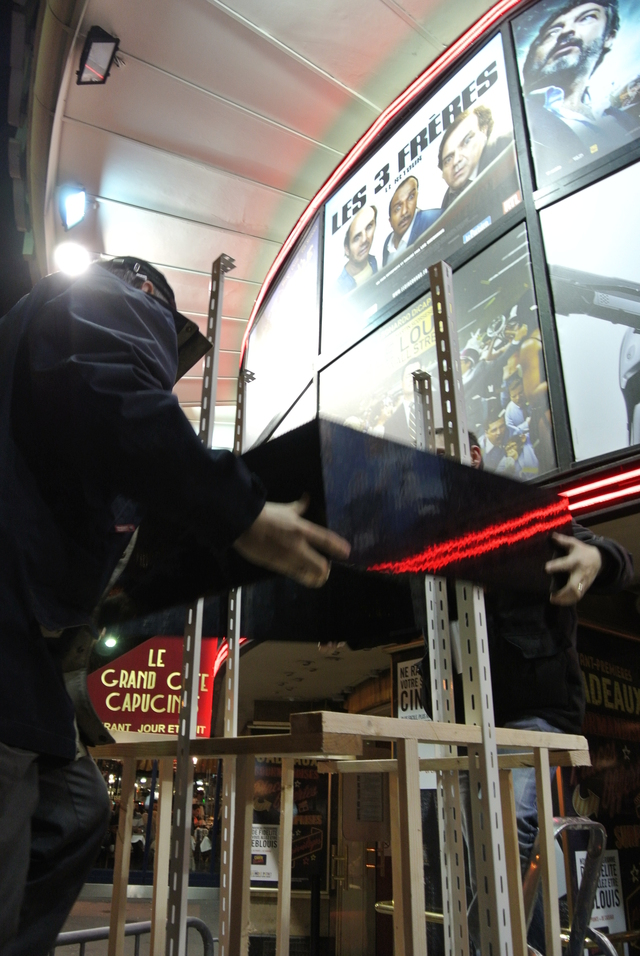](https://www.freelug.org/IMG/jpg/DSC_5789.jpg)

Puis panneau par panneau.

[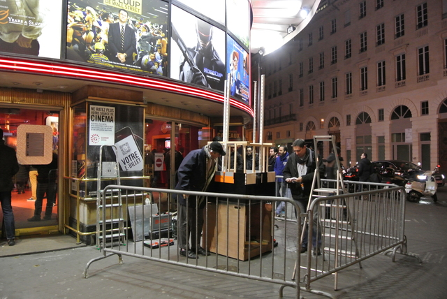](https://www.freelug.org/IMG/jpg/DSC_5792.jpg)

[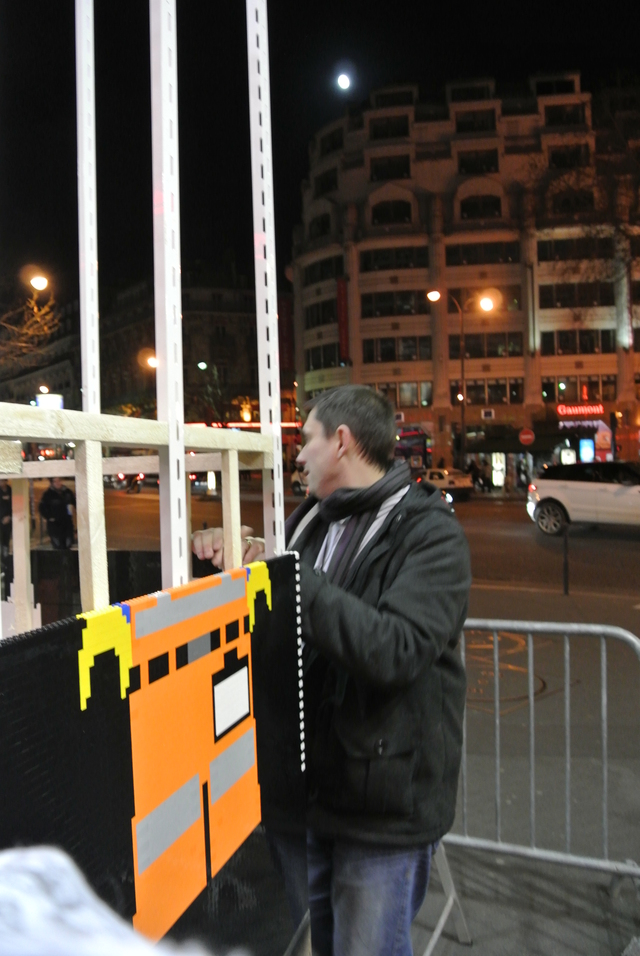](https://www.freelug.org/IMG/jpg/DSC_5795.jpg)

[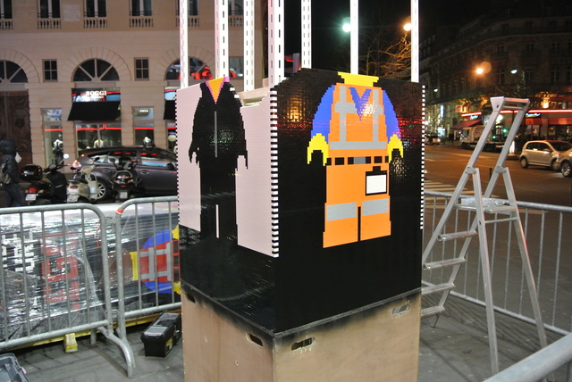](https://www.freelug.org/IMG/jpg/DSC_5801.jpg)

[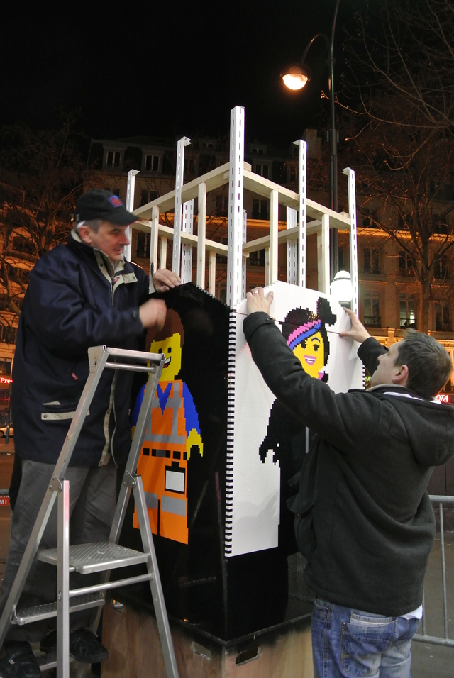](https://www.freelug.org/IMG/jpg/DSC_5814.jpg)

Le temps était beaucoup moins agréable qu’à Deauville, surtout beaucoup plus froid, mais nous avons échappé au pire : juste une averse de grêle lors du déchargement des voitures et un peu de vent.

Vers 22h00 le totem n°1 est arrivé en camion, nous l’avons laissé couché sur le trottoir jusqu’au lendemain.

[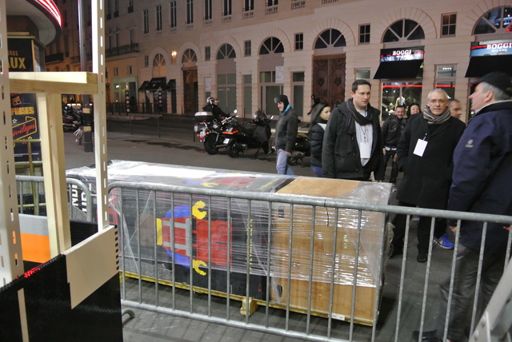](https://www.freelug.org/IMG/jpg/DSC_5794-2.jpg)

suite du montage :

[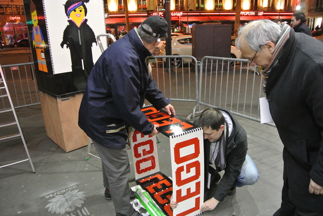](https://www.freelug.org/IMG/jpg/DSC_5826.jpg)

[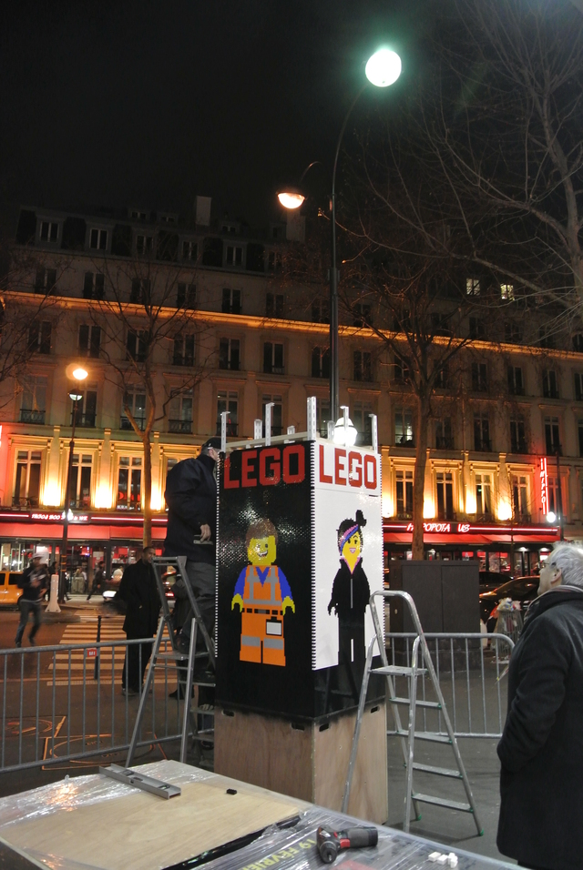](https://www.freelug.org/IMG/jpg/DSC_5829.jpg)

A 2h00 le totem n°2 était fini nous avons pu aller nous coucher et  
laisser l’agent de sécurité les surveiller.

[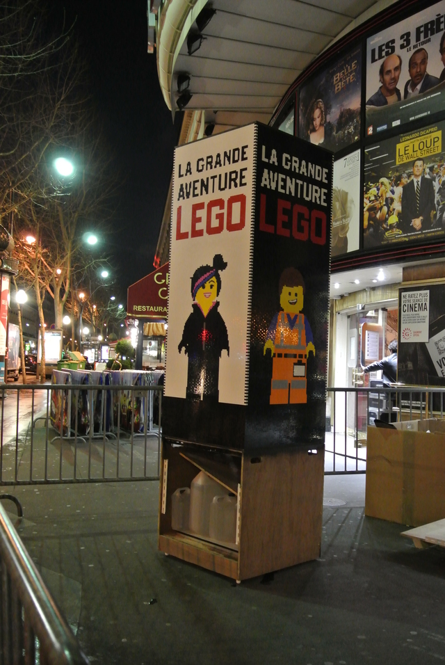](https://www.freelug.org/IMG/jpg/DSC_5846.jpg)

Nous avons encore discuté un peu avec les passants, qui nous demandaient si c’était bien en brique LEGO, certains avaient du mal à y croire. D’habitude les visiteurs voit nos réalisations finies (ou presque) là ils nous voit les monter cela est très sympa et gratifiant. Même plusieurs personnes connaissaient FreeLUG.

Petit vidéo d’un court instant du montage :

Je vous assure ce n’est pas le caméraman du film...

De retour à 6h00… Et oui nous voulions être là pour la pose du tapis rouge et placer les deux Totems en bordures.

La nous devons nous attaquer à la périlleuse tâche de redresser le totem de Deauville qui est toujours couché sur son brancard.

[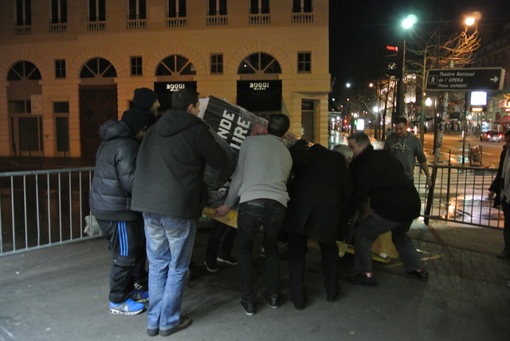](https://www.freelug.org/IMG/jpg/DSC_5842.jpg)

[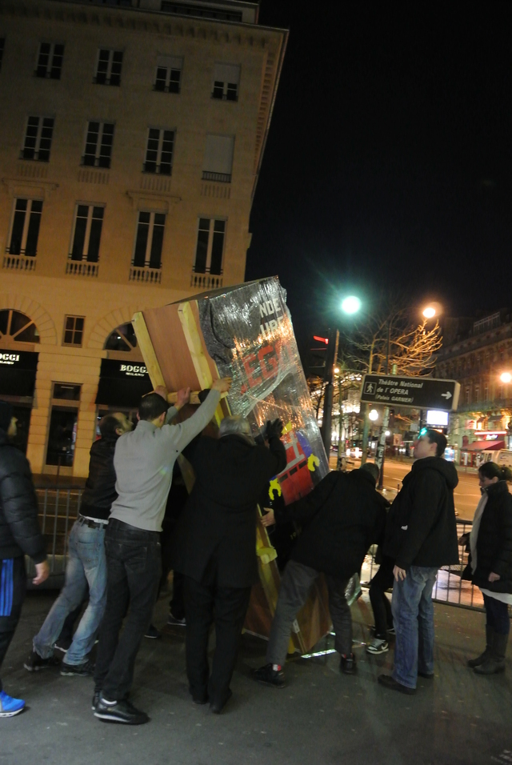](https://www.freelug.org/IMG/jpg/DSC_5844.jpg)

[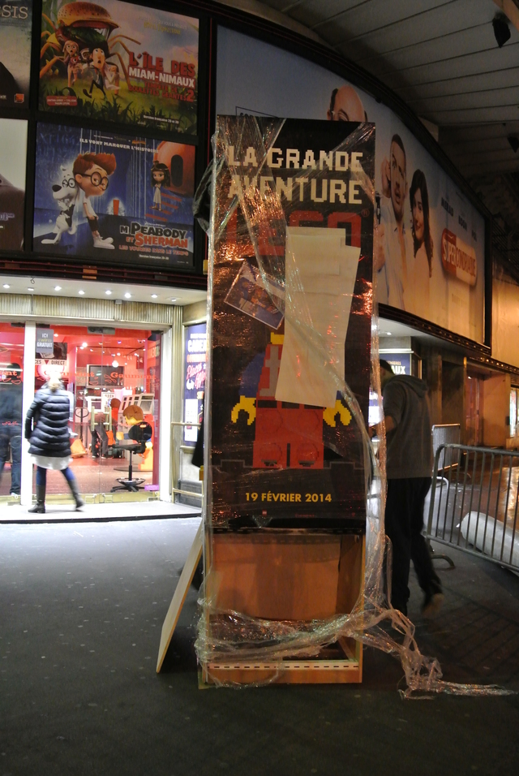](https://www.freelug.org/IMG/jpg/DSC_5847.jpg)

Il ne restait plus qu’à fermer les totems, leur mettre des jupes pour  
cacher le bas et coller les autocollants d’annonce du film (le marouflage de Stickers c’est un art… n’est-ce pas Perrine ?).

Entre-temps les équipes technique avaient posé le tapis rouge d’usage :

[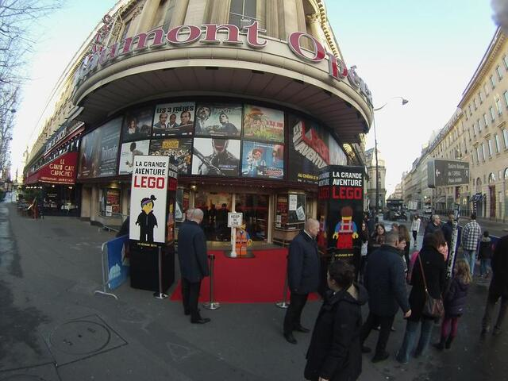](https://www.freelug.org/IMG/jpg/LEGOLaGrandeAventure-AP__2_.jpg)

On a ensuite installé les deux « enseignes » lumineuses de Gilles dans le  
salon VIP (merci à Tal d’avoir posé devant) :

[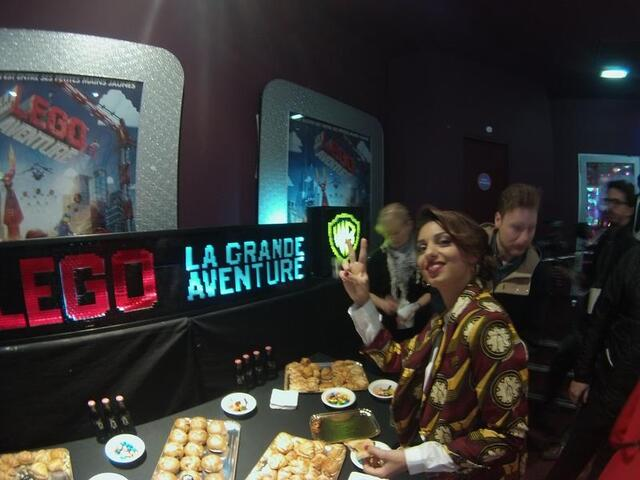](https://www.freelug.org/IMG/jpg/LEGOLaGrandeAventure-AP__29_.jpg)

De mettre en place, nous a permis d’obtenir l’accréditation « All Acces » sur l’évènement : déjà on se prend pour Batman :

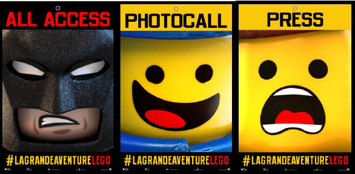

c’est sympa de vivre « l’organisation de l’intérieur ».

L’échange et l’entraide entre nous et WB, s’est fait tout  
naturellement, WB allant remplir des jerricans d’eau, nous distribuant des affiches aux passants…  
**–** De recueillir en direct les avis du public ainsi que des professionnels,  
de côtoyer les vedettes.  
**–** De prendre des photos à partir de l’emplacement réservé à la presse.

Nous avons eu la visite des FreeLUGiens qui pouvaient venir. Pas beaucoup de demande sûrement à cause des vacances pour certains et de la distance pour les autres.

Après le film est à voir pour les enfants, les adultes et les AFOLs. Il est  
très rythmé, même si à la fin cela baisse un peu, mais on entre dans un  
monde plus connu de tous.

Malheureusement nous avions tous du mal à garder les yeux ouverts,  
confortablement installés dans les fauteuil du cinéma (seulement 2h30 de sommeil :) ) Nous avons dû quand même du fermer les yeux 2 ou 3 fois...

De voir les minifigs bouger dans un monde tout en briques LEGO c’est un rêve ou alors nous avons vraiment dormis pendant le film !

Gilles, JCP & Jeremy

Un article à venir pour un peu plus de détails sur l’avant-première car celui-là est déjà conséquent ;-)

**Lien vers les galeries :**

GILLES :

DEAUVILLE :[http://photos.freelug.org/main.php/...](http://photos.freelug.org/main.php/v/gmifr/Expositions/2013/wb/)

PARIS :[http://photos.freelug.org/main.php/...](http://photos.freelug.org/main.php/v/gmifr/Expositions/2014/2014_LaGrandeAventure/AvantPremiere/)
