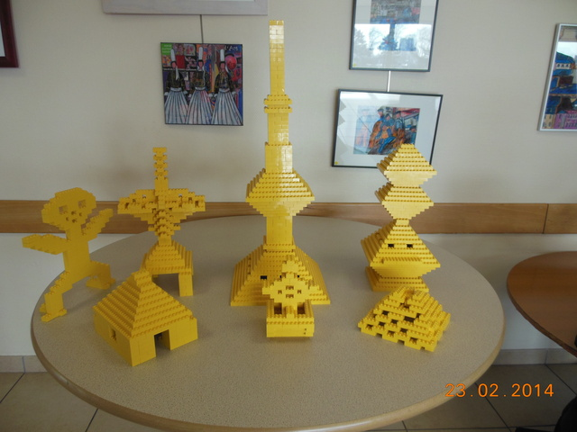

Le dimanche 23 février avait lieu Festi’sport au complexe sportif Jean GUEGUENIAT à Brest (29), c’est une grande fête où les enfants de 5 à 11 ans peuvent essayer plusieurs sports seul ou en famille ou avec les copains, parmi ces sport, il y avait : du foot, du basket, de la natation et d’autres sports, un espace LEGO était présent. C’est organisé par la FSGT et le Foyer laïque de St Marc. Au cours de la journée les enfants ont un programme avec les différents sports et activités manuelles, ou ils viennent sans faire de sport et restent le temps qu’ils veulent à l’activité.

Un espace construction avec les briques jaunes, Technic et Mindstorms et du Techball était au patronage laïque du pilier rouge juste à côté du complexe sportif. La journée a commencé par la construction, les parents ont participé avec leurs enfants. Ils ont pu essayer le Techball.

Il n’y a pas eu de match, ils ont beaucoup apprécié l’activité sur la journée. L’année dernière une mosaïque avait été construite. Il y a eu beaucoup d’enfants, Théo du club de St Martin-des-Champs était avec moi.

[http://photos.freelug.org/main.php/...](http://photos.freelug.org/main.php/v/dam29/expo/sport/)

site du foyer Laïque  
[http://www.flsm.infini.fr/](http://www.flsm.infini.fr/)

Damien
