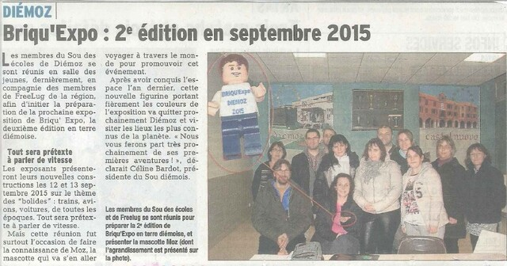

En 2013, pour promouvoir la première [BRIQU’Expo Diemoz](http://chezyannoch.com/lego_briquexpo_diemoz2013.php), deux petites minifigs ont fait un grand voyage dans l’espace à plus de 27 000 m d’altitude avec l’affiche de l’exposition !

[Vidéo de la publication d’origine](https://www.youtube.com/embed/PnyhFp4wo4E?list=FLVl1h9UPBYDfjDrtkFBY0kQ)

Pour la prochaine édition qui aura lieu les 12 et 13 Septembre 2015, il paraissait difficile de faire une communication plus percutante.

Heureusement, nous pouvons compter sur le petit Moz, la mascotte qui va s’en aller promouvoir la prochaine édition. Les présentations ont été officiellement faites lors d’une réunion entre les membres organisateurs de FreeLUG, et le Sou-des-Ecoles de Diemoz.

**Moz à la Une**

Petite présentation de Moz à la presse

En attendant de vous présenter plus en détail le long voyage de Moz, voici un petit Teaser :

[Vidéo de la publication d’origine](https://www.youtube.com/embed/C1Cw79ot9Sc)

Toutes les infos seront disponibles [ici](http://chezyannoch.com/lego_briquexpo_diemoz2015.php) ainsi que sur la page Facebook [BRIQU’Expo Diemoz](https://www.facebook.com/BRIQUExpoDiemoz)
