Dans la catégorie "Porte" sur BrickLink, il y en a 81 différentes mais si on affine notre recherche afin de trouver des portes pour des maisons à l’échelle minifig, ce nombre diminue grandement (une dizaine de modèles différents d’après moi). Alors dans une rue, FreeLUG par exemple, si tout le monde a la même porte c’est pas cool.

En premier lieu, j’ai fait des portes en SNOT basique. 4 briques de large, 5 briques de haut, hop on prend une plate 4x6, quelques tiles une plate ronde 1x1 pour la poignée et ça fait une porte différente.

[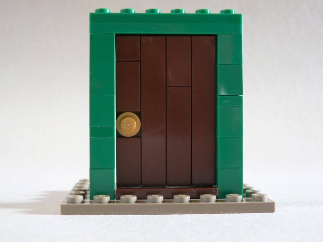](https://www.freelug.org/IMG/jpg/PFporte0002.jpg)

Facile efficace mais ça manque de détails et de relief à mon goût.

Je me suis souvenu de la REF 2006 à Toulouse avec Erik (notre cher président) nous faisant un exposé sur comment lisser ses SNOT.... et bien …..j’ai fait tout l’inverse ! J’ai cherché toutes les pièces « with groove » (cette petite rainure qui permet de les enlever sans se casser les ongles) afin de donner un peu plus de relief à mes portes.

[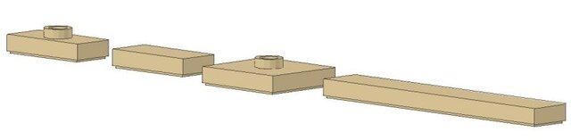](https://www.freelug.org/IMG/jpg/Exemple_groove.jpg)

En cherchant ces pièces, j’ai réalisé que les « turntable 2\*2 » sont des pièces « with groove », et qu’elles peuvent donc être très pratiques en les utilisant comme « plate 2\*2 with groove ».

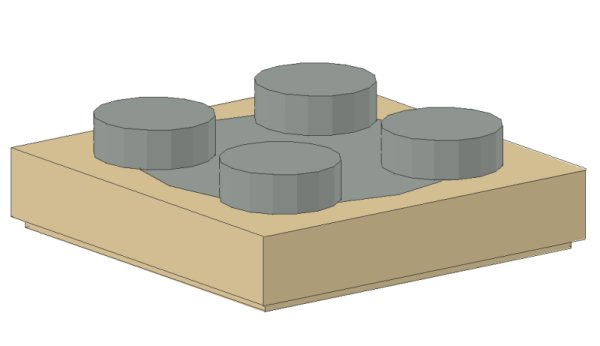

J’avais déjà fait des portes un peu différentes pour deux bâtiments :

\- ma maison de shérif de la REF 2011

[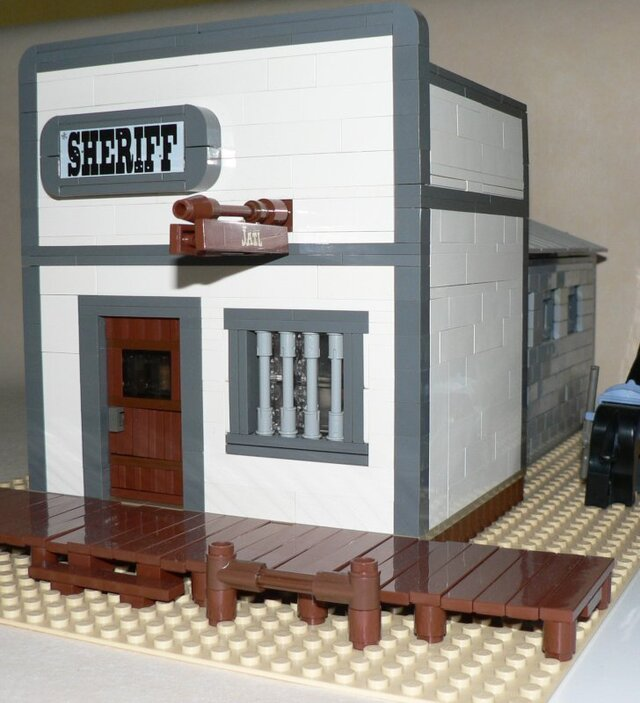](https://www.freelug.org/IMG/jpg/Sherif01.jpg)

\- ma maison pour la rue FreeLUG de l’AG 2012

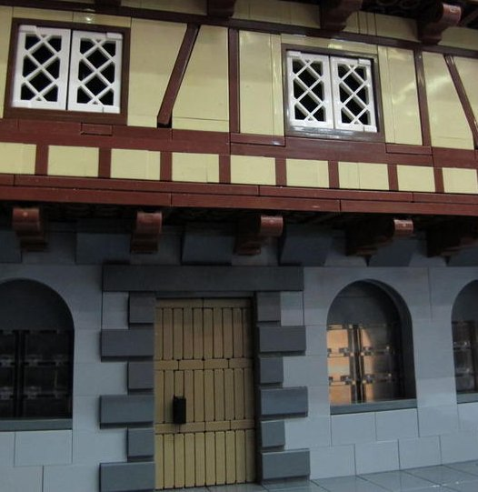

J’ai continué à réfléchir sur des portes un peu différentes et voici quelques exemples de ce que j’ai réalisé (mais que l’on peut multiplier à l’infini car En LEGO Tout Est Possible).

J’ai d’abord fait du MLcad pour imaginer un peu le design.

[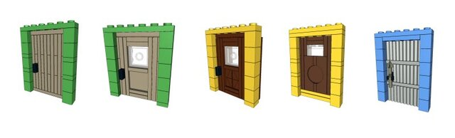](https://www.freelug.org/IMG/jpg/PortesMLCAD.jpg)

Et je suis passé à la réalisation... avec des surprises :-)

Voici donc quelques photos de ces portes assemblées.

[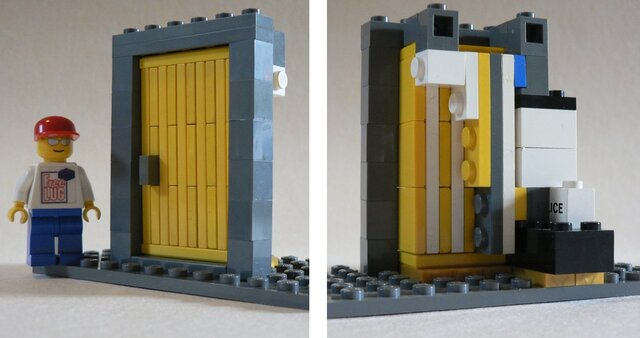](https://www.freelug.org/IMG/jpg/Porte_1.jpg)

[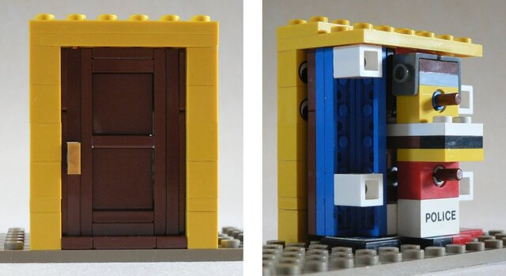](https://www.freelug.org/IMG/jpg/Porte_2.jpg)

[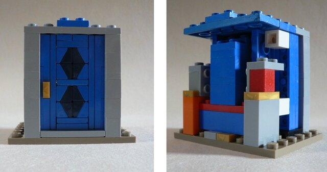](https://www.freelug.org/IMG/jpg/Porte_3.jpg)

[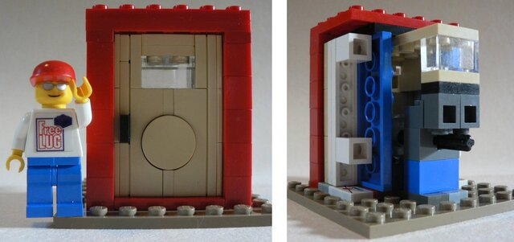](https://www.freelug.org/IMG/jpg/Porte_4.jpg)

[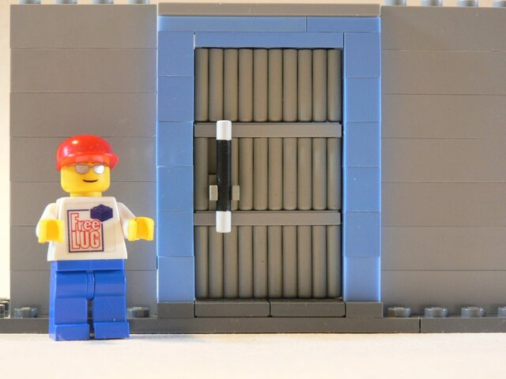](https://www.freelug.org/IMG/jpg/PFporte0502.jpg)

Toutes les autres photos sont [la](http://photos.freelug.org/main.php/v/vroum/Creations/porte_bois/).

Xavier

**Mais on ne peut pas les ouvrir ces portes !**
