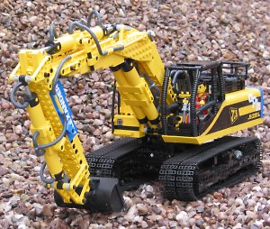
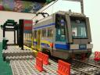
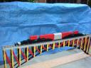

Ce genre d’article aura pour but de vous tenir informé en Français de l’actualité de la communauté LEGO. Les liens pointent vers la source de l’info (anglais) ou vers des sites contenant de nombreuses photos donc accessible à tous.

TECHNIC

[Jennifer Clark](http://news.lugnet.com/announce/moc/?n=1585)  
vient de mettre en ligne sa dernière création, une superbe excavatrice JCB à l’échelle des personnages Technic. Comme à l’habitude de Jennifer c’est un excellent travail. Vous trouverez des nombreuses [photos](http://www.genuinemodels.com/) et quelques vidéos pour vous rendre compte du degré de réalisme de cette création.

TRAINS

[Luca Giannitti](http://news.lugnet.com/town/?n=6918) nous propose un modèle du tram de Turin. Dans sa galerie [BrickShelf](http://www.brickshelf.com/cgi-bin/gallery.cgi?f=63616) vous retrouverez des photos du modèles mis en scène dans la ville grâce à des photomontages très réussis ainsi que des photos prises à l’intérieur de la maquette.

[Bruce Chamberlain](http://news.lugnet.com/trains/?n=21678) soumet à notre curiosité pour la première fois un MOC. Il s’agit d’un [wagon](http://www.brickshelf.com/cgi-bin/gallery.cgi?f=64061) de taille extrême destiné à du transport exceptionnel, doté de 36 essieux ! Notez que ce wagon peut circuler sur les courbes les plus serrées.

GENERAL

Ces derniers jours, tout allait mal sur LUGNET à propos des nouvelles couleurs et des sets châteaux à la façon Bionicle (ce qu’ils appellent les Constractions = « Constructible Action figures ». Jake McKee de chez LEGO y répond ici

Au sujet du thème [château](http://news.lugnet.com/castle/?n=18627)

Au sujet des [couleurs](http://news.lugnet.com/lego/?n=539)

Globalement le message est que la communauté ne doit pas faire circuler des rumeurs basées sur des informations aujourd’hui inexistantes. Il nous tiendra informé en temps voulu.  
Le thème château continue bel et bien tel qu’on le connaît et il y aura même des sorties Harry Potter en 2004.
