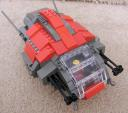
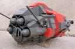
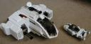
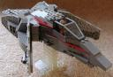
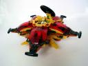
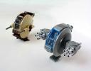
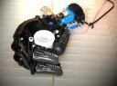
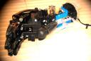

Ce genre d’article aura pour but de vous tenir informé en Français de l’actualité de la communauté LEGO. Les liens pointent vers la source de l’info (anglais) ou vers des sites contenant de nombreuses photos donc accessible à tous.

**Espace**

[Ryan Wood](http://news.lugnet.com/space/?n=29281) nous présente une navette spatiale sortie tout droit de son imagination.

Si vous vous attardez sur ce [modèle](http://www.brickshelf.com/cgi-bin/gallery.cgi?f=64203) vous apprécierez l’usage surprenant qu’il fait des casques médiévaux !

Si son travail vous interesse, sachez que vous pouvez voir de nombreuses autres créations [ici](http://www.brickshelf.com/cgi-bin/gallery.cgi?f=28180).

[Mark Stafford](http://news.lugnet.com/space/?n=29296) nous propose lui quatre modèles.

Tout d’abord un [vaisseau spatial](http://www.brickshelf.com/cgi-bin/gallery.cgi?f=59799) coloré très original mais surtout observez son architecture en étoile à 5 branches qui n’a pas du être facile à réaliser.

puis un [robot](http://www.brickshelf.com/cgi-bin/gallery.cgi?f=59808) fragile sur ses pattes :-)

puis deux versions d’un [pod](http://www.brickshelf.com/cgi-bin/gallery.cgi?f=64233) (véhicule monoplace) dont une version lourdement armée pour la défense anti-insectoïdes :-).

et enfin, doté d’une esthétique surprenante, un vaisseau romantiquement appélé ["la bulle de l’amour"](http://www.brickshelf.com/cgi-bin/gallery.cgi?f=64689). Ne vous y trompé pas c’est un vaisseau pirate !! On trouve notemment, peut être pour la première fois, l’usage dans un MOC de Clikits&reg que Mark à récupéré au LegoWorld cette année.

Notez que Mark accompagne ces créations de descriptions imaginatives.

**Robotique....**

Tiens un Français sur LUGNET !! C’est [Christophe Masclet](http://news.lugnet.com/technic/?n=11730)aussi connu sous le pseudo de Chrismaker qui nous présente une [main](http://www.brickshelf.com/cgi-bin/gallery.cgi?f=64614) robotique où chaque doigt est auto-adaptatif et la main est muni d’une détecteur InfraRouge (merci à Philo ;-)) pour saisir des objets.

On notera que pour cette réalisation, christophe à utilisé des pièces Bionicle&reg (comme quoi ont peut faire de jolies choses avec)

Cette main fait apparement partie d’un projet encore plus ambitieux dont vous trouverez les détails sur le site de christophe : [LEGOTIC](http://mapage.noos.fr/chrismaker/index.htm)

**...et train**

Enfin, pour rester avec les Français, notons que Philippe (Frogleap) rencontre un succès grandissant sur LUGNET suite à son [article sur l’automatisation des aiguillages](/articles/175/). Larry en profite pour nous signaler qu’il est notre porte-drapeau aux Etats-Unis où il arbore fièrement avec son fils le polo à la marque de FreeLUG :-).
