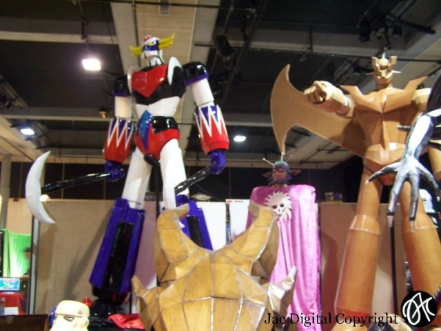
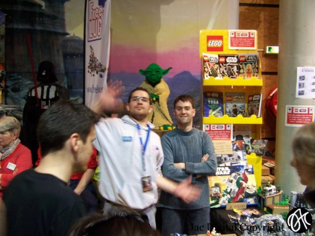
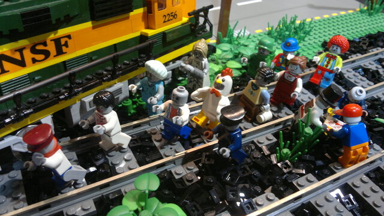
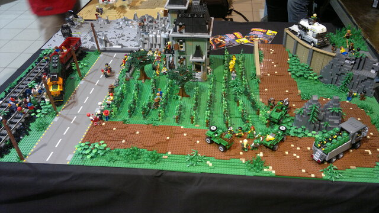
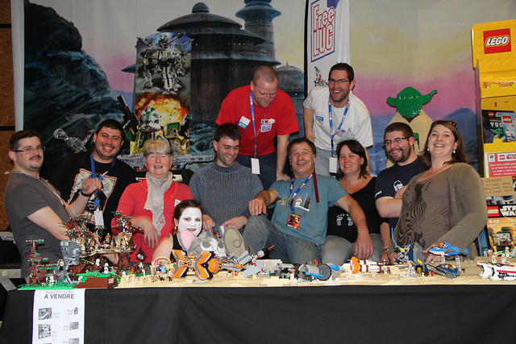

Comme toujours, une super ambiance, des costumes, des maquettes, des constructions de géant et beaucoup de monde sur cette nouvelle édition qui a accueilli cette année presque 6500 visiteurs...

On croirait qu’au bout de 16 années d’existence, l’exposition soit rodée et que, en plus on s’en lasse un peu. Il n’en est rien, nous sommes attendus avec toujours autant de passion. Notre stand a été pris d’assaut dès l’ouverture. Certains visiteurs n’ont pas hésité à tracer tout droit vers nous, j’en suis sûr.

Générations SW réuni tous les fans de SW bien sûr mais aussi tous les films de SF, les séries, les mangas, les jeux vidéo et tout ce qui peut contenir une part de rêve ou de fantasy. On s’y retrouve très facilement avec nos constructions un peu décalées pour certaines, en briques LEGO.

Malgré la fatigue de certains, l’ambiance est là...

C’est avec plaisir que nous prenons rendez-vous pour l’année prochaine, si notre place est toujours disponible, bien sûr...

_JAC_

* * *

Pour cette convention Star-Wars, un monde fou, toujours aussi enthousiaste, beaucoup de costumes cette année.

Au stand FreeLUG, une ambiance surchauffée, très sympathique. Nous avions une gentille padawan, nouvelle FreeLUGienne, Jeanne, fière de son rôle de distributrice de goodies et journaux LEGO.

_Mamy Danny_

* * *

Que dire...?  
A part que c’est toujours un plaisir de venir retrouver JAC et les copains copines pour exposer, se retrouver autour de Star-Wars...  
Participer à la tombola et gagner... ;-)  
Un grand merci à JAC et surtout Séverine de nous avoir accueillis...

À l’année prochaine !!!

_PierroLego_

* * *

Pour cette édition de Génération Star-Wars et Science-fiction, j’ai voulu me lancer dans le diorama zombies dans le style de "Walking Dead" (pour ceux qui connaissent la série télé ou le comics).

**Brains !**

J’ai donc pour l’occasion recyclé mon diorama rallye pour en faire un morceau de campagne infecté par les morts-vivants et ou de braves survivants essayant de s’en sortir comme ils peuvent, quelques militaires et une bande de braconniers venant compléter les figurines.  
J’y ai aussi intégré la maison hantée LEGO pour ajouter du lugubre au décor.

**Vue d’ensemble de mon diorama**

J’ai aussi testé quelques idées sur ce diorama :  
**–** poteaux téléphoniques le long de la route  
**–** ballast matérialisé par des plates 1x1 noires sous la voie de chemin de fer  
**–** achat de quelques pièces custom (torses, jambes et tête de zombies, armes en tout genre, tile "Don’t open deads inside" etc...)  
De quoi "égayer" le tout !

Pour finir, je tiens à remercier JAC et Séverine pour l’accueil tout au long du week-end, Danielle et sa famille pour une partie du ravitaillement, et aussi tous mes comparses du week-end pour l’amusement et les discussions qui ont rythmé ces 2 jours.

_TriboLego_

* * *

Une première convention et une sacrée première convention. Ça fait vachement plaisir de rencontrer autant de personnes passionnées de LEGO, de science-fiction et de Star-Wars. Un grand merci pour votre accueil et votre bonne humeur débordante ;-) A très bientôt ++++++

_SamLr_

* * *

Une expo, c’est avant tout des rencontres, que l’on soit exposant ou simple visiteur, et j’avoue que ce fut encore des moments forts, fan de brique à Talence m’a laissé un souvenir impérissable, cette convention me laissera aussi de grand souvenir, et de faire la connaissance d’adhérents que je ne connaissais pas me ravi à chaque fois :-).  
J’ai beaucoup aimé les échanges avec les gens qui sont venus visiter notre stand, et parfois les petites étoiles dans les yeux n’étaient pas dans ceux des enfants et là ça fait vraiment plaisir, arriver à toucher le coeur des enfants et des adultes, ça donne un sentiment de bien-être se dire que finalement, par cette petite chose qu’est une brique LEGO on transmet de la joie. Côtoyer des fans purs et durs de SW a été magique aussi, croisé un "Chewee" de 2m, un clone ou Dark Vador c’est marrant, j’ai même vu Capitaine Flam !!!! Retour en enfance assuré...  
Enfin car tout a une fin il a fallu se séparer et rentrer mais les images et souvenir de ces moments sont dans nos mémoires pour longtemps. Merci à tous

_Xaviator_

PS : On ne sait toujours pas ce qui n’est pas assez long ??? (private joke) :-D

* * *

Le mot de Jean Alain

Heureux d’être, une fois de plus, venus vous voir exposer.  
J’ai pris rendez-vous avec Jeanne, pour l’année prochaine. (- ;  
Merci pour cette bonne convivialité.

_JAT_

* * *

Les galeries de photos

-   [JAC](http://photos.freelug.org/main.php/v/JAC/Exposition/2014/SW/)

-   [SamLr](https://www.flickr.com/photos/111555352@N04/with/13994009478/)

-   [Tribolego](http://photos.freelug.org/main.php/v/Pierre_13/Expos/2014/Cusset2014/)

-   [Mamy Danny](http://photos.freelug.org/main.php/v/dannylou/expos/expos_001_001/)
