La dernière sortie de la LGV était pour la BRIQU’Expo Diemoz en septembre dernier. J’avais pour ma part ressenti une grande frustration de ne pas avoir pu jouer avec mon prototype.

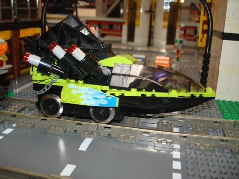

**Mon premier prototype**

Mon premier petit prototype pour rouler sur la LGV.

Alors, lorsque la présence de la LGV a été confirmée pour cette exposition, je n’ai pas hésité une seule seconde. J’ai ammené mon petit Diorama médiéval (qui s’est une nouvelle fois retrouvé à côté de mon comparse Milkbrick), et j’ai passé des heures à essayer d’approcher le record de Jac. Mais il faut reconnaitre que j’en suis encore bien loin.

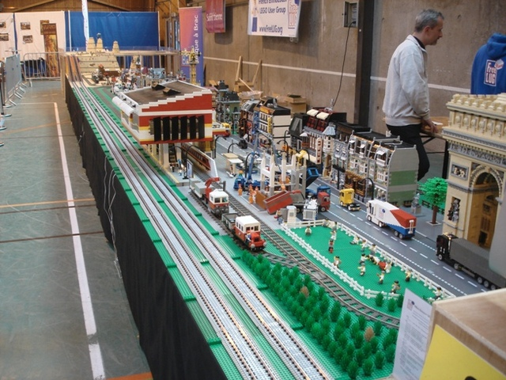

**La LGV**

La Ligne grande vitesse décorées sur des thèmes classiques : City, Train, Western, Medieval

Ce n’est pas grave, je ferai mieux la prochaine. Je garderai un très bon souvenir de cette exposition. C’est toujours aussi agréable de retrouver la petite bande de la région Lyonnaise, de faire connaissance avec de nouvelles têtes (FreeLugien ou Brick Pirate).

Quelques photo du coin médiéval réalisé par Milkbrick et moi même :

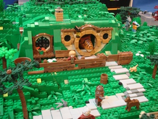

**La maison du Hobbit**

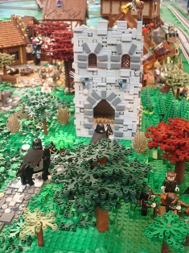

**La tour abandonnée**

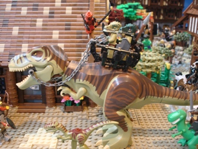

**Le village de Milkbrick**

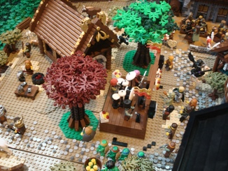

**Le village de Milkbrick**

Bien sûr, il ne peut y avoir de belle LGV sans beaux et gros bâtiments, et pour cela nous pouvions compter sur Laurent et cdhd :

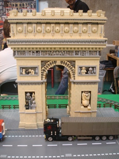

**Arc de Triomphe de Cdhd**

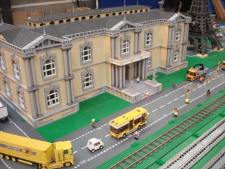

**Le Musée de Laurent**

Le diorama comportait aussi un très beau quartier urbain, plein de vie :

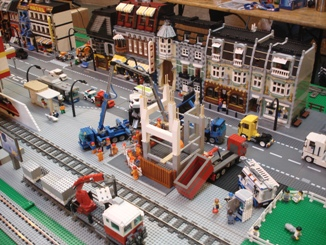

**La ville en pleine ébullition**

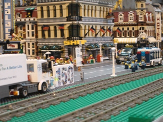

**Ca bouge en ville !**

Même MOZ, la mascotte de la prochaine [BRIQU’Expo DIEMOZ](http://chezyannoch.com/briquexpodiemoz/briquexpo_diemoz2015.php) était de la partie !

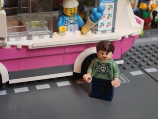

**MOZ à Model’Rail**

Et comme en Lego nous avons coutume de dire ELTEP (En Lego Tout Est Possible), il n’était pas étonnant de voir quelques cowboys au côté des citadins et hobbit !

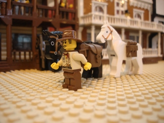

**A poor lonesome cowboy**

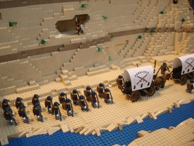

**La cavalerie, en retard comme toujours.**

Vivement la prochaine sortie de la LGV pour encore plus de spectacle et de fun !

Yannoch

* * *

Dès que j’ai reçu la confirmation de la part de l’organisateur de cette nouvelle édition de Model’Rail à Saint Etienne, j’ai tout de suite voulu motiver les copains pour amener la LGV de BaB... Après d’âpres négociations... Xavier et Denis sont venus avec l’ensemble du matériel composant la LGV.

Le montage s’est passé sans problème particulier le vendredi en voyant arriver les exposants les uns après les autres. Tout fut prêt pour l’ouverture au public, et les premiers runs ne se sont pas fait attendre (et les premiers crash... ;-D ).

Cette année encore, la LGV a présenté de sympathiques créations le long des 35ml. C’est toujours un plaisir de passer ces week end en parlant LEGO...  
Pas de record battu mais encore de grand frissons au commande des trains sur la LGV...

Merci à l’association Model’Rail pour leur accueil, à BaB pour les tables et rails... ;-), et enfin aux exposants qui sont venus avec leurs dernières créations LEGO...

J’espère qu’on sera de la partie en 2016...

Pierrolego

* * *

Je n’avais pas prévu d’exposer à Saint-Etienne cette année, mais finalement je me suis incrusté. L’occasion de ressortir mon musée... même s’il n’a toujours de musée que le nom...  
C’est toujours un plaisir de pouvoir exposer le long de la LGV, pour voir  
les grands enfants jouer avec leurs trains :)

Laurent

* * *

Lorsque cette exposition a été annoncé par Pierre, il n’était pas prévu d’y faire la LGV que nous devions faire à FanaBrique 2014. Mais des empêchements des uns et des autres Lgévétiste pour FANA de cette année nous a finalement décidé de proposer la LGV complète aux organisateurs de Model’Rail qui ont accepté. De plus, confort important pour nous, nous avions la salle dès le vendredi matin ce qui permettait un montage sans stress des 120 tables nécessaires pour les 90 mètres de voies LGV.

Pierre L s’est donc lancé dans la coordination et l’organisation des modules pendant que d’autres peaufinaient leur trains ou la voie. Finalement l’on a même du refuser des exposants car plus assez de places les long des 35 mètres du layout.

Coté train et record, le WE a été palpitant. Des centaines de run ont été fait et des dizaines de crash (beaucoup pas volontaire) ont animés ces deux jours d’expos.

[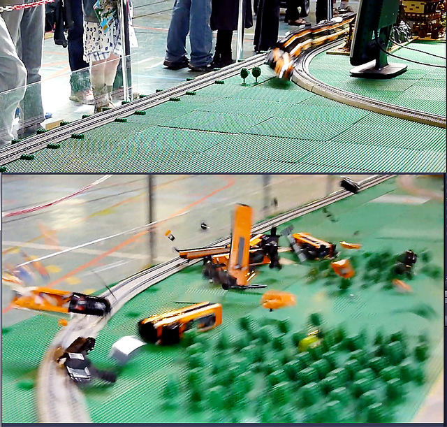](https://www.freelug.org/IMG/jpg/CrFinal_01.jpg)

Finalement, aucun record n’a été battu (sauf celui de la bonne humeur) mais il s’en est fallu d’un cheveux. Dans la catégorie officielle cdhd atteint 24,98 Km/h pour un record à battre de 25,59 Km/h. Pour la catégorie proto, cdhd atteint 29,19 Km/h pour un record à battre à 29,81 Km/h.  
Ce sera donc pour la prochaine fois.

[Tous les résultats ici](http://freelug.org/spip.php?article1885)

cdhd.

* * *

Après avoir vu la LGV à Diémoz, ma satisfaction fut énorme quand j’ai appris qu’elle serait à Saint-Étienne. J’ai donc décidé de venir exposer le long de la LGV. J’avoue que le travail du vendredi était important pour la mise en place de la LGV, mais à l’ouverture au public, nous nous sommes amusés comme des gamins. Mes premiers essais sur la LGV ont fait rire tous les participants : crash sur crash (grand merci à Laurent pour le remontage des rames TGV explosés). C’est pendant le dimanche où j’ai pu faire réellement de vrais runs avec la rame TGV.

La LGV, c’est une vrai expérience collaborative et des parties de rigolades.

Arnaud

* * *

Plus de photos sur la galerie : [Model’Rail 2014](https://www.flickr.com/photos/84107414@N03/sets/72157644744637684/).
