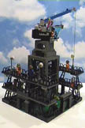
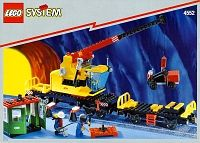
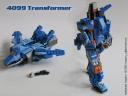

Ce genre d’article aura pour but de vous tenir informé en Français de l’actualité de la communauté LEGO. Les liens pointent vers la source de l’info (anglais) ou vers des sites contenant de nombreuses photos donc accessible à tous.

Ville

[Amado Pinlac](http://news.lugnet.com/starwars/?n=16413) nous propose un MOC original bien que peu coloré. Il s’agit d’un [bâtiment](http://acpinlego.homestead.com/UnderConstruction.html) en cours de construction dont la destination est secrète.

La grue de chantier placée en son sommet est largement inspiré de la boite n°4552.

Technic et RoboTech

Nathanel Kuipers nous avait déjà gratifié d’un superbe modèle alternatif à la 8458 mais qui plus est il nous proposait aussi la [notice de montage](http://www.brickshelf.com/cgi-bin/gallery.cgi?f=47708).

[Aujourd’hui](http://news.lugnet.com/announce/?n=2321) il nous annonce un modèle de robot transformer :

Vous trouverez non seulement la [notice de montage](http://www.brickshelf.com/cgi-bin/gallery.cgi?f=65487) répartie en sous-répertoires mais aussi les [instructions de transformation](http://www.brickshelf.com/cgi-bin/gallery.cgi?f=61266) du robot en avion (ou plutôt l’inverse d’ailleurs ;-))

Train

Saluons le [travail](http://news.lugnet.com/trains/?n=21814) apprécié (il à été classé parmi les top stories de LUGNET) de Philippe qui a traduit son [article sur les aiguillages](https://www.freelug.org/spip.php?article175) pour nos amis non francophone.

People

Pour terminer cette semaine, sachez que Kate et Jake de LEGO Direct ont récemment participé à une session de questions-réponses sur Internet avec nos amis d’outre-rhin. Vous en trouverez une retranscription en anglais [ici](http://f24.parsimony.net/forum61776/messages/72470.htm).

En résumé, aucun scoop, malgré les questions pressantes des AFOLs allemands concernant les prochaines sorties. Concernant les gris, Jake à confirmé que TLC étudie la possibilité pour nous de commander par le S@H des pièces de "l’ancien" gris en vrac. Globalement cette rencontre est déçevante, bien qu’encourageante, car Jake répond souvent qu’il ne peut pas s’avancer, que c’est à l’étude, et que rien n’est jamais mort. Les AFOLs restent donc dans l’expectative - il faut attendre et voir et surtout se débrouiller par nous-mêmes. Merci quand même à Jake qui reste à l’écoute de la communauté des AFOLs.
