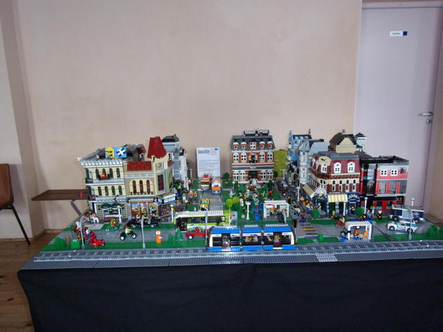

Exposition multi thèmes pour la fête patronale à La Chamba dans la Loire, c’était le dimanche 27 juillet 2014.

Cette toute petite ville station verte du Forez à 1100m d’altitude est surtout connue pour ses pistes de ski de fond, raquettes, chiens de traîneaux, au "Col de la Loge".

Mais l’Association culturelle est extrêmement dynamique et animait la fête patronale, avec une exposition multi thèmes dans la salle des fêtes. Un apéritif était offert à tous, habitants et visiteurs, il y avait d’autres animations dont un groupe folklorique et un repas le soir.

J’ai donc représenté FreeLUG, avec ma ville en modulars, avec une fois de plus, beaucoup de succès. Une très belle journée de contacts, questions, admiration et discussions.

Le matin a été marqué par la rencontre d’un jeune forestier, qui se trouve être l’un des derniers du village. Nous avons parlé "LEGO Technic". C’est un passionné qui possède une jolie collection.

Puis, beaucoup de visites de jeunes, de moins jeunes, qui ont apprécié les scènes de vie de mes minifigs, et qui visiblement ne connaissaient ni les constructions modulars ni les séries de minifigs. Les enfants ont joué avec les deux premières lignes de la ville, le tram et les véhicules, car c’était permis.

La promotion de FreeLUG avec les cartes de visite a bien fonctionné.

L’accueil a été particulièrement sympathique, avec café, aide, repas gratuit en soirée, etc.... Nous sommes invités pour l’an prochain, j’espère ne pas être seule, cette fois.

mamy danny

[Galerie photos](http://photos.freelug.org/main.php/v/dannylou/expos/La+Chamba+42/)
