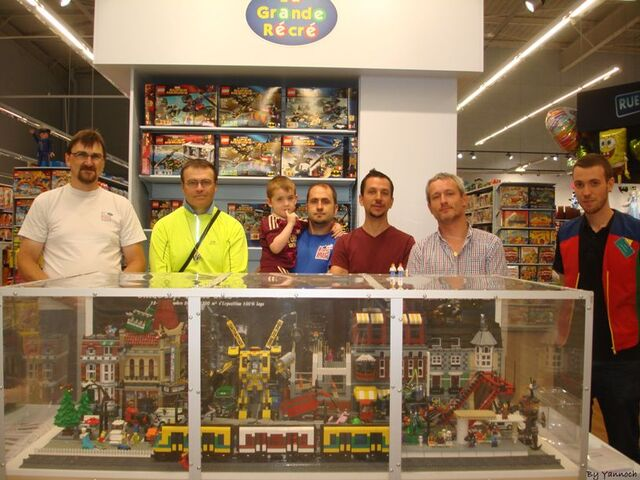
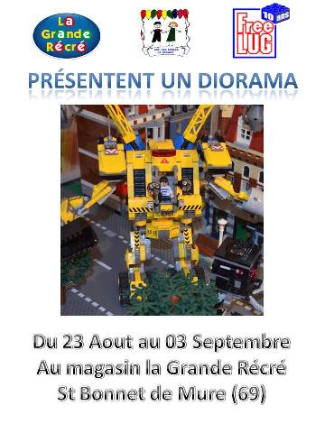
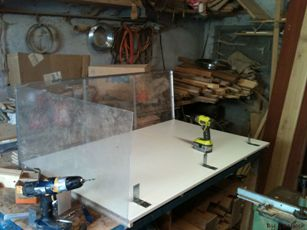
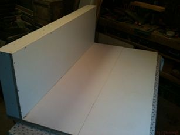
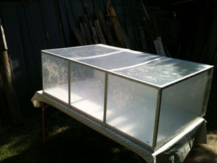
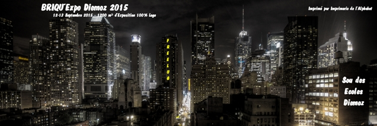
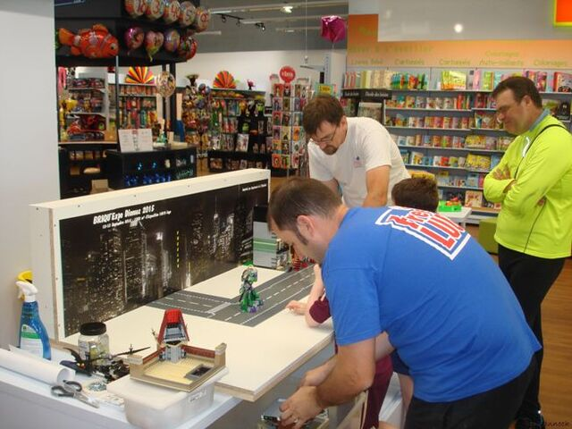
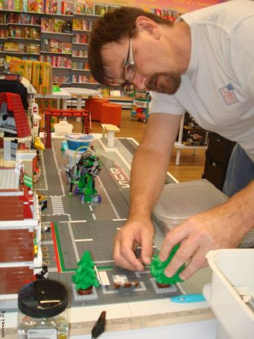
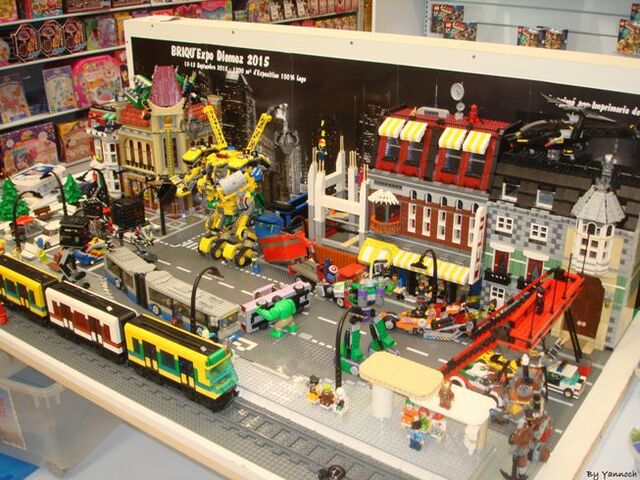
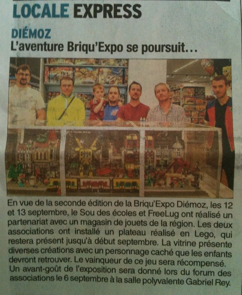

Dans le cadre du partenariat avec le magasin la Grande Récré de St Bonnet de Mure pour la prochaine édition de la BRIQU’Expo Diémoz, nous avons mis en place un diorama qui restera une dizaine de jours en place.

**Présentation du Diorama**

Il y a quelques mois, j’ai été contacté par le gérant du magasin La Grande Récré de St Bonnet de Mure pour mettre en place un partenariat en vue de la prochaine [BRIQU’EXpo Diemoz](http://chezyannoch.com/lego_briquexpo_diemoz2015.php). Après concertation avec les autres personnes de l’organisation, nous avons convenu d’un calendrier pour proposer plusieurs animations au magasin.

Voici la première qui consistait à mettre en place un diorama orienté City/Super Héros/Lego Movies.

Voici l’affiche qui a été réalisée pour l’occasion :

**Affiche**

Et le petit teaser :

[Vidéo de la publication d’origine](https://www.youtube.com/embed/ao9KO8sisGE?list=UUVl1h9UPBYDfjDrtkFBY0kQ)

La réalisation de ce petit diorama a été assuré par Chimère, Arnaud et moi même.

Pour travailler, comme à notre habitude, nous avons établi un petit plan sur Bluebrick. Chacun a ensuite travaillé de son côté.

Pour exposer le diorama dans le magasin, une vitrine a été construite. Il était initialement prévu de faire une vitrine permettant d’accueillir un diorama de 2x6 baseplates de 32x32. Malheureusement, les plaques de plexi disponibles n’ont pas permis cela, et nous devrons nous contenter de 2x5.5 baseplates :

**Construction de la vitrine**

La vitrine repose sur un socle en bois, démontable.

**Construction de la vitrine**

Le socle de la vitrine possède un fond qui permettra d’accueillir le décor.

**Construction de la vitrine**

Et voilà la vitrine. Un petit nettoyage sera bien sûr nécessaire.

Pour mettre le diorama en valeur, nous avons décidé de réaliser un décor pour le fond de la vitrine. Ce dernier a pu être imprimé par un de nos partenaires [l’Imprimerie L’Alphabet](http://www.imprimeriealphabet.com/)

**Décor pour le fond de la vitrine**

Le jour J, nous nous sommes retrouvés dans le magasin pour la mise en place :  
**–** Installation de la vitrine pour la première fois  
**–** Mise en place du décor pour le fond de la vitrine  
**–** Installation du diorama  
**–** Fermeture de la vitrine

**Mise en place**

Mise en place du décor et des premières plaques

**Mise en place**

Mise en place du diorama dans la vitrine

**Diorama**

Voici le diorama dans son intégralité

Plus de photos sont disponibles sur la galerie [ici](https://www.flickr.com/photos/84107414@N03/sets/72157646704887836/).

La vitrine restera en place jusqu’au début du mois de septembre. Le magasin a organisé un petit concours pour les enfants qui doivent rechercher un personnage précis dans le diorama.

Notre animation a été relayée dans la presse locale avec le petit article ci-dessous, paru dans le Dauphiné Libéré :

**Article du Dauphiné du 29 Aout 2014**
