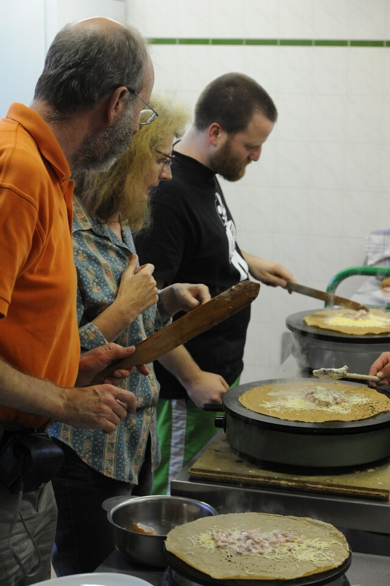
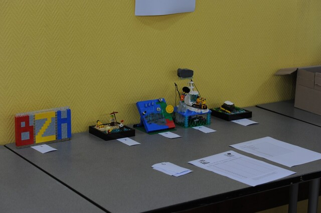
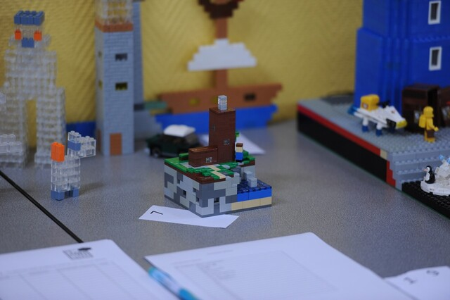
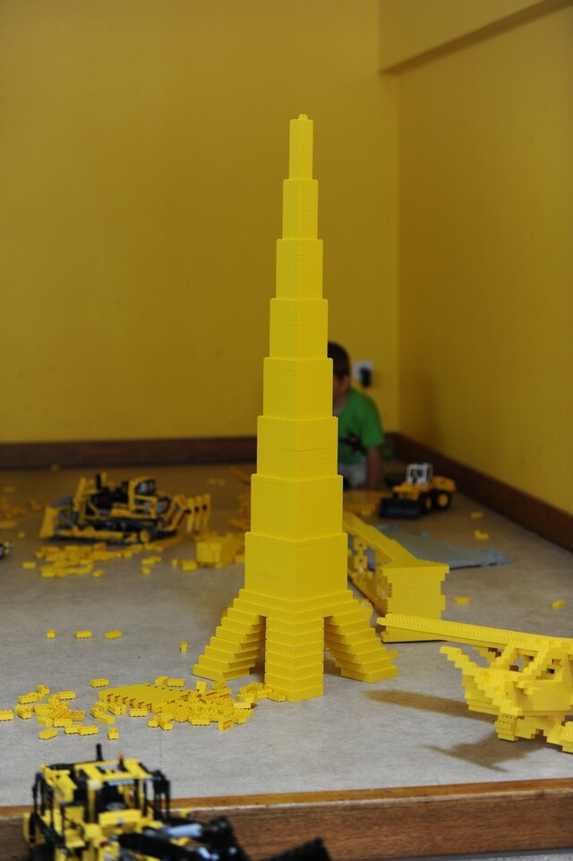
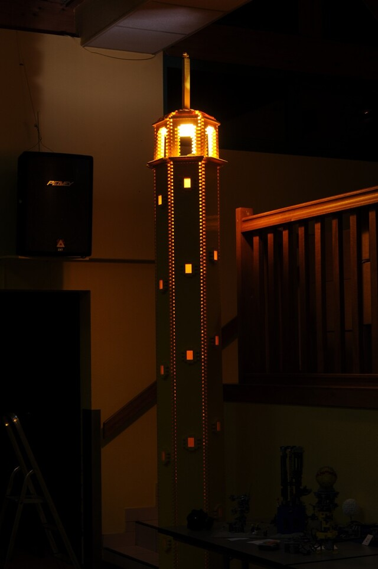
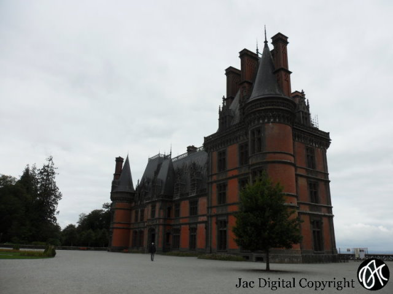
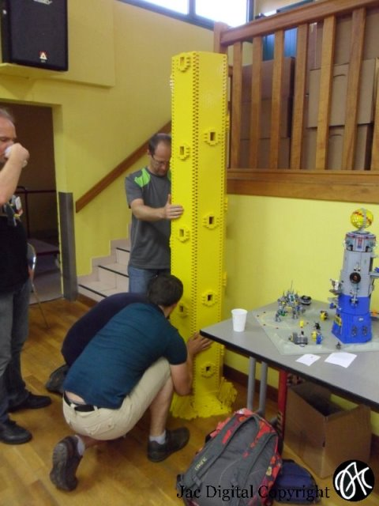
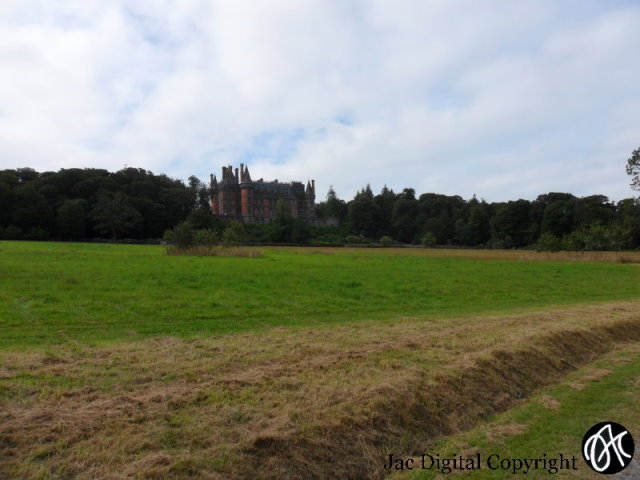
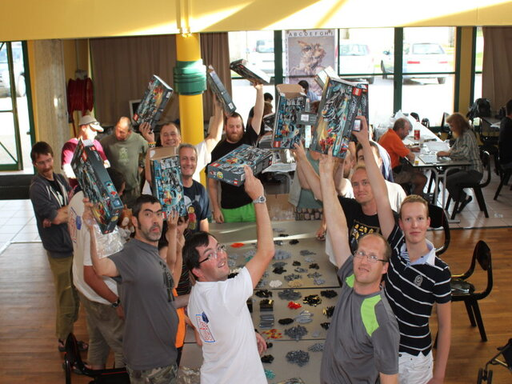
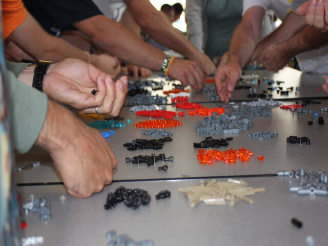

Pour cette édition 2014, rendez-vous était pris à Saint Goazec, petit village magnifique du Finistère.

Lors de l’AG de mars 2014, 3 projets de REF étaient présentés. Et après le vote des adhérents, c’est Saint Goazec dans le Finistère qui a été retenu pour le week-end du 15 août.

Rendez-vous était donc donné à tous les AFOLs dans le bout de la Bretagne pour les 15, 16 et 17 août.

Ah ! les REF, prendre un week-end pour passer un moment entre fans de la brique LEGO sans la contrainte d’une expo. Non pas que les expositions soient vraiment une contrainte, mais la discussion n’est pas la même, forcément.

Avec Pierre L, nous avons programmé les points clés de ce moment légotique, avec notamment une soirée crêpe le samedi soir. Les crêpes avait été achetées auprès d’une crêperie voisine et chaque participant devait la garnir à son gré. Ce fut un grand succès, à tel point que les garnitures prévues n’ont pas été suffisantes. L’ensemble des participants a trouvé l’idée géniale et cela a donné l’occasion à de bons moments de rigolade.

Avec l’équipe de la FAA, 2 concours ont été proposés aux participants : le premier, "BZH : Bienvenu en Zone Humide", consistait à traduire le fameux dicton disant qu’il pleut tout le temps en Bretagne.

5 participants se sont illustrés avec comme gagnant la famille Dallet pour les 2 premiers prix.

L’autre concours consistait à créer un phare avec des thèmes LEGO (Star Wars, Espace, City...)

9 participants ont montré leur talent et à nouveau la famille Dallet s’est fait remarquer en gagnant le deuxième prix.

Les briques jaunes de l’association étaient également mises à disposition, ce qui a permis de belles réalisations :

L’an passé, lors de la REF dans le Cantal, une tour de 7 mètres de haut en LEGO avait été construite. Cette année nous avons eu le droit à un phare, hexagonal, de plus de 3 mètres de haut.

Ce moment de rencontre entre passionnés a permis à l’équipe "d’Histoires en Briques" de finaliser une partie de leur travail par le tri d’une partie de la commande de briques pour la réalisation des monuments napoléoniens.

Enfin, dernier moment clé de cette rencontre, un [draft](/articles/1167/) était organisé avec un nombre assez important de participants.

Sébastien

PS : nous avons eu le droit à un retour sur le site de la [mairie de Saint Goazec](http://www.saintgoazec.com/article/116-rassemblement-des-passionnes-lego.html)

* * *

Pour cette année, rendez-vous en Bretagne pour cette rencontre annuelle. Beaucoup de changements pour nous puisque la famille s’est agrandie et qu’il faut prévoir maintenant avec une petite personne qui prend de la place, enfin, surtout ses bagages !! C’est donc après 2 jours de trajet que nous trouvons St Goazec, au milieu des bois, enfin presque, et avec deux superbes châteaux en bordures.

Beaucoup de discussions, comme je l’ai dis, je n’ai pas pu participer au montage du phare jaune, mais j’ai pris des photos... J’ai juste oublié une photo de la construction terminée. C’est dingue ces briques jaune, ce que l’on peut faire avec.

Nous avons visité le domaine de Trévarez le Dimanche matin. Le parc est magnifique.

Nous profitons souvent de ces rencontres pour préparer des animations. Les drafts en font partie. Pour cette fois, nous avions décidé de le faire avec une boîte de moyenne taille qui contenais plus de 300 pièces. Ce fut une véritable étape de passer par le tri. Le draft a dû être fait en 2 fois, d’abord les grosses pièces et ensuite les petites. Mais ce fut tout de même une bonne partie de jeu entre tous, enfin, je l’espère. Voilà quelques photos souvenirs, merci Virginie.

Nous avons dû partir le Dimanche après-midi pas très tard, mais avec de bons souvenirs. Les crêpes étaient super bonnes !

JAC

* * *

**Galerie photo**

[JAC](http://photos.freelug.org/main.php/v/JAC/REF/2014/)

[Sébastien](http://photos.freelug.org/main.php/v/sebhamon/2014/REF/)
