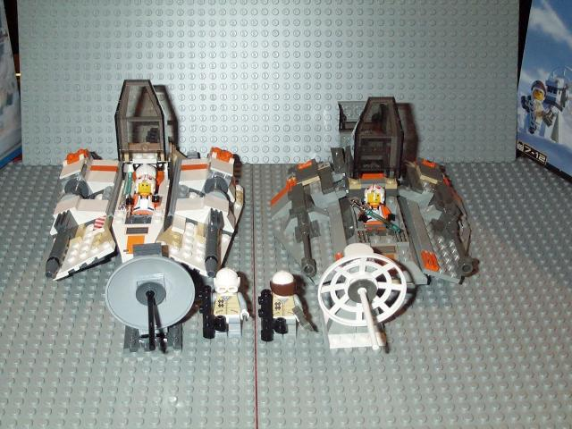
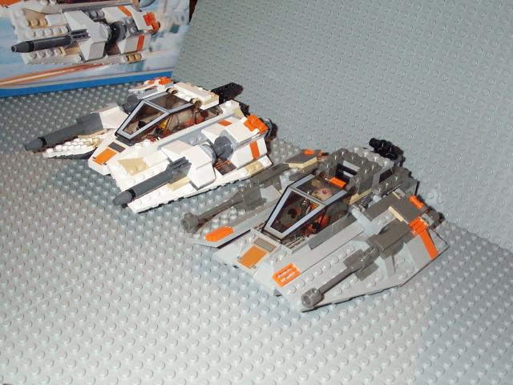
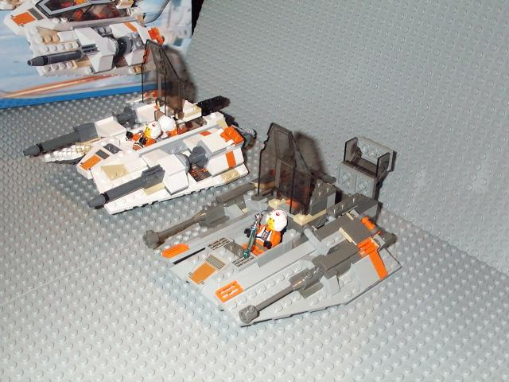
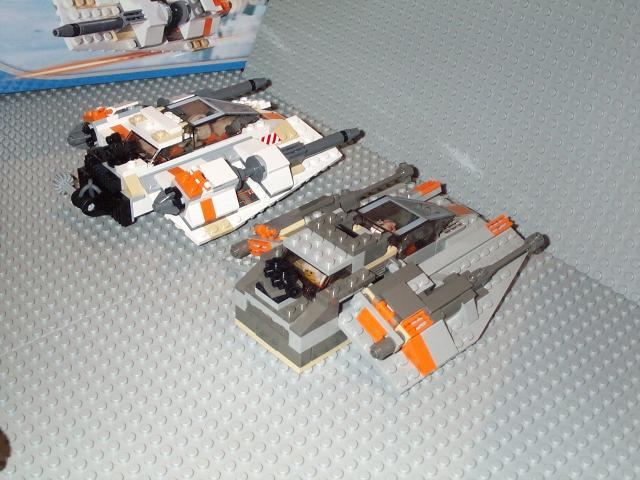
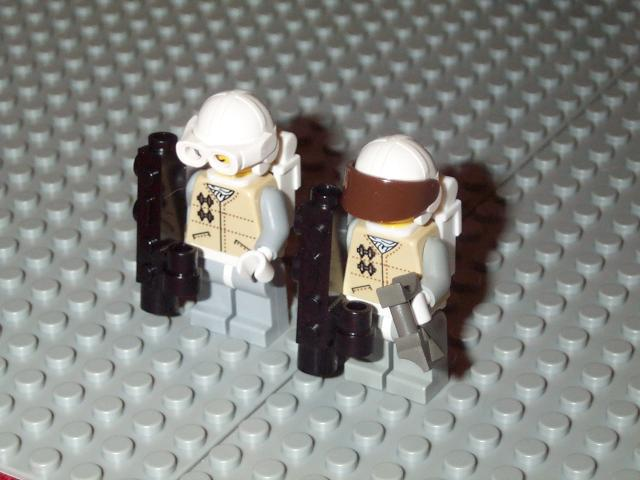
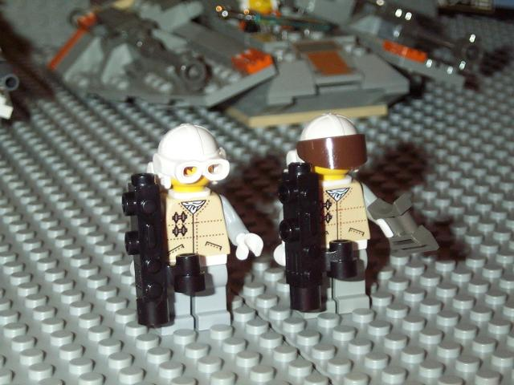
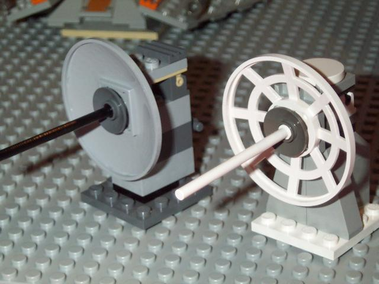
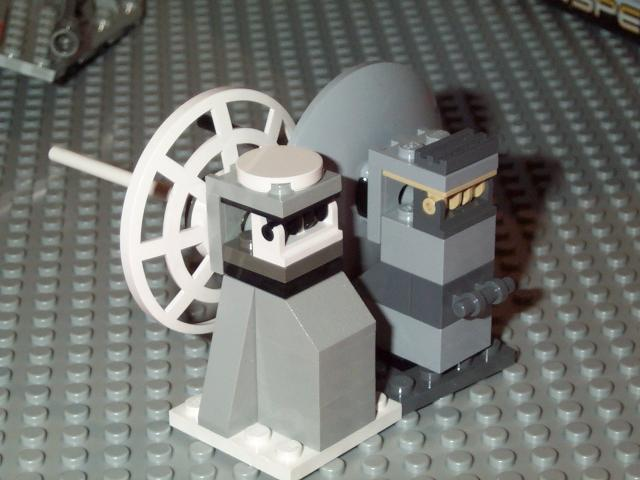

Ayant la chance d’avoir déjà en ma possession ce nouveau Set 2004 StarWars, je vais vous en donner mes premières impressions.

Ce "nouveau" set est le successeur du très convoité [7130](http://guide.lugnet.com/set/7130). Je vais donc vous faire principalement une comparaison de ces 2 sets.

**Le nouveau et l’ancien SnowSpeeder :-)**

## Fiche Technique

**–** Année : 2004  
**–** Nombre de pièce : 213  
**–** Prix (Français) : 29,99 Euros  
**–** Liens utiles :

-   [LUGNET](http://guide.lugnet.com/set/4500)
-   [peeron](http://www.peeron.com/cgi-bin/invcgis/inv/sets/4500-1?withpics=yes)
-   [SHOP@Home](http://shop.lego.com/product.asp?p=4500)

## Le Snowspeeder

Le nouveau Snowspeeder est globalement de la même taille que l’ancien. La première chose qui frappe est qu’il n’est plus gris comme le [7130](http://guide.lugnet.com/set/7130), mais majoritairement blanc. Si l’allure générale est la même (normal, on parle quand même du même vaisseau), la construction est totallement différente.

Tout d’abord le cockpit ne s’ouvre plus en 2 morceaux comme sur le 7130 (une ouverture pour le pilote et une pour le cannonier), mais en un seul morceau. Si ceci rend le vaisseau plus réaliste, cela à pour defaut de ne pas faciliter le placement du cannonier. En effet il faut détacher la verrière pour pouvoir positionner le cannonier.

Un détail qui apporte un peu plus au réalisme du vaisseau : le [4500](http://guide.lugnet.com/set/4500) dispose à l’arrière, du fameux grappin qui a permis à Luke de faire tomber un AT-AT. Cela va permettre de produire des dioramas de l’attaque de la base de Hoth, beaucoup plus réaliste :-))

Les pilotes sont identique au modèle 7130.

## Le Hoth Rebel et le radar

Les rebel Hoth des 2 boites (4500 et 7130) sont identiques (sauf aux couleurs de gris. voir plus bas) à 2 exceptions près :  
**–** Le visière marron s’est transformée en lunette. Personnellement je trouve cela regrettable. La visière, meme si elle n’etait pas réaliste, avait plus de gueule que la paire de lunette sur le casque.  
**–** Les jumelles ont disparu. Je ne m’explique pas la raison de cela. C’est bien dommage.

Le nouveau radar est aussi considérablement différent de l’ancien. et au contraire des Snowspeeder (qui sont passé de gris à blanc), les radars sont passé de blanc à gris :-). Le coupole du radar est de plus passée en plein. Je vous laisse juger avec la photo ci-dessus (et ci-dessous) des autres differences entre ces radars.

## Les couleurs

La question est inevitable actuellement : les gris sont-ils vraiment differents ? je vous laisse juger avec la photo suivante entre l’ancien et le nouveau radar.

A noter que j’ai eu les autres nouveaux sets 2004 StarWars et les gris ont changé dans tous les nouveaux sets.

## Conclusion

Ce nouveau snowspeeder est plus réaliste que l’ancien (couleur, forme, fonctionnalité). Il a de plus le mérite de nous permettre de nous fournir en Snowspeeder et hoth rebel sans avoir à être victime des spéculations (le 7130 et le hoth rebel se trouvent a prix d’or). Bref un set que je recommande vivement à ceux qui veulent faire des diorama de la base Hoth (et je sais de quoi je parle :-))
