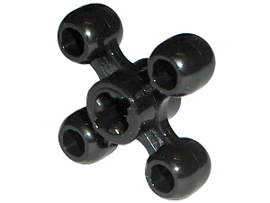
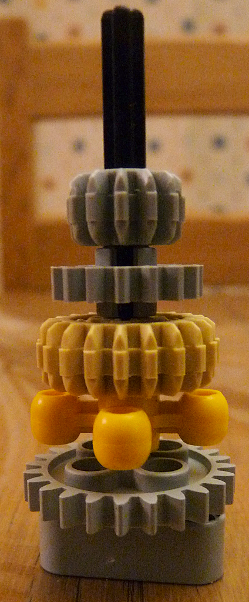
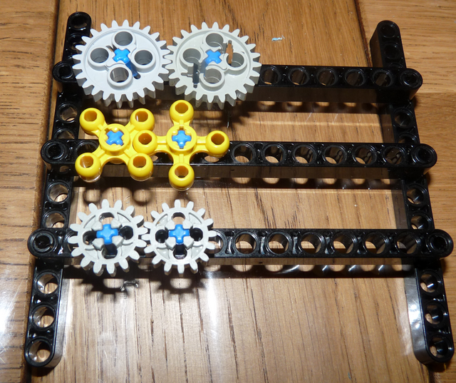
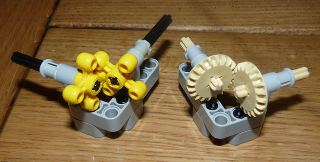
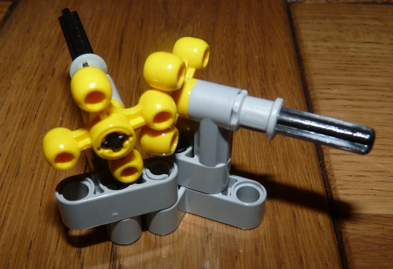
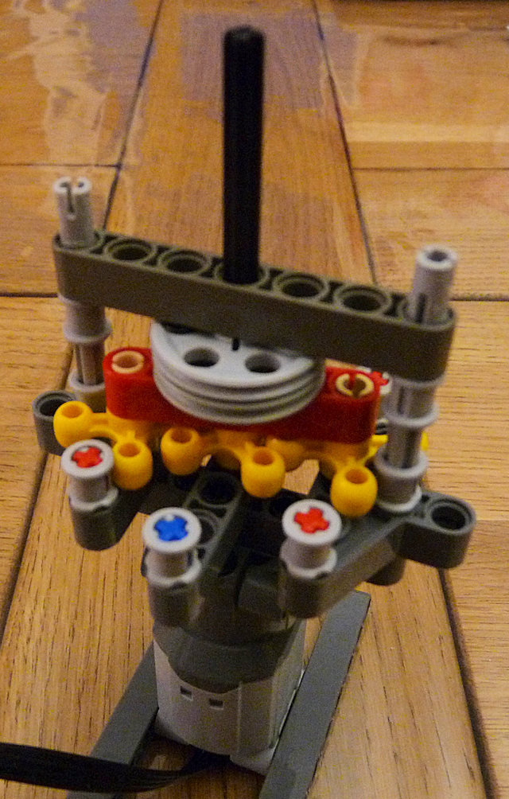
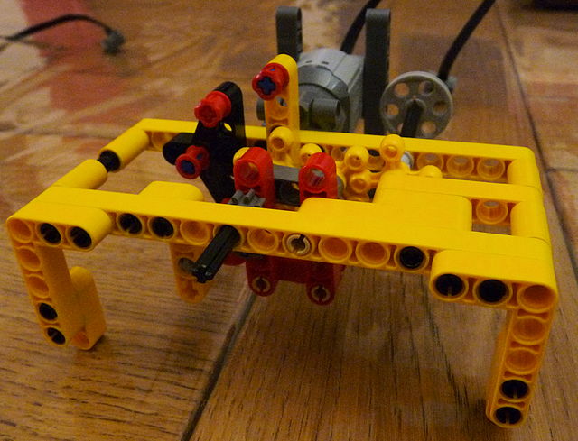
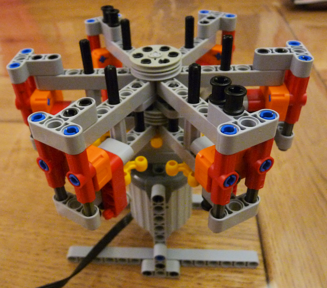
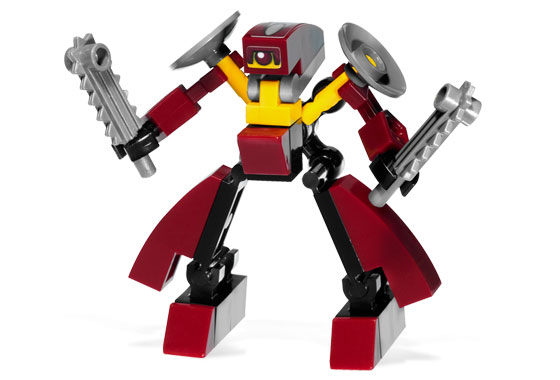

Présentation de la pièce 32072, une pièce pleine de qualités qu’il faut savoir utiliser.

## **Historique**

Apparue en 1998 dans le set Spy Runner [(8213)](http://www.bricklink.com/catalogItem.asp?S=8213-1) la Technic knob wheel est un engrenage à 4 dents. Elle se généralise à partir de 2002 et est disponible dans près de [100 sets](http://www.bricklink.com/catalogItemIn.asp?P=32072&in=S) et 8 couleurs différentes. Le set en possédant le plus est l’Axalara T9 [(8943)](http://www.bricklink.com/catalogItem.asp?S=8943-1)apparu en 2008 dans la gamme Bionicle.

## **Description**

Les knobs sont percées en leurs centres par un trou cruciforme pouvant accueillir un axe Technic. Elles possèdent 4 dents en forme de tonneau toutes percées en leurs centres. Elles font 3 tenons de diamètre et 1 tenon de haut. Les dents sont alignées sur l’axe technic. L’entre-axes pour faire un engrenage droit est de 2 tenons.  
Les engrenages à base de knobs se caractérisent par un fort chevauchement des dents (environ 1 tenon). Les trous situés dans les dents permettent de loger tout élément qui peut tenir dans une main de minifig.

Étonnamment Bricklink classe les knobs dans la catégorie "Technic" et non "Technic, gear" avec les autres engrenages.

## **Comparaison avec les engrenages Technic classiques**.

**comparaison des engrenages**

**comparaison des engrenages**

On peut observer que les knobs sont légèrement plus petites que les 24d mais que lors d’un montage dans un engrenage droit l’entre-axes des roues est le même que celui des 12d.  
Les engrenages à 90° réalisés avec les knobs sont comparables a ceux réalisés avec les 20d (même encombrement, même jeux)

L’avantage principal des knobs est sont fort engrènement. De celui-ci découle les qualités suivantes :  
**–**  Un transfert de couple important ;  
**–**  Pas de saut de dents et autre craquement. Les engrenages à base de knobs bloquent mais ne sautent pas ;  
La géométrie des pièces leurs confère aussi des avantages. Les knobs permettent entre autre :  
**–**  De réaliser des engrenage avec des angles différents de 0° et 90° (voir § différents montage) ;  
**–**  De s’engrener sur les Technic bush ou des Technic pin.

Les inconvénients proviennent principalement de la géométrie. Parmi eux on peut citer :  
**–**  Gros encombrement pour 4 dents seulement ;  
**–**  N’existe qu’en un seul diamètre (pas de rapport de réduction possible) ;  
**–**  Dans les engrenages droit, fonctionnement avec de légers à-coups

## **Différents montages**

Conçue à la base pour faire des engrenages à 90° les knobs sont à l’aise dans beaucoup de variantes :  
Les montages suivant sont soit réalisables uniquement avec des knobs, soit fiabilisés par l’utilisation de knobs.

_Renvoie d’angle variable_

**Renvoie d’angle**

Ce montage permet un débattement angulaire de 180°. L’axe de rotation passe par le point de contact des knobs.

_Réducteur épicycloïdal_

**Réducteur épicycloïdale**

Dans ce montage, la couronne extérieure est réalisée avec des Technic bush.

_Transmission mono-directive à embrayage piloté_

**Transmission mono-directive**

Ce mécanisme permet dans un sens d’entraîner l’axe de sortie (avec la poulie), dans l’autre de débrayer cet axe.

_Multiplexeur à échappement\*_

**Multiplexeur à échappement**

Cet assemblage permet avec un seul moteur d’alimenter séquentiellement 6 sorties. Le passage d’une sortie à l’autre ce fait automatiquement lorsque le mouvement arrive en bout de course.

****Utilisation autre que technique :****

Cette pièce ne sert pas que dans les montages Technic.  
Sa géométrie lui permet des incursions dans les autres gammes :  
**–** Base artic [6575](http://www.bricklink.com/catalogItem.asp?S=6575-1) support antennes radar  
**–** Exoforce châssis de robot

****Conclusion****

Si vous ne l’avez pas encore, n’hésitez plus, quelque soit vos montages, adoptez la KNOB attitude.

## Documents joints

-   **[transmission mono directive](https://www.freelug.org/IMG/pdf/Transmission_mono.pdf "Télécharger PDF - 1 Mio")**
    
    3 septembre 2014 \- PDF - 1 Mio
    
    description et explication
